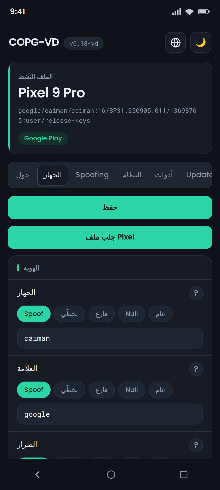
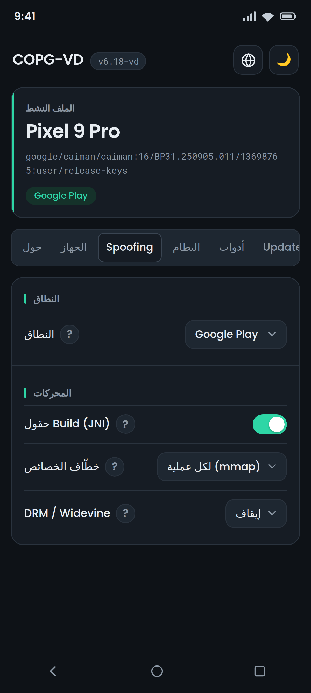
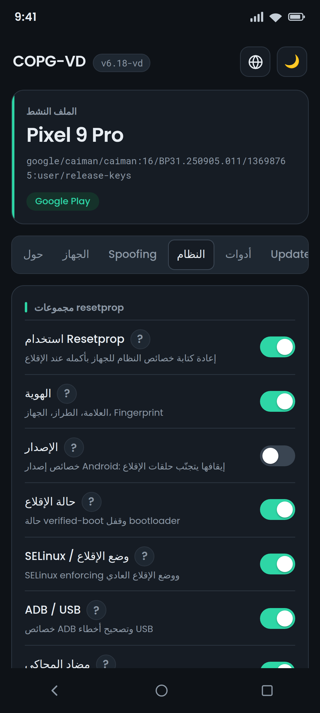
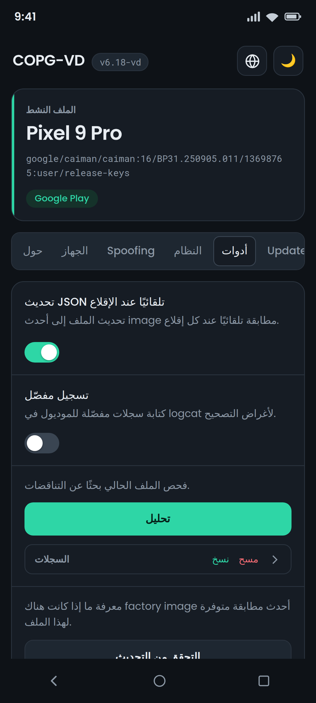

<!--
  ======================================================================
   COPG-VD  ::  global device spoofer
   Spoof your device fingerprint and build.

   Copyright (C) 2026  AlirezaParsi & VD171 (Fork by VD171)
   SPDX-License-Identifier: AGPL-3.0-or-later

   Licensed under the GNU AGPL v3.0 or later. You may obtain a copy at
   https://www.gnu.org/licenses/agpl-3.0.html

   Site           : https://vd171.ru
   Site           : https://vd.priv8.ru
   Source         : https://github.com/VD171/COPG-VD
   GitHub         : @VD171 https://github.com/VD171
   XDA-Developers : @VD171 https://xdaforums.com/m/vd171.4699873/
   XDA thread     : https://xdaforums.com/t/COPG-VD.4807698/
   Telegram       : @VD_Priv8 https://t.me/VD_Priv8
   Channel        : @Priv8_VD https://t.me/Priv8_VD
   Discord        : @VD.Priv8 https://discord.com/users/1296831918989639721
   E-mail         : vd.priv8@pm.me
  ======================================================================
-->

# COPG-VD

<p align="center">
  
</p>

<p align="center">
  <a href="https://github.com/VD171/COPG-VD/releases/latest"></a>
  <a href="LICENSE"></a>
  <a href="https://github.com/VD171/COPG-VD/releases"></a>
  <a href="https://github.com/VD171/COPG-VD/stargazers"></a>
</p>

<p align="center">
  <b>COPG-VD هو spoofer للجهاز: يعيد كتابة بصمة الجهاز (fingerprint) والـ build بحيث ترى التطبيقات الجهاز الذي تختاره بدلاً من الجهاز الحقيقي.</b><br>
  يعمل على Zygisk (KernelSU أو APatch أو Magisk) وبشكل افتراضي يقصر الانتحال على حزمة Google Play: لذا فهو بديل أخف وأكثر متانة لـ PlayIntegrityFix.
</p>

<p align="center">
  <a href="https://github.com/VD171/COPG-VD/releases">Releases</a> ·
  <a href="https://github.com/VD171/COPG-VD/wiki/ar-Home">Wiki</a> ·
  <a href="https://github.com/VD171/COPG-VD/wiki/ar-USER-GUIDE">دليل المستخدم</a> ·
  <a href="https://github.com/VD171/COPG-VD/wiki/ar-CONFIGURATION">مرجع الإعداد</a> ·
  <a href="https://github.com/VD171/COPG-VD/wiki/ar-ARCHITECTURE">البنية المعمارية</a> ·
  <a href="https://github.com/VD171/COPG-VD/wiki/ar-FILE-STRUCTURE">بنية الملفات</a> ·
  <a href="https://github.com/VD171/COPG-VD/wiki/ar-AI-AGENTS">وكلاء الذكاء الاصطناعي</a> ·
  <a href="https://xdaforums.com/t/COPG-VD.4807698/">XDA thread</a>
</p>

> **Languages:** [English](README.md) · العربية · [Čeština](README.cs.md) · [Deutsch](README.de.md) · [Español](README.es.md) · [فارسی](README.fa.md) · [Français](README.fr.md) · [हिन्दी](README.hi.md) · [Bahasa Indonesia](README.id.md) · [Italiano](README.it.md) · [日本語](README.ja.md) · [한국어](README.ko.md) · [Nederlands](README.nl.md) · [Polski](README.pl.md) · [Português](README.pt.md) · [Русский](README.ru.md) · [Svenska](README.sv.md) · [ไทย](README.th.md) · [Türkçe](README.tr.md) · [Українська](README.uk.md) · [Tiếng Việt](README.vi.md) · [中文](README.zh.md)

<p align="center">
     
</p>

---

## لماذا

يرفض عدد متزايد من التطبيقات العمل، أو يخفّض خدماته بصمت، عندما لا يكون الجهاز الذي تراه هاتفاً نظيفاً ومعتمَداً: فـ Play Integrity ومستويات DRM وفحوص الجهاز الخاصة بكل تطبيق تقرأ جميعها بصمة الـ build (fingerprint) وproperties النظام. يعيد COPG-VD كتابة تلك الهوية بحيث ترى التطبيقات جهاز Pixel متماسكاً (أو أي جهاز تضبطه) بدلاً من جهازك الحقيقي. مع بصمة تعمل بشكل صحيح لا تحتاج عادةً إلى PlayIntegrityFix أو GooglePhotosUnlimited: فهو بديل أخف وأكثر متانة، ويقصر الانتحال افتراضياً على حزمة Google Play بحيث يبقى بقية نظامك دون مساس.

## الميزات

- **التحكم في النطاق (Scope):** سلّم الهوية المنتحلة إلى حزمة Google Play وحدها (الافتراضي)، أو إلى الجهاز بالكامل، أو إلى whitelist، أو إلى كل شيء ما عدا blacklist. في الوضع المحدود يسلّم Zygisk الهوية لكل عملية على حدة، فلا تتسرّب أبداً عبر الـ properties العامة.
- **محرّكات مستقلة:** حقول Build (إعادة كتابة لـ `android.os.Build.*` عبر JNI)، وproperty hook لكل عملية بأسلوب clean-room (دون hook للدالة)، و`resetprop` مُدار بالمجموعات، ومستوى DRM / Widevine اختياري (L1 أو L3) بقائمة أهداف خاصة به. ويمكن إيقاف كل واحد منها.
- **التحكم لكل حقل:** يمكن ضبط كل حقل Build، أو تفريغه، أو حذفه، أو تخطيه، مع قائمة `global_fields` للقيم التي يجب أن تبقى متسقة على مستوى الجهاز بالكامل.
- **بصمة محدّثة دائماً:** يأتي ملف Pixel شخصي ضمن الحزمة ويحدّث نفسه مرة واحدة لكل إقلاع من أحدث صورة مصنع (factory image) من Google؛ ويمكنك أيضاً جلب ملف Pixel شخصي آخر من WebUI. وهو لا يرجع إلى الوراء أبداً ويرفض ملفاً شخصياً لجهاز مختلف.
- **سياسة آمنة لإصدار Android:** لا يُرفع الـ SDK فوق الـ framework الحقيقي لديك تحت أي سياسة (رفعه يسبّب softloop للهاتف فقط).
- **Analyze:** يدقّق الإعداد في مواجهة الـ ROM والـ props لديك ويبلّغ عن أي تنافر قبل أن يصل إلى التطبيقات.
- **WebUI:** خمس علامات تبويب لإدارة كل شيء، دون أي طلب شبكي؛ ويحمل ملف الإعداد جميع الإعدادات بحيث تبقى بعد تحديث الموديول.
- **تحديث ذاتي تزايدي (VDLU)** ومكتبة أصلية بـ **أربع ABIs** (arm64-v8a، armeabi-v7a، x86، x86_64).

## وكلاء الذكاء الاصطناعي

يمكن برمجة COPG-VD بلا واجهة (headless): فالموديول بأكمله يُدار عبر ملف JSON واحد (`/data/adb/COPG-VD/COPG-VD.json`) ونقطة دخول shell واحدة، `fingerprint-update.sh`، بأفعال مستقرة (`check`، `apply`، `analyze`، `fetch-index`، `fetch <path>` وغيرها). يستطيع وكيل يعمل بصلاحية root قراءة الإعداد والكتابة إليه وتنفيذ كل إجراء تستطيعه WebUI، دون كشط (scraping) الـ WebUI. انظر [docs/AI-AGENTS.md](docs/ar/AI-AGENTS.md). وتخضع تصحيحات الذكاء الاصطناعي لنفس معايير المراجعة التي يخضع لها أي تصحيح آخر.

## التثبيت

افلش ملف الـ zip في KernelSU أو APatch أو Magisk وأعد التشغيل. يُنتحل ملف Pixel الشخصي المرفق للتطبيقات المستهدفة على الفور. يشغّل المثبّت بوابة سلامة `.sha256` ويُحبِط العملية عند وجود zip تالف أو مبتور (ويتخطاها بأمان حيث لا تتوفر أداة checksum). يتطلّب Zygisk، عبر KernelSU أو APatch أو Magisk، وصلاحية root.

## الأمان

الانتحال يجري على جانب المستخدم فقط: لا يرفع COPG-VD الـ SDK أبداً فوق الـ framework الحقيقي لديك، ويُبقي الشركة المصنّعة متسقة مع بقية الملف الشخصي، ويقرأ الإصدار الحقيقي من `/system/build.prop`، لا من الـ properties التي يزوّرها. ويتطلّب المحدِّث الذاتي توقيع ed25519 صالحاً ويرفض الـ downgrades؛ ولا ترسل WebUI أي طلب شبكي. أبلغ عن المشكلات وفق [SECURITY.md](docs/ar/SECURITY.md).

## البناء

دائماً release، وليس debug أبداً. تُبنى المكتبة الأصلية ومساعد الـ scope في الـ CI لجميع الـ ABIs الأربع؛ ويجمّع workflow الإصدار ملف الـ zip القابل للفلاش، ويكتب مرافِقات `.sha256` لكل ملف، ويعيد توليد خط أساس (baseline) VDLU الموقّع، وينشر باسم `github-actions[bot]`. انظر [CONTRIBUTING.md](docs/ar/CONTRIBUTING.md).

## كيفية الاستخدام؟
ثبّت الموديول، أعد التشغيل، ويتم انتحال الملف الشخصي المرفق (جهاز Pixel) للتطبيقات المستهدفة. مع بصمة تعمل بشكل صحيح لا تحتاج إلى PlayIntegrityFix أو GooglePhotosUnlimited.  
يتم ضبط كل شيء في `/data/adb/COPG-VD/COPG-VD.json`، أو من WebUI. جميع الحقول اختيارية: أي حقل لا يتم توفيره يتم تخطيه.  

### Scope: من يرى الانتحال
`scope_mode` يحدد العمليات التي تحصل على الهوية المنتحلة. في الوضع المحدود، يسلّم Zygisk الهوية لكل عملية على حدة ولا تتسرب إلى بقية النظام عبر الـ properties العامة.  
* **Google Play** (`playstore`، الافتراضي): حزمة Play فقط (Google Play services، وعمليتها unstable، ومتجر Play).  
* **Global**: الجهاز بالكامل؛ كل عملية تراها.  
* **Whitelist**: فقط التطبيقات الموجودة في `scope_whitelist`.  
* **Blacklist**: كل التطبيقات ما عدا الموجودة في `scope_blacklist`.  

### Engines: كيف يتم تسليم الانتحال
كل واحد مستقل ويمكن إيقافه:  
* **Build fields (JNI)**: يعيد كتابة `android.os.Build.*` في العمليات المستهدفة.  
* **Property hook**: يعرض properties النظام المنتحلة للعمليات المستهدفة (إعادة تعيين نظيفة لمنطقة الـ properties لكل عملية على حدة، دون hook للدالة).  
* **resetprop**: يعيد كتابة properties النظام، مُدارة حسب المجموعة: الهوية، والإصدار، وحالة الإقلاع، وSELinux، وadb/usb، ومضاد المحاكي، ومرحلة تنظيف. في الوضع المحدود تبقى مجموعتا الهوية والإصدار خارج resetprop على مستوى الجهاز (يسلّمها Zygisk لكل عملية)؛ وتبقى مجموعات boot/lock/SELinux عامة.  
* **DRM / Widevine** (معطّل افتراضياً): يبلّغ عن مستوى أمان Widevine المختار، L1 أو L3، للتطبيقات التي تقرأه. بشكل افتراضي يتّبع النطاق أعلاه؛ اضبط `drm_targets` (قائمة تطبيقات) لتطبيق انتحال DRM على تلك التطبيقات فقط، بشكل مستقل عن `scope_mode`: يبقى الموديول مُحمَّلاً في تطبيق مُدرَج لأجل خطّاف DRM فقط، حتى عندما يكون ذلك التطبيق خارج النطاق الرئيسي. الفراغ أو الغياب يعني اتّباع النطاق. (يتطلّب وضعاً ذا نطاق، ليس Global.)  

### Fields: التعيين، أو التفريغ، أو الحذف، أو التخطي
داخل كائن `COPG-VD` لكل حقل Build أربع حالات:  
* **Set**: `"KEY": "value"` يكتب القيمة.  
* **Empty**: `"KEY": ""` يكتب قيمة فارغة.  
* **Delete**: أدرج المفتاح في `"COPG-VD-Delete": [ ... ]` على المستوى الأعلى لإزالته (يصبح حقل Build قيمته null، وتُزال الـ property عبر `resetprop --delete`).  
* **Skip**: اترك المفتاح خارجاً تماماً؛ يتم الإبقاء على قيمة الـ ROM نفسها.  

تطبّق قائمة `"global_fields": [ ... ]` حقول Build المذكورة على مستوى الجهاز حتى في الوضع المحدود، للحفاظ على قيمة متسقة في كل مكان: فقط للحقول الآمنة من ناحية الاتساق (الـ security patch مثلاً)، وليس الهوية أبداً وليس مجموعة إصدار Android أبداً.  

### مثال على ملف إعدادات JSON
`/data/adb/COPG-VD/COPG-VD.json`
```json
{
  "Instructions": "Use strings on double-quotes only.",
  "Instructions": "All fields are OPTIONAL. If some field is not provided, it will be skipped.",
  "Strings extracted from": "https://dl.google.com/developers/android/CANARY/images/factory/tegu_beta-zp11.261016.008-factory-28d56d15.zip",
  "scope_mode": "playstore",
  "motor_drm": false,
  "drm_targets": [],
  "global_fields": ["SECURITY_PATCH"],
  "process_overrides": [],
  "COPG-VD": {
    "BRAND": "google",
    "DEVICE": "tegu",
    "MANUFACTURER": "Google",
    "MODEL": "Pixel 9a",
    "FINGERPRINT": "google/tegu_beta/tegu:CANARY/ZP11.261016.008/16754936:user/release-keys",
    "PRODUCT": "tegu_beta",
    "BOOTLOADER": "unknown",
    "BOARD": "tegu",
    "HARDWARE": "tegu",
    "DISPLAY": "ZP11.261016.008",
    "ID": "ZP11.261016.008",
    "HOST": "e4df75f83a59",
    "INCREMENTAL": "16754936",
    "TIMESTAMP": "1793211232",
    "PREVIEW_SDK": "20261104",
    "USER": "android-build",
    "SDK_FINGERPRINT": "ee82a872870173d77e68050e21a2bcbf",
    "UUID": "FjWvtSORkI0sEwekaPz2s30gqV5vWP_EZHFtBiXzboc",
    "SECURITY_PATCH": "2026-11-05",
    "FIRST_API_LEVEL": "35",
    "DRM_SECURITY_LEVEL": "L1"
  }
}
```
تأكد من استخدام الـ strings بين علامات اقتباس مزدوجة فقط.  
يتم تحديث الكتلة أعلاه و`module/COPG-VD.json.example` يومياً عبر الـ workflow [Update COPG-VD.json](.github/workflows/update-json.yml)، مباشرة من أحدث صورة مصنع (factory image) من Google.  

### إبقاء البصمة محدّثة
`fingerprint-update.sh` يسحب ذلك الملف ويحدّث إعداداتك، من WebUI (**Check Update** / **Update Now**) أو من تلقاء نفسه **مرة واحدة لكل إقلاع** (**Auto-update JSON on boot**، مفعّل افتراضياً).  
* يتم تحديث `/data/adb/COPG-VD/COPG-VD.json` في مكانه، ويُحتفظ بالمحتوى السابق بجواره كـ `COPG-VD.json.bak`.  
* تُعاد كتابة حقول build فقط (fingerprint، ID، incremental، timestamp، security patch، SDK، UUID، host، user). كل ما خصّصته غير ذلك يُحتفظ به: المفاتيح الإضافية، و`scope_mode`، و`BOOTLOADER`/`BOARD`/`HARDWARE`، والكائنات الأخرى، وترتيب المفاتيح والتنسيق.  
* لا يرجع إلى الوراء أبداً: يُرفض أي build upstream أقدم من المثبّت. هذا
  أمر روتيني (قد يتأخر الـ repo خلف إعداد حدّثته يدوياً) وهو أيضاً الحماية
  الأهم على Android، حيث أداة التنزيل الوحيدة المتاحة هي busybox `wget`، التي لا تستطيع
  التحقق من شهادات TLS: للسبب نفسه يتم التحقق من كل قيمة قبل استخدامها.  
* إذا كان ملفك الشخصي ينتحل **جهازاً آخر** (`BRAND`/`DEVICE`/`MANUFACTURER`/`MODEL`/`PRODUCT` مختلفة)، فلا يُطبَّق شيء: بصمة Pixel على ملف شخصي آخر أسوأ من بصمة قديمة.  
* عند الإقلاع يعمل في الخلفية ويستمر في إعادة المحاولة لمدة ~10 دقائق، لأن الواي فاي عادة لا يكون جاهزاً بعد عند انتهاء الإقلاع. وهو لا يؤخر الإقلاع أبداً.  
* يُعاد تطبيق `resetprop` مباشرة بعد التحديث، لكن `android.os.Build` يكتبه موديول zygisk عند بدء zygote: **أعد التشغيل** لكي تصل القيم الجديدة إلى التطبيقات.  
* السجل في `/data/adb/COPG-VD/update.log`.  

### إصدار Android: ولماذا لا يتم انتحاله
`ANDROID_VERSION` و`SDK_INT` و`SDK_FULL` و`CODENAME` تصف **الـ ROM الخاصة بك**، لا الجهاز الذي يُنتحل. إخبار التطبيقات بأن الـ SDK أحدث مما هو عليه الـ framework فعلاً يجعلها تستدعي APIs غير موجودة: تنهار تطبيقات Google، ويعيد الهاتف التشغيل، ثم يبدأ من جديد. الإقلاع نفسه يكتمل، لذا فهي **softloop** ولا يظهر أي شيء في سجلات الإقلاع.  
* ليست موجودة في الإعداد المرفق والمحدّث لا يكتبها أبداً.  
* **Spoof Android version** في WebUI يقرر ما إذا كانت ستُطبَّق أصلاً:  
  * **Never** (الافتراضي): يُستخدم إصدار الـ ROM نفسه.  
  * **Up to this ROM**: فقط ما لا يتجاوزه، وهو ما يعني عملياً خفض الـ SDK.  
  * **Force**: يفرض حقول الإصدار الأخرى بالضبط كما تطلب الإعدادات، لكن الـ SDK يظل محدوداً بقيمة الـ ROM الخاصة بك حتى هنا (رفع الـ SDK فوق الـ framework الحقيقي يسبب softloop فقط ولا فائدة مشروعة له)، لذا منذ v6.19 **لم يعد Force يسبب softloop**.  
* يُقرأ الإصدار الحقيقي من `/system/build.prop`، وليس أبداً من `getprop`: فهو بالضبط ما يزوّره هذا الموديول.  

### Analyze
**Analyze** في WebUI (أو `fingerprint-update.sh analyze`) يدقّق الإعداد كما هو: الإصدار مقابل الـ ROM، وما إذا كان الملف لا يزال قابلاً للتحليل أصلاً (الملف التالف يجعل الموديول ينتحل **لا شيء**، ولا يخبر بذلك سوى logcat)، وما إذا كانت البصمة متوافقة مع الحقول المحيطة بها، والمفاتيح التي لا يقرؤها الموديول، والتواريخ، وما إذا كانت الـ props تحمل بالفعل ما يطلبه الإعداد.  

### WebUI
WebUI اختياري (يمكن تعديل كل شيء في إعداد JSON مباشرة) لكنه الطريقة السهلة لإدارة الموديول. له خمس علامات تبويب: **About**، و**Device** (كل حقل، مضبوط حسب الحالة، مجمّع حسب الفئة)، و**Spoofing** (الـ scope والـ engines)، و**System** (مجموعات resetprop)، و**Tools** (Analyze، وCheck Update، وUpdate Now، وBackup/Restore، والتحديث التلقائي عند الإقلاع). لا يرسل أي طلب شبكي؛ كل ما يحتاجه مُضمَّن داخل الموديول.  
إذا كنت مستخدم Magisk، فاستخدم KsuWebUI من KOW (https://github.com/KOWX712/KsuWebUIStandalone/releases). يمكنك أيضًا استخدام WebUI-X Portable من MMRL (https://github.com/MMRLApp/WebUI-X-Portable/releases) أو KsuWebUI-SN (https://github.com/dnascorpionofficial/KsuWebUI-SN/releases).  

### الإعدادات في ملف الإعداد
يحمل `COPG-VD.json` إعداداته بجوار الملف الشخصي، بحيث تسافر اختياراتك مع النسخة الاحتياطية ويمكن تعديلها يدوياً: `scope_mode`، ومفاتيح الـ engines، ومجموعات resetprop، و`global_fields`، وكائن `COPG-VD-Settings` (`resetprop`، و`autoupdate`، و`spoof_version`). كل شيء موجود في هذا الملف الواحد: تقرأ سكربتات الإقلاع وWebUI الإعدادات منه مباشرةً، لذا تبقى اختياراتك بعد تحديث الوحدة. `"spoof_version": "force"` يُرفض من الملف ويُخفَّض: استعادة نسخة احتياطية قديمة يجب ألا تعيد تفعيله من وراء ظهرك.  

## التحديثات التزايدية (VDLU)

يأتي COPG-VD مع محرك **[VDLiveUpdate](https://github.com/VD171/VDLiveUpdate) (VDLU)** (مُضمَّن في `module/vdlu/`): يحدّث الموديول نفسه بجلب الملفات التي تغيّرت فقط (كتل معنونة بالمحتوى + ملف `manifest.json` موقّع)، بدلاً من إعادة تنزيل ملف `.zip` بالكامل. الوضع **المُحصَّن** (Hardened): توقيع ed25519 إلزامي والرجوع لإصدار أقدم محظور؛ ويبقى ملف `.zip` الكامل صالحاً كحل احتياطي.

- **`vdlu/`** (المُرفق في ملف الـ zip): `update.sh` (المحرك) + `vdlu-verify` + `config.default` + `keyring/` (المفتاح العام).
- **الحالة** في `/data/adb/COPG-VD/vdlu/` (config/journal/blobs/staged/rollback)، خارج الموديول، وتبقى بعد إعادة التثبيت.
- **مُشغِّل الإقلاع:** `post-fs-data.sh`، قبل zygote، يحتوي COPG-VD على `zygisk/*.so` + `sepolicy.rule` (REBOOT-hard)، لذا يتم تجهيز ملف `.so` الجديد وتبديله قبل أن يربطه zygote.
- **واجهة الويب:** لوحة **Updates** (`webroot/vdlu.js`) مع إشعار تقدّم وزر إلغاء.
- **الإصدار:** راجع `module/vdlu/RELEASE.md` (`vdlu-pack` + `vdlu-sign`، أرشفة الـ manifest، و`vdlu-gc` يحذف الكتل اليتيمة، ودفع Pages على دفعات).

<!-- vd-docs -->
## التوثيق

- **[Wiki](https://github.com/VD171/COPG-VD/wiki/ar-Home)**: الوثائق الكاملة، يمكن تصفحها عبر الإنترنت.
- **[دليل المستخدم](https://github.com/VD171/COPG-VD/wiki/ar-USER-GUIDE)**: التثبيت وواجهة WebUI والاستخدام اليومي.
- **[مرجع الإعداد](https://github.com/VD171/COPG-VD/wiki/ar-CONFIGURATION)**: كل إعداد في ملف الإعدادات وما يفعله.
- **[البنية المعمارية](https://github.com/VD171/COPG-VD/wiki/ar-ARCHITECTURE)** و **[بنية الملفات](https://github.com/VD171/COPG-VD/wiki/ar-FILE-STRUCTURE)**: كيف يعمل التزييف وأين يوجد كل شيء.
- **[وكلاء الذكاء الاصطناعي](https://github.com/VD171/COPG-VD/wiki/ar-AI-AGENTS)**: قُد الإعداد والمحدِّث بلا واجهة.

<!-- /vd-docs -->

## انظر أيضًا

- **[VDBackup](https://github.com/VD171/VD-Backup)**: نسخ احتياطي واستعادة كاملة للتطبيقات والبيانات بصلاحية root، تُدار بالكامل من WebUI.
- **[VD-dropbear](https://github.com/VD171/VD-dropbear)**: خادم SSH مستقل يعمل بصلاحيات الجذر (Dropbear).
- **[VDGoogle](https://github.com/VD171/VD-Google)**: خدمات Google الخاصة بك (RCS، Wallet، شهادات Play Integrity)، تُقرأ على جهازك دون إنترنت.
- **[VDInstaller](https://github.com/VD171/VD-Installer)**: مثبّت تحميل جانبي بصلاحيات الجذر وبلا احتكاك لحزم APK المفردة والمجمّعة والمقسّمة، مع مفتاح لمدقّق Play Protect وانتحال مصدر التثبيت.
- **[VDInfos](https://github.com/VD171/VD-Infos)**: مُنقّح طرق الجهاز يقرأ كل عنصر عبر كل طريقة يمكنها قراءته ويقارنها جنباً إلى جنب.
- **[VDLiveUpdate](https://github.com/VD171/VDLiveUpdate)**: محرك تحديث ذاتي تزايدي بلا فلاش، مدمج في وحدات KernelSU/APatch/Magisk.
- **[VD-Modules](https://github.com/VD171/VD-Modules)**: مستودع وحداتنا على MMRL/WebUI-X (ثبّت كل هذه من مدير الجذر لديك).
- **[@VictorGabriel7Dev/build.prop](https://github.com/VictorGabriel7Dev/build.prop)**: مجموعة بيانات من بصمات `build.prop` لأجهزة Pixel (فورك من @T3SL4).
- **[@VictorGabriel7Dev/mtproto-store](https://github.com/VictorGabriel7Dev/mtproto-store)**: استخدم Telegram كمخزن كائنات من خلال أداة CLI صغيرة بلغة Go.

## جهات الاتصال

- https://vd171.ru
- https://vd.priv8.ru
- **Telegram:** @VD_Priv8 https://t.me/VD_Priv8
- **Channel:** @Priv8_VD https://t.me/Priv8_VD
- **Discord:** @VD.Priv8 https://discord.com/users/1296831918989639721
- **E-mail:** vd.priv8@pm.me
- **XDA-Developers:** @VD171 https://xdaforums.com/m/vd171.4699873/
- **XDA thread:** https://xdaforums.com/t/COPG-VD.4807698/
- **GitHub:** @VD171 https://github.com/VD171

## الترخيص

**AGPL-3.0-or-later**: راجع [LICENSE](LICENSE). COPG-VD هو تفريعة (fork) من قِبل VD171 للمشروع الأصلي COPG من AlirezaParsi (Apache-2.0)، وأُعيد ترخيصه تحت GNU AGPL-3.0-or-later. حقوق النسخ على الشبكة (NETWORK COPYLEFT): إذا شغّلت نسخة معدّلة، حتى كخدمة، فيجب أن تتيح شيفرتها المصدرية.

## العلامات التجارية

COPG-VD مشروع مستقل وغير رسمي. ليس له ارتباط بـ Google LLC ولا هو معتمد أو مدعوم منها. «Google» و«Google Play» و«Play Integrity» و«Pixel» و«Android» والأسماء والشعارات ذات الصلة هي علامات تجارية لـ Google LLC. يعمل COPG-VD بالكامل على جهازك.

## الوسوم

`Zygisk` `KernelSU` `APatch` `Magisk` `device-spoofing` `fingerprint` `PlayIntegrity` `Pixel` `build.prop` `resetprop` `root` `Android` `COPG-VD`

---

📣 **انضم إلى القناة للتحديثات:** @Priv8_VD https://t.me/Priv8_VD
