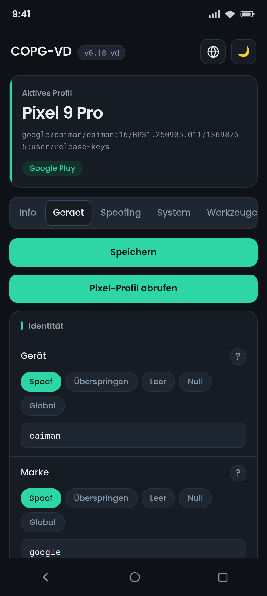
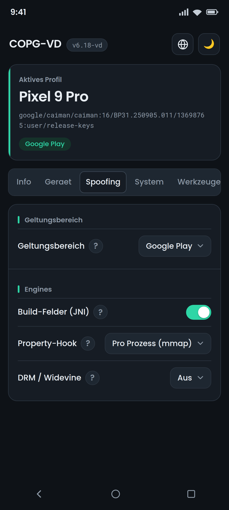
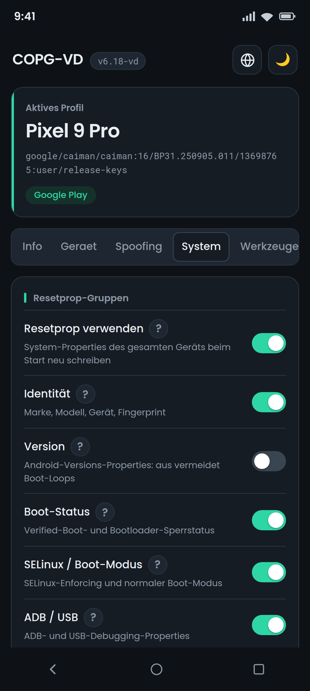
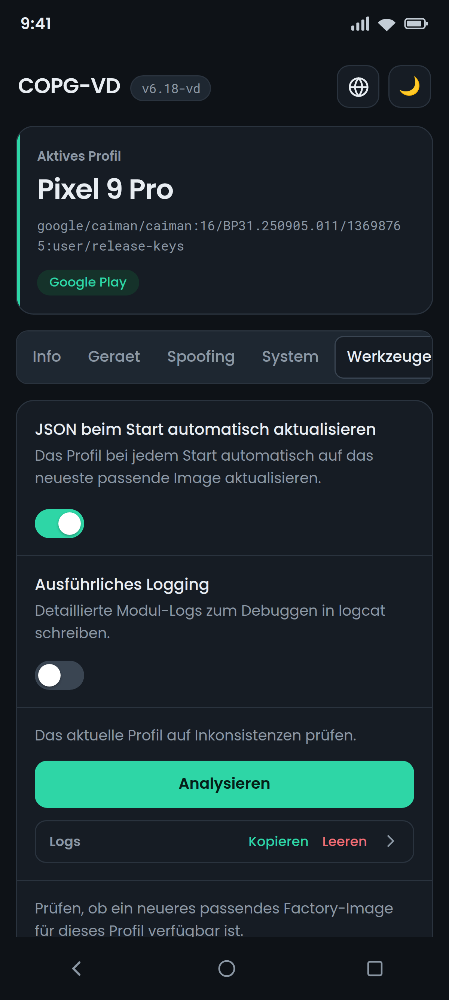

<!--
  ======================================================================
   COPG-VD  ::  global device spoofer
   Spoof your device fingerprint and build.

   Copyright (C) 2026  AlirezaParsi & VD171 (Fork by VD171)
   SPDX-License-Identifier: AGPL-3.0-or-later

   Licensed under the GNU AGPL v3.0 or later. You may obtain a copy at
   https://www.gnu.org/licenses/agpl-3.0.html

   Site           : https://vd171.ru
   Site           : https://vd.priv8.ru
   Source         : https://github.com/VD171/COPG-VD
   GitHub         : @VD171 https://github.com/VD171
   XDA-Developers : @VD171 https://xdaforums.com/m/vd171.4699873/
   XDA thread     : https://xdaforums.com/t/COPG-VD.4807698/
   Telegram       : @VD_Priv8 https://t.me/VD_Priv8
   Channel        : @Priv8_VD https://t.me/Priv8_VD
   Discord        : @VD.Priv8 https://discord.com/users/1296831918989639721
   E-mail         : vd.priv8@pm.me
  ======================================================================
-->

# COPG-VD

<p align="center">
  
</p>

<p align="center">
  <a href="https://github.com/VD171/COPG-VD/releases/latest"></a>
  <a href="LICENSE"></a>
  <a href="https://github.com/VD171/COPG-VD/releases"></a>
  <a href="https://github.com/VD171/COPG-VD/stargazers"></a>
</p>

<p align="center">
  <b>COPG-VD ist ein Geräte-Spoofer: Er schreibt den Geräte-Fingerprint und Build um, sodass Apps das von dir gewählte Gerät sehen statt des echten.</b><br>
  Er läuft auf Zygisk (KernelSU, APatch oder Magisk) und beschränkt das Spoofing standardmäßig auf den Google-Play-Stack: damit ist er eine leichtere, robustere Alternative zu PlayIntegrityFix.
</p>

<p align="center">
  <a href="https://github.com/VD171/COPG-VD/releases">Releases</a> ·
  <a href="https://github.com/VD171/COPG-VD/wiki/de-Home">Wiki</a> ·
  <a href="https://github.com/VD171/COPG-VD/wiki/de-USER-GUIDE">Benutzerhandbuch</a> ·
  <a href="https://github.com/VD171/COPG-VD/wiki/de-CONFIGURATION">Konfigurationsreferenz</a> ·
  <a href="https://github.com/VD171/COPG-VD/wiki/de-ARCHITECTURE">Architektur</a> ·
  <a href="https://github.com/VD171/COPG-VD/wiki/de-FILE-STRUCTURE">Dateistruktur</a> ·
  <a href="https://github.com/VD171/COPG-VD/wiki/de-AI-AGENTS">KI-Agenten</a> ·
  <a href="https://xdaforums.com/t/COPG-VD.4807698/">XDA thread</a>
</p>

> **Languages:** [English](README.md) · [العربية](README.ar.md) · [Čeština](README.cs.md) · Deutsch · [Español](README.es.md) · [فارسی](README.fa.md) · [Français](README.fr.md) · [हिन्दी](README.hi.md) · [Bahasa Indonesia](README.id.md) · [Italiano](README.it.md) · [日本語](README.ja.md) · [한국어](README.ko.md) · [Nederlands](README.nl.md) · [Polski](README.pl.md) · [Português](README.pt.md) · [Русский](README.ru.md) · [Svenska](README.sv.md) · [ไทย](README.th.md) · [Türkçe](README.tr.md) · [Українська](README.uk.md) · [Tiếng Việt](README.vi.md) · [中文](README.zh.md)

<p align="center">
     
</p>

---

## Warum

Immer mehr Apps verweigern den Start oder schalten still auf eine abgespeckte Variante um, wenn das Gerät, das sie sehen, kein sauberes, zertifiziertes Telefon ist: Play Integrity, DRM-Stufen und app-spezifische Geräteprüfungen lesen allesamt den Build-Fingerprint und die System-Properties. COPG-VD schreibt diese Identität um, sodass Apps ein kohärentes Pixel (oder jedes von dir konfigurierte Gerät) sehen statt deines echten. Mit einem funktionierenden Fingerprint brauchst du meist weder PlayIntegrityFix noch GooglePhotosUnlimited: Es ist eine leichtere, robustere Alternative und beschränkt das Spoofing standardmäßig auf den Google-Play-Stack, sodass der Rest deines Systems unangetastet bleibt.

## Funktionen

- **Scope-Steuerung:** Liefere die gespoofte Identität nur an den Google-Play-Stack (der Standard), an das gesamte Gerät, an eine Whitelist oder an alles außer einer Blacklist. In einem begrenzten Modus liefert Zygisk die Identität pro Prozess, sodass sie niemals über die globalen Properties durchsickert.
- **Unabhängige Engines:** Build-Felder (eine JNI-Umschreibung von `android.os.Build.*`), ein Clean-Room-Property-Hook pro Prozess (kein Funktions-Hook), gruppiertes `resetprop` und eine optionale DRM- / Widevine-Stufe (L1 oder L3) mit eigener Zielliste. Jede lässt sich abschalten.
- **Steuerung pro Feld:** Jedes Build-Feld kann gesetzt, geleert, gelöscht oder übersprungen werden, mit einer `global_fields`-Liste für Werte, die geräteweit konsistent bleiben müssen.
- **Stets frischer Fingerprint:** Ein Pixel-Profil ist im Lieferumfang enthalten und aktualisiert sich einmal pro Boot aus dem neuesten Google-Factory-Image selbst, du kannst über die WebUI auch ein anderes Pixel-Profil holen. Es stuft nie herunter und lehnt ein Profil für ein anderes Gerät ab.
- **Sichere Android-Versions-Policy:** Das SDK wird unter keiner Policy über dein echtes Framework angehoben (es anzuheben, softloopt das Telefon nur).
- **Analyze:** Prüft die Konfiguration gegen deine ROM und die Props und meldet alles Inkohärente, bevor es die Apps erreicht.
- **WebUI:** Fünf Tabs, um alles zu steuern, ohne Netzwerkanfrage, die Konfigurationsdatei trägt alle Einstellungen, sodass sie ein Modul-Update überleben.
- **Inkrementelles Selbst-Update (VDLU)** und eine native Bibliothek mit **vier ABIs** (arm64-v8a, armeabi-v7a, x86, x86_64).

## KI-Agenten

COPG-VD ist headless skriptbar: Das gesamte Modul wird von einer einzigen JSON-Datei (`/data/adb/COPG-VD/COPG-VD.json`) und einem einzigen Shell-Einstiegspunkt gesteuert, `fingerprint-update.sh`, mit stabilen Verben (`check`, `apply`, `analyze`, `fetch-index`, `fetch <path>` und weiteren). Ein als root laufender Agent kann die Konfiguration lesen und schreiben und jede Aktion ausführen, die auch die WebUI kann, ohne die WebUI abzuscrapen. Siehe [docs/AI-AGENTS.md](docs/de/AI-AGENTS.md). Patches von KI werden an derselben Review-Latte gemessen wie alle anderen.

## Installation

Flashe das Zip in KernelSU, APatch oder Magisk und reboote. Das mitgelieferte Pixel-Profil wird den Zielapps sofort gespooft. Der Installer führt ein `.sha256`-Integritäts-Gate aus und bricht bei einem beschädigten oder abgeschnittenen Zip ab (und überspringt sicher, wo kein Prüfsummen-Werkzeug vorhanden ist). Erfordert Zygisk, über KernelSU, APatch oder Magisk, und root.

## Sicherheit

Das Spoofing ist rein user-seitig: COPG-VD hebt das SDK nie über dein echtes Framework an, hält den Hersteller kohärent mit dem Rest des Profils und liest die echte Version aus `/system/build.prop`, niemals aus den Properties, die es fälscht. Der Selbst-Updater verlangt eine gültige ed25519-Signatur und lehnt Downgrades ab, die WebUI stellt keine Netzwerkanfrage. Melde Probleme gemäß [SECURITY.md](docs/de/SECURITY.md).

## Build

Immer release, niemals debug. Die native Bibliothek und der Scope-Helfer werden in der CI für alle vier ABIs gebaut, der Release-Workflow stellt das flashbare Zip zusammen, schreibt die `.sha256`-Begleitdateien pro Datei, erzeugt die signierte VDLU-Baseline neu und veröffentlicht als `github-actions[bot]`. Siehe [CONTRIBUTING.md](docs/de/CONTRIBUTING.md).

## Wie wird es verwendet?
Installiere das Modul, reboote, und das mitgelieferte Profil (ein Pixel) wird für die betroffenen Apps gespooft. Mit einem funktionierenden Fingerprint brauchst du PlayIntegrityFix oder GooglePhotosUnlimited nicht.  
Alles wird in `/data/adb/COPG-VD/COPG-VD.json` oder über die WebUI konfiguriert. Alle Felder sind OPTIONAL: ein Feld, das nicht angegeben wird, wird übersprungen.  

### Scope: wer das Spoofing sieht
`scope_mode` entscheidet, welche Prozesse die gespoofte Identität erhalten. In einem begrenzten Modus wird die Identität von Zygisk pro Prozess geliefert und nicht über die globalen Properties an den Rest des Systems weitergegeben.  
* **Google Play** (`playstore`, der Standard): nur der Play-Stack (Google Play Services, sein unstable-Prozess und der Play Store).  
* **Global**: das gesamte Gerät, jeder Prozess sieht es.  
* **Whitelist**: nur die Apps in `scope_whitelist`.  
* **Blacklist**: jede App außer denen in `scope_blacklist`.  

### Engines: wie das Spoofing geliefert wird
Jede ist unabhängig und kann abgeschaltet werden:  
* **Build fields (JNI)**: schreibt `android.os.Build.*` in den betroffenen Prozessen um.  
* **Property hook**: präsentiert den betroffenen Prozessen die gespooften System-Properties (ein Clean-Room-Remap des Property-Bereichs pro Prozess, kein Funktions-Hook).  
* **resetprop**: schreibt die System-Properties um, gruppenweise verwaltet: Identität, Version, Boot-Status, SELinux, adb/usb, Anti-Emulator und ein Aufräum-Durchlauf. In einem begrenzten Modus bleiben die Gruppen Identität und Version aus dem geräteweiten resetprop heraus (Zygisk liefert sie pro Prozess), die Gruppen boot/lock/SELinux bleiben global.  
* **DRM / Widevine** (standardmäßig aus): meldet den Apps, die ihn lesen, eine gewählte Widevine-Sicherheitsstufe, L1 oder L3. Standardmäßig folgt es dem Scope oben, setze `drm_targets` (eine Liste von Apps), um das DRM-Spoofing nur auf diese Apps anzuwenden, unabhängig von `scope_mode`: das Modul bleibt in einer gelisteten App nur für den DRM-Hook geladen, auch wenn diese App außerhalb des Haupt-Scopes liegt. Leer oder nicht vorhanden bedeutet, dem Scope zu folgen. (Erfordert einen Modus mit Geltungsbereich, nicht Global.)  

### Fields: setzen, leeren, löschen oder überspringen
Innerhalb des `COPG-VD`-Objekts hat jedes Build-Feld vier Zustände:  
* **Set**: `"KEY": "value"` schreibt den Wert.  
* **Empty**: `"KEY": ""` schreibt einen leeren Wert.  
* **Delete**: führe den Schlüssel in einem `"COPG-VD-Delete": [ ... ]` auf oberster Ebene auf, um ihn zu entfernen (ein Build-Feld wird null, eine Property wird mit `resetprop --delete` entfernt).  
* **Skip**: lass den Schlüssel ganz weg, der eigene Wert der ROM bleibt erhalten.  

Eine `"global_fields": [ ... ]`-Liste wendet die genannten Build-Felder auch in einem begrenzten Modus geräteweit an, um einen Wert überall konsistent zu halten: nur für kohärenzsichere Felder (zum Beispiel den Security Patch), niemals für die Identität und niemals für die Android-Versions-Gruppe.  

### Beispiel-JSON-Konfigurationsdatei
`/data/adb/COPG-VD/COPG-VD.json`
```json
{
  "Instructions": "Use strings on double-quotes only.",
  "Instructions": "All fields are OPTIONAL. If some field is not provided, it will be skipped.",
  "Strings extracted from": "https://dl.google.com/developers/android/CANARY/images/factory/tegu_beta-zp11.261016.008-factory-28d56d15.zip",
  "scope_mode": "playstore",
  "motor_drm": false,
  "drm_targets": [],
  "global_fields": ["SECURITY_PATCH"],
  "process_overrides": [],
  "COPG-VD": {
    "BRAND": "google",
    "DEVICE": "tegu",
    "MANUFACTURER": "Google",
    "MODEL": "Pixel 9a",
    "FINGERPRINT": "google/tegu_beta/tegu:CANARY/ZP11.261016.008/16754936:user/release-keys",
    "PRODUCT": "tegu_beta",
    "BOOTLOADER": "unknown",
    "BOARD": "tegu",
    "HARDWARE": "tegu",
    "DISPLAY": "ZP11.261016.008",
    "ID": "ZP11.261016.008",
    "HOST": "e4df75f83a59",
    "INCREMENTAL": "16754936",
    "TIMESTAMP": "1793211232",
    "PREVIEW_SDK": "20261104",
    "USER": "android-build",
    "SDK_FINGERPRINT": "ee82a872870173d77e68050e21a2bcbf",
    "UUID": "FjWvtSORkI0sEwekaPz2s30gqV5vWP_EZHFtBiXzboc",
    "SECURITY_PATCH": "2026-11-05",
    "FIRST_API_LEVEL": "35",
    "DRM_SECURITY_LEVEL": "L1"
  }
}
```
Achte darauf, Strings ausschließlich in doppelten Anführungszeichen zu verwenden.  
Der Block oben und `module/COPG-VD.json.example` werden täglich durch den Workflow [Update COPG-VD.json](.github/workflows/update-json.yml) aktualisiert, direkt aus dem neuesten Google-Factory-Image.  

### Den Fingerprint aktuell halten
`fingerprint-update.sh` lädt diese Datei und aktualisiert deine Konfiguration, über die WebUI (**Check Update** / **Update Now**) oder von selbst **einmal pro Boot** (**Auto-update JSON on boot**, standardmäßig aktiviert).  
* `/data/adb/COPG-VD/COPG-VD.json` wird an Ort und Stelle aktualisiert, und der vorherige Inhalt wird daneben als `COPG-VD.json.bak` aufbewahrt.  
* Nur die Build-Felder werden neu geschrieben (fingerprint, ID, incremental, timestamp, security patch, SDK, UUID, host, user). Alles andere, das du angepasst hast, bleibt erhalten: zusätzliche Schlüssel, `scope_mode`, `BOOTLOADER`/`BOARD`/`HARDWARE`, andere Objekte, Schlüsselreihenfolge und Formatierung.  
* Es geht niemals rückwärts: ein Upstream-Build, der älter ist als der installierte, wird abgelehnt. Das ist
  normal (das Repo kann hinter einer Konfiguration liegen, die du von Hand aktualisiert hast) und es ist auch der Schutz, der
  auf Android am wichtigsten ist, wo der einzige verfügbare Downloader busybox `wget` ist, das keine
  TLS-Zertifikate prüfen kann: aus demselben Grund wird jeder Wert vor der Verwendung validiert.  
* Wenn dein Profil **ein anderes Gerät** spooft (abweichende `BRAND`/`DEVICE`/`MANUFACTURER`/`MODEL`/`PRODUCT`), wird nichts angewendet: ein Pixel-Fingerprint auf einem anderen Profil ist schlimmer als ein alter Fingerprint.  
* Beim Boot läuft es im Hintergrund und versucht es etwa 10 Minuten lang immer wieder, weil WLAN meist noch nicht verfügbar ist, wenn der Boot abgeschlossen ist. Es verzögert den Boot niemals.  
* `resetprop` wird direkt nach einem Update erneut angewendet, aber `android.os.Build` wird vom Zygisk-Modul geschrieben, wenn Zygote startet: **reboote**, damit die neuen Werte die Apps erreichen.  
* Log unter `/data/adb/COPG-VD/update.log`.  

### Android-Version: und warum sie nicht gespooft wird
`ANDROID_VERSION`, `SDK_INT`, `SDK_FULL` und `CODENAME` beschreiben **deine ROM**, nicht das gespoofte Gerät. Apps vorzugaukeln, das SDK sei neuer als das Framework tatsächlich ist, bringt sie dazu, APIs aufzurufen, die nicht existieren: Googles Apps stürzen ab, das Telefon rebootet und fängt von vorn an. Der Boot selbst wird abgeschlossen, daher ist es ein **Softloop** und in den Boot-Logs taucht nichts auf.  
* Sie stehen nicht in der ausgelieferten Konfiguration und der Updater schreibt sie nie.  
* **Spoof Android version** in der WebUI entscheidet, ob sie überhaupt angewendet werden:  
  * **Never** (Standard): die eigene Version der ROM wird verwendet.  
  * **Up to this ROM**: nur das, was sie nicht überschreitet, was in der Praxis bedeutet, das SDK abzusenken.  
  * **Force**: erzwingt die übrigen Versionsfelder genau so, wie die Konfiguration es verlangt, aber das SDK wird auch hier auf den Wert deiner ROM begrenzt (das SDK über das echte Framework anzuheben, löst nur einen Softloop aus und hat keinen legitimen Nutzen), sodass **Force seit v6.19 keinen Softloop mehr verursacht**.  
* Die echte Version wird aus `/system/build.prop` gelesen, niemals aus `getprop`: genau das ist es, was dieses Modul fälscht.  

### Analyze
**Analyze** in der WebUI (oder `fingerprint-update.sh analyze`) prüft die Konfiguration im aktuellen Zustand: Version gegen die ROM, ob die Datei überhaupt noch geparst werden kann (eine kaputte bewirkt, dass das Modul **nichts** spooft, und nur logcat sagt es), ob der Fingerprint zu den umgebenden Feldern passt, Schlüssel, die das Modul nicht liest, Datumsangaben und ob die Props bereits das enthalten, was die Konfiguration verlangt.  

### WebUI
Die WebUI ist optional (alles kann direkt in der JSON-Konfiguration bearbeitet werden) aber sie ist der einfache Weg, das Modul zu steuern. Sie hat fünf Tabs: **About**, **Device** (jedes Feld, pro Zustand gesetzt, nach Kategorie gruppiert), **Spoofing** (Scope und Engines), **System** (die resetprop-Gruppen) und **Tools** (Analyze, Check Update, Update Now, Backup/Restore und das Auto-Update beim Boot). Sie stellt keine Netzwerkanfrage, alles, was sie braucht, ist im Modul enthalten.  
Wenn du Magisk-Nutzer bist, verwende KsuWebUI von KOW (https://github.com/KOWX712/KsuWebUIStandalone/releases). Du kannst auch WebUI-X Portable von MMRL verwenden (https://github.com/MMRLApp/WebUI-X-Portable/releases) oder KsuWebUI-SN (https://github.com/dnascorpionofficial/KsuWebUI-SN/releases).  

### Einstellungen in der Konfiguration
`COPG-VD.json` trägt seine Einstellungen direkt neben dem Profil, damit deine Entscheidungen mit einem Backup reisen und von Hand bearbeitet werden können: `scope_mode`, die Engine-Schalter, die resetprop-Gruppen, `global_fields` und ein `COPG-VD-Settings`-Objekt (`resetprop`, `autoupdate`, `spoof_version`). Alles liegt in dieser einen Datei: die Boot-Skripte und die WebUI lesen die Einstellungen direkt daraus, sodass deine Entscheidungen ein Modul-Update überleben. `"spoof_version": "force"` wird aus der Datei abgelehnt und heruntergestuft: das Wiederherstellen eines alten Backups darf es nicht hinter deinem Rücken erneut scharfschalten.  

## Inkrementelle Updates (VDLU)

COPG-VD liefert die **[VDLiveUpdate](https://github.com/VD171/VDLiveUpdate) (VDLU)**-Engine mit (eingebunden in `module/vdlu/`): Das Modul aktualisiert sich selbst, indem es nur die geänderten Dateien lädt (inhaltsadressierte Blobs + eine signierte `manifest.json`), statt das ganze `.zip` erneut herunterzuladen. Profil **Hardened**: Die ed25519-Signatur ist verpflichtend und Downgrades sind blockiert, das vollständige `.zip` bleibt als Fallback gültig.

- **`vdlu/`** (im Zip enthalten): `update.sh` (Engine) + `vdlu-verify` + `config.default` + `keyring/` (öffentlicher Schlüssel).
- **Zustand** in `/data/adb/COPG-VD/vdlu/` (config/journal/blobs/staged/rollback), außerhalb des Moduls, übersteht ein erneutes Flashen.
- **Boot-Trigger:** `post-fs-data.sh`, vor zygote, COPG-VD hat `zygisk/*.so` + `sepolicy.rule` (REBOOT-hard), daher wird die neue `.so` bereitgestellt und ausgetauscht, bevor zygote sie mappt.
- **WebUI:** ein **Updates**-Panel (`webroot/vdlu.js`) mit Fortschrittsanzeige und Abbrechen.
- **Release:** siehe `module/vdlu/RELEASE.md` (`vdlu-pack` + `vdlu-sign`, Manifest archivieren, `vdlu-gc` entfernt verwaiste Blobs, gebündelter Pages-Push).

<!-- vd-docs -->
## Dokumentation

- **[Wiki](https://github.com/VD171/COPG-VD/wiki/de-Home)**: die vollständige Dokumentation, online durchsuchbar.
- **[Benutzerhandbuch](https://github.com/VD171/COPG-VD/wiki/de-USER-GUIDE)**: Installation, die WebUI und die tägliche Nutzung.
- **[Konfigurationsreferenz](https://github.com/VD171/COPG-VD/wiki/de-CONFIGURATION)**: jede Einstellung in der Konfigurationsdatei und ihre Funktion.
- **[Architektur](https://github.com/VD171/COPG-VD/wiki/de-ARCHITECTURE)** und **[Dateistruktur](https://github.com/VD171/COPG-VD/wiki/de-FILE-STRUCTURE)**: wie das Spoofing funktioniert und wo alles liegt.
- **[KI-Agenten](https://github.com/VD171/COPG-VD/wiki/de-AI-AGENTS)**: die Konfiguration und den Updater headless steuern.

<!-- /vd-docs -->

## Siehe auch

- **[VDBackup](https://github.com/VD171/VD-Backup)**: vollständige Sicherung und Wiederherstellung von Apps und Daten als root, komplett über eine WebUI gesteuert.
- **[VD-dropbear](https://github.com/VD171/VD-dropbear)**: ein eigenständiger gerooteter SSH-Daemon (Dropbear).
- **[VDGoogle](https://github.com/VD171/VD-Google)**: deine Google-Dienste (RCS, Wallet, Play-Integrity-Attestierungen), auf deinem Gerät gelesen, ohne Internet.
- **[VDInstaller](https://github.com/VD171/VD-Installer)**: ein reibungsloser Root-Sideload-Installer für einzelne, Batch- und Split-APKs, mit einem Play-Protect-Verifier-Schalter und Fälschung der Installationsquelle.
- **[VDInfos](https://github.com/VD171/VD-Infos)**: ein Geräte-Methoden-Debugger, der jeden Eintrag über jede Methode liest, die ihn lesen kann, und sie nebeneinander vergleicht.
- **[VDLiveUpdate](https://github.com/VD171/VDLiveUpdate)**: eine flashlose, inkrementelle Selbstaktualisierungs-Engine, eingebettet in KernelSU/APatch/Magisk-Module.
- **[VD-Modules](https://github.com/VD171/VD-Modules)**: unser Modul-Repository für MMRL/WebUI-X (installiere alle davon über deinen Root-Manager).
- **[@VictorGabriel7Dev/build.prop](https://github.com/VictorGabriel7Dev/build.prop)**: ein Datensatz von Pixel-`build.prop`-Fingerprints (Fork von @T3SL4).
- **[@VictorGabriel7Dev/mtproto-store](https://github.com/VictorGabriel7Dev/mtproto-store)**: Telegram als Objektspeicher über eine winzige Go-CLI nutzen.

## Kontakte

- https://vd171.ru
- https://vd.priv8.ru
- **Telegram:** @VD_Priv8 https://t.me/VD_Priv8
- **Channel:** @Priv8_VD https://t.me/Priv8_VD
- **Discord:** @VD.Priv8 https://discord.com/users/1296831918989639721
- **E-mail:** vd.priv8@pm.me
- **XDA-Developers:** @VD171 https://xdaforums.com/m/vd171.4699873/
- **XDA thread:** https://xdaforums.com/t/COPG-VD.4807698/
- **GitHub:** @VD171 https://github.com/VD171

## Lizenz

**AGPL-3.0-or-later**: siehe [LICENSE](LICENSE). COPG-VD ist ein Fork von VD171 des ursprünglichen COPG von AlirezaParsi (Apache-2.0), neu lizenziert unter der GNU AGPL-3.0-or-later. NETZWERK-COPYLEFT: Wer eine veränderte Version betreibt, auch als Dienst, muss deren Quelltext anbieten.

## Marken

COPG-VD ist ein unabhängiges, inoffizielles Projekt. Es ist nicht mit Google LLC verbunden, wird von ihr nicht unterstützt oder gesponsert. „Google", „Google Play", „Play Integrity", „Pixel", „Android" und zugehörige Namen und Logos sind Marken von Google LLC. COPG-VD läuft vollständig auf deinem Gerät.

## Tags

`Zygisk` `KernelSU` `APatch` `Magisk` `device-spoofing` `fingerprint` `PlayIntegrity` `Pixel` `build.prop` `resetprop` `root` `Android` `COPG-VD`

---

📣 **Tritt dem Kanal für Updates bei:** @Priv8_VD https://t.me/Priv8_VD
