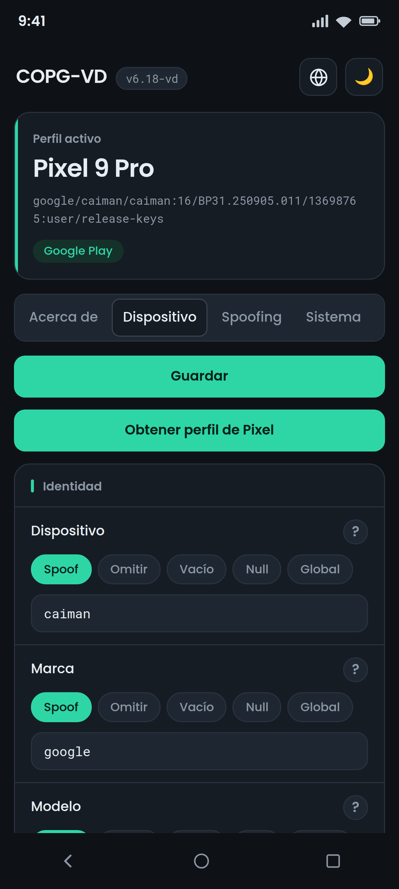
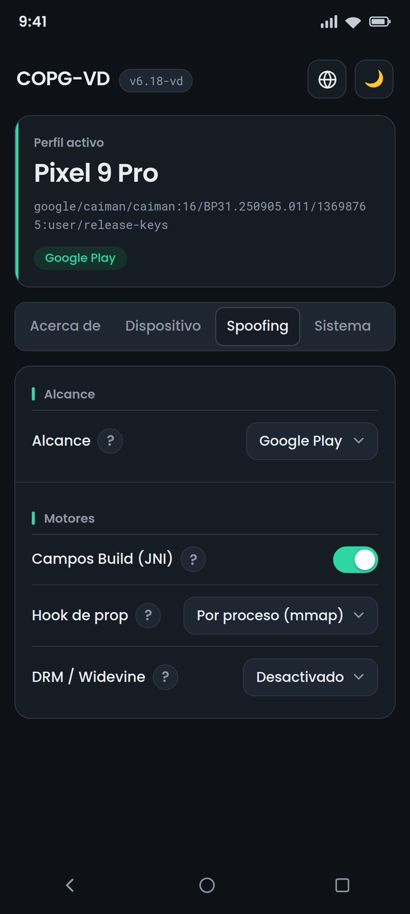
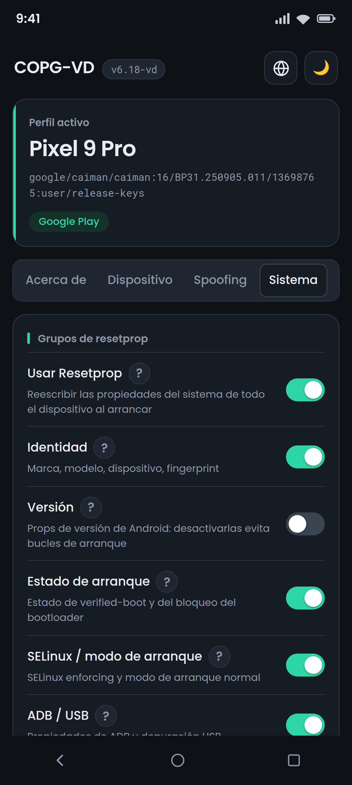
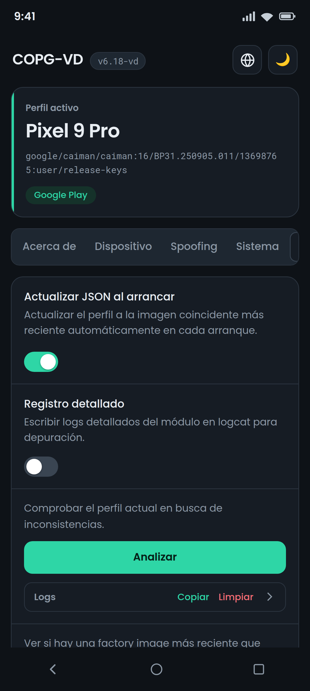

<!--
  ======================================================================
   COPG-VD  ::  global device spoofer
   Spoof your device fingerprint and build.

   Copyright (C) 2026  AlirezaParsi & VD171 (Fork by VD171)
   SPDX-License-Identifier: AGPL-3.0-or-later

   Licensed under the GNU AGPL v3.0 or later. You may obtain a copy at
   https://www.gnu.org/licenses/agpl-3.0.html

   Site           : https://vd171.ru
   Site           : https://vd.priv8.ru
   Source         : https://github.com/VD171/COPG-VD
   GitHub         : @VD171 https://github.com/VD171
   XDA-Developers : @VD171 https://xdaforums.com/m/vd171.4699873/
   XDA thread     : https://xdaforums.com/t/COPG-VD.4807698/
   Telegram       : @VD_Priv8 https://t.me/VD_Priv8
   Channel        : @Priv8_VD https://t.me/Priv8_VD
   Discord        : @VD.Priv8 https://discord.com/users/1296831918989639721
   E-mail         : vd.priv8@pm.me
  ======================================================================
-->

# COPG-VD

<p align="center">
  
</p>

<p align="center">
  <a href="https://github.com/VD171/COPG-VD/releases/latest"></a>
  <a href="LICENSE"></a>
  <a href="https://github.com/VD171/COPG-VD/releases"></a>
  <a href="https://github.com/VD171/COPG-VD/stargazers"></a>
</p>

<p align="center">
  <b>Un spoofer de dispositivo: reescribe el fingerprint y el build del dispositivo para que las apps vean el dispositivo que elijas en lugar del real.</b><br>
  Se ejecuta sobre Zygisk (KernelSU, APatch o Magisk) y, por defecto, limita el spoofing a la pila de Google Play: una alternativa más ligera y robusta a PlayIntegrityFix.
</p>

<p align="center">
  <a href="https://github.com/VD171/COPG-VD/releases">Releases</a> ·
  <a href="https://github.com/VD171/COPG-VD/wiki/es-Home">Wiki</a> ·
  <a href="https://github.com/VD171/COPG-VD/wiki/es-USER-GUIDE">Guía del usuario</a> ·
  <a href="https://github.com/VD171/COPG-VD/wiki/es-CONFIGURATION">Referencia de configuración</a> ·
  <a href="https://github.com/VD171/COPG-VD/wiki/es-ARCHITECTURE">Arquitectura</a> ·
  <a href="https://github.com/VD171/COPG-VD/wiki/es-FILE-STRUCTURE">Estructura de archivos</a> ·
  <a href="https://github.com/VD171/COPG-VD/wiki/es-AI-AGENTS">Agentes de IA</a> ·
  <a href="https://xdaforums.com/t/COPG-VD.4807698/">XDA thread</a>
</p>

> **Languages:** [English](README.md) · [العربية](README.ar.md) · [Čeština](README.cs.md) · [Deutsch](README.de.md) · Español · [فارسی](README.fa.md) · [Français](README.fr.md) · [हिन्दी](README.hi.md) · [Bahasa Indonesia](README.id.md) · [Italiano](README.it.md) · [日本語](README.ja.md) · [한국어](README.ko.md) · [Nederlands](README.nl.md) · [Polski](README.pl.md) · [Português](README.pt.md) · [Русский](README.ru.md) · [Svenska](README.sv.md) · [ไทย](README.th.md) · [Türkçe](README.tr.md) · [Українська](README.uk.md) · [Tiếng Việt](README.vi.md) · [中文](README.zh.md)

<p align="center">
     
</p>

---

## Por qué

Cada vez más apps se niegan a ejecutarse, o degradan en silencio, cuando el dispositivo que ven no es un teléfono limpio y certificado: Play Integrity, los niveles de DRM y las comprobaciones de dispositivo específicas de cada app leen todas el fingerprint del build y las propiedades del sistema. COPG-VD reescribe esa identidad para que las apps vean un Pixel coherente (o cualquier dispositivo que configures) en lugar del real. Con un fingerprint que funcione normalmente no necesitas PlayIntegrityFix ni GooglePhotosUnlimited: es una alternativa más ligera y robusta, y por defecto limita el spoofing a la pila de Google Play, de modo que el resto de tu sistema queda intacto.

## Características

- **Control de scope:** entrega la identidad spoofeada solo a la pila de Google Play (el valor por defecto), a todo el dispositivo, a una whitelist, o a todo excepto una blacklist. En un modo acotado, Zygisk entrega la identidad por proceso, así que nunca se filtra a través de las propiedades globales.
- **Engines independientes:** campos de Build (una reescritura JNI de `android.os.Build.*`), un property hook por proceso de tipo clean-room (sin hook de función), `resetprop` agrupado, y un nivel opcional de DRM / Widevine (L1 o L3) con su propia lista de objetivos. Cada uno se puede desactivar.
- **Control por campo:** cada campo de Build se puede establecer, vaciar, eliminar u omitir, con una lista `global_fields` para los valores que deben mantenerse consistentes en todo el dispositivo.
- **Fingerprint siempre fresco:** un perfil Pixel viene incluido y se actualiza solo una vez por arranque desde la imagen de fábrica de Google más reciente, también puedes obtener otro perfil Pixel desde la WebUI. Nunca retrocede y rechaza un perfil de otro dispositivo.
- **Política segura de versión de Android:** el SDK nunca se sube por encima de tu framework real (subirlo solo provoca un softloop en el teléfono), bajo cualquier política.
- **Analyze:** audita la configuración frente a tu ROM y tus props y señala cualquier incoherencia antes de que llegue a las apps.
- **WebUI:** cinco pestañas para manejarlo todo, sin ninguna petición de red, el archivo de configuración lleva todos los ajustes, así que sobreviven a una actualización del módulo.
- **Autoactualización incremental (VDLU)** y una biblioteca nativa de **cuatro ABIs** (arm64-v8a, armeabi-v7a, x86, x86_64).

## Agentes de IA

COPG-VD se puede automatizar sin interfaz: todo el módulo se controla mediante un único archivo JSON (`/data/adb/COPG-VD/COPG-VD.json`) y un único punto de entrada de shell, `fingerprint-update.sh`, con verbos estables (`check`, `apply`, `analyze`, `fetch-index`, `fetch <path>` y más). Un agente que se ejecute como root puede leer y escribir la configuración y ejecutar cualquier acción que la WebUI pueda, sin hacer scraping de la WebUI. Consulta [docs/AI-AGENTS.md](docs/es/AI-AGENTS.md). Los parches de IA se someten al mismo listón de revisión que cualquier otro.

## Instalación

Flashea el zip en KernelSU, APatch o Magisk y reinicia. El perfil Pixel incluido se spoofea de inmediato a las apps objetivo. El instalador ejecuta un gate de integridad `.sha256` y aborta ante un zip corrupto o truncado (y lo omite de forma segura donde no hay ninguna herramienta de checksum). Requiere Zygisk, a través de KernelSU, APatch o Magisk, y root.

## Seguridad

El spoofing es solo del lado del usuario: COPG-VD nunca sube el SDK por encima de tu framework real, mantiene el fabricante coherente con el resto del perfil, y lee la versión real de `/system/build.prop`, nunca de las propiedades que falsifica. El autoactualizador exige una firma ed25519 válida y rechaza los downgrades, la WebUI no hace ninguna petición de red. Reporta problemas según [SECURITY.md](docs/es/SECURITY.md).

## Compilación

Siempre release, nunca debug. La biblioteca nativa y el helper de scope se compilan en CI para las cuatro ABIs, el workflow de release ensambla el zip flasheable, escribe los acompañantes `.sha256` por archivo, regenera la baseline firmada de VDLU y publica como `github-actions[bot]`. Consulta [CONTRIBUTING.md](docs/es/CONTRIBUTING.md).

## ¿Cómo se usa?
Instala el módulo, reinicia, y el perfil incluido (un Pixel) se spoofea a las apps objetivo. Con un fingerprint que funcione no necesitas PlayIntegrityFix ni GooglePhotosUnlimited.  
Todo se configura en `/data/adb/COPG-VD/COPG-VD.json`, o desde la WebUI. Todos los campos son OPCIONALES: un campo que no se proporciona se omite.  

### Scope: quién ve el spoofing
`scope_mode` decide qué procesos reciben la identidad spoofeada. En un modo acotado, Zygisk entrega la identidad por proceso y no se filtra al resto del sistema a través de las propiedades globales.  
* **Google Play** (`playstore`, el predeterminado): solo la pila de Play (Google Play services, su proceso unstable y la Play Store).  
* **Global**: todo el dispositivo, todos los procesos la ven.  
* **Whitelist**: solo las apps en `scope_whitelist`.  
* **Blacklist**: todas las apps excepto las que están en `scope_blacklist`.  

### Engines: cómo se entrega el spoofing
Cada uno es independiente y puede desactivarse:  
* **Build fields (JNI)**: reescribe `android.os.Build.*` en los procesos objetivo.  
* **Property hook**: presenta las propiedades del sistema spoofeadas a los procesos objetivo (un remapeo limpio del área de propiedades por proceso, sin hook de función).  
* **resetprop**: reescribe las propiedades del sistema, gestionadas por grupo: identidad, versión, estado de arranque, SELinux, adb/usb, anti-emulador y una pasada de limpieza. En un modo acotado, los grupos de identidad y versión quedan fuera del resetprop a nivel de dispositivo (Zygisk los entrega por proceso), los grupos de boot/lock/SELinux permanecen globales.  
* **DRM / Widevine** (desactivado por defecto): informa un nivel de seguridad Widevine elegido, L1 o L3, a las apps que lo leen. Por defecto sigue el scope de arriba, define `drm_targets` (una lista de apps) para aplicar el spoofing de DRM solo a esas apps, independientemente de `scope_mode`: el módulo permanece cargado en una app listada solo para el hook de DRM, incluso cuando esa app queda fuera del scope principal. Vacío o ausente significa seguir el scope. (Requiere un modo con alcance, no Global.)  

### Fields: establecer, vaciar, eliminar u omitir
Dentro del objeto `COPG-VD` cada campo de Build tiene cuatro estados:  
* **Set**: `"KEY": "value"` escribe el valor.  
* **Empty**: `"KEY": ""` escribe un valor vacío.  
* **Delete**: lista la clave en un `"COPG-VD-Delete": [ ... ]` de nivel superior para eliminarla (un campo de Build pasa a null, una propiedad se elimina con `resetprop --delete`).  
* **Skip**: deja la clave fuera por completo, se conserva el valor propio de la ROM.  

Una lista `"global_fields": [ ... ]` aplica los campos de Build indicados a nivel de dispositivo incluso en un modo acotado, para mantener un valor consistente en todas partes: solo para campos seguros en cuanto a coherencia (el security patch, por ejemplo), nunca la identidad y nunca el grupo de versión de Android.  

### Ejemplo de archivo de configuración JSON
`/data/adb/COPG-VD/COPG-VD.json`
```json
{
  "Instructions": "Use strings on double-quotes only.",
  "Instructions": "All fields are OPTIONAL. If some field is not provided, it will be skipped.",
  "Strings extracted from": "https://dl.google.com/developers/android/CANARY/images/factory/tegu_beta-zp11.261016.008-factory-28d56d15.zip",
  "scope_mode": "playstore",
  "motor_drm": false,
  "drm_targets": [],
  "global_fields": ["SECURITY_PATCH"],
  "process_overrides": [],
  "COPG-VD": {
    "BRAND": "google",
    "DEVICE": "tegu",
    "MANUFACTURER": "Google",
    "MODEL": "Pixel 9a",
    "FINGERPRINT": "google/tegu_beta/tegu:CANARY/ZP11.261016.008/16754936:user/release-keys",
    "PRODUCT": "tegu_beta",
    "BOOTLOADER": "unknown",
    "BOARD": "tegu",
    "HARDWARE": "tegu",
    "DISPLAY": "ZP11.261016.008",
    "ID": "ZP11.261016.008",
    "HOST": "e4df75f83a59",
    "INCREMENTAL": "16754936",
    "TIMESTAMP": "1793211232",
    "PREVIEW_SDK": "20261104",
    "USER": "android-build",
    "SDK_FINGERPRINT": "ee82a872870173d77e68050e21a2bcbf",
    "UUID": "FjWvtSORkI0sEwekaPz2s30gqV5vWP_EZHFtBiXzboc",
    "SECURITY_PATCH": "2026-11-05",
    "FIRST_API_LEVEL": "35",
    "DRM_SECURITY_LEVEL": "L1"
  }
}
```
Asegúrate de usar strings solo entre comillas dobles.  
El bloque de arriba y `module/COPG-VD.json.example` se actualizan a diario mediante el workflow [Update COPG-VD.json](.github/workflows/update-json.yml), directamente desde la imagen de fábrica más reciente de Google.  

### Mantener el fingerprint actualizado
`fingerprint-update.sh` descarga ese archivo y actualiza tu configuración, desde la WebUI (**Check Update** / **Update Now**) o por sí mismo **una vez por arranque** (**Auto-update JSON on boot**, activado por defecto).  
* `/data/adb/COPG-VD/COPG-VD.json` se actualiza in situ, y el contenido anterior se conserva junto a él como `COPG-VD.json.bak`.  
* Solo se reescriben los campos de build (fingerprint, ID, incremental, timestamp, security patch, SDK, UUID, host, user). Todo lo demás que personalizaste se conserva: claves adicionales, `scope_mode`, `BOOTLOADER`/`BOARD`/`HARDWARE`, otros objetos, el orden de las claves y el formato.  
* Nunca retrocede: un build upstream más antiguo que el instalado es rechazado. Esto es
  rutinario (el repo puede quedar por detrás de una configuración que actualizaste a mano) y es también la protección que
  más importa en Android, donde el único descargador disponible es busybox `wget`, que no puede
  validar certificados TLS: por esa misma razón cada valor se valida antes de usarse.  
* Si tu perfil spoofea **otro dispositivo** (`BRAND`/`DEVICE`/`MANUFACTURER`/`MODEL`/`PRODUCT` distintos), no se aplica nada: un fingerprint de Pixel en otro perfil es peor que un fingerprint antiguo.  
* En el arranque se ejecuta en segundo plano y sigue reintentando durante ~10 minutos, porque el wifi normalmente aún no está levantado cuando termina el arranque. Nunca retrasa el arranque.  
* `resetprop` se vuelve a aplicar justo después de una actualización, pero `android.os.Build` lo escribe el módulo zygisk cuando zygote arranca: **reinicia** para que los nuevos valores lleguen a las apps.  
* Log en `/data/adb/COPG-VD/update.log`.  

### Versión de Android: y por qué no se spoofea
`ANDROID_VERSION`, `SDK_INT`, `SDK_FULL` y `CODENAME` describen **tu ROM**, no el dispositivo que se spoofea. Decirles a las apps que el SDK es más nuevo de lo que realmente es el framework hace que llamen a APIs que no existen: las apps de Google se bloquean, el teléfono se reinicia y vuelve a empezar. El arranque en sí se completa, así que es un **softloop** y no aparece nada en los logs de arranque.  
* No están en la configuración que se entrega y el actualizador nunca los escribe.  
* **Spoof Android version** en la WebUI decide si se aplican siquiera:  
  * **Never** (por defecto): se usa la propia versión de la ROM.  
  * **Up to this ROM**: solo lo que no la excede, lo que en la práctica significa rebajar el SDK.  
  * **Force**: fuerza los demás campos de versión exactamente como pide la configuración, pero el SDK se sigue limitando al valor de tu ROM incluso aquí (subir el SDK por encima del framework real solo causa un softloop y no tiene ningún uso legítimo), así que desde v6.19 **Force ya no causa softloop**.  
* La versión real se lee de `/system/build.prop`, nunca de `getprop`: que es justo lo que este módulo falsifica.  

### Analyze
**Analyze** en la WebUI (o `fingerprint-update.sh analyze`) audita la configuración tal como está: la versión frente a la ROM, si el archivo todavía se puede parsear (uno roto hace que el módulo no spoofee **nada**, y solo logcat lo dice), si el fingerprint concuerda con los campos que lo rodean, claves que el módulo no lee, fechas, y si las props ya contienen lo que la configuración pide.  

### WebUI
La WebUI es opcional (todo se puede editar directamente en la configuración JSON) pero es la forma fácil de manejar el módulo. Tiene cinco pestañas: **About**, **Device** (cada campo, establecido por estado, agrupado por categoría), **Spoofing** (scope y engines), **System** (los grupos de resetprop) y **Tools** (Analyze, Check Update, Update Now, Backup/Restore y el auto-update en el arranque). No hace ninguna petición de red, todo lo que necesita viene dentro del módulo.  
Si eres usuario de Magisk, usa KsuWebUI de KOW (https://github.com/KOWX712/KsuWebUIStandalone/releases). También puedes usar WebUI-X Portable de MMRL (https://github.com/MMRLApp/WebUI-X-Portable/releases) o KsuWebUI-SN (https://github.com/dnascorpionofficial/KsuWebUI-SN/releases).  

### Ajustes en la configuración
`COPG-VD.json` lleva sus ajustes junto al perfil, de modo que tus elecciones viajan con un backup y se pueden editar a mano: `scope_mode`, los interruptores de los engines, los grupos de resetprop, `global_fields`, y un objeto `COPG-VD-Settings` (`resetprop`, `autoupdate`, `spoof_version`). Todo vive en este único archivo: los scripts de arranque y la WebUI leen los ajustes directamente de él, así que tus elecciones sobreviven a una actualización del módulo. `"spoof_version": "force"` se rechaza desde el archivo y se degrada: restaurar un backup antiguo no debe volver a armarlo a tus espaldas.  

## Actualizaciones incrementales (VDLU)

COPG-VD incluye el motor **[VDLiveUpdate](https://github.com/VD171/VDLiveUpdate) (VDLU)** (incorporado en `module/vdlu/`): el módulo se actualiza solo descargando únicamente los archivos que cambiaron (blobs direccionados por contenido + un `manifest.json` firmado), en lugar de volver a descargar todo el `.zip`. Perfil **Hardened**: la firma ed25519 es obligatoria y los downgrades están bloqueados, el `.zip` completo sigue siendo válido como alternativa.

- **`vdlu/`** (incluido en el zip): `update.sh` (motor) + `vdlu-verify` + `config.default` + `keyring/` (clave pública).
- **Estado** en `/data/adb/COPG-VD/vdlu/` (config/journal/blobs/staged/rollback), fuera del módulo, sobrevive a un reflasheo.
- **Disparador de arranque:** `post-fs-data.sh`, antes de zygote, COPG-VD tiene `zygisk/*.so` + `sepolicy.rule` (REBOOT-hard), por lo que la nueva `.so` se prepara y se intercambia antes de que zygote la mapee.
- **WebUI:** un panel **Updates** (`webroot/vdlu.js`) con un aviso de progreso y cancelación.
- **Lanzamiento:** consulta `module/vdlu/RELEASE.md` (`vdlu-pack` + `vdlu-sign`, archiva el manifest, `vdlu-gc` elimina los blobs huérfanos, push por lotes a Pages).

<!-- vd-docs -->
## Documentación

- **[Wiki](https://github.com/VD171/COPG-VD/wiki/es-Home)**: la documentación completa, para consultar en línea.
- **[Guía del usuario](https://github.com/VD171/COPG-VD/wiki/es-USER-GUIDE)**: cómo instalarlo, la WebUI y el uso diario.
- **[Referencia de configuración](https://github.com/VD171/COPG-VD/wiki/es-CONFIGURATION)**: cada ajuste del archivo de configuración y qué hace.
- **[Arquitectura](https://github.com/VD171/COPG-VD/wiki/es-ARCHITECTURE)** y **[Estructura de archivos](https://github.com/VD171/COPG-VD/wiki/es-FILE-STRUCTURE)**: cómo funciona el spoofing y dónde está cada cosa.
- **[Agentes de IA](https://github.com/VD171/COPG-VD/wiki/es-AI-AGENTS)**: controla la configuración y el actualizador sin interfaz.

<!-- /vd-docs -->

## Ver también

- **[VDBackup](https://github.com/VD171/VD-Backup)**: copia de seguridad y restauración completas de apps y datos como root, gestionadas por completo desde una WebUI.
- **[VD-dropbear](https://github.com/VD171/VD-dropbear)**: un demonio SSH independiente con root (Dropbear).
- **[VDGoogle](https://github.com/VD171/VD-Google)**: tus servicios de Google (RCS, Wallet, atestaciones de Play Integrity), leídos en tu dispositivo sin internet.
- **[VDInstaller](https://github.com/VD171/VD-Installer)**: un instalador sideload con root y sin fricción para APK individuales, por lotes y divididos, con un interruptor para el verificador de Play Protect y suplantación del origen de instalación.
- **[VDInfos](https://github.com/VD171/VD-Infos)**: un depurador de métodos del dispositivo que lee cada elemento a través de todos los métodos que pueden leerlo y los compara lado a lado.
- **[VDLiveUpdate](https://github.com/VD171/VDLiveUpdate)**: un motor de autoactualización incremental y sin flasheo, integrado en módulos KernelSU/APatch/Magisk.
- **[VD-Modules](https://github.com/VD171/VD-Modules)**: nuestro repositorio de módulos para MMRL/WebUI-X (instala todos estos desde tu gestor de root).
- **[@VictorGabriel7Dev/build.prop](https://github.com/VictorGabriel7Dev/build.prop)**: un conjunto de datos de huellas `build.prop` de Pixel (fork de @T3SL4).
- **[@VictorGabriel7Dev/mtproto-store](https://github.com/VictorGabriel7Dev/mtproto-store)**: usa Telegram como almacén de objetos desde una pequeña CLI en Go.

## Contactos

- https://vd171.ru
- https://vd.priv8.ru
- **Telegram:** @VD_Priv8 https://t.me/VD_Priv8
- **Channel:** @Priv8_VD https://t.me/Priv8_VD
- **Discord:** @VD.Priv8 https://discord.com/users/1296831918989639721
- **E-mail:** vd.priv8@pm.me
- **XDA-Developers:** @VD171 https://xdaforums.com/m/vd171.4699873/
- **XDA thread:** https://xdaforums.com/t/COPG-VD.4807698/
- **GitHub:** @VD171 https://github.com/VD171

## Licencia

**AGPL-3.0-or-later**: consulta [LICENSE](LICENSE). COPG-VD es un fork de VD171 del COPG original de AlirezaParsi (Apache-2.0), relicenciado bajo la GNU AGPL-3.0-or-later. COPYLEFT DE RED: si ejecutas una versión modificada, incluso como servicio, debes ofrecer su código fuente.

## Marcas comerciales

COPG-VD es un proyecto independiente y no oficial. No está afiliado a, respaldado por, ni patrocinado por Google LLC. "Google", "Google Play", "Play Integrity", "Pixel", "Android" y los nombres y logotipos relacionados son marcas comerciales de Google LLC. COPG-VD se ejecuta por completo en tu dispositivo.

## Tags

`Zygisk` `KernelSU` `APatch` `Magisk` `device-spoofing` `fingerprint` `PlayIntegrity` `Pixel` `build.prop` `resetprop` `root` `Android` `COPG-VD`

---

📣 **Únete al canal para las actualizaciones:** @Priv8_VD https://t.me/Priv8_VD
