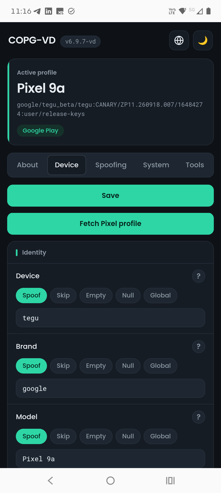
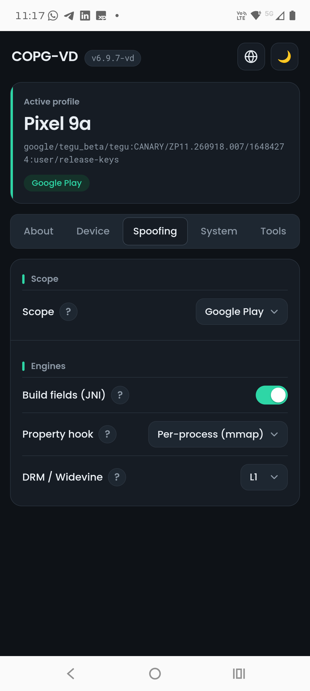
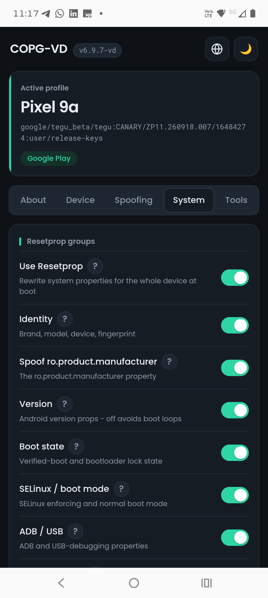
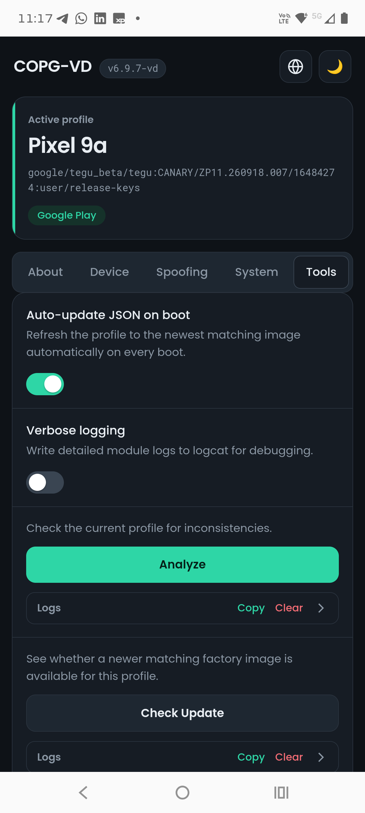

<!--
  COPG-VD: global device spoofer: spoof your device fingerprint and build.
  Copyright (C) 2026  AlirezaParsi & VD171. SPDX-License-Identifier: Apache-2.0 (Fork by VD171)
-->

# COPG-VD

<p align="center">
  
</p>

<p align="center">
  <a href="https://github.com/VD171/COPG-VD/releases/latest"></a>
  <a href="LICENSE"></a>
  <a href="https://github.com/VD171/COPG-VD/releases"></a>
  <a href="https://github.com/VD171/COPG-VD/stargazers"></a>
</p>

<p align="center" dir="rtl">
  <b>یک جعل‌کننده دستگاه: fingerprint و build دستگاه را بازنویسی می‌کند تا اپ‌ها به‌جای دستگاه واقعی، دستگاهی را که شما انتخاب می‌کنید ببینند.</b><br>
  روی Zygisk (KernelSU، APatch یا Magisk) اجرا می‌شود و به‌طور پیش‌فرض دامنه جعل را به استک Google Play محدود می‌کند: جایگزینی سبک‌تر و مقاوم‌تر برای PlayIntegrityFix.
</p>

<p align="center">
  <a href="https://github.com/VD171/COPG-VD/releases">Releases</a> ·
  <a href="https://github.com/VD171/COPG-VD/wiki/fa-Home">Wiki</a> ·
  <a href="https://github.com/VD171/COPG-VD/wiki/fa-USER-GUIDE">راهنمای کاربر</a> ·
  <a href="https://github.com/VD171/COPG-VD/wiki/fa-CONFIGURATION">مرجع پیکربندی</a> ·
  <a href="https://github.com/VD171/COPG-VD/wiki/fa-ARCHITECTURE">معماری</a> ·
  <a href="https://github.com/VD171/COPG-VD/wiki/fa-FILE-STRUCTURE">ساختار فایل</a> ·
  <a href="https://github.com/VD171/COPG-VD/wiki/fa-AI-AGENTS">عامل‌های هوش مصنوعی</a> ·
  <a href="https://xdaforums.com/t/COPG-VD.4807698/">XDA thread</a>
</p>

> **Languages:** [English](README.md) · [العربية](README.ar.md) · [Čeština](README.cs.md) · [Deutsch](README.de.md) · [Español](README.es.md) · [فارسی](README.fa.md) · [Français](README.fr.md) · [हिन्दी](README.hi.md) · [Bahasa Indonesia](README.id.md) · [Italiano](README.it.md) · [日本語](README.ja.md) · [한국어](README.ko.md) · [Nederlands](README.nl.md) · [Polski](README.pl.md) · [Português](README.pt.md) · [Русский](README.ru.md) · [Svenska](README.sv.md) · [ไทย](README.th.md) · [Türkçe](README.tr.md) · [Українська](README.uk.md) · [Tiếng Việt](README.vi.md) · [中文](README.zh.md)

<p align="center">
     
</p>

---

<div dir="rtl">

## چرا

شمار فزاینده‌ای از اپ‌ها وقتی دستگاهی که می‌بینند یک تلفن تمیز و دارای گواهی نباشد، از اجرا سر باز می‌زنند یا بی‌سروصدا کیفیت خود را پایین می‌آورند: Play Integrity، سطوح DRM و بررسی‌های دستگاهِ مخصوص هر اپ، همگی fingerprint مربوط به build و propertyهای سیستم را می‌خوانند. COPG-VD این هویت را بازنویسی می‌کند تا اپ‌ها به‌جای دستگاه واقعی شما یک Pixel منسجم (یا هر دستگاهی که پیکربندی کنید) ببینند. با یک fingerprint سالم معمولا نیازی به PlayIntegrityFix یا GooglePhotosUnlimited ندارید: این یک جایگزین سبک‌تر و مقاوم‌تر است و به‌طور پیش‌فرض دامنه جعل را به استک Google Play محدود می‌کند تا بقیه سیستم شما دست‌نخورده بماند.

## ویژگی‌ها

- **کنترل دامنه (Scope):** هویت جعلی را فقط به استک Google Play (پیش‌فرض)، به کل دستگاه، به یک whitelist، یا به همه چیز به‌جز یک blacklist تحویل دهید. در حالت با دامنه محدود، Zygisk هویت را پر-پروسه تحویل می‌دهد، پس هرگز از طریق propertyهای سراسری نشت نمی‌کند.
- **موتورهای مستقل:** فیلدهای Build (یک بازنویسی `android.os.Build.*` از طریق JNI)، یک property hook پر-پروسه به‌شیوه clean-room (بدون hook تابعی)، `resetprop` گروه‌بندی‌شده، و یک سطح اختیاری DRM / Widevine (L1 یا L3) با فهرست اهداف خودش. هر کدام را می‌توان خاموش کرد.
- **کنترل پر-فیلد:** هر فیلد Build را می‌توان تنظیم، خالی، حذف یا رد کرد، همراه با یک فهرست `global_fields` برای مقادیری که باید در سراسر دستگاه یکدست بمانند.
- **fingerprint همیشه تازه:** یک پروفایل Pixel درون جعبه ارائه می‌شود و یک بار در هر بوت خود را از جدیدترین ایمیج کارخانه‌ای Google تازه می‌کند؛ می‌توانید از طریق WebUI یک پروفایل Pixel دیگر هم بگیرید. هرگز به نسخه قدیمی‌تر برنمی‌گردد و پروفایلِ مربوط به دستگاهی دیگر را رد می‌کند.
- **سیاست امن نسخه Android:** SDK تحت هیچ سیاستی بالاتر از framework واقعی شما برده نمی‌شود (بالا بردن آن فقط تلفن را softloop می‌کند).
- **Analyze:** پیکربندی را در برابر رام و propهای شما بررسی می‌کند و هر ناسازگاری را پیش از رسیدن به اپ‌ها گزارش می‌دهد.
- **WebUI:** پنج تب برای راندن همه چیز، بدون هیچ درخواست شبکه‌ای؛ فایل پیکربندی همه تنظیمات را در خود دارد تا پس از به‌روزرسانی ماژول حفظ شوند.
- **خودبه‌روزرسانی افزایشی (VDLU)** و یک کتابخانه بومی با **چهار ABI** (arm64-v8a، armeabi-v7a، x86، x86_64).

## عامل‌های هوش مصنوعی

COPG-VD را می‌توان به‌صورت headless اسکریپت‌نویسی کرد: کل ماژول با یک فایل JSON (`/data/adb/COPG-VD/COPG-VD.json`) و یک نقطه ورود shell یگانه، `fingerprint-update.sh`، با افعال پایدار (`check`، `apply`، `analyze`، `fetch-index`، `fetch <path>` و بیشتر) هدایت می‌شود. یک عامل که با دسترسی root اجرا می‌شود می‌تواند پیکربندی را بخواند و بنویسد و هر کاری را که WebUI می‌تواند انجام دهد، بدون scrape کردن WebUI، اجرا کند. به [docs/AI-AGENTS.md](docs/fa/AI-AGENTS.md) مراجعه کنید. وصله‌های هوش مصنوعی به همان میزان بازبینی هر وصله دیگری سنجیده می‌شوند.

## نصب

فایل zip را در KernelSU، APatch یا Magisk فلش کنید و ریبوت کنید. پروفایل Pixel ارائه‌شده بی‌درنگ برای اپ‌های هدف جعل می‌شود. نصب‌کننده یک gate یکپارچگی `.sha256` را اجرا می‌کند و در صورت وجود zip خراب یا بریده‌شده عملیات را لغو می‌کند (و در جایی که هیچ ابزار checksum موجود نیست به‌سلامت از آن می‌گذرد). به Zygisk، از طریق KernelSU، APatch یا Magisk، و دسترسی root نیاز دارد.

## امنیت

جعل تنها در سمت کاربر انجام می‌شود: COPG-VD هرگز SDK را بالاتر از framework واقعی شما نمی‌برد، سازنده را با بقیه پروفایل منسجم نگه می‌دارد، و نسخه واقعی را از `/system/build.prop` می‌خواند، هرگز از propertyهایی که جعل می‌کند. خودبه‌روزرسان به یک امضای معتبر ed25519 نیاز دارد و downgrade را رد می‌کند؛ WebUI هیچ درخواست شبکه‌ای نمی‌فرستد. مشکلات را مطابق [SECURITY.md](docs/fa/SECURITY.md) گزارش دهید.

## ساخت

همیشه release، هرگز debug. کتابخانه بومی و کمک‌کننده scope در CI برای هر چهار ABI ساخته می‌شوند؛ workflow انتشار، zip قابل فلش را مونتاژ می‌کند، همراه‌های `.sha256` پر-فایل را می‌نویسد، خط پایه (baseline) امضاشده VDLU را دوباره تولید می‌کند و با نام `github-actions[bot]` منتشر می‌کند. به [CONTRIBUTING.md](docs/fa/CONTRIBUTING.md) مراجعه کنید.

## چگونه استفاده کنیم؟
ماژول را نصب کنید، ریبوت کنید، و پروفایل ارائه‌شده (یک Pixel) برای اپ‌های هدف جعل می‌شود. با یک fingerprint سالم نیازی به PlayIntegrityFix یا GooglePhotosUnlimited ندارید.  
همه چیز در `/data/adb/COPG-VD/COPG-VD.json` یا از طریق WebUI پیکربندی می‌شود. همه فیلدها اختیاری هستند: فیلدی که ارائه نشود نادیده گرفته می‌شود.  

### Scope: چه کسی جعل را می‌بیند
`scope_mode` تصمیم می‌گیرد کدام پروسه‌ها هویت جعلی را دریافت کنند. در یک حالت با دامنه محدود، هویت توسط Zygisk به‌صورت پر-پروسه تحویل داده می‌شود و از طریق propertyهای سراسری به بقیه سیستم نشت نمی‌کند.  
* **Google Play** (`playstore`، پیش‌فرض): فقط استک Play (Google Play services، پروسه unstable آن و Play Store).  
* **Global**: کل دستگاه؛ هر پروسه آن را می‌بیند.  
* **Whitelist**: فقط اپ‌های موجود در `scope_whitelist`.  
* **Blacklist**: هر اپ به‌جز آن‌هایی که در `scope_blacklist` هستند.  

### Engines: جعل چگونه تحویل داده می‌شود
هر کدام مستقل است و می‌توان آن را خاموش کرد:  
* **Build fields (JNI)**: `android.os.Build.*` را در پروسه‌های هدف بازنویسی می‌کند.  
* **Property hook**: propertyهای سیستمی جعلی را به پروسه‌های هدف ارائه می‌دهد (یک remap پر-پروسه از ناحیه property به‌شیوه clean-room، بدون هیچ hook تابعی).  
* **resetprop**: propertyهای سیستم را بازنویسی می‌کند، مدیریت‌شده بر اساس گروه: identity، version، boot state، SELinux، adb/usb، anti-emulator و یک پاس پاکسازی. در یک حالت با دامنه محدود، گروه‌های identity و version خارج از resetprop سراسری دستگاه می‌مانند (Zygisk آن‌ها را پر-پروسه تحویل می‌دهد)؛ گروه‌های boot/lock/SELinux سراسری می‌مانند.  
* **DRM / Widevine** (به‌طور پیش‌فرض خاموش): یک سطح امنیتی Widevine انتخاب‌شده، L1 یا L3، را به اپ‌هایی که آن را می‌خوانند گزارش می‌دهد. به‌طور پیش‌فرض از دامنه بالا پیروی می‌کند؛ `drm_targets` (فهرستی از اپ‌ها) را تنظیم کنید تا جعل DRM فقط روی آن اپ‌ها اعمال شود، مستقل از `scope_mode`: ماژول فقط برای قلاب DRM در یک اپ فهرست‌شده بارگذاری‌شده می‌ماند، حتی وقتی آن اپ بیرون از دامنه اصلی باشد. خالی یا غایب یعنی پیروی از دامنه. (به یک حالت دارای دامنه نیاز دارد، نه Global.)  

### Fields: تنظیم، خالی، حذف یا رد کردن
درون آبجکت `COPG-VD` هر فیلد Build چهار حالت دارد:  
* **Set**: `"KEY": "value"` مقدار را می‌نویسد.  
* **Empty**: `"KEY": ""` یک مقدار خالی می‌نویسد.  
* **Delete**: برای حذف آن، کلید را در یک `"COPG-VD-Delete": [ ... ]` در سطح بالا فهرست کنید (یک فیلد Build به null تبدیل می‌شود، یک property با `resetprop --delete` حذف می‌شود).  
* **Skip**: کلید را کاملا کنار بگذارید؛ مقدار خودِ رام حفظ می‌شود.  

یک فهرست `"global_fields": [ ... ]` فیلدهای Build نام‌برده را حتی در یک حالت با دامنه محدود به‌صورت سراسری روی کل دستگاه اعمال می‌کند، تا یک مقدار همه‌جا یکدست بماند: فقط برای فیلدهای امن از نظر انسجام (مثلا security patch)، هرگز identity و هرگز گروه نسخه Android.  

### نمونه فایل پیکربندی JSON
`/data/adb/COPG-VD/COPG-VD.json`
```json
{
  "Instructions": "Use strings on double-quotes only.",
  "Instructions": "All fields are OPTIONAL. If some field is not provided, it will be skipped.",
  "Strings extracted from": "https://dl.google.com/developers/android/CANARY/images/factory/tegu_beta-zp11.261016.008-factory-28d56d15.zip",
  "scope_mode": "playstore",
  "motor_drm": false,
  "drm_targets": [],
  "global_fields": ["SECURITY_PATCH"],
  "process_overrides": [],
  "COPG-VD": {
    "BRAND": "google",
    "DEVICE": "tegu",
    "MANUFACTURER": "Google",
    "MODEL": "Pixel 9a",
    "FINGERPRINT": "google/tegu_beta/tegu:CANARY/ZP11.261016.008/16754936:user/release-keys",
    "PRODUCT": "tegu_beta",
    "BOOTLOADER": "unknown",
    "BOARD": "tegu",
    "HARDWARE": "tegu",
    "DISPLAY": "ZP11.261016.008",
    "ID": "ZP11.261016.008",
    "HOST": "e4df75f83a59",
    "INCREMENTAL": "16754936",
    "TIMESTAMP": "1793211232",
    "PREVIEW_SDK": "20261104",
    "USER": "android-build",
    "SDK_FINGERPRINT": "ee82a872870173d77e68050e21a2bcbf",
    "UUID": "FjWvtSORkI0sEwekaPz2s30gqV5vWP_EZHFtBiXzboc",
    "SECURITY_PATCH": "2026-11-05",
    "FIRST_API_LEVEL": "35",
    "DRM_SECURITY_LEVEL": "L1"
  }
}
```
مطمئن شوید که رشته‌ها را فقط داخل گیومه دوتایی قرار می‌دهید.  
بلوک بالا و `module/COPG-VD.json.example` روزانه توسط workflow با نام [Update COPG-VD.json](.github/workflows/update-json.yml)، مستقیما از جدیدترین ایمیج کارخانه‌ای Google، تازه‌سازی می‌شوند.  

### به‌روز نگه داشتن fingerprint
`fingerprint-update.sh` آن فایل را دریافت کرده و پیکربندی شما را به‌روز می‌کند، از طریق WebUI (**Check Update** / **Update Now**) یا به‌طور خودکار **یک بار در هر بوت** (**Auto-update JSON on boot**، به‌طور پیش‌فرض روشن).  
* `/data/adb/COPG-VD/COPG-VD.json` در جای خود به‌روز می‌شود و محتوای قبلی در کنار آن با نام `COPG-VD.json.bak` نگه داشته می‌شود.  
* فقط فیلدهای build بازنویسی می‌شوند (fingerprint، ID، incremental، timestamp، security patch، SDK، UUID، host، user). هر چیز دیگری که سفارشی کرده‌اید حفظ می‌شود: کلیدهای اضافی، `scope_mode`، `BOOTLOADER`/`BOARD`/`HARDWARE`، آبجکت‌های دیگر، ترتیب کلیدها و قالب‌بندی.  
* هرگز به عقب برنمی‌گردد: یک build از upstream که قدیمی‌تر از نسخه نصب‌شده باشد رد می‌شود. این موضوع عادی است (مخزن می‌تواند از پیکربندی‌ای که دستی به‌روز کرده‌اید عقب بماند) و همچنین همان محافظتی است که روی Android بیش از همه اهمیت دارد، جایی که تنها دانلودر موجود busybox `wget` است، که نمی‌تواند گواهی‌های TLS را اعتبارسنجی کند: به همین دلیل هر مقدار پیش از استفاده اعتبارسنجی می‌شود.  
* اگر پروفایل شما **دستگاه دیگری** را جعل کند (مقادیر `BRAND`/`DEVICE`/`MANUFACTURER`/`MODEL`/`PRODUCT` متفاوت)، هیچ چیزی اعمال نمی‌شود: یک fingerprint مربوط به Pixel روی پروفایلی دیگر بدتر از یک fingerprint قدیمی است.  
* هنگام بوت در پس‌زمینه اجرا می‌شود و حدود ۱۰ دقیقه مدام تلاش را تکرار می‌کند، چون معمولا هنگام پایان بوت هنوز wifi بالا نیامده است. هرگز بوت را به تاخیر نمی‌اندازد.  
* `resetprop` بلافاصله پس از یک به‌روزرسانی دوباره اعمال می‌شود، اما `android.os.Build` را ماژول zygisk هنگام شروع zygote می‌نویسد: برای رسیدن مقادیر جدید به اپ‌ها **ریبوت** کنید.  
* لاگ در `/data/adb/COPG-VD/update.log`.  

### نسخه Android: و چرا جعل نمی‌شود
`ANDROID_VERSION`، `SDK_INT`، `SDK_FULL` و `CODENAME` توصیف‌کننده **رام شما** هستند، نه دستگاهی که جعل می‌شود. گفتن به اپ‌ها که SDK جدیدتر از آن چیزی است که framework واقعا هست، باعث می‌شود APIهایی را فراخوانی کنند که وجود ندارند: اپ‌های Google کرش می‌کنند، گوشی ریبوت می‌شود و از نو شروع می‌شود. خود بوت کامل می‌شود، پس این یک **softloop** است و چیزی در لاگ‌های بوت نمایان نمی‌شود.  
* آن‌ها در پیکربندی ارائه‌شده نیستند و به‌روزرسان هرگز آن‌ها را نمی‌نویسد.  
* **Spoof Android version** در WebUI تصمیم می‌گیرد که آیا اصلا اعمال شوند یا نه:  
  * **Never** (پیش‌فرض): از نسخه خودِ رام استفاده می‌شود.  
  * **Up to this ROM**: فقط آنچه از آن فراتر نمی‌رود، که در عمل یعنی پایین آوردن SDK.  
  * **Force**: فیلدهای دیگر نسخه را دقیقا همان‌طور که پیکربندی می‌خواهد اعمال می‌کند، اما SDK حتی در اینجا هم همچنان به مقدار رام شما محدود می‌ماند (بالا بردن SDK فراتر از framework واقعی فقط softloop می‌کند و هیچ کاربرد مشروعی ندارد)، پس از v6.19 دیگر **Force باعث softloop نمی‌شود**.  
* نسخه واقعی از `/system/build.prop` خوانده می‌شود، هرگز از `getprop`: چون این دقیقا همان چیزی است که این ماژول جعل می‌کند.  

### Analyze
**Analyze** در WebUI (یا `fingerprint-update.sh analyze`) پیکربندی را در وضعیت فعلی‌اش بررسی می‌کند: نسخه در برابر رام، اینکه آیا فایل هنوز اصلا قابل parse شدن است (یک فایل خراب باعث می‌شود ماژول **هیچ چیزی** را جعل نکند، و فقط logcat این را می‌گوید)، اینکه آیا fingerprint با فیلدهای اطرافش هماهنگ است، کلیدهایی که ماژول نمی‌خواند، تاریخ‌ها، و اینکه آیا propها از پیش همان چیزی را دارند که پیکربندی می‌خواهد.  

### WebUI
WebUI اختیاری است (همه چیز را می‌توان مستقیما در پیکربندی JSON ویرایش کرد) اما راه آسان راندن ماژول است. پنج تب دارد: **About**، **Device** (هر فیلد، بر اساس حالت تنظیم‌شده، گروه‌بندی‌شده بر اساس دسته)، **Spoofing** (scope و engines)، **System** (گروه‌های resetprop) و **Tools** (Analyze، Check Update، Update Now، Backup/Restore و به‌روزرسانی خودکار هنگام بوت). هیچ درخواست شبکه‌ای نمی‌فرستد؛ هر چه نیاز دارد درون خود ماژول ارائه می‌شود.  
اگر کاربر Magisk هستید، از KsuWebUI ساخته KOW استفاده کنید (https://github.com/KOWX712/KsuWebUIStandalone/releases). همچنین می‌توانید از WebUI-X Portable ساخته MMRL استفاده کنید (https://github.com/MMRLApp/WebUI-X-Portable/releases) یا KsuWebUI-SN (https://github.com/dnascorpionofficial/KsuWebUI-SN/releases).  

### تنظیمات درون پیکربندی
`COPG-VD.json` تنظیماتش را در کنار پروفایل نگه می‌دارد، تا انتخاب‌های شما همراه با یک پشتیبان جابجا شوند و بتوان آن‌ها را دستی ویرایش کرد: `scope_mode`، کلیدهای engineها، گروه‌های resetprop، `global_fields`، و یک آبجکت `COPG-VD-Settings` (`resetprop`، `autoupdate`، `spoof_version`). همه چیز در همین یک فایل قرار دارد: اسکریپت‌های بوت و WebUI تنظیمات را مستقیما از آن می‌خوانند، پس انتخاب‌های شما پس از یک به‌روزرسانی ماژول حفظ می‌شوند. `"spoof_version": "force"` از درون فایل رد شده و تنزل داده می‌شود: بازگرداندن یک پشتیبان قدیمی نباید آن را از پشت سر شما دوباره مسلح کند.  

<!-- vd-docs -->
## مستندات

- **[Wiki](https://github.com/VD171/COPG-VD/wiki/fa-Home)**: مستندات کامل، قابل مرور به صورت آنلاین.
- **[راهنمای کاربر](https://github.com/VD171/COPG-VD/wiki/fa-USER-GUIDE)**: نصب، WebUI و استفاده روزمره.
- **[مرجع پیکربندی](https://github.com/VD171/COPG-VD/wiki/fa-CONFIGURATION)**: هر تنظیم در فایل پیکربندی و کاری که انجام می‌دهد.
- **[معماری](https://github.com/VD171/COPG-VD/wiki/fa-ARCHITECTURE)** و **[ساختار فایل](https://github.com/VD171/COPG-VD/wiki/fa-FILE-STRUCTURE)**: نحوه کار جعل و محل قرارگیری همه چیز.
- **[عامل‌های هوش مصنوعی](https://github.com/VD171/COPG-VD/wiki/fa-AI-AGENTS)**: پیکربندی و به‌روزرسان را به‌صورت headless هدایت کنید.

<!-- /vd-docs -->

## به‌روزرسانی‌های افزایشی (VDLU)

COPG-VD موتور **[VDLiveUpdate](https://github.com/VD171/VDLiveUpdate) (VDLU)** را به همراه دارد (جاسازی‌شده در `module/vdlu/`): ماژول با دریافت تنها فایل‌هایی که تغییر کرده‌اند (بلاب‌های آدرس‌دهی‌شده با محتوا + یک `manifest.json` امضاشده) خود را به‌روز می‌کند، به جای دانلود دوبارهٔ کل `.zip`. نمایهٔ **Hardened**: امضای ed25519 اجباری است و بازگشت به نسخهٔ قدیمی مسدود شده است؛ فایل کامل `.zip` به عنوان جایگزین معتبر باقی می‌ماند.

- **`vdlu/`** (همراه در زیپ): `update.sh` (موتور) + `vdlu-verify` + `config.default` + `keyring/` (کلید عمومی).
- **وضعیت** در `/data/adb/COPG-VD/vdlu/` (config/journal/blobs/staged/rollback) - بیرون از ماژول، پس از فلش دوباره باقی می‌ماند.
- **محرک بوت:** `post-fs-data.sh`، پیش از zygote - COPG-VD دارای `zygisk/*.so` + `sepolicy.rule` (REBOOT-hard) است، بنابراین فایل `.so` جدید پیش از آنکه zygote آن را نگاشت کند آماده و جایگزین می‌شود.
- **رابط وب:** یک پنل **Updates** (`webroot/vdlu.js`) با اعلان پیشرفت و لغو.
- **انتشار:** به `module/vdlu/RELEASE.md` مراجعه کنید (`vdlu-pack` + `vdlu-sign`، آرشیو manifest، `vdlu-gc` بلاب‌های یتیم را حذف می‌کند، و ارسال دسته‌ای به Pages).

## همچنین ببینید

- **[VDBackup](https://github.com/VD171/VD-Backup)**: پشتیبان‌گیری و بازیابی کامل اپ‌ها و داده‌ها به‌صورت root، که به‌طور کامل از یک WebUI هدایت می‌شود.
- **[VD-dropbear](https://github.com/VD171/VD-dropbear)**: یک دیمن SSH مستقل با روت (Dropbear).
- **[VDGoogle](https://github.com/VD171/VD-Google)**: سرویس‌های Google شما (RCS، Wallet، گواهی‌های Play Integrity)، خوانده‌شده روی دستگاه شما بدون اینترنت.
- **[VDInstaller](https://github.com/VD171/VD-Installer)**: یک نصب‌کنندهٔ ساید‌لود روت‌شدهٔ بدون‌اصطکاک برای APKهای تکی، دسته‌ای و تقسیم‌شده، همراه با کلید تأییدکنندهٔ Play Protect و جعل منبع نصب.
- **[VDInfos](https://github.com/VD171/VD-Infos)**: یک اشکال‌زدای روش‌های دستگاه که هر مورد را از طریق همه روش‌هایی که می‌توانند آن را بخوانند می‌خواند و آن‌ها را کنار هم مقایسه می‌کند.
- **[VDLiveUpdate](https://github.com/VD171/VDLiveUpdate)**: یک موتور خودبه‌روزرسانی افزایشی و بدون فلش، تعبیه‌شده در ماژول‌های KernelSU/APatch/Magisk.
- **[VD-Modules](https://github.com/VD171/VD-Modules)**: مخزن ماژول‌های ما برای MMRL/WebUI-X (همهٔ این‌ها را از مدیر روت خود نصب کنید).
- **[@VictorGabriel7Dev/build.prop](https://github.com/VictorGabriel7Dev/build.prop)**: یک مجموعه‌داده از اثرهای `build.prop` دستگاه‌های Pixel (فورک از @T3SL4).
- **[@VictorGabriel7Dev/mtproto-store](https://github.com/VictorGabriel7Dev/mtproto-store)**: از Telegram به عنوان یک فضای ذخیره‌سازی شیء از طریق یک CLI کوچک Go استفاده کنید.

## اطلاعات تماس

- Site           : https://vd171.ru
- Site           : https://vd.priv8.ru
- Source         : https://github.com/VD171/COPG-VD
- GitHub         : [@VD171](https://github.com/VD171)
- XDA-Developers : [@VD171](https://xdaforums.com/m/vd171.4699873/)
- XDA thread     : [COPG-VD](https://xdaforums.com/t/COPG-VD.4807698/)
- Telegram       : [@VD_Priv8](https://t.me/VD_Priv8)
- Channel        : [@Priv8_VD](https://t.me/Priv8_VD)
- Discord        : [@VD.Priv8](https://discord.com/users/1296831918989639721)
- E-mail         : vd.priv8@pm.me

<div dir="rtl">

## مجوز

**Apache-2.0**: به [LICENSE](LICENSE) مراجعه کنید. COPG-VD یک fork از VD171 بر پایه COPG اصلی AlirezaParsi است که تحت همان مجوز ادامه یافته است.

## علائم تجاری

COPG-VD یک پروژه مستقل و غیررسمی است. وابسته به، تاییدشده توسط، یا پشتیبانی‌شده از سوی Google LLC نیست. "Google"، "Google Play"، "Play Integrity"، "Pixel"، "Android" و نام‌ها و لوگوهای مرتبط، علائم تجاری Google LLC هستند. COPG-VD به‌طور کامل روی دستگاه شما اجرا می‌شود.

</div>

## Tags

`Zygisk` `KernelSU` `APatch` `Magisk` `device-spoofing` `fingerprint` `PlayIntegrity` `Pixel` `build.prop` `resetprop` `root` `Android` `COPG-VD`
