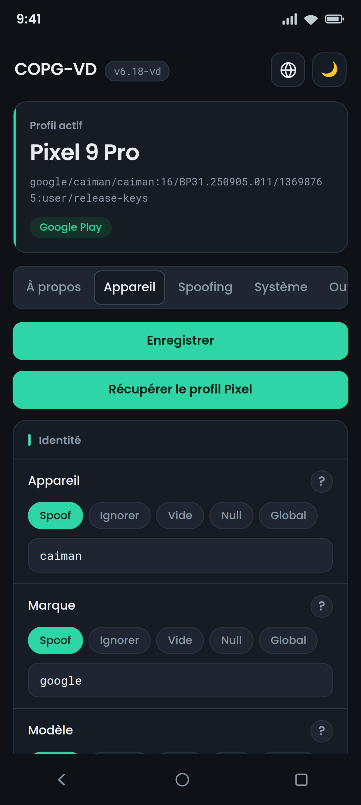
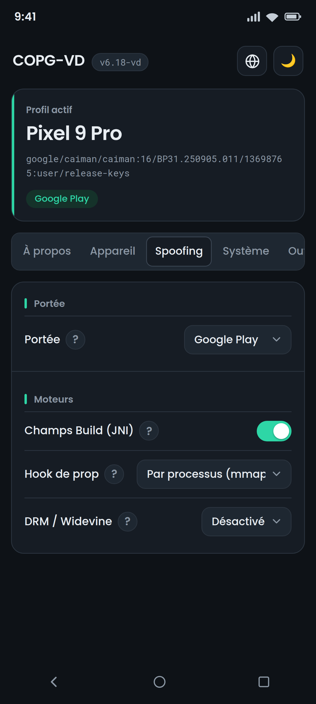
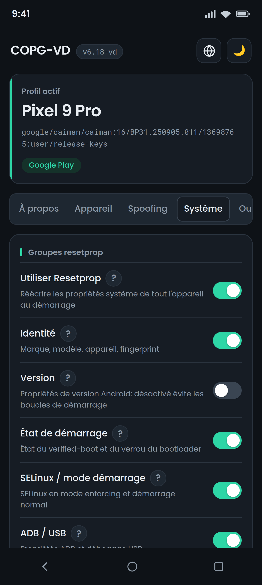
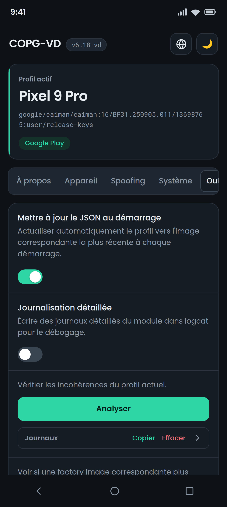

<!--
  ======================================================================
   COPG-VD  ::  global device spoofer
   Spoof your device fingerprint and build.

   Copyright (C) 2026  AlirezaParsi & VD171 (Fork by VD171)
   SPDX-License-Identifier: AGPL-3.0-or-later

   Licensed under the GNU AGPL v3.0 or later. You may obtain a copy at
   https://www.gnu.org/licenses/agpl-3.0.html

   Site           : https://vd171.ru
   Site           : https://vd.priv8.ru
   Source         : https://github.com/VD171/COPG-VD
   GitHub         : @VD171 https://github.com/VD171
   XDA-Developers : @VD171 https://xdaforums.com/m/vd171.4699873/
   XDA thread     : https://xdaforums.com/t/COPG-VD.4807698/
   Telegram       : @VD_Priv8 https://t.me/VD_Priv8
   Channel        : @Priv8_VD https://t.me/Priv8_VD
   Discord        : @VD.Priv8 https://discord.com/users/1296831918989639721
   E-mail         : vd.priv8@pm.me
  ======================================================================
-->

# COPG-VD

<p align="center">
  
</p>

<p align="center">
  <a href="https://github.com/VD171/COPG-VD/releases/latest"></a>
  <a href="LICENSE"></a>
  <a href="https://github.com/VD171/COPG-VD/releases"></a>
  <a href="https://github.com/VD171/COPG-VD/stargazers"></a>
</p>

<p align="center">
  <b>Un usurpateur d'appareil : il réécrit le fingerprint et le build de l'appareil pour que les applications voient l'appareil que vous choisissez au lieu du vrai.</b><br>
  Il fonctionne sur Zygisk (KernelSU, APatch ou Magisk) et, par défaut, limite la portée de l'usurpation à la pile Google Play: une alternative plus légère et plus robuste à PlayIntegrityFix.
</p>

<p align="center">
  <a href="https://github.com/VD171/COPG-VD/releases">Releases</a> ·
  <a href="https://github.com/VD171/COPG-VD/wiki/fr-Home">Wiki</a> ·
  <a href="https://github.com/VD171/COPG-VD/wiki/fr-USER-GUIDE">Guide de l'utilisateur</a> ·
  <a href="https://github.com/VD171/COPG-VD/wiki/fr-CONFIGURATION">Référence de configuration</a> ·
  <a href="https://github.com/VD171/COPG-VD/wiki/fr-ARCHITECTURE">Architecture</a> ·
  <a href="https://github.com/VD171/COPG-VD/wiki/fr-FILE-STRUCTURE">Structure des fichiers</a> ·
  <a href="https://github.com/VD171/COPG-VD/wiki/fr-AI-AGENTS">Agents IA</a> ·
  <a href="https://xdaforums.com/t/COPG-VD.4807698/">XDA thread</a>
</p>

> **Languages:** [English](README.md) · [العربية](README.ar.md) · [Čeština](README.cs.md) · [Deutsch](README.de.md) · [Español](README.es.md) · [فارسی](README.fa.md) · Français · [हिन्दी](README.hi.md) · [Bahasa Indonesia](README.id.md) · [Italiano](README.it.md) · [日本語](README.ja.md) · [한국어](README.ko.md) · [Nederlands](README.nl.md) · [Polski](README.pl.md) · [Português](README.pt.md) · [Русский](README.ru.md) · [Svenska](README.sv.md) · [ไทย](README.th.md) · [Türkçe](README.tr.md) · [Українська](README.uk.md) · [Tiếng Việt](README.vi.md) · [中文](README.zh.md)

<p align="center">
     
</p>

---

## Pourquoi

De plus en plus d'applications refusent de s'exécuter, ou se dégradent silencieusement, lorsque l'appareil qu'elles voient n'est pas un téléphone propre et certifié : Play Integrity, les niveaux DRM et les vérifications d'appareil propres à chaque application lisent tous le build fingerprint et les propriétés système. COPG-VD réécrit cette identité pour que les applications voient un Pixel cohérent (ou tout appareil que vous configurez) au lieu du vôtre. Avec un fingerprint fonctionnel, vous n'avez généralement besoin ni de PlayIntegrityFix ni de GooglePhotosUnlimited : c'est une alternative plus légère et plus robuste, et par défaut elle limite la portée de l'usurpation à la pile Google Play, de sorte que le reste de votre système est laissé intact.

## Fonctionnalités

- **Contrôle de la portée :** livrez l'identité usurpée uniquement à la pile Google Play (le défaut), à tout l'appareil, à une whitelist, ou à tout sauf une blacklist. Dans un mode à portée restreinte, Zygisk livre l'identité par processus, de sorte qu'elle ne fuit jamais par les propriétés globales.
- **Engines indépendants :** les champs Build (une réécriture JNI de `android.os.Build.*`), un property hook clean-room par processus (sans hook de fonction), un `resetprop` groupé, et un niveau DRM / Widevine optionnel (L1 ou L3) avec sa propre liste de cibles. Chacun peut être désactivé.
- **Contrôle par champ :** chaque champ Build peut être défini, vidé, supprimé ou ignoré, avec une liste `global_fields` pour les valeurs qui doivent rester cohérentes sur tout l'appareil.
- **Fingerprint toujours à jour :** un profil Pixel est livré dans la boîte et se rafraîchit une fois par démarrage à partir de la dernière image d'usine Google, vous pouvez aussi récupérer un autre profil Pixel depuis la WebUI. Il ne revient jamais en arrière et refuse un profil destiné à un autre appareil.
- **Politique de version d'Android sûre :** le SDK n'est jamais monté au-dessus de votre framework réel (le monter ne fait que provoquer un softloop du téléphone), sous toutes les politiques.
- **Analyze :** audite la config par rapport à votre ROM et à vos propriétés et signale toute incohérence avant qu'elle n'atteigne les applications.
- **WebUI :** cinq onglets pour tout piloter, sans aucune requête réseau, le fichier de configuration porte tous les réglages, de sorte qu'ils survivent à une mise à jour du module.
- **Mise à jour automatique incrémentale (VDLU)** et une bibliothèque native **quatre ABI** (arm64-v8a, armeabi-v7a, x86, x86_64).

## Agents IA

COPG-VD est scriptable sans interface : tout le module est piloté par un seul fichier JSON (`/data/adb/COPG-VD/COPG-VD.json`) et un unique point d'entrée shell, `fingerprint-update.sh`, avec des verbes stables (`check`, `apply`, `analyze`, `fetch-index`, `fetch <path>` et d'autres). Un agent s'exécutant en root peut lire et écrire la config et piloter chaque action que la WebUI permet, sans scraper la WebUI. Voir [docs/AI-AGENTS.md](docs/fr/AI-AGENTS.md). Les patches issus d'une IA sont tenus au même niveau de revue que tout autre.

## Installation

Flashez le zip dans KernelSU, APatch ou Magisk et redémarrez. Le profil Pixel livré est usurpé auprès des applications ciblées immédiatement. L'installateur exécute un contrôle d'intégrité `.sha256` et avorte sur un zip corrompu ou tronqué (et passe sans risque là où aucun outil de somme de contrôle n'est présent). Nécessite Zygisk, via KernelSU, APatch ou Magisk, et le root.

## Sécurité

L'usurpation est uniquement côté utilisateur : COPG-VD ne monte jamais le SDK au-dessus de votre framework réel, garde le fabricant cohérent avec le reste du profil, et lit la version réelle depuis `/system/build.prop`, jamais depuis les propriétés qu'il falsifie. Le programme d'auto-mise à jour exige une signature ed25519 valide et refuse les downgrades, la WebUI ne fait aucune requête réseau. Signalez les problèmes selon [SECURITY.md](docs/fr/SECURITY.md).

## Compilation

Toujours en release, jamais en debug. La bibliothèque native et le helper de portée sont compilés en CI pour les quatre ABI, le workflow de release assemble le zip flashable, écrit les compagnons `.sha256` par fichier, régénère la baseline VDLU signée et publie en tant que `github-actions[bot]`. Voir [CONTRIBUTING.md](docs/fr/CONTRIBUTING.md).

## Comment l'utiliser ?
Installez le module, redémarrez, et le profil livré (un Pixel) est usurpé auprès des applications ciblées. Avec un fingerprint fonctionnel, vous n'avez besoin ni de PlayIntegrityFix ni de GooglePhotosUnlimited.  
Tout se configure dans `/data/adb/COPG-VD/COPG-VD.json`, ou depuis la WebUI. Tous les champs sont OPTIONNELS: un champ qui n'est pas fourni est ignoré.  

### Scope: qui voit l'usurpation
`scope_mode` décide quels processus reçoivent l'identité usurpée. Dans un mode à portée restreinte, l'identité est livrée par processus par Zygisk et n'est pas divulguée au reste du système via les propriétés globales.  
* **Google Play** (`playstore`, par défaut): uniquement la pile Play (Google Play services, son processus unstable et le Play Store).  
* **Global**: tout l'appareil, chaque processus la voit.  
* **Whitelist**: uniquement les applications listées dans `scope_whitelist`.  
* **Blacklist**: toutes les applications sauf celles listées dans `scope_blacklist`.  

### Engines: comment l'usurpation est livrée
Chacun est indépendant et peut être désactivé :  
* **Build fields (JNI)**: réécrit `android.os.Build.*` dans les processus ciblés.  
* **Property hook**: présente les propriétés système usurpées aux processus ciblés (un remappage clean-room par processus de la zone des propriétés, sans hook de fonction).  
* **resetprop**: réécrit les propriétés système, géré par groupe : identité, version, état de boot, SELinux, adb/usb, anti-émulateur et une passe de nettoyage. Dans un mode à portée restreinte, les groupes identité et version restent en dehors du resetprop appliqué à tout l'appareil (Zygisk les livre par processus), les groupes boot/lock/SELinux restent globaux.  
* **DRM / Widevine** (désactivé par défaut): rapporte un niveau de sécurité Widevine choisi, L1 ou L3, aux applications qui le lisent. Par défaut, elle suit la portée ci-dessus, définissez `drm_targets` (une liste d'applications) pour appliquer l'usurpation DRM **uniquement** à ces applications, indépendamment de `scope_mode`: le module reste chargé dans une application listée juste pour le hook DRM, même lorsque cette application est en dehors de la portée principale. Vide ou absent signifie suivre la portée. (Nécessite un mode à portée restreinte, pas Global.)  

### Fields: définir, vider, supprimer ou ignorer
À l'intérieur de l'objet `COPG-VD`, chaque champ Build a quatre états :  
* **Set**: `"KEY": "value"` écrit la valeur.  
* **Empty**: `"KEY": ""` écrit une valeur vide.  
* **Delete**: listez la clé dans un `"COPG-VD-Delete": [ ... ]` de premier niveau pour la supprimer (un champ Build devient null, une propriété est supprimée avec `resetprop --delete`).  
* **Skip**: laissez la clé totalement de côté, la valeur propre de la ROM est conservée.  

Une liste `"global_fields": [ ... ]` applique les champs Build nommés à tout l'appareil même dans un mode à portée restreinte, afin de garder une valeur cohérente partout: uniquement pour les champs sûrs vis-à-vis de la cohérence (le security patch, par exemple), jamais l'identité et jamais le groupe de la version d'Android.  

### Exemple de fichier de configuration JSON
`/data/adb/COPG-VD/COPG-VD.json`
```json
{
  "Instructions": "Use strings on double-quotes only.",
  "Instructions": "All fields are OPTIONAL. If some field is not provided, it will be skipped.",
  "Strings extracted from": "https://dl.google.com/developers/android/CANARY/images/factory/tegu_beta-zp11.261016.008-factory-28d56d15.zip",
  "scope_mode": "playstore",
  "motor_drm": false,
  "drm_targets": [],
  "global_fields": ["SECURITY_PATCH"],
  "process_overrides": [],
  "COPG-VD": {
    "BRAND": "google",
    "DEVICE": "tegu",
    "MANUFACTURER": "Google",
    "MODEL": "Pixel 9a",
    "FINGERPRINT": "google/tegu_beta/tegu:CANARY/ZP11.261016.008/16754936:user/release-keys",
    "PRODUCT": "tegu_beta",
    "BOOTLOADER": "unknown",
    "BOARD": "tegu",
    "HARDWARE": "tegu",
    "DISPLAY": "ZP11.261016.008",
    "ID": "ZP11.261016.008",
    "HOST": "e4df75f83a59",
    "INCREMENTAL": "16754936",
    "TIMESTAMP": "1793211232",
    "PREVIEW_SDK": "20261104",
    "USER": "android-build",
    "SDK_FINGERPRINT": "ee82a872870173d77e68050e21a2bcbf",
    "UUID": "FjWvtSORkI0sEwekaPz2s30gqV5vWP_EZHFtBiXzboc",
    "SECURITY_PATCH": "2026-11-05",
    "FIRST_API_LEVEL": "35",
    "DRM_SECURITY_LEVEL": "L1"
  }
}
```
Veillez à n'utiliser que des chaînes entre guillemets doubles.  
Le bloc ci-dessus et `module/COPG-VD.json.example` sont actualisés quotidiennement par le workflow [Update COPG-VD.json](.github/workflows/update-json.yml), directement à partir de la dernière image d'usine Google.  

### Garder le fingerprint à jour
`fingerprint-update.sh` récupère ce fichier et met à jour votre configuration, depuis la WebUI (**Check Update** / **Update Now**) ou de lui-même **une fois par démarrage** (**Auto-update JSON on boot**, activé par défaut).  
* `/data/adb/COPG-VD/COPG-VD.json` est mis à jour sur place, et le contenu précédent est conservé à côté sous le nom `COPG-VD.json.bak`.  
* Seuls les champs de build sont réécrits (fingerprint, ID, incremental, timestamp, security patch, SDK, UUID, host, user). Tout le reste que vous avez personnalisé est préservé : clés supplémentaires, `scope_mode`, `BOOTLOADER`/`BOARD`/`HARDWARE`, autres objets, ordre des clés et formatage.  
* Cela ne revient jamais en arrière : un build amont plus ancien que celui installé est refusé. C'est normal (le dépôt peut rester en retard par rapport à une config que vous avez mise à jour à la main) et c'est aussi la protection qui compte le plus sur Android, où le seul téléchargeur disponible est le `wget` de busybox, qui ne peut pas valider les certificats TLS: chaque valeur est validée avant utilisation pour la même raison.  
* Si votre profil usurpe **un autre appareil** (`BRAND`/`DEVICE`/`MANUFACTURER`/`MODEL`/`PRODUCT` différents), rien n'est appliqué: un fingerprint Pixel sur un autre profil est pire qu'un fingerprint ancien.  
* Au démarrage, il s'exécute en arrière-plan et continue de réessayer pendant environ 10 minutes, car le wifi n'est généralement pas encore actif à la fin du démarrage. Il ne retarde jamais le démarrage.  
* `resetprop` est réappliqué juste après une mise à jour, mais `android.os.Build` est écrit par le module zygisk lorsque zygote démarre : **redémarrez** pour que les nouvelles valeurs atteignent les applications.  
* Journal dans `/data/adb/COPG-VD/update.log`.  

### Version d'Android: et pourquoi elle n'est pas usurpée
`ANDROID_VERSION`, `SDK_INT`, `SDK_FULL` et `CODENAME` décrivent **votre ROM**, pas l'appareil usurpé. Dire aux applications que le SDK est plus récent que le framework ne l'est réellement les fait appeler des API qui n'existent pas : les applications de Google plantent, le téléphone redémarre, et cela recommence. Le démarrage lui-même se termine, c'est donc une **softloop** et rien n'apparaît dans les journaux de démarrage.  
* Ils ne sont pas dans la config livrée et le programme de mise à jour ne les écrit jamais.  
* **Spoof Android version** dans la WebUI décide s'ils sont appliqués du tout :  
  * **Never** (par défaut): la version propre de la ROM est utilisée.  
  * **Up to this ROM**: seulement ce qui ne la dépasse pas, ce qui en pratique signifie abaisser le SDK.  
  * **Force**: force les autres champs de version exactement comme le demande la config, mais le SDK reste plafonné à la valeur de votre ROM même ici (monter le SDK au-dessus du framework réel ne fait que provoquer un softloop et n'a aucun usage légitime), donc depuis v6.19 **Force ne provoque plus de softloop**.  
* La version réelle est lue depuis `/system/build.prop`, jamais depuis `getprop`: c'est précisément ce que ce module falsifie.  

### Analyze
**Analyze** dans la WebUI (ou `fingerprint-update.sh analyze`) audite la config telle qu'elle est : la version par rapport à la ROM, si le fichier se parse toujours (un fichier cassé fait que le module n'usurpe **rien**, et seul logcat le signale), si le fingerprint concorde avec les champs qui l'entourent, les clés que le module ne lit pas, les dates, et si les props portent déjà ce que la config demande.  

### WebUI
La WebUI est optionnelle (tout peut être édité directement dans la config JSON) mais c'est le moyen facile de piloter le module. Elle comporte cinq onglets : **About**, **Device** (chaque champ, défini par état, groupé par catégorie), **Spoofing** (scope et engines), **System** (les groupes resetprop) et **Tools** (Analyze, Check Update, Update Now, Backup/Restore et l'auto-update au démarrage). Elle ne fait aucune requête réseau, tout ce dont elle a besoin est livré à l'intérieur du module.  
Si vous êtes un utilisateur de Magisk, utilisez KsuWebUI par KOW (https://github.com/KOWX712/KsuWebUIStandalone/releases). Vous pouvez aussi utiliser WebUI-X Portable par MMRL (https://github.com/MMRLApp/WebUI-X-Portable/releases) ou KsuWebUI-SN (https://github.com/dnascorpionofficial/KsuWebUI-SN/releases).  

### Réglages dans la config
`COPG-VD.json` porte ses réglages à côté du profil, de sorte que vos choix voyagent avec une sauvegarde et peuvent être édités à la main : `scope_mode`, les interrupteurs des engines, les groupes resetprop, `global_fields`, et un objet `COPG-VD-Settings` (`resetprop`, `autoupdate`, `spoof_version`). Tout réside dans ce seul fichier: les scripts de démarrage et la WebUI y lisent les réglages directement, de sorte que vos choix survivent à une mise à jour du module. `"spoof_version": "force"` est refusé depuis le fichier et rétrogradé : restaurer une ancienne sauvegarde ne doit pas le réarmer à votre insu.  

## Mises à jour incrémentielles (VDLU)

COPG-VD embarque le moteur **[VDLiveUpdate](https://github.com/VD171/VDLiveUpdate) (VDLU)** (intégré dans `module/vdlu/`) : le module se met à jour tout seul en ne récupérant que les fichiers modifiés (blobs adressés par contenu + un `manifest.json` signé), au lieu de retélécharger le `.zip` entier. Profil **Hardened** : la signature ed25519 est obligatoire et les downgrades sont bloqués, le `.zip` complet reste valide comme solution de repli.

- **`vdlu/`** (livré dans le zip) : `update.sh` (moteur) + `vdlu-verify` + `config.default` + `keyring/` (clé publique).
- **État** dans `/data/adb/COPG-VD/vdlu/` (config/journal/blobs/staged/rollback), hors du module, survit à un reflash.
- **Déclencheur au démarrage :** `post-fs-data.sh`, avant zygote, COPG-VD a `zygisk/*.so` + `sepolicy.rule` (REBOOT-hard), donc la nouvelle `.so` est préparée et échangée avant que zygote ne la mappe.
- **WebUI :** un panneau **Updates** (`webroot/vdlu.js`) avec une notification de progression et une annulation.
- **Publication :** voir `module/vdlu/RELEASE.md` (`vdlu-pack` + `vdlu-sign`, archive le manifest, `vdlu-gc` supprime les blobs orphelins, push Pages par lots).

<!-- vd-docs -->
## Documentation

- **[Wiki](https://github.com/VD171/COPG-VD/wiki/fr-Home)**: la documentation complète, consultable en ligne.
- **[Guide de l'utilisateur](https://github.com/VD171/COPG-VD/wiki/fr-USER-GUIDE)**: l'installation, la WebUI et l'usage au quotidien.
- **[Référence de configuration](https://github.com/VD171/COPG-VD/wiki/fr-CONFIGURATION)**: chaque paramètre du fichier de configuration et son rôle.
- **[Architecture](https://github.com/VD171/COPG-VD/wiki/fr-ARCHITECTURE)** et **[Structure des fichiers](https://github.com/VD171/COPG-VD/wiki/fr-FILE-STRUCTURE)**: comment fonctionne le spoofing et où tout se trouve.
- **[Agents IA](https://github.com/VD171/COPG-VD/wiki/fr-AI-AGENTS)** : pilotez la config et le programme de mise à jour sans interface.

<!-- /vd-docs -->

## Voir aussi

- **[VDBackup](https://github.com/VD171/VD-Backup)** : sauvegarde et restauration complètes des applications et des données en root, pilotées entièrement depuis une WebUI.
- **[VD-dropbear](https://github.com/VD171/VD-dropbear)** : un démon SSH autonome avec les droits root (Dropbear).
- **[VDGoogle](https://github.com/VD171/VD-Google)** : vos services Google (RCS, Wallet, attestations Play Integrity), lus sur votre appareil sans internet.
- **[VDInstaller](https://github.com/VD171/VD-Installer)** : un installateur sideload en root et sans friction pour les APK uniques, par lots et splittés, avec un interrupteur pour le vérificateur Play Protect et l'usurpation de la source d'installation.
- **[VDInfos](https://github.com/VD171/VD-Infos)** : un débogueur de méthodes de l'appareil qui lit chaque élément via toutes les méthodes capables de le lire et les compare côte à côte.
- **[VDLiveUpdate](https://github.com/VD171/VDLiveUpdate)** : un moteur d'auto-mise à jour incrémentale et sans flashage, intégré aux modules KernelSU/APatch/Magisk.
- **[VD-Modules](https://github.com/VD171/VD-Modules)** : notre dépôt de modules pour MMRL/WebUI-X (installez-les tous depuis votre gestionnaire root).
- **[@VictorGabriel7Dev/build.prop](https://github.com/VictorGabriel7Dev/build.prop)** : un jeu de données d'empreintes `build.prop` de Pixel (fork de @T3SL4).
- **[@VictorGabriel7Dev/mtproto-store](https://github.com/VictorGabriel7Dev/mtproto-store)** : utilisez Telegram comme stockage d'objets depuis un petit CLI en Go.

## Contacts

- https://vd171.ru
- https://vd.priv8.ru
- **Telegram:** @VD_Priv8 https://t.me/VD_Priv8
- **Channel:** @Priv8_VD https://t.me/Priv8_VD
- **Discord:** @VD.Priv8 https://discord.com/users/1296831918989639721
- **E-mail:** vd.priv8@pm.me
- **XDA-Developers:** @VD171 https://xdaforums.com/m/vd171.4699873/
- **XDA thread:** https://xdaforums.com/t/COPG-VD.4807698/
- **GitHub:** @VD171 https://github.com/VD171

## Licence

**AGPL-3.0-or-later**: voir [LICENSE](LICENSE). COPG-VD est un fork par VD171 du COPG original d'AlirezaParsi (Apache-2.0), relicencié sous GNU AGPL-3.0-or-later. COPYLEFT RÉSEAU: si vous exécutez une version modifiée, même en tant que service, vous devez en proposer les sources.

## Marques

COPG-VD est un projet indépendant et non officiel. Il n'est ni affilié à, ni approuvé par, ni sponsorisé par Google LLC. "Google", "Google Play", "Play Integrity", "Pixel", "Android" et les noms et logos associés sont des marques de Google LLC. COPG-VD s'exécute entièrement sur votre appareil.

## Tags

`Zygisk` `KernelSU` `APatch` `Magisk` `device-spoofing` `fingerprint` `PlayIntegrity` `Pixel` `build.prop` `resetprop` `root` `Android` `COPG-VD`

---

📣 **Rejoignez le canal pour les mises à jour :** @Priv8_VD https://t.me/Priv8_VD
