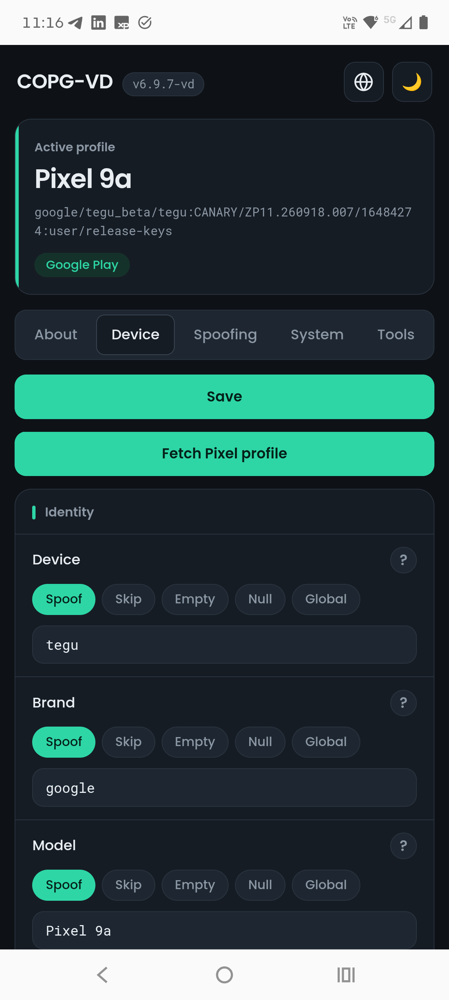
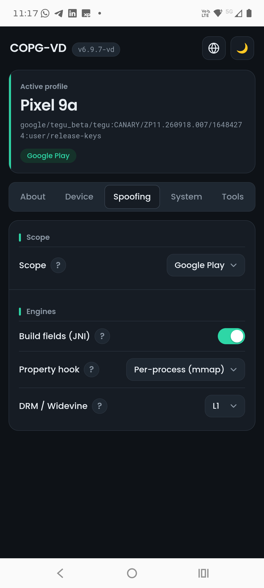
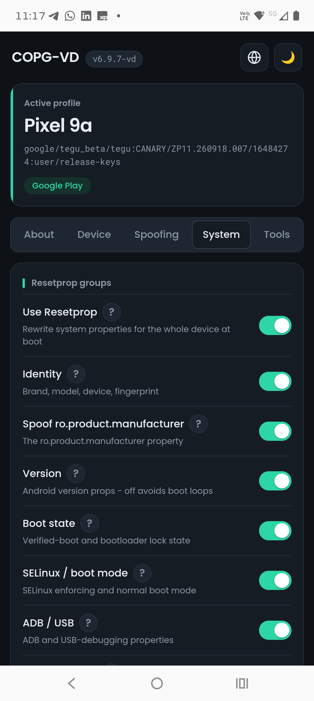
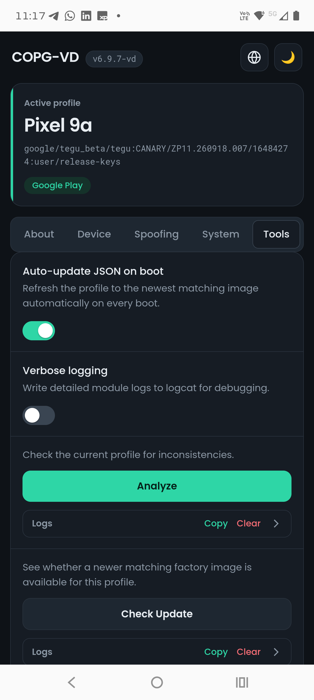

<!--
  COPG-VD: global device spoofer: spoof your device fingerprint and build.
  Copyright (C) 2026  AlirezaParsi & VD171. SPDX-License-Identifier: Apache-2.0 (Fork by VD171)
-->

# COPG-VD

<p align="center">
  
</p>

<p align="center">
  <a href="https://github.com/VD171/COPG-VD/releases/latest"></a>
  <a href="LICENSE"></a>
  <a href="https://github.com/VD171/COPG-VD/releases"></a>
  <a href="https://github.com/VD171/COPG-VD/stargazers"></a>
</p>

<p align="center">
  <b>COPG-VD adalah pengusur (spoofer) perangkat: ia menulis ulang fingerprint dan build perangkat sehingga aplikasi melihat perangkat yang Anda pilih alih-alih perangkat yang sebenarnya.</b><br>
  Ia berjalan di Zygisk (KernelSU, APatch, atau Magisk) dan, secara default, membatasi cakupan spoofing ke tumpukan Google Play: sehingga menjadi alternatif yang lebih ringan dan lebih tangguh dibandingkan PlayIntegrityFix.
</p>

<p align="center">
  <a href="https://github.com/VD171/COPG-VD/releases">Releases</a> ·
  <a href="https://github.com/VD171/COPG-VD/wiki/id-Home">Wiki</a> ·
  <a href="https://github.com/VD171/COPG-VD/wiki/id-USER-GUIDE">Panduan Pengguna</a> ·
  <a href="https://github.com/VD171/COPG-VD/wiki/id-CONFIGURATION">Referensi konfigurasi</a> ·
  <a href="https://github.com/VD171/COPG-VD/wiki/id-ARCHITECTURE">Arsitektur</a> ·
  <a href="https://github.com/VD171/COPG-VD/wiki/id-FILE-STRUCTURE">Struktur file</a> ·
  <a href="https://github.com/VD171/COPG-VD/wiki/id-AI-AGENTS">Agen AI</a> ·
  <a href="https://xdaforums.com/t/COPG-VD.4807698/">XDA thread</a>
</p>

> **Languages:** [English](README.md) · [العربية](README.ar.md) · [Čeština](README.cs.md) · [Deutsch](README.de.md) · [Español](README.es.md) · [فارسی](README.fa.md) · [Français](README.fr.md) · [हिन्दी](README.hi.md) · [Bahasa Indonesia](README.id.md) · [Italiano](README.it.md) · [日本語](README.ja.md) · [한국어](README.ko.md) · [Nederlands](README.nl.md) · [Polski](README.pl.md) · [Português](README.pt.md) · [Русский](README.ru.md) · [Svenska](README.sv.md) · [ไทย](README.th.md) · [Türkçe](README.tr.md) · [Українська](README.uk.md) · [Tiếng Việt](README.vi.md) · [中文](README.zh.md)

<p align="center">
     
</p>

---

## Mengapa

Semakin banyak aplikasi menolak berjalan, atau diam-diam menurunkan kualitas, ketika perangkat yang mereka lihat bukan ponsel yang bersih dan bersertifikat: Play Integrity, tingkat DRM, dan pemeriksaan perangkat khusus aplikasi semuanya membaca build fingerprint dan properti sistem. COPG-VD menulis ulang identitas itu sehingga aplikasi melihat Pixel yang koheren (atau perangkat apa pun yang Anda konfigurasikan) alih-alih perangkat asli Anda. Dengan fingerprint yang berfungsi, Anda biasanya tidak memerlukan PlayIntegrityFix atau GooglePhotosUnlimited: ini alternatif yang lebih ringan dan lebih tangguh, dan secara bawaan membatasi cakupan spoofing ke stack Google Play sehingga sisa sistem Anda dibiarkan apa adanya.

## Fitur

- **Kontrol cakupan:** kirimkan identitas palsu hanya ke stack Google Play (bawaan), ke seluruh perangkat, ke whitelist, atau ke semua kecuali blacklist. Dalam mode bercakupan, Zygisk mengirimkan identitas per proses, jadi tidak pernah bocor melalui properti global.
- **Engine independen:** field Build (penulisan ulang JNI dari `android.os.Build.*`), property hook clean-room per proses (tanpa function hook), `resetprop` berkelompok, dan tingkat DRM / Widevine opsional (L1 atau L3) dengan daftar targetnya sendiri. Masing-masing dapat dimatikan.
- **Kontrol per field:** setiap field Build dapat diatur, dikosongkan, dihapus, atau dilewati, dengan daftar `global_fields` untuk nilai yang harus tetap konsisten di seluruh perangkat.
- **Fingerprint selalu segar:** profil Pixel disertakan dalam paket dan menyegarkan dirinya sendiri sekali per boot dari citra pabrik Google terbaru; Anda juga dapat mengambil profil Pixel lain dari WebUI. Ia tidak pernah menurunkan versi dan menolak profil untuk perangkat yang berbeda.
- **Kebijakan versi Android yang aman:** SDK tidak pernah dinaikkan di atas framework asli Anda (menaikkannya hanya membuat ponsel softloop), di bawah setiap kebijakan.
- **Analyze:** mengaudit config terhadap ROM dan props Anda serta menandai apa pun yang tidak koheren sebelum mencapai aplikasi.
- **WebUI:** lima tab untuk mengendalikan semuanya, tanpa permintaan jaringan; file konfigurasi membawa semua pengaturan sehingga bertahan melewati pembaruan modul.
- **Pembaruan mandiri inkremental (VDLU)** dan pustaka native **empat ABI** (arm64-v8a, armeabi-v7a, x86, x86_64).

## Agen AI

COPG-VD dapat diskrip tanpa antarmuka: seluruh modul dikendalikan oleh satu file JSON (`/data/adb/COPG-VD/COPG-VD.json`) dan satu titik masuk shell tunggal, `fingerprint-update.sh`, dengan verb yang stabil (`check`, `apply`, `analyze`, `fetch-index`, `fetch <path>` dan lainnya). Agen yang berjalan sebagai root dapat membaca dan menulis config serta mengendalikan setiap aksi yang dapat dilakukan WebUI, tanpa scraping WebUI. Lihat [docs/AI-AGENTS.md](docs/id/AI-AGENTS.md). Patch dari AI ditahan pada standar tinjauan yang sama dengan yang lain.

## Instalasi

Flash zip di KernelSU, APatch, atau Magisk lalu reboot. Profil Pixel yang disertakan langsung dipalsukan ke aplikasi yang ditargetkan. Installer menjalankan gerbang integritas `.sha256` dan membatalkan pada zip yang rusak atau terpotong (dan melewati dengan aman di mana tidak ada alat checksum). Membutuhkan Zygisk, melalui KernelSU, APatch, atau Magisk, dan root.

## Keamanan

Spoofing hanya di sisi pengguna: COPG-VD tidak pernah menaikkan SDK di atas framework asli Anda, menjaga pabrikan tetap koheren dengan sisa profil, dan membaca versi asli dari `/system/build.prop`, tidak pernah dari properti yang dipalsukannya. Pembaru mandiri memerlukan tanda tangan ed25519 yang valid dan menolak downgrade; WebUI tidak membuat permintaan jaringan. Laporkan masalah sesuai [SECURITY.md](docs/id/SECURITY.md).

## Build

Selalu release, tidak pernah debug. Pustaka native dan helper cakupan dibangun di CI untuk keempat ABI; alur kerja release merakit zip yang dapat di-flash, menulis pendamping `.sha256` per file, meregenerasi baseline VDLU yang ditandatangani, dan menerbitkan sebagai `github-actions[bot]`. Lihat [CONTRIBUTING.md](docs/id/CONTRIBUTING.md).

## Cara menggunakannya?
Pasang modul, reboot, dan profil yang disertakan (sebuah Pixel) di-spoof ke aplikasi yang ditargetkan. Dengan fingerprint yang berfungsi, Anda tidak memerlukan PlayIntegrityFix atau GooglePhotosUnlimited.  
Semuanya dikonfigurasi di `/data/adb/COPG-VD/COPG-VD.json`, atau dari WebUI. Semua field bersifat OPSIONAL: field yang tidak disediakan akan dilewati.  

### Scope: siapa yang melihat spoofing
`scope_mode` menentukan proses mana yang mendapatkan identitas yang di-spoof. Dalam mode bercakupan terbatas, identitas dikirimkan per proses oleh Zygisk dan tidak bocor ke seluruh sistem lainnya melalui properti global.  
* **Google Play** (`playstore`, default): hanya tumpukan Play (Google Play services, proses unstable-nya, dan Play Store).  
* **Global**: seluruh perangkat; setiap proses melihatnya.  
* **Whitelist**: hanya aplikasi dalam `scope_whitelist`.  
* **Blacklist**: setiap aplikasi kecuali yang ada dalam `scope_blacklist`.  

### Engines: bagaimana spoofing dikirimkan
Masing-masing bersifat independen dan dapat dimatikan:  
* **Build fields (JNI)**: menulis ulang `android.os.Build.*` di proses yang ditargetkan.  
* **Property hook**: menyajikan properti sistem yang di-spoof ke proses yang ditargetkan (pemetaan ulang area properti per proses secara clean-room, tanpa hook fungsi).  
* **resetprop**: menulis ulang properti sistem, dikelola per grup: identitas, versi, keadaan boot, SELinux, adb/usb, anti-emulator, dan sebuah lintasan pembersihan. Dalam mode bercakupan terbatas, grup identitas dan versi tetap di luar resetprop yang berlaku untuk seluruh perangkat (Zygisk mengirimkannya per proses); grup boot/lock/SELinux tetap global.  
* **DRM / Widevine** (nonaktif secara default): melaporkan tingkat keamanan Widevine yang dipilih, L1 atau L3, ke aplikasi yang membacanya. Secara default ia mengikuti cakupan di atas; atur `drm_targets` (daftar aplikasi) untuk menerapkan spoof DRM **hanya** ke aplikasi tersebut, terlepas dari `scope_mode`: modul tetap dimuat dalam aplikasi yang terdaftar hanya untuk hook DRM, bahkan ketika aplikasi itu berada di luar cakupan utama. Kosong atau tidak ada berarti mengikuti cakupan. (Membutuhkan mode bercakupan terbatas, bukan Global.)  

### Fields: set, kosongkan, hapus, atau lewati
Di dalam objek `COPG-VD`, setiap field Build memiliki empat keadaan:  
* **Set**: `"KEY": "value"` menulis nilainya.  
* **Empty**: `"KEY": ""` menulis nilai kosong.  
* **Delete**: cantumkan kunci di dalam `"COPG-VD-Delete": [ ... ]` tingkat atas untuk menghapusnya (field Build menjadi null, properti dihapus dengan `resetprop --delete`).  
* **Skip**: biarkan kunci itu sepenuhnya tidak dicantumkan; nilai milik ROM sendiri yang dipertahankan.  

Daftar `"global_fields": [ ... ]` menerapkan field Build yang disebutkan ke seluruh perangkat bahkan dalam mode bercakupan terbatas, untuk menjaga sebuah nilai tetap konsisten di mana saja: hanya untuk field yang aman terhadap koherensi (security patch, misalnya), tidak pernah identitas dan tidak pernah grup versi Android.  

### Contoh file konfigurasi JSON
`/data/adb/COPG-VD/COPG-VD.json`
```json
{
  "Instructions": "Use strings on double-quotes only.",
  "Instructions": "All fields are OPTIONAL. If some field is not provided, it will be skipped.",
  "Strings extracted from": "https://dl.google.com/developers/android/CANARY/images/factory/tegu_beta-zp11.261016.008-factory-28d56d15.zip",
  "scope_mode": "playstore",
  "motor_drm": false,
  "drm_targets": [],
  "global_fields": ["SECURITY_PATCH"],
  "process_overrides": [],
  "COPG-VD": {
    "BRAND": "google",
    "DEVICE": "tegu",
    "MANUFACTURER": "Google",
    "MODEL": "Pixel 9a",
    "FINGERPRINT": "google/tegu_beta/tegu:CANARY/ZP11.261016.008/16754936:user/release-keys",
    "PRODUCT": "tegu_beta",
    "BOOTLOADER": "unknown",
    "BOARD": "tegu",
    "HARDWARE": "tegu",
    "DISPLAY": "ZP11.261016.008",
    "ID": "ZP11.261016.008",
    "HOST": "e4df75f83a59",
    "INCREMENTAL": "16754936",
    "TIMESTAMP": "1793211232",
    "PREVIEW_SDK": "20261104",
    "USER": "android-build",
    "SDK_FINGERPRINT": "ee82a872870173d77e68050e21a2bcbf",
    "UUID": "FjWvtSORkI0sEwekaPz2s30gqV5vWP_EZHFtBiXzboc",
    "SECURITY_PATCH": "2026-11-05",
    "FIRST_API_LEVEL": "35",
    "DRM_SECURITY_LEVEL": "L1"
  }
}
```
Pastikan untuk menggunakan string hanya dalam tanda kutip ganda.  
Blok di atas dan `module/COPG-VD.json.example` disegarkan setiap hari oleh workflow [Update COPG-VD.json](.github/workflows/update-json.yml), langsung dari image pabrik Google terbaru.  

### Menjaga fingerprint tetap baru
`fingerprint-update.sh` menarik file tersebut dan memperbarui konfigurasi Anda, dari WebUI (**Check Update** / **Update Now**) atau dengan sendirinya **sekali per boot** (**Auto-update JSON on boot**, aktif secara default).  
* `/data/adb/COPG-VD/COPG-VD.json` diperbarui di tempat, dan konten sebelumnya disimpan di sampingnya sebagai `COPG-VD.json.bak`.  
* Hanya field build yang ditulis ulang (fingerprint, ID, incremental, timestamp, security patch, SDK, UUID, host, user). Semua yang lain yang Anda sesuaikan tetap dipertahankan: kunci tambahan, `scope_mode`, `BOOTLOADER`/`BOARD`/`HARDWARE`, objek lain, urutan kunci, dan pemformatan.  
* Ini tidak pernah mundur: build hulu yang lebih lama daripada yang terpasang akan ditolak. Ini hal biasa (repo bisa tertinggal di belakang konfigurasi yang Anda perbarui secara manual) dan ini juga merupakan penjaga yang paling penting di Android, di mana satu-satunya pengunduh yang tersedia adalah `wget` busybox, yang tidak dapat memvalidasi sertifikat TLS: setiap nilai divalidasi sebelum digunakan dengan alasan yang sama.  
* Jika profil Anda melakukan spoofing **perangkat lain** (`BRAND`/`DEVICE`/`MANUFACTURER`/`MODEL`/`PRODUCT` yang berbeda), tidak ada yang diterapkan: fingerprint Pixel pada profil lain lebih buruk daripada fingerprint yang lama.  
* Saat boot, ia berjalan di latar belakang dan terus mencoba lagi selama sekitar 10 menit, karena wifi biasanya belum aktif ketika boot selesai. Ia tidak pernah menunda boot.  
* `resetprop` diterapkan kembali segera setelah pembaruan, tetapi `android.os.Build` ditulis oleh modul zygisk saat zygote dimulai: **reboot** agar nilai-nilai baru sampai ke aplikasi.  
* Log di `/data/adb/COPG-VD/update.log`.  

### Versi Android: dan mengapa tidak di-spoof
`ANDROID_VERSION`, `SDK_INT`, `SDK_FULL`, dan `CODENAME` menggambarkan **ROM Anda**, bukan perangkat yang sedang di-spoof. Memberi tahu aplikasi bahwa SDK lebih baru daripada framework yang sebenarnya membuat mereka memanggil API yang tidak ada: aplikasi Google crash, ponsel reboot, dan mulai dari awal lagi. Boot itu sendiri selesai, jadi ini adalah **softloop** dan tidak ada yang muncul di log boot.  
* Mereka tidak ada dalam konfigurasi yang dikirim dan pembaru tidak pernah menulisnya.  
* **Spoof Android version** di WebUI menentukan apakah mereka diterapkan sama sekali:  
  * **Never** (default): versi milik ROM sendiri yang digunakan.  
  * **Up to this ROM**: hanya yang tidak melebihinya, yang dalam praktiknya berarti menurunkan SDK.  
  * **Force**: memaksa field versi lainnya persis seperti yang diminta konfigurasi, tetapi SDK tetap dibatasi pada nilai ROM Anda bahkan di sini (menaikkan SDK di atas framework sebenarnya hanya menyebabkan softloop dan tidak memiliki kegunaan yang sah), jadi sejak v6.19 **Force tidak lagi menyebabkan softloop**.  
* Versi sebenarnya dibaca dari `/system/build.prop`, tidak pernah dari `getprop`: itulah justru hal yang dipalsukan oleh modul ini.  

### Analyze
**Analyze** di WebUI (atau `fingerprint-update.sh analyze`) mengaudit konfigurasi apa adanya: versi terhadap ROM, apakah file masih dapat diurai sama sekali (file yang rusak membuat modul tidak spoofing **apa pun**, dan hanya logcat yang mengatakannya), apakah fingerprint sesuai dengan field di sekitarnya, kunci-kunci yang tidak dibaca modul, tanggal, dan apakah props sudah membawa apa yang diminta konfigurasi.  

### WebUI
WebUI bersifat opsional (semuanya dapat diedit langsung di konfigurasi JSON) tetapi inilah cara mudah untuk mengendalikan modul. Ia memiliki lima tab: **About**, **Device** (setiap field, diatur per keadaan, dikelompokkan berdasarkan kategori), **Spoofing** (scope dan engines), **System** (grup-grup resetprop), dan **Tools** (Analyze, Check Update, Update Now, Backup/Restore, dan auto-update saat boot). Ia tidak membuat permintaan jaringan sama sekali; semua yang dibutuhkannya disertakan di dalam modul.  
Jika Anda pengguna Magisk, gunakan KsuWebUI oleh KOW (https://github.com/KOWX712/KsuWebUIStandalone/releases). Anda juga dapat menggunakan WebUI-X Portable oleh MMRL (https://github.com/MMRLApp/WebUI-X-Portable/releases) atau KsuWebUI-SN (https://github.com/dnascorpionofficial/KsuWebUI-SN/releases).  

### Pengaturan dalam konfigurasi
`COPG-VD.json` membawa pengaturannya di samping profil, sehingga pilihan Anda ikut bersama cadangan dan dapat diedit secara manual: `scope_mode`, sakelar-sakelar engine, grup-grup resetprop, `global_fields`, dan sebuah objek `COPG-VD-Settings` (`resetprop`, `autoupdate`, `spoof_version`). Semuanya berada di satu file ini: skrip boot dan WebUI membaca pengaturan langsung darinya, sehingga pilihan Anda bertahan melewati pembaruan modul. `"spoof_version": "force"` ditolak dari file dan diturunkan: memulihkan cadangan lama tidak boleh mengaktifkannya kembali tanpa sepengetahuan Anda.  

<!-- vd-docs -->
## Dokumentasi

- **[Wiki](https://github.com/VD171/COPG-VD/wiki/id-Home)**: dokumentasi lengkap, dapat dibaca online.
- **[Panduan Pengguna](https://github.com/VD171/COPG-VD/wiki/id-USER-GUIDE)**: cara memasang, WebUI, dan penggunaan sehari-hari.
- **[Referensi konfigurasi](https://github.com/VD171/COPG-VD/wiki/id-CONFIGURATION)**: setiap pengaturan di berkas konfigurasi dan fungsinya.
- **[Arsitektur](https://github.com/VD171/COPG-VD/wiki/id-ARCHITECTURE)** dan **[Struktur file](https://github.com/VD171/COPG-VD/wiki/id-FILE-STRUCTURE)**: cara kerja spoofing dan lokasi semua berkas.
- **[Agen AI](https://github.com/VD171/COPG-VD/wiki/id-AI-AGENTS)**: kendalikan config dan updater tanpa antarmuka.

<!-- /vd-docs -->

## Pembaruan inkremental (VDLU)

COPG-VD menyertakan mesin **[VDLiveUpdate](https://github.com/VD171/VDLiveUpdate) (VDLU)** (di-vendor di `module/vdlu/`): modul memperbarui dirinya sendiri dengan hanya mengambil berkas yang berubah (blob beralamat konten + `manifest.json` yang ditandatangani), alih-alih mengunduh ulang seluruh `.zip`. Profil **Hardened**: tanda tangan ed25519 wajib dan downgrade diblokir; `.zip` lengkap tetap valid sebagai cadangan.

- **`vdlu/`** (disertakan dalam zip): `update.sh` (mesin) + `vdlu-verify` + `config.default` + `keyring/` (kunci publik).
- **Status** di `/data/adb/COPG-VD/vdlu/` (config/journal/blobs/staged/rollback) - di luar modul, bertahan setelah flash ulang.
- **Pemicu boot:** `post-fs-data.sh`, sebelum zygote - COPG-VD memiliki `zygisk/*.so` + `sepolicy.rule` (REBOOT-hard), sehingga `.so` baru disiapkan dan ditukar sebelum zygote memetakannya.
- **WebUI:** panel **Updates** (`webroot/vdlu.js`) dengan toast progres dan pembatalan.
- **Rilis:** lihat `module/vdlu/RELEASE.md` (`vdlu-pack` + `vdlu-sign`, arsipkan manifest, `vdlu-gc` memangkas blob yatim, push Pages secara batch).

## Lihat juga

- **[VDBackup](https://github.com/VD171/VD-Backup)**: backup dan pemulihan penuh aplikasi dan data sebagai root, dikendalikan sepenuhnya dari sebuah WebUI.
- **[VD-dropbear](https://github.com/VD171/VD-dropbear)**: daemon SSH mandiri dengan akses root (Dropbear).
- **[VDGoogle](https://github.com/VD171/VD-Google)**: layanan Google Anda (RCS, Wallet, atestasi Play Integrity), dibaca di perangkat Anda tanpa internet.
- **[VDInstaller](https://github.com/VD171/VD-Installer)**: sebuah pemasang sideload ber-root tanpa hambatan untuk APK tunggal, batch, dan split, dengan sakelar verifier Play Protect dan pemalsuan sumber pemasangan.
- **[VDInfos](https://github.com/VD171/VD-Infos)**: sebuah debugger metode perangkat yang membaca setiap item melalui setiap metode yang dapat membacanya dan membandingkannya secara berdampingan.
- **[VDLiveUpdate](https://github.com/VD171/VDLiveUpdate)**: sebuah mesin pembaruan-mandiri inkremental tanpa flash, tertanam di dalam modul KernelSU/APatch/Magisk.
- **[VD-Modules](https://github.com/VD171/VD-Modules)**: repositori modul kami untuk MMRL/WebUI-X (pasang semuanya dari manajer root Anda).
- **[@VictorGabriel7Dev/build.prop](https://github.com/VictorGabriel7Dev/build.prop)**: sebuah kumpulan data fingerprint `build.prop` Pixel (fork dari @T3SL4).
- **[@VictorGabriel7Dev/mtproto-store](https://github.com/VictorGabriel7Dev/mtproto-store)**: gunakan Telegram sebagai penyimpanan objek dari CLI Go yang mungil.

## Kontak

- Site           : https://vd171.ru
- Site           : https://vd.priv8.ru
- Source         : https://github.com/VD171/COPG-VD
- GitHub         : [@VD171](https://github.com/VD171)
- XDA-Developers : [@VD171](https://xdaforums.com/m/vd171.4699873/)
- XDA thread     : [COPG-VD](https://xdaforums.com/t/COPG-VD.4807698/)
- Telegram       : [@VD_Priv8](https://t.me/VD_Priv8)
- Channel        : [@Priv8_VD](https://t.me/Priv8_VD)
- Discord        : [@VD.Priv8](https://discord.com/users/1296831918989639721)
- E-mail         : vd.priv8@pm.me

## Lisensi

**Apache-2.0**: lihat [LICENSE](LICENSE). COPG-VD adalah fork oleh VD171 dari COPG asli karya AlirezaParsi, dilanjutkan di bawah lisensi yang sama.

## Merek Dagang

COPG-VD adalah proyek independen dan tidak resmi. Proyek ini tidak berafiliasi dengan, didukung oleh, atau disponsori oleh Google LLC. "Google", "Google Play", "Play Integrity", "Pixel", "Android" serta nama dan logo terkait adalah merek dagang dari Google LLC. COPG-VD berjalan sepenuhnya di perangkat Anda.

## Tags

`Zygisk` `KernelSU` `APatch` `Magisk` `device-spoofing` `fingerprint` `PlayIntegrity` `Pixel` `build.prop` `resetprop` `root` `Android` `COPG-VD`
