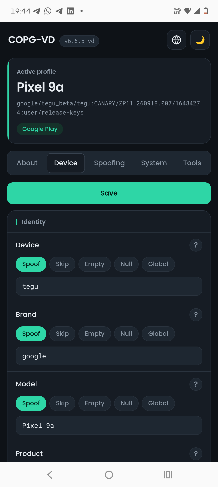
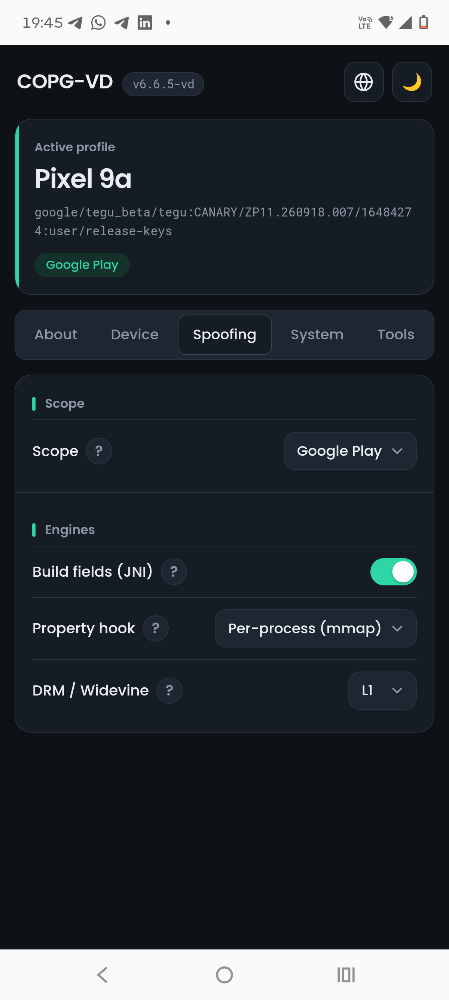
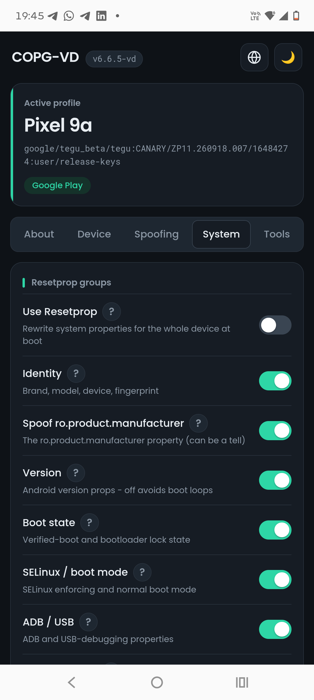
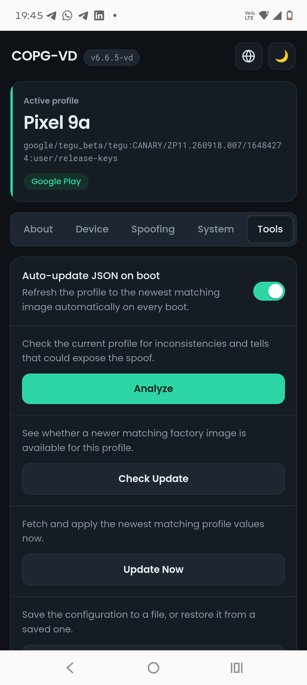

## COPG-VD

[English](README.md) · [العربية](README.ar.md) · [Čeština](README.cs.md) · [Deutsch](README.de.md) · [Español](README.es.md) · [فارسی](README.fa.md) · [Français](README.fr.md) · [हिन्दी](README.hi.md) · [Bahasa Indonesia](README.in.md) · [Italiano](README.it.md) · [日本語](README.ja.md) · [한국어](README.ko.md) · [Nederlands](README.nl.md) · [Polski](README.pl.md) · [Português](README.pt.md) · [Русский](README.ru.md) · [Svenska](README.sv.md) · [ไทย](README.th.md) · [Türkçe](README.tr.md) · [Tiếng Việt](README.vi.md) · [中文](README.zh.md)

COPG-VD adalah pengusur (spoofer) perangkat: ia menulis ulang fingerprint dan build perangkat sehingga aplikasi melihat perangkat yang Anda pilih alih-alih perangkat yang sebenarnya.  
Ia berjalan di Zygisk (KernelSU, APatch, atau Magisk) dan, secara default, membatasi cakupan spoofing ke tumpukan Google Play - sehingga menjadi alternatif yang lebih ringan dan lebih tangguh dibandingkan PlayIntegrityFix.  

## Tangkapan layar

<p align="center">
     
</p>

## Cara menggunakannya?
Pasang modul, reboot, dan profil yang disertakan (sebuah Pixel) di-spoof ke aplikasi yang ditargetkan. Dengan fingerprint yang berfungsi, Anda tidak memerlukan PlayIntegrityFix atau GooglePhotosUnlimited.  
Semuanya dikonfigurasi di `/data/adb/COPG-VD.json`, atau dari WebUI. Semua field bersifat OPSIONAL - field yang tidak disediakan akan dilewati.  

### Scope - siapa yang melihat spoofing
`scope_mode` menentukan proses mana yang mendapatkan identitas yang di-spoof. Dalam mode bercakupan terbatas, identitas dikirimkan per proses oleh Zygisk dan tidak bocor ke seluruh sistem lainnya melalui properti global.  
* **Google Play** (`playstore`, default) - hanya tumpukan Play (Google Play services, proses unstable-nya, dan Play Store).  
* **Global** - seluruh perangkat; setiap proses melihatnya.  
* **Whitelist** - hanya aplikasi dalam `scope_whitelist`.  
* **Blacklist** - setiap aplikasi kecuali yang ada dalam `scope_blacklist`.  

### Engines - bagaimana spoofing dikirimkan
Masing-masing bersifat independen dan dapat dimatikan:  
* **Build fields (JNI)** - menulis ulang `android.os.Build.*` di proses yang ditargetkan.  
* **Property hook** - menyajikan properti sistem yang di-spoof ke proses yang ditargetkan (pemetaan ulang area properti per proses secara clean-room, tanpa hook fungsi).  
* **resetprop** - menulis ulang properti sistem, dikelola per grup: identitas, versi, keadaan boot, SELinux, adb/usb, anti-emulator, dan sebuah lintasan pembersihan. Dalam mode bercakupan terbatas, grup identitas dan versi tetap di luar resetprop yang berlaku untuk seluruh perangkat (Zygisk mengirimkannya per proses); grup boot/lock/SELinux tetap global.  
* **DRM / Widevine** (nonaktif secara default) - melaporkan tingkat keamanan Widevine yang dipilih, L1 atau L3, ke aplikasi yang membacanya.  

### Fields - set, kosongkan, hapus, atau lewati
Di dalam objek `COPG-VD`, setiap field Build memiliki empat keadaan:  
* **Set** - `"KEY": "value"` menulis nilainya.  
* **Empty** - `"KEY": ""` menulis nilai kosong.  
* **Delete** - cantumkan kunci di dalam `"COPG-VD-Delete": [ ... ]` tingkat atas untuk menghapusnya (field Build menjadi null, properti dihapus dengan `resetprop --delete`).  
* **Skip** - biarkan kunci itu sepenuhnya tidak dicantumkan; nilai milik ROM sendiri yang dipertahankan.  

Daftar `"global_fields": [ ... ]` menerapkan field Build yang disebutkan ke seluruh perangkat bahkan dalam mode bercakupan terbatas, untuk menjaga sebuah nilai tetap konsisten di mana saja - hanya untuk field yang aman terhadap koherensi (security patch, misalnya), tidak pernah identitas dan tidak pernah grup versi Android.  

### Contoh file konfigurasi JSON
`/data/adb/COPG-VD.json`
```json
{
  "Instructions": "Use strings on double-quotes only.",
  "Instructions": "All fields are OPTIONAL. If some field is not provided, it will be skipped.",
  "Strings extracted from": "https://dl.google.com/developers/android/CANARY/images/factory/tegu_beta-zp11.260918.007-factory-f5955275.zip",
  "scope_mode": "playstore",
  "COPG-VD": {
    "BRAND": "google",
    "DEVICE": "tegu",
    "MANUFACTURER": "Google",
    "MODEL": "Pixel 9a",
    "FINGERPRINT": "google/tegu_beta/tegu:CANARY/ZP11.260918.007/16484274:user/release-keys",
    "PRODUCT": "tegu_beta",
    "BOOTLOADER": "unknown",
    "BOARD": "tegu",
    "HARDWARE": "tegu",
    "DISPLAY": "ZP11.260918.007",
    "ID": "ZP11.260918.007",
    "HOST": "51b22e6d8afb",
    "INCREMENTAL": "16484274",
    "TIMESTAMP": "1790806751",
    "PREVIEW_SDK": "20261007",
    "USER": "android-build",
    "SDK_FINGERPRINT": "d9ad4b00fa641d6e43c42cc969f49492",
    "UUID": "_mQOcxvuFzRVZAjNEr2UUUpk2fv0mqDc8RpFyaeJjuk",
    "SECURITY_PATCH": "2026-10-05",
    "FIRST_API_LEVEL": "35",
    "DRM_SECURITY_LEVEL": "L1"
  },
  "motor_drm": false,
  "global_fields": ["SECURITY_PATCH"]
}
```
Pastikan untuk menggunakan string hanya dalam tanda kutip ganda.  
Blok di atas dan `module/COPG-VD.json.example` disegarkan setiap hari oleh workflow [Update COPG-VD.json](.github/workflows/update-json.yml), langsung dari image pabrik Google terbaru.  

### Menjaga fingerprint tetap baru
`fingerprint-update.sh` menarik file tersebut dan memperbarui konfigurasi Anda, dari WebUI (**Check Update** / **Update Now**) atau dengan sendirinya **sekali per boot** (**Auto-update JSON on boot**, aktif secara default).  
* Baik `/data/adb/COPG-VD.json` maupun `/data/adb/modules/COPG-VD/COPG-VD.json` diperbarui ketika keduanya ada, dan konten sebelumnya disimpan sebagai `.bak`.  
* Hanya field build yang ditulis ulang (fingerprint, ID, incremental, timestamp, security patch, SDK, UUID, host, user). Semua yang lain yang Anda sesuaikan tetap dipertahankan: kunci tambahan, `scope_mode`, `BOOTLOADER`/`BOARD`/`HARDWARE`, objek lain, urutan kunci, dan pemformatan.  
* Ini tidak pernah mundur: build hulu yang lebih lama daripada yang terpasang akan ditolak. Ini hal biasa (repo bisa tertinggal di belakang konfigurasi yang Anda perbarui secara manual) dan ini juga merupakan penjaga yang paling penting di Android, di mana satu-satunya pengunduh yang tersedia adalah `wget` busybox, yang tidak dapat memvalidasi sertifikat TLS - setiap nilai divalidasi sebelum digunakan dengan alasan yang sama.  
* Jika profil Anda melakukan spoofing **perangkat lain** (`BRAND`/`DEVICE`/`MANUFACTURER`/`MODEL`/`PRODUCT` yang berbeda), tidak ada yang diterapkan - fingerprint Pixel pada profil lain lebih buruk daripada fingerprint yang lama.  
* Saat boot, ia berjalan di latar belakang dan terus mencoba lagi selama sekitar 10 menit, karena wifi biasanya belum aktif ketika boot selesai. Ia tidak pernah menunda boot.  
* `resetprop` diterapkan kembali segera setelah pembaruan, tetapi `android.os.Build` ditulis oleh modul zygisk saat zygote dimulai: **reboot** agar nilai-nilai baru sampai ke aplikasi.  
* Log di `/data/adb/COPG-VD.update.log`.  

### Versi Android - dan mengapa tidak di-spoof
`ANDROID_VERSION`, `SDK_INT`, `SDK_FULL`, dan `CODENAME` menggambarkan **ROM Anda**, bukan perangkat yang sedang di-spoof. Memberi tahu aplikasi bahwa SDK lebih baru daripada framework yang sebenarnya membuat mereka memanggil API yang tidak ada: aplikasi Google crash, ponsel reboot, dan mulai dari awal lagi. Boot itu sendiri selesai, jadi ini adalah **softloop** dan tidak ada yang muncul di log boot.  
* Mereka tidak ada dalam konfigurasi yang dikirim dan pembaru tidak pernah menulisnya.  
* **Spoof Android version** di WebUI menentukan apakah mereka diterapkan sama sekali:  
  * **Never** (default) - versi milik ROM sendiri yang digunakan.  
  * **Up to this ROM** - hanya yang tidak melebihinya, yang dalam praktiknya berarti menurunkan SDK.  
  * **Force** - persis seperti yang dikatakan konfigurasi. Inilah yang menyebabkan softloop.  
* Versi sebenarnya dibaca dari `/system/build.prop`, tidak pernah dari `getprop` - itulah justru hal yang dipalsukan oleh modul ini.  

### Analyze
**Analyze** di WebUI (atau `fingerprint-update.sh analyze`) mengaudit konfigurasi apa adanya: versi terhadap ROM, apakah file masih dapat diurai sama sekali (file yang rusak membuat modul tidak spoofing **apa pun**, dan hanya logcat yang mengatakannya), apakah fingerprint sesuai dengan field di sekitarnya, kunci-kunci yang tidak dibaca modul, tanggal, dan apakah props sudah membawa apa yang diminta konfigurasi.  

### WebUI
WebUI bersifat opsional - semuanya dapat diedit langsung di konfigurasi JSON - tetapi inilah cara mudah untuk mengendalikan modul. Ia memiliki lima tab: **About**, **Device** (setiap field, diatur per keadaan, dikelompokkan berdasarkan kategori), **Spoofing** (scope dan engines), **System** (grup-grup resetprop), dan **Tools** (Analyze, Check Update, Update Now, Backup/Restore, dan auto-update saat boot). Ia tidak membuat permintaan jaringan sama sekali; semua yang dibutuhkannya disertakan di dalam modul.  
Jika Anda pengguna Magisk, gunakan KsuWebUI oleh KOW (https://github.com/KOWX712/KsuWebUIStandalone/releases).  

### Pengaturan dalam konfigurasi
`COPG-VD.json` membawa pengaturannya di samping profil, sehingga pilihan Anda ikut bersama cadangan dan dapat diedit secara manual: `scope_mode`, sakelar-sakelar engine, grup-grup resetprop, `global_fields`, dan sebuah objek `COPG-VD-Settings` (`resetprop`, `autoupdate`, `spoof_manufacturer`, `spoof_version`). WebUI menulis keduanya, konfigurasi dan file flag yang dibaca skrip boot. `"spoof_version": "force"` ditolak dari file dan diturunkan: memulihkan cadangan lama tidak boleh mengaktifkannya kembali tanpa sepengetahuan Anda.  

## Kontak

* https://vd171.ru
* https://vd.priv8.ru
* **Telegram:** @VD_Priv8 https://t.me/VD_Priv8
* **Discord:** @VD.Priv8 https://discord.com/users/1296831918989639721
* **E-mail:** vd.priv8@pm.me
* **XDA-Developers:** @VD171 https://xdaforums.com/m/vd171.4699873/
* **GitHub:** @VD171 https://github.com/VD171

---

**Tags:** `Zygisk` `KernelSU` `APatch` `Magisk` `device-spoofing` `fingerprint` `PlayIntegrity` `Pixel` `build.prop` `resetprop` `root` `Android` `COPG` `COPG-VD`
