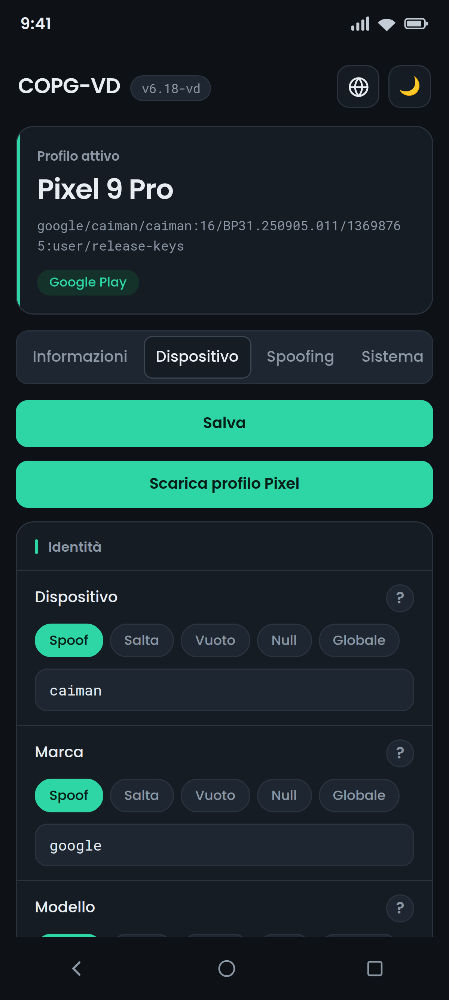
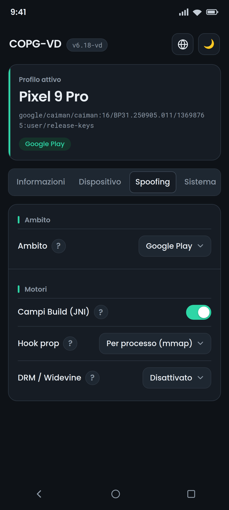
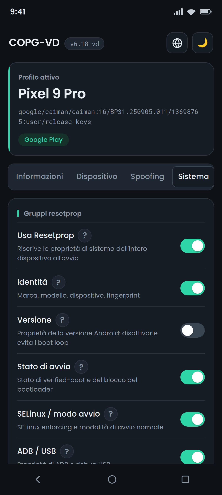
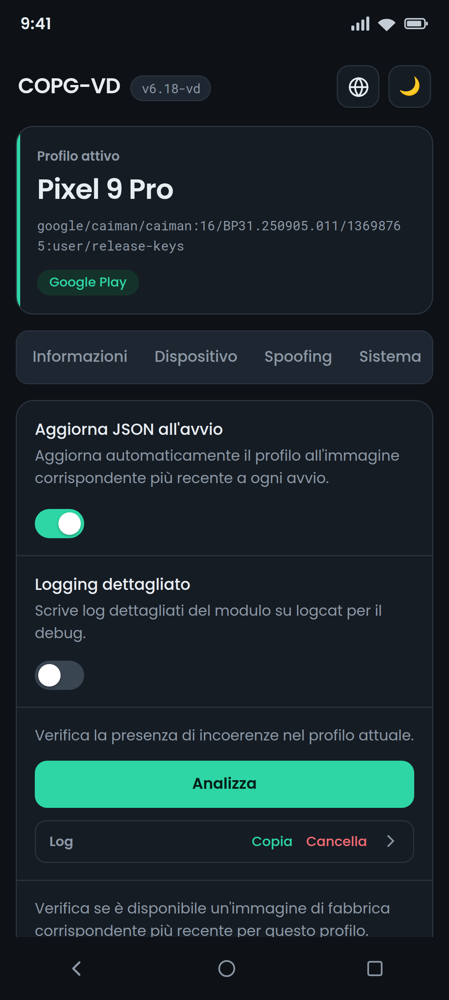

<!--
  ======================================================================
   COPG-VD  ::  global device spoofer
   Spoof your device fingerprint and build.

   Copyright (C) 2026  AlirezaParsi & VD171 (Fork by VD171)
   SPDX-License-Identifier: AGPL-3.0-or-later

   Licensed under the GNU AGPL v3.0 or later. You may obtain a copy at
   https://www.gnu.org/licenses/agpl-3.0.html

   Site           : https://vd171.ru
   Site           : https://vd.priv8.ru
   Source         : https://github.com/VD171/COPG-VD
   GitHub         : @VD171 https://github.com/VD171
   XDA-Developers : @VD171 https://xdaforums.com/m/vd171.4699873/
   XDA thread     : https://xdaforums.com/t/COPG-VD.4807698/
   Telegram       : @VD_Priv8 https://t.me/VD_Priv8
   Channel        : @Priv8_VD https://t.me/Priv8_VD
   Discord        : @VD.Priv8 https://discord.com/users/1296831918989639721
   E-mail         : vd.priv8@pm.me
  ======================================================================
-->

# COPG-VD

<p align="center">
  
</p>

<p align="center">
  <a href="https://github.com/VD171/COPG-VD/releases/latest"></a>
  <a href="LICENSE"></a>
  <a href="https://github.com/VD171/COPG-VD/releases"></a>
  <a href="https://github.com/VD171/COPG-VD/stargazers"></a>
</p>

<p align="center">
  <b>COPG-VD è uno spoofer di dispositivo: riscrive il fingerprint e la build del dispositivo in modo che le app vedano il dispositivo che scegli invece di quello reale.</b><br>
  Funziona su Zygisk (KernelSU, APatch o Magisk) e, per impostazione predefinita, limita lo spoof allo stack di Google Play: quindi è un'alternativa più leggera e più robusta a PlayIntegrityFix.
</p>

<p align="center">
  <a href="https://github.com/VD171/COPG-VD/releases">Releases</a> ·
  <a href="https://github.com/VD171/COPG-VD/wiki/it-Home">Wiki</a> ·
  <a href="https://github.com/VD171/COPG-VD/wiki/it-USER-GUIDE">Guida utente</a> ·
  <a href="https://github.com/VD171/COPG-VD/wiki/it-CONFIGURATION">Riferimento di configurazione</a> ·
  <a href="https://github.com/VD171/COPG-VD/wiki/it-ARCHITECTURE">Architettura</a> ·
  <a href="https://github.com/VD171/COPG-VD/wiki/it-FILE-STRUCTURE">Struttura dei file</a> ·
  <a href="https://github.com/VD171/COPG-VD/wiki/it-AI-AGENTS">Agenti IA</a> ·
  <a href="https://xdaforums.com/t/COPG-VD.4807698/">XDA thread</a>
</p>

> **Languages:** [English](README.md) · [العربية](README.ar.md) · [Čeština](README.cs.md) · [Deutsch](README.de.md) · [Español](README.es.md) · [فارسی](README.fa.md) · [Français](README.fr.md) · [हिन्दी](README.hi.md) · [Bahasa Indonesia](README.id.md) · Italiano · [日本語](README.ja.md) · [한국어](README.ko.md) · [Nederlands](README.nl.md) · [Polski](README.pl.md) · [Português](README.pt.md) · [Русский](README.ru.md) · [Svenska](README.sv.md) · [ไทย](README.th.md) · [Türkçe](README.tr.md) · [Українська](README.uk.md) · [Tiếng Việt](README.vi.md) · [中文](README.zh.md)

<p align="center">
     
</p>

---

## Perché

Sempre più applicazioni rifiutano di funzionare, o si degradano silenziosamente, quando il dispositivo che vedono non è un telefono pulito e certificato: Play Integrity, i livelli DRM e i controlli del dispositivo specifici di ogni applicazione leggono tutti il build fingerprint e le proprietà di sistema. COPG-VD riscrive quell'identità in modo che le applicazioni vedano un Pixel coerente (o qualsiasi dispositivo tu configuri) invece del tuo reale. Con un fingerprint funzionante di solito non hai bisogno né di PlayIntegrityFix né di GooglePhotosUnlimited: è un'alternativa più leggera e più robusta, e per impostazione predefinita limita l'ambito dello spoofing allo stack Google Play, così il resto del sistema resta intatto.

## Funzionalità

- **Controllo dell'ambito:** consegna l'identità contraffatta solo allo stack Google Play (l'impostazione predefinita), all'intero dispositivo, a una whitelist, o a tutto tranne una blacklist. In una modalità con ambito ristretto Zygisk consegna l'identità per processo, così non trapela mai attraverso le proprietà globali.
- **Engine indipendenti:** i campi Build (una riscrittura JNI di `android.os.Build.*`), un property hook clean-room per processo (senza hook di funzione), un `resetprop` raggruppato, e un livello DRM / Widevine opzionale (L1 o L3) con la propria lista di bersagli. Ciascuno può essere disattivato.
- **Controllo per campo:** ogni campo Build può essere impostato, svuotato, eliminato o saltato, con una lista `global_fields` per i valori che devono restare coerenti su tutto il dispositivo.
- **Fingerprint sempre aggiornato:** un profilo Pixel è incluso nella confezione e si aggiorna una volta per avvio dalla più recente immagine di fabbrica Google, puoi anche recuperare un altro profilo Pixel dalla WebUI. Non torna mai indietro e rifiuta un profilo destinato a un altro dispositivo.
- **Politica di versione di Android sicura:** il SDK non viene mai alzato al di sopra del tuo framework reale (alzarlo provoca solo un softloop del telefono), sotto ogni politica.
- **Analyze:** verifica la config rispetto alla tua ROM e alle tue props e segnala qualsiasi incoerenza prima che raggiunga le applicazioni.
- **WebUI:** cinque schede per pilotare tutto, senza alcuna richiesta di rete, il file di configurazione porta tutte le impostazioni, così sopravvivono a un aggiornamento del modulo.
- **Aggiornamento automatico incrementale (VDLU)** e una libreria nativa a **quattro ABI** (arm64-v8a, armeabi-v7a, x86, x86_64).

## Agenti IA

COPG-VD è programmabile senza interfaccia: l'intero modulo è pilotato da un unico file JSON (`/data/adb/COPG-VD/COPG-VD.json`) e da un singolo punto di ingresso shell, `fingerprint-update.sh`, con verbi stabili (`check`, `apply`, `analyze`, `fetch-index`, `fetch <path>` e altri). Un agente in esecuzione come root può leggere e scrivere la config e pilotare ogni azione che la WebUI consente, senza scrapare la WebUI. Vedi [docs/AI-AGENTS.md](docs/it/AI-AGENTS.md). Le patch provenienti da un'IA sono tenute allo stesso livello di revisione di qualsiasi altra.

## Installazione

Flasha lo zip in KernelSU, APatch o Magisk e riavvia. Il profilo Pixel incluso viene applicato alle applicazioni bersaglio immediatamente. L'installer esegue un controllo di integrità `.sha256` e si interrompe su uno zip corrotto o troncato (e salta in sicurezza dove non è presente alcuno strumento di checksum). Richiede Zygisk, tramite KernelSU, APatch o Magisk, e i permessi di root.

## Sicurezza

Lo spoofing è solo lato utente: COPG-VD non alza mai il SDK al di sopra del tuo framework reale, mantiene il produttore coerente con il resto del profilo e legge la versione reale da `/system/build.prop`, mai dalle proprietà che falsifica. L'auto-aggiornatore richiede una firma ed25519 valida e rifiuta i downgrade, la WebUI non effettua alcuna richiesta di rete. Segnala i problemi secondo [SECURITY.md](docs/it/SECURITY.md).

## Compilazione

Sempre in release, mai in debug. La libreria nativa e l'helper dell'ambito sono compilati in CI per tutte e quattro le ABI, il workflow di release assembla lo zip flashabile, scrive i compagni `.sha256` per ogni file, rigenera la baseline VDLU firmata e pubblica come `github-actions[bot]`. Vedi [CONTRIBUTING.md](docs/it/CONTRIBUTING.md).

## Come si usa?
Installa il modulo, riavvia, e il profilo distribuito (un Pixel) viene spoofato verso le app interessate. Con un fingerprint funzionante non hai bisogno di PlayIntegrityFix o GooglePhotosUnlimited.  
Tutto si configura in `/data/adb/COPG-VD/COPG-VD.json`, oppure dalla WebUI. Tutti i campi sono OPZIONALI: un campo non fornito viene saltato.  

### Scope: chi vede lo spoof
`scope_mode` decide quali processi ricevono l'identità spoofata. In una modalità con ambito limitato l'identità viene consegnata per processo da Zygisk e non trapela al resto del sistema attraverso le proprietà globali.  
* **Google Play** (`playstore`, il valore predefinito): solo lo stack di Play (Google Play services, il suo processo unstable e il Play Store).  
* **Global**: l'intero dispositivo, ogni processo lo vede.  
* **Whitelist**: solo le app in `scope_whitelist`.  
* **Blacklist**: tutte le app tranne quelle in `scope_blacklist`.  

### Engine: come viene consegnato lo spoof
Ognuno è indipendente e può essere disattivato:  
* **Build fields (JNI)**: riscrive `android.os.Build.*` nei processi interessati.  
* **Property hook**: presenta le proprietà di sistema spoofate ai processi interessati (una rimappatura clean-room per processo dell'area delle proprietà, senza hook di funzione).  
* **resetprop**: riscrive le proprietà di sistema, gestite per gruppo: identità, versione, stato di avvio, SELinux, adb/usb, anti-emulatore e una passata di pulizia. In una modalità con ambito limitato i gruppi identità e versione restano fuori dal resetprop applicato a tutto il dispositivo (Zygisk li consegna per processo), i gruppi boot/lock/SELinux restano globali.  
* **DRM / Widevine** (disattivato per impostazione predefinita): riporta un livello di sicurezza Widevine scelto, L1 o L3, alle app che lo leggono. Per impostazione predefinita segue l'ambito sopra, imposta `drm_targets` (un elenco di app) per applicare lo spoof DRM **solo** a quelle app, indipendentemente da `scope_mode`: il modulo resta caricato in un'app elencata solo per l'hook DRM, anche quando quell'app è fuori dall'ambito principale. Vuoto o assente significa seguire l'ambito. (Richiede una modalità con ambito limitato, non Global.)  

### Campi: impostare, vuoto, eliminare o saltare
All'interno dell'oggetto `COPG-VD` ogni campo Build ha quattro stati:  
* **Set**: `"KEY": "value"` scrive il valore.  
* **Empty**: `"KEY": ""` scrive un valore vuoto.  
* **Delete**: elenca la chiave in un `"COPG-VD-Delete": [ ... ]` di primo livello per rimuoverla (un campo Build diventa null, una proprietà viene rimossa con `resetprop --delete`).  
* **Skip**: ometti del tutto la chiave, viene mantenuto il valore proprio della ROM.  

Una lista `"global_fields": [ ... ]` applica i campi Build indicati a tutto il dispositivo anche in una modalità con ambito limitato, per mantenere un valore coerente ovunque: solo per campi sicuri dal punto di vista della coerenza (la security patch, ad esempio), mai l'identità e mai il gruppo della versione di Android.  

### Esempio di file di configurazione JSON
`/data/adb/COPG-VD/COPG-VD.json`
```json
{
  "Instructions": "Use strings on double-quotes only.",
  "Instructions": "All fields are OPTIONAL. If some field is not provided, it will be skipped.",
  "Strings extracted from": "https://dl.google.com/developers/android/CANARY/images/factory/tegu_beta-zp11.261016.008-factory-28d56d15.zip",
  "scope_mode": "playstore",
  "motor_drm": false,
  "drm_targets": [],
  "global_fields": ["SECURITY_PATCH"],
  "process_overrides": [],
  "COPG-VD": {
    "BRAND": "google",
    "DEVICE": "tegu",
    "MANUFACTURER": "Google",
    "MODEL": "Pixel 9a",
    "FINGERPRINT": "google/tegu_beta/tegu:CANARY/ZP11.261016.008/16754936:user/release-keys",
    "PRODUCT": "tegu_beta",
    "BOOTLOADER": "unknown",
    "BOARD": "tegu",
    "HARDWARE": "tegu",
    "DISPLAY": "ZP11.261016.008",
    "ID": "ZP11.261016.008",
    "HOST": "e4df75f83a59",
    "INCREMENTAL": "16754936",
    "TIMESTAMP": "1793211232",
    "PREVIEW_SDK": "20261104",
    "USER": "android-build",
    "SDK_FINGERPRINT": "ee82a872870173d77e68050e21a2bcbf",
    "UUID": "FjWvtSORkI0sEwekaPz2s30gqV5vWP_EZHFtBiXzboc",
    "SECURITY_PATCH": "2026-11-05",
    "FIRST_API_LEVEL": "35",
    "DRM_SECURITY_LEVEL": "L1"
  }
}
```
Assicurati di usare le stringhe solo tra virgolette doppie.  
Il blocco qui sopra e `module/COPG-VD.json.example` vengono aggiornati quotidianamente dal workflow [Update COPG-VD.json](.github/workflows/update-json.yml), direttamente dalla più recente immagine di fabbrica Google.  

### Mantenere aggiornato il fingerprint
`fingerprint-update.sh` scarica quel file e aggiorna la tua configurazione, dalla WebUI (**Check Update** / **Update Now**) oppure da solo **una volta per avvio** (**Auto-update JSON on boot**, attivo per impostazione predefinita).  
* `/data/adb/COPG-VD/COPG-VD.json` viene aggiornato sul posto, e il contenuto precedente viene conservato accanto come `COPG-VD.json.bak`.  
* Vengono riscritti solo i campi di build (fingerprint, ID, incremental, timestamp, security patch, SDK, UUID, host, user). Tutto il resto che hai personalizzato viene preservato: chiavi extra, `scope_mode`, `BOOTLOADER`/`BOARD`/`HARDWARE`, altri oggetti, ordine delle chiavi e formattazione.  
* Non torna mai indietro: una build upstream più vecchia di quella installata viene rifiutata. Questo è normale (il repository può restare indietro rispetto a una configurazione che hai aggiornato a mano) ed è anche la protezione che conta di più su Android, dove l'unico downloader disponibile è il `wget` di busybox, che non può validare i certificati TLS: per lo stesso motivo ogni valore viene validato prima dell'uso.  
* Se il tuo profilo fa lo spoofing di **un altro dispositivo** (`BRAND`/`DEVICE`/`MANUFACTURER`/`MODEL`/`PRODUCT` diversi), non viene applicato nulla: un fingerprint Pixel su un altro profilo è peggio di un fingerprint vecchio.  
* All'avvio viene eseguito in background e continua a riprovare per circa 10 minuti, perché di solito il wifi non è ancora attivo quando l'avvio finisce. Non ritarda mai l'avvio.  
* `resetprop` viene riapplicato subito dopo un aggiornamento, ma `android.os.Build` viene scritto dal modulo zygisk quando zygote si avvia: **riavvia** affinché i nuovi valori raggiungano le app.  
* Log in `/data/adb/COPG-VD/update.log`.  

### Versione di Android: e perché non viene falsificata
`ANDROID_VERSION`, `SDK_INT`, `SDK_FULL` e `CODENAME` descrivono **la tua ROM**, non il dispositivo di cui si fa lo spoofing. Dire alle app che l'SDK è più recente di quanto il framework sia realmente le fa chiamare API che non esistono: le app di Google si bloccano, il telefono si riavvia e tutto ricomincia. L'avvio stesso si completa, quindi è un **softloop** e nei log di avvio non compare nulla.  
* Non sono nella configurazione distribuita e l'updater non li scrive mai.  
* **Spoof Android version** nella WebUI decide se vengano applicati affatto:  
  * **Never** (predefinito): viene usata la versione propria della ROM.  
  * **Up to this ROM**: solo ciò che non la supera, il che in pratica significa abbassare l'SDK.  
  * **Force**: forza gli altri campi di versione esattamente come chiede la configurazione, ma l'SDK resta comunque limitato al valore della tua ROM anche qui (alzare l'SDK oltre il framework reale provoca solo il softloop e non ha alcun uso legittimo), quindi da v6.19 **Force non provoca più il softloop**.  
* La versione reale viene letta da `/system/build.prop`, mai da `getprop`: che è proprio la cosa che questo modulo falsifica.  

### Analyze
**Analyze** nella WebUI (o `fingerprint-update.sh analyze`) verifica la configurazione così com'è: la versione rispetto alla ROM, se il file è ancora analizzabile (uno rotto fa sì che il modulo non faccia lo spoofing di **nulla**, e solo logcat lo segnala), se il fingerprint concorda con i campi circostanti, le chiavi che il modulo non legge, le date e se le props contengono già ciò che la configurazione richiede.  

### WebUI
La WebUI è opzionale (tutto può essere modificato direttamente nella configurazione JSON) ma è il modo più semplice per gestire il modulo. Ha cinque schede: **About**, **Device** (ogni campo, impostato per stato, raggruppato per categoria), **Spoofing** (ambito ed engine), **System** (i gruppi resetprop) e **Tools** (Analyze, Check Update, Update Now, Backup/Restore e l'auto-aggiornamento all'avvio). Non effettua alcuna richiesta di rete, tutto ciò di cui ha bisogno è incluso nel modulo.  
Se sei un utente Magisk, usa KsuWebUI di KOW (https://github.com/KOWX712/KsuWebUIStandalone/releases). Puoi anche usare WebUI-X Portable di MMRL (https://github.com/MMRLApp/WebUI-X-Portable/releases) o KsuWebUI-SN (https://github.com/dnascorpionofficial/KsuWebUI-SN/releases).  

### Impostazioni nella configurazione
`COPG-VD.json` porta le sue impostazioni accanto al profilo, così le tue scelte viaggiano con un backup e possono essere modificate a mano: `scope_mode`, gli interruttori degli engine, i gruppi resetprop, `global_fields` e un oggetto `COPG-VD-Settings` (`resetprop`, `autoupdate`, `spoof_version`). Tutto risiede in questo unico file: gli script di avvio e la WebUI leggono le impostazioni direttamente da esso, così le tue scelte sopravvivono a un aggiornamento del modulo. `"spoof_version": "force"` viene rifiutato dal file e declassato: ripristinare un vecchio backup non deve riattivarlo a tua insaputa.  

## Aggiornamenti incrementali (VDLU)

COPG-VD include il motore **[VDLiveUpdate](https://github.com/VD171/VDLiveUpdate) (VDLU)** (incorporato in `module/vdlu/`): il modulo si aggiorna da solo scaricando solo i file che sono cambiati (blob indirizzati per contenuto + un `manifest.json` firmato), invece di riscaricare l'intero `.zip`. Profilo **Hardened**: la firma ed25519 è obbligatoria e i downgrade sono bloccati, il `.zip` completo resta valido come fallback.

- **`vdlu/`** (incluso nello zip): `update.sh` (motore) + `vdlu-verify` + `config.default` + `keyring/` (chiave pubblica).
- **Stato** in `/data/adb/COPG-VD/vdlu/` (config/journal/blobs/staged/rollback), fuori dal modulo, sopravvive a un riflash.
- **Trigger all'avvio:** `post-fs-data.sh`, prima di zygote, COPG-VD ha `zygisk/*.so` + `sepolicy.rule` (REBOOT-hard), quindi la nuova `.so` viene preparata e scambiata prima che zygote la mappi.
- **WebUI:** un pannello **Updates** (`webroot/vdlu.js`) con un toast di avanzamento e annullamento.
- **Rilascio:** vedi `module/vdlu/RELEASE.md` (`vdlu-pack` + `vdlu-sign`, archivia il manifest, `vdlu-gc` rimuove i blob orfani, push su Pages in batch).

<!-- vd-docs -->
## Documentazione

- **[Wiki](https://github.com/VD171/COPG-VD/wiki/it-Home)**: la documentazione completa, consultabile online.
- **[Guida utente](https://github.com/VD171/COPG-VD/wiki/it-USER-GUIDE)**: l'installazione, la WebUI e l'uso quotidiano.
- **[Riferimento di configurazione](https://github.com/VD171/COPG-VD/wiki/it-CONFIGURATION)**: ogni impostazione del file di configurazione e cosa fa.
- **[Architettura](https://github.com/VD171/COPG-VD/wiki/it-ARCHITECTURE)** e **[Struttura dei file](https://github.com/VD171/COPG-VD/wiki/it-FILE-STRUCTURE)**: come funziona lo spoofing e dove si trova tutto.
- **[Agenti IA](https://github.com/VD171/COPG-VD/wiki/it-AI-AGENTS)**: pilota la config e l'updater senza interfaccia.

<!-- /vd-docs -->

## Vedi anche

- **[VDBackup](https://github.com/VD171/VD-Backup)**: backup e ripristino completi di app e dati come root, gestiti interamente da una WebUI.
- **[VD-dropbear](https://github.com/VD171/VD-dropbear)**: un daemon SSH autonomo con privilegi di root (Dropbear).
- **[VDGoogle](https://github.com/VD171/VD-Google)**: i tuoi servizi Google (RCS, Wallet, attestazioni Play Integrity), letti sul tuo dispositivo senza internet.
- **[VDInstaller](https://github.com/VD171/VD-Installer)**: un installer sideload con root e senza attriti per APK singoli, in batch e split, con un interruttore per il verificatore Play Protect e lo spoofing della sorgente di installazione.
- **[VDInfos](https://github.com/VD171/VD-Infos)**: un debugger di metodi del dispositivo che legge ogni elemento attraverso ogni metodo in grado di leggerlo e li confronta affiancati.
- **[VDLiveUpdate](https://github.com/VD171/VDLiveUpdate)**: un motore di autoaggiornamento incrementale e senza flash, integrato nei moduli KernelSU/APatch/Magisk.
- **[VD-Modules](https://github.com/VD171/VD-Modules)**: il nostro repository di moduli per MMRL/WebUI-X (installali tutti dal tuo gestore root).
- **[@VictorGabriel7Dev/build.prop](https://github.com/VictorGabriel7Dev/build.prop)**: un set di dati di impronte `build.prop` di Pixel (fork di @T3SL4).
- **[@VictorGabriel7Dev/mtproto-store](https://github.com/VictorGabriel7Dev/mtproto-store)**: usa Telegram come archivio di oggetti da una piccola CLI in Go.

## Contatti

- https://vd171.ru
- https://vd.priv8.ru
- **Telegram:** @VD_Priv8 https://t.me/VD_Priv8
- **Channel:** @Priv8_VD https://t.me/Priv8_VD
- **Discord:** @VD.Priv8 https://discord.com/users/1296831918989639721
- **E-mail:** vd.priv8@pm.me
- **XDA-Developers:** @VD171 https://xdaforums.com/m/vd171.4699873/
- **XDA thread:** https://xdaforums.com/t/COPG-VD.4807698/
- **GitHub:** @VD171 https://github.com/VD171

## Licenza

**AGPL-3.0-or-later**: vedi [LICENSE](LICENSE). COPG-VD è un fork di VD171 dell'originale COPG di AlirezaParsi (Apache-2.0), rilicenziato sotto la GNU AGPL-3.0-or-later. COPYLEFT DI RETE: se esegui una versione modificata, anche come servizio, devi offrirne il codice sorgente.

## Marchi

COPG-VD è un progetto indipendente e non ufficiale. Non è affiliato, approvato o sponsorizzato da Google LLC. "Google", "Google Play", "Play Integrity", "Pixel", "Android" e i nomi e i loghi correlati sono marchi di Google LLC. COPG-VD funziona interamente sul tuo dispositivo.

## Tags

`Zygisk` `KernelSU` `APatch` `Magisk` `device-spoofing` `fingerprint` `PlayIntegrity` `Pixel` `build.prop` `resetprop` `root` `Android` `COPG-VD`

---

📣 **Unisciti al canale per gli aggiornamenti:** @Priv8_VD https://t.me/Priv8_VD
