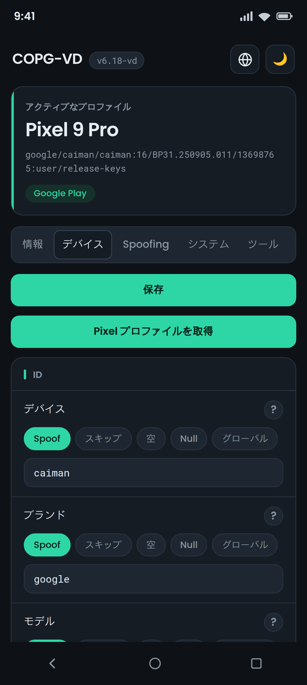
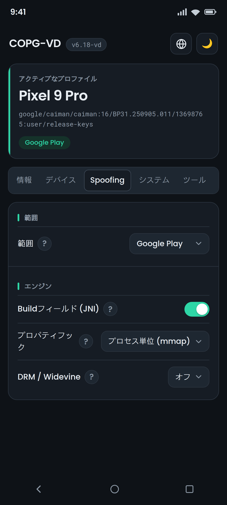
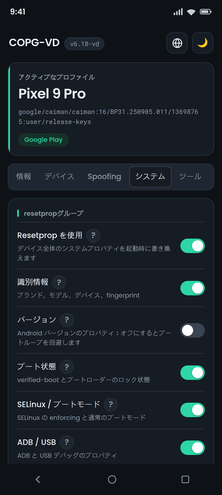
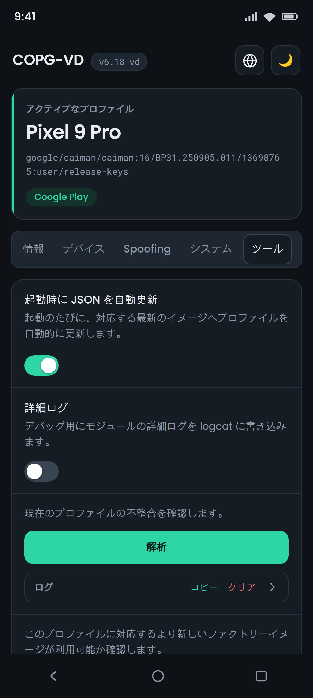

<!--
  ======================================================================
   COPG-VD  ::  global device spoofer
   Spoof your device fingerprint and build.

   Copyright (C) 2026  AlirezaParsi & VD171 (Fork by VD171)
   SPDX-License-Identifier: AGPL-3.0-or-later

   Licensed under the GNU AGPL v3.0 or later. You may obtain a copy at
   https://www.gnu.org/licenses/agpl-3.0.html

   Site           : https://vd171.ru
   Site           : https://vd.priv8.ru
   Source         : https://github.com/VD171/COPG-VD
   GitHub         : @VD171 https://github.com/VD171
   XDA-Developers : @VD171 https://xdaforums.com/m/vd171.4699873/
   XDA thread     : https://xdaforums.com/t/COPG-VD.4807698/
   Telegram       : @VD_Priv8 https://t.me/VD_Priv8
   Channel        : @Priv8_VD https://t.me/Priv8_VD
   Discord        : @VD.Priv8 https://discord.com/users/1296831918989639721
   E-mail         : vd.priv8@pm.me
  ======================================================================
-->

# COPG-VD

<p align="center">
  
</p>

<p align="center">
  <a href="https://github.com/VD171/COPG-VD/releases/latest"></a>
  <a href="LICENSE"></a>
  <a href="https://github.com/VD171/COPG-VD/releases"></a>
  <a href="https://github.com/VD171/COPG-VD/stargazers"></a>
</p>

<p align="center">
  <b>COPG-VD はデバイススプーファーです: デバイスの fingerprint と build を書き換え、アプリが実際のデバイスではなく、あなたが選んだデバイスを見るようにします。</b><br>
  Zygisk (KernelSU、APatch または Magisk) 上で動作し、デフォルトではスプーフの対象を Google Play スタックに限定します: PlayIntegrityFix より軽量で堅牢な代替手段です。
</p>

<p align="center">
  <a href="https://github.com/VD171/COPG-VD/releases">Releases</a> ·
  <a href="https://github.com/VD171/COPG-VD/wiki/ja-Home">Wiki</a> ·
  <a href="https://github.com/VD171/COPG-VD/wiki/ja-USER-GUIDE">ユーザーガイド</a> ·
  <a href="https://github.com/VD171/COPG-VD/wiki/ja-CONFIGURATION">設定リファレンス</a> ·
  <a href="https://github.com/VD171/COPG-VD/wiki/ja-ARCHITECTURE">アーキテクチャ</a> ·
  <a href="https://github.com/VD171/COPG-VD/wiki/ja-FILE-STRUCTURE">ファイル構造</a> ·
  <a href="https://github.com/VD171/COPG-VD/wiki/ja-AI-AGENTS">AIエージェント</a> ·
  <a href="https://xdaforums.com/t/COPG-VD.4807698/">XDA thread</a>
</p>

> **Languages:** [English](README.md) · [العربية](README.ar.md) · [Čeština](README.cs.md) · [Deutsch](README.de.md) · [Español](README.es.md) · [فارسی](README.fa.md) · [Français](README.fr.md) · [हिन्दी](README.hi.md) · [Bahasa Indonesia](README.id.md) · [Italiano](README.it.md) · 日本語 · [한국어](README.ko.md) · [Nederlands](README.nl.md) · [Polski](README.pl.md) · [Português](README.pt.md) · [Русский](README.ru.md) · [Svenska](README.sv.md) · [ไทย](README.th.md) · [Türkçe](README.tr.md) · [Українська](README.uk.md) · [Tiếng Việt](README.vi.md) · [中文](README.zh.md)

<p align="center">
     
</p>

---

## なぜ

アプリは、見えているデバイスがクリーンで認証された端末でないと、ますます動作を拒否したり、ひそかに機能を落としたりします。Play Integrity、DRM レベル、アプリ固有のデバイスチェックはいずれも build fingerprint とシステムプロパティを読み取ります。COPG-VD はその識別情報を書き換え、アプリが実際の端末ではなく一貫した Pixel(または設定した任意のデバイス)を見るようにします。機能する fingerprint があれば、通常は PlayIntegrityFix も GooglePhotosUnlimited も必要ありません。より軽量で堅牢な代替手段であり、既定ではスプーフの範囲を Google Play スタックに限定するため、システムの残りの部分はそのまま残ります。

## 機能

- **範囲の制御:** スプーフした識別情報を、Google Play スタックのみ(既定)、端末全体、ホワイトリスト、またはブラックリストを除くすべてに届けます。範囲を限定したモードでは Zygisk が識別情報をプロセスごとに届けるため、グローバルプロパティを通じて漏れることはありません。
- **独立したエンジン:** Build フィールド(`android.os.Build.*` の JNI による書き換え)、プロセスごとのクリーンルーム property hook(function hook なし)、グループ化された `resetprop`、そして独自のターゲットリストを持つ任意の DRM / Widevine レベル(L1 または L3)。それぞれ個別にオフにできます。
- **フィールドごとの制御:** すべての Build フィールドは設定・空に・削除・スキップでき、端末全体で一貫して保つべき値のための `global_fields` リストもあります。
- **常に最新の fingerprint:** Pixel プロファイルが同梱され、最新の Google 工場出荷イメージから起動ごとに一度自身を更新します。WebUI から別の Pixel プロファイルを取得することもできます。決してダウングレードせず、別のデバイス向けのプロファイルは拒否します。
- **安全な Android バージョンポリシー:** どのポリシーでも、SDK が実際の framework より上に引き上げられることはありません(引き上げると端末が softloop するだけです)。
- **Analyze:** 設定を ROM と props に照らして監査し、アプリに届く前に不整合を指摘します。
- **WebUI:** すべてを操作する 5 つのタブがあり、ネットワークリクエストは一切ありません。設定ファイルがすべての設定を保持するため、モジュールの更新後も残ります。
- **増分的な自己更新(VDLU)** と **4 ABI** のネイティブライブラリ(arm64-v8a, armeabi-v7a, x86, x86_64)。

## AIエージェント

COPG-VD はヘッドレスでスクリプト化できます。モジュール全体が 1 つの JSON ファイル(`/data/adb/COPG-VD/COPG-VD.json`)と単一のシェルエントリポイント `fingerprint-update.sh`(`check`、`apply`、`analyze`、`fetch-index`、`fetch <path>` などの安定した動詞を持つ)によって操作されます。root として実行されるエージェントは、WebUI をスクレイプすることなく、設定を読み書きし、WebUI ができるあらゆる操作を実行できます。[docs/AI-AGENTS.md](docs/ja/AI-AGENTS.md) を参照してください。AI からのパッチも、他のものと同じレビュー基準で扱われます。

## インストール

KernelSU、APatch、または Magisk で zip をフラッシュして再起動します。同梱の Pixel プロファイルは、対象のアプリに対してただちにスプーフされます。インストーラーは `.sha256` 整合性ゲートを実行し、破損または切り詰められた zip では中止します(チェックサムツールが存在しない環境では安全にスキップします)。KernelSU、APatch、または Magisk を介した Zygisk と root が必要です。

## セキュリティ

スプーフはユーザー側のみです。COPG-VD は SDK を実際の framework より上に引き上げることは決してなく、製造元をプロファイルの残りの部分と一貫させ、実際のバージョンを `/system/build.prop` から読み取ります。偽装するプロパティからは決して読み取りません。自己アップデーターは有効な ed25519 署名を要求し、ダウングレードを拒否します。WebUI はネットワークリクエストを行いません。問題は [SECURITY.md](docs/ja/SECURITY.md) に従って報告してください。

## ビルド

常に release で、決して debug ではありません。ネイティブライブラリと範囲ヘルパーは、4 つの ABI すべてについて CI でビルドされます。release ワークフローはフラッシュ可能な zip を組み立て、ファイルごとの `.sha256` コンパニオンを書き込み、署名された VDLU ベースラインを再生成し、`github-actions[bot]` として公開します。[CONTRIBUTING.md](docs/ja/CONTRIBUTING.md) を参照してください。

## 使い方
モジュールをインストールして再起動すると、同梱のプロファイル (Pixel) が対象のアプリに対してスプーフィングされます。動作する fingerprint があれば、PlayIntegrityFix や GooglePhotosUnlimited は必要ありません。  
すべては `/data/adb/COPG-VD/COPG-VD.json` で、または WebUI から設定します。すべてのフィールドは任意 (OPTIONAL) です: 指定されていないフィールドはスキップされます。  

### Scope: 誰がスプーフを見るか
`scope_mode` は、どのプロセスがスプーフされた識別情報を受け取るかを決定します。スコープ付きモードでは、識別情報は Zygisk によってプロセスごとに配信され、グローバルプロパティを通じてシステムの他の部分に漏れることはありません。  
* **Google Play** (`playstore`、デフォルト): Play スタックのみ (Google Play services、その unstable プロセス、および Play Store)。  
* **Global**: デバイス全体。すべてのプロセスがそれを見ます。  
* **Whitelist**: `scope_whitelist` にあるアプリのみ。  
* **Blacklist**: `scope_blacklist` にあるものを除くすべてのアプリ。  

### Engine: スプーフがどのように配信されるか
それぞれは独立しており、オフにできます:  
* **Build fields (JNI)**: 対象のプロセスで `android.os.Build.*` を書き換えます。  
* **Property hook**: スプーフされたシステムプロパティを対象のプロセスに提示します (プロパティ領域のプロセスごとのクリーンルーム再マッピングであり、関数フックは行いません)。  
* **resetprop**: システムプロパティを書き換えます。グループごとに管理されます: 識別情報、バージョン、起動状態、SELinux、adb/usb、アンチエミュレーター、およびクリーンアップのパス。スコープ付きモードでは、識別情報とバージョンのグループはデバイス全体の resetprop から除外されます (Zygisk がそれらをプロセスごとに配信します)。boot/lock/SELinux のグループはグローバルのままです。  
* **DRM / Widevine** (デフォルトでオフ): 選択した Widevine セキュリティレベル (L1 または L3) を、それを読み取るアプリに報告します。 デフォルトでは上記の範囲に従います。DRM スプーフをそれらのアプリ**のみ**に適用するには `drm_targets` (アプリのリスト) を設定します。これは `scope_mode` とは独立しています: 対象のアプリがメインの範囲の外にある場合でも、モジュールは DRM フックのためだけにリスト内のアプリに読み込まれたままになります。空または未設定は範囲に従うことを意味します。(スコープ付きモードが必要です。Global ではありません。)  

### フィールド: 設定、空、削除、スキップ
`COPG-VD` オブジェクト内で、各 Build フィールドには 4 つの状態があります:  
* **Set**: `"KEY": "value"` は値を書き込みます。  
* **Empty**: `"KEY": ""` は空の値を書き込みます。  
* **Delete**: キーを削除するには、トップレベルの `"COPG-VD-Delete": [ ... ]` にそのキーを列挙します (Build フィールドは null になり、プロパティは `resetprop --delete` で削除されます)。  
* **Skip**: キーを完全に省略します。ROM 自身の値が保持されます。  

`"global_fields": [ ... ]` のリストは、スコープ付きモードであっても、指定された Build フィールドをデバイス全体に適用し、値をどこでも一貫させます: 一貫性の観点から安全なフィールド (例えば security patch) のみを対象とし、識別情報は決して対象とせず、Android バージョンのグループも決して対象としません。  

### JSON 設定ファイルの例
`/data/adb/COPG-VD/COPG-VD.json`
```json
{
  "Instructions": "Use strings on double-quotes only.",
  "Instructions": "All fields are OPTIONAL. If some field is not provided, it will be skipped.",
  "Strings extracted from": "https://dl.google.com/developers/android/CANARY/images/factory/tegu_beta-zp11.261016.008-factory-28d56d15.zip",
  "scope_mode": "playstore",
  "motor_drm": false,
  "drm_targets": [],
  "global_fields": ["SECURITY_PATCH"],
  "process_overrides": [],
  "COPG-VD": {
    "BRAND": "google",
    "DEVICE": "tegu",
    "MANUFACTURER": "Google",
    "MODEL": "Pixel 9a",
    "FINGERPRINT": "google/tegu_beta/tegu:CANARY/ZP11.261016.008/16754936:user/release-keys",
    "PRODUCT": "tegu_beta",
    "BOOTLOADER": "unknown",
    "BOARD": "tegu",
    "HARDWARE": "tegu",
    "DISPLAY": "ZP11.261016.008",
    "ID": "ZP11.261016.008",
    "HOST": "e4df75f83a59",
    "INCREMENTAL": "16754936",
    "TIMESTAMP": "1793211232",
    "PREVIEW_SDK": "20261104",
    "USER": "android-build",
    "SDK_FINGERPRINT": "ee82a872870173d77e68050e21a2bcbf",
    "UUID": "FjWvtSORkI0sEwekaPz2s30gqV5vWP_EZHFtBiXzboc",
    "SECURITY_PATCH": "2026-11-05",
    "FIRST_API_LEVEL": "35",
    "DRM_SECURITY_LEVEL": "L1"
  }
}
```
文字列は必ず二重引用符で囲んで使用してください。  
上記のブロックと `module/COPG-VD.json.example` は、[Update COPG-VD.json](.github/workflows/update-json.yml) ワークフローによって、最新の Google 工場出荷イメージから直接、毎日更新されます。  

### fingerprint を最新に保つ
`fingerprint-update.sh` はそのファイルを取得して設定を更新します。WebUI から (**Check Update** / **Update Now**)、またはそれ自身で**起動ごとに一度** (**Auto-update JSON on boot**、デフォルトで有効) 実行されます。  
* `/data/adb/COPG-VD/COPG-VD.json` はその場で更新され、以前の内容はその隣に `COPG-VD.json.bak` として保持されます。  
* 書き換えられるのはビルドフィールドのみです (fingerprint、ID、incremental、timestamp、security patch、SDK、UUID、host、user)。カスタマイズしたその他すべては保持されます: 追加のキー、`scope_mode`、`BOOTLOADER`/`BOARD`/`HARDWARE`、他のオブジェクト、キーの順序、書式。  
* 決して後退しません: インストール済みより古い上流ビルドは拒否されます。これは
  通常のことであり (リポジトリは手動で更新した設定より遅れることがあります)、同時に Android において
  最も重要な保護でもあります。Android で利用できる唯一のダウンローダーは busybox の `wget` で、TLS 証明書を
  検証できないためです: 同じ理由で、すべての値は使用前に検証されます。  
* プロファイルが**別のデバイス**をスプーフィングしている場合 (`BRAND`/`DEVICE`/`MANUFACTURER`/`MODEL`/`PRODUCT` が異なる)、何も適用されません: 別のプロファイルに Pixel の fingerprint を使うのは、古い fingerprint よりも悪いからです。  
* 起動時にはバックグラウンドで実行され、約 10 分間リトライを続けます。起動完了時には通常まだ wifi が立ち上がっていないためです。起動を遅らせることは決してありません。  
* 更新直後に `resetprop` が再適用されますが、`android.os.Build` は zygote の開始時に zygisk モジュールによって書き込まれます: 新しい値をアプリに届けるには**再起動**してください。  
* ログは `/data/adb/COPG-VD/update.log` にあります。  

### Android バージョン: そしてなぜスプーフィングされないのか
`ANDROID_VERSION`、`SDK_INT`、`SDK_FULL`、`CODENAME` は、スプーフィングされるデバイスではなく、**あなたの ROM** を表します。SDK が実際のフレームワークより新しいとアプリに伝えると、存在しない API を呼び出すようになります: Google のアプリがクラッシュし、端末が再起動し、それを繰り返します。起動自体は完了するため、これは **softloop** であり、起動ログには何も表示されません。  
* これらは配布される設定には含まれておらず、アップデーターが書き込むこともありません。  
* WebUI の **Spoof Android version** が、これらを適用するかどうかを決定します:  
  * **Never** (デフォルト): ROM 自身のバージョンが使用されます。  
  * **Up to this ROM**: それを超えないものだけ、つまり実際には SDK を下げることを意味します。  
  * **Force**: 設定が求めるとおりに他のバージョンフィールドを強制しますが、ここでも SDK は依然としてあなたの ROM の値に制限されます(SDK を実際のフレームワークより上げることは softloop するだけで正当な用途がありません)。そのため v6.19 以降、**Force はもう softloop しません**。  
* 実際のバージョンは `/system/build.prop` から読み取られ、`getprop` からは決して読み取られません: それこそがこのモジュールが偽装するものだからです。  

### Analyze
WebUI の **Analyze** (または `fingerprint-update.sh analyze`) は、現状の設定を監査します: ROM に対するバージョン、ファイルがそもそもまだパースできるか (壊れていると、モジュールは**何も**スプーフィングせず、logcat だけがそれを伝えます)、fingerprint が周囲のフィールドと一致するか、モジュールが読まないキー、日付、そして props がすでに設定の要求する内容を保持しているか。  

### WebUI
WebUI は任意です (すべては JSON 設定で直接編集できます) が、モジュールを操作する簡単な方法です。5 つのタブがあります: **About**、**Device** (すべてのフィールドを状態ごとに設定し、カテゴリごとにグループ化)、**Spoofing** (スコープとエンジン)、**System** (resetprop グループ)、**Tools** (Analyze、Check Update、Update Now、Backup/Restore、および起動時の自動更新)。ネットワークリクエストは一切行いません。必要なものはすべてモジュール内に同梱されています。  
Magisk ユーザーの場合は、KOW による KsuWebUI を使用してください (https://github.com/KOWX712/KsuWebUIStandalone/releases)。 WebUI-X Portable（MMRL 製）を使用することもできます (https://github.com/MMRLApp/WebUI-X-Portable/releases) または KsuWebUI-SN (https://github.com/dnascorpionofficial/KsuWebUI-SN/releases)。  

### 設定内の設定項目
`COPG-VD.json` は設定をプロファイルの隣に保持するため、あなたの選択はバックアップとともに移動し、手動で編集できます: `scope_mode`、エンジンのスイッチ、resetprop グループ、`global_fields`、そして `COPG-VD-Settings` オブジェクト (`resetprop`、`autoupdate`、`spoof_version`)。すべてはこの 1 つのファイルに存在します: 起動スクリプトと WebUI は設定をそこから直接読み取るため、あなたの選択はモジュールの更新を越えて残ります。`"spoof_version": "force"` はファイルからは拒否され、ダウングレードされます: 古いバックアップを復元しても、知らないうちに再び有効化されてはならないからです。  

## 増分アップデート (VDLU)

COPG-VD は **[VDLiveUpdate](https://github.com/VD171/VDLiveUpdate) (VDLU)** エンジンを同梱しています（`module/vdlu/` にベンダーリング）。モジュールは `.zip` 全体を再ダウンロードする代わりに、変更されたファイルのみを取得して自分自身を更新します（コンテンツアドレス方式の blob + 署名付き `manifest.json`）。**Hardened** プロファイル: ed25519 署名は必須でダウングレードはブロックされます。完全な `.zip` はフォールバックとして引き続き有効です。

- **`vdlu/`**（zip に同梱）: `update.sh`（エンジン）+ `vdlu-verify` + `config.default` + `keyring/`（公開鍵）。
- **状態** は `/data/adb/COPG-VD/vdlu/`（config/journal/blobs/staged/rollback）- モジュールの外にあり、再フラッシュ後も残ります。
- **ブートトリガー:** `post-fs-data.sh`、zygote より前、COPG-VD には `zygisk/*.so` + `sepolicy.rule`（REBOOT-hard）があるため、新しい `.so` は zygote がマップする前にステージングされて入れ替えられます。
- **WebUI:** 進捗トーストとキャンセルを備えた **Updates** パネル（`webroot/vdlu.js`）。
- **リリース:** `module/vdlu/RELEASE.md` を参照（`vdlu-pack` + `vdlu-sign`、manifest をアーカイブ、`vdlu-gc` が孤立した blob を削除、Pages へのバッチプッシュ）。

<!-- vd-docs -->
## ドキュメント

- **[Wiki](https://github.com/VD171/COPG-VD/wiki/ja-Home)**: オンラインで閲覧できる完全なドキュメント。
- **[ユーザーガイド](https://github.com/VD171/COPG-VD/wiki/ja-USER-GUIDE)**: インストール、WebUI、日々の使い方。
- **[設定リファレンス](https://github.com/VD171/COPG-VD/wiki/ja-CONFIGURATION)**: 設定ファイルの各項目とその役割。
- **[アーキテクチャ](https://github.com/VD171/COPG-VD/wiki/ja-ARCHITECTURE)** と **[ファイル構造](https://github.com/VD171/COPG-VD/wiki/ja-FILE-STRUCTURE)**: スプーフィングの仕組みと各ファイルの場所。
- **[AIエージェント](https://github.com/VD171/COPG-VD/wiki/ja-AI-AGENTS)**: 設定とアップデーターをヘッドレスで操作します。

<!-- /vd-docs -->

## 関連アプリ

- **[VDBackup](https://github.com/VD171/VD-Backup)**: アプリとデータの完全なバックアップと復元を root として行い、すべて WebUI から操作します。
- **[VD-dropbear](https://github.com/VD171/VD-dropbear)**: root として動作するスタンドアロンの SSH デーモン (Dropbear)。
- **[VDGoogle](https://github.com/VD171/VD-Google)**: あなたの Google サービス (RCS、Wallet、Play Integrity の認証) を、インターネットなしで端末上で読み取ります。
- **[VDInstaller](https://github.com/VD171/VD-Installer)**: 単一・バッチ・分割 APK に対応した、摩擦のない root サイドロードインストーラーで、Play Protect 検証のトグルとインストール元の偽装を備えます。
- **[VDInfos](https://github.com/VD171/VD-Infos)**: 各項目を、それを読み取れるあらゆるメソッドを通して読み取り、並べて比較するデバイスメソッドデバッガーです。
- **[VDLiveUpdate](https://github.com/VD171/VDLiveUpdate)**: フラッシュ不要の増分セルフアップデートエンジンで、KernelSU/APatch/Magisk モジュールに組み込まれます。
- **[VD-Modules](https://github.com/VD171/VD-Modules)**: MMRL/WebUI-X 向けの私たちのモジュールリポジトリ (これらすべてを root マネージャーからインストールできます)。
- **[@VictorGabriel7Dev/build.prop](https://github.com/VictorGabriel7Dev/build.prop)**: Pixel の `build.prop` フィンガープリントのデータセット (@T3SL4 のフォーク)。
- **[@VictorGabriel7Dev/mtproto-store](https://github.com/VictorGabriel7Dev/mtproto-store)**: 小さな Go CLI から Telegram をオブジェクトストレージとして利用。

## 連絡先

- https://vd171.ru
- https://vd.priv8.ru
- **Telegram:** @VD_Priv8 https://t.me/VD_Priv8
- **Channel:** @Priv8_VD https://t.me/Priv8_VD
- **Discord:** @VD.Priv8 https://discord.com/users/1296831918989639721
- **E-mail:** vd.priv8@pm.me
- **XDA-Developers:** @VD171 https://xdaforums.com/m/vd171.4699873/
- **XDA thread:** https://xdaforums.com/t/COPG-VD.4807698/
- **GitHub:** @VD171 https://github.com/VD171

## ライセンス

**AGPL-3.0-or-later**: [LICENSE](LICENSE) を参照してください。COPG-VD は、AlirezaParsi によるオリジナルの COPG (Apache-2.0) を VD171 がフォークしたもので、GNU AGPL-3.0-or-later で再ライセンスされています。ネットワークコピーレフト: 改変版をサービスとして動作させる場合でも、そのソースコードを提供しなければなりません。

## 商標

COPG-VD は独立した非公式プロジェクトです。Google LLC とは提携しておらず、承認も後援も受けていません。「Google」、「Google Play」、「Play Integrity」、「Pixel」、「Android」および関連する名称とロゴは Google LLC の商標です。COPG-VD は完全にあなたの端末上で動作します。

## Tags

`Zygisk` `KernelSU` `APatch` `Magisk` `device-spoofing` `fingerprint` `PlayIntegrity` `Pixel` `build.prop` `resetprop` `root` `Android` `COPG-VD`

---

📣 **更新はチャンネルに参加してください:** @Priv8_VD https://t.me/Priv8_VD
