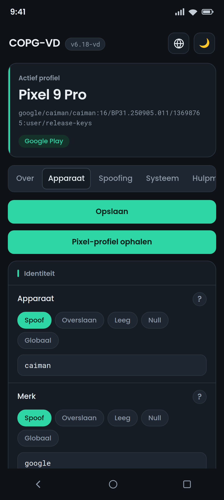
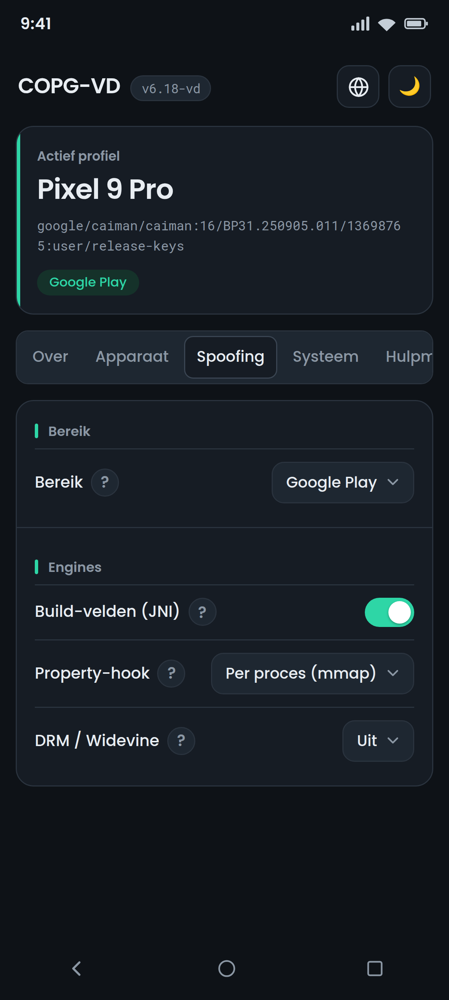
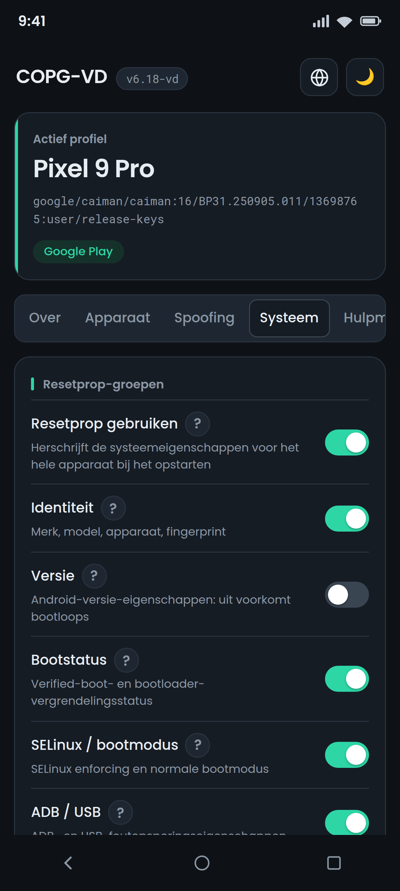
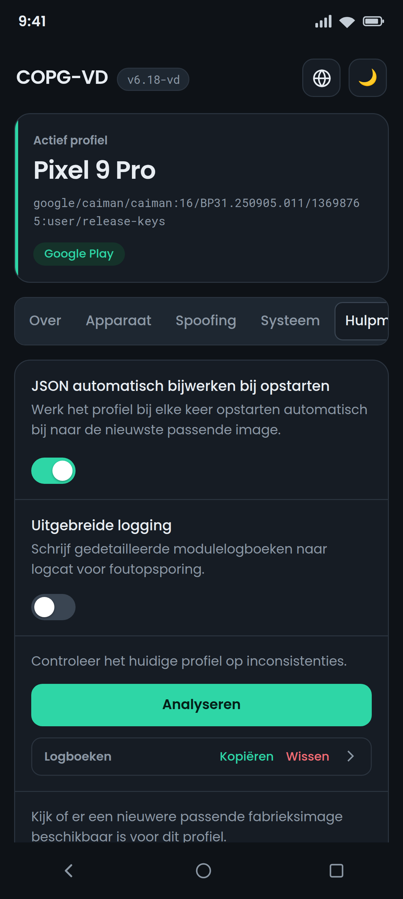

<!--
  ======================================================================
   COPG-VD  ::  global device spoofer
   Spoof your device fingerprint and build.

   Copyright (C) 2026  AlirezaParsi & VD171 (Fork by VD171)
   SPDX-License-Identifier: AGPL-3.0-or-later

   Licensed under the GNU AGPL v3.0 or later. You may obtain a copy at
   https://www.gnu.org/licenses/agpl-3.0.html

   Site           : https://vd171.ru
   Site           : https://vd.priv8.ru
   Source         : https://github.com/VD171/COPG-VD
   GitHub         : @VD171 https://github.com/VD171
   XDA-Developers : @VD171 https://xdaforums.com/m/vd171.4699873/
   XDA thread     : https://xdaforums.com/t/COPG-VD.4807698/
   Telegram       : @VD_Priv8 https://t.me/VD_Priv8
   Channel        : @Priv8_VD https://t.me/Priv8_VD
   Discord        : @VD.Priv8 https://discord.com/users/1296831918989639721
   E-mail         : vd.priv8@pm.me
  ======================================================================
-->

# COPG-VD

<p align="center">
  
</p>

<p align="center">
  <a href="https://github.com/VD171/COPG-VD/releases/latest"></a>
  <a href="LICENSE"></a>
  <a href="https://github.com/VD171/COPG-VD/releases"></a>
  <a href="https://github.com/VD171/COPG-VD/stargazers"></a>
</p>

<p align="center">
  <b>COPG-VD is een apparaatspoofer: het herschrijft de fingerprint en build van het apparaat zodat apps het apparaat zien dat jij kiest in plaats van het echte.</b><br>
  Het draait op Zygisk (KernelSU, APatch of Magisk) en beperkt de spoof standaard tot de Google Play-stack: zo is het een lichter, robuuster alternatief voor PlayIntegrityFix.
</p>

<p align="center">
  <a href="https://github.com/VD171/COPG-VD/releases">Releases</a> ·
  <a href="https://github.com/VD171/COPG-VD/wiki/nl-Home">Wiki</a> ·
  <a href="https://github.com/VD171/COPG-VD/wiki/nl-USER-GUIDE">Gebruikershandleiding</a> ·
  <a href="https://github.com/VD171/COPG-VD/wiki/nl-CONFIGURATION">Configuratiereferentie</a> ·
  <a href="https://github.com/VD171/COPG-VD/wiki/nl-ARCHITECTURE">Architectuur</a> ·
  <a href="https://github.com/VD171/COPG-VD/wiki/nl-FILE-STRUCTURE">Bestandsstructuur</a> ·
  <a href="https://github.com/VD171/COPG-VD/wiki/nl-AI-AGENTS">AI-agents</a> ·
  <a href="https://xdaforums.com/t/COPG-VD.4807698/">XDA thread</a>
</p>

> **Languages:** [English](README.md) · [العربية](README.ar.md) · [Čeština](README.cs.md) · [Deutsch](README.de.md) · [Español](README.es.md) · [فارسی](README.fa.md) · [Français](README.fr.md) · [हिन्दी](README.hi.md) · [Bahasa Indonesia](README.id.md) · [Italiano](README.it.md) · [日本語](README.ja.md) · [한국어](README.ko.md) · Nederlands · [Polski](README.pl.md) · [Português](README.pt.md) · [Русский](README.ru.md) · [Svenska](README.sv.md) · [ไทย](README.th.md) · [Türkçe](README.tr.md) · [Українська](README.uk.md) · [Tiếng Việt](README.vi.md) · [中文](README.zh.md)

<p align="center">
     
</p>

---

## Waarom

Apps weigeren steeds vaker te draaien, of schakelen stilletjes terug, wanneer het apparaat dat ze zien geen schoon, gecertificeerd toestel is: Play Integrity, DRM-niveaus en app-specifieke apparaatcontroles lezen allemaal de build-fingerprint en de systeemeigenschappen. COPG-VD herschrijft die identiteit zodat apps een coherente Pixel zien (of elk apparaat dat je instelt) in plaats van je echte. Met een werkende fingerprint heb je meestal geen PlayIntegrityFix of GooglePhotosUnlimited nodig: het is een lichter, robuuster alternatief, en standaard beperkt het de spoof tot de Google Play-stack, zodat de rest van je systeem met rust wordt gelaten.

## Functies

- **Scopebeheer:** lever de gespoofte identiteit alleen aan de Google Play-stack (de standaard), aan het hele apparaat, aan een whitelist of aan alles behalve een blacklist. In een scoped modus levert Zygisk de identiteit per proces, zodat die nooit via de globale eigenschappen lekt.
- **Onafhankelijke engines:** Build-velden (een JNI-herschrijving van `android.os.Build.*`), een clean-room eigenschapshook per proces (geen functiehook), gegroepeerde `resetprop`, en een optioneel DRM / Widevine-niveau (L1 of L3) met een eigen doellijst. Elk kan worden uitgeschakeld.
- **Beheer per veld:** elk Build-veld kan worden ingesteld, leeggemaakt, verwijderd of overgeslagen, met een `global_fields`-lijst voor waarden die apparaatbreed consistent moeten blijven.
- **Altijd verse fingerprint:** een Pixel-profiel zit standaard meegeleverd en vernieuwt zichzelf eens per boot vanuit de nieuwste fabrieksimage van Google, je kunt ook een ander Pixel-profiel ophalen vanuit de WebUI. Het gaat nooit terug en weigert een profiel voor een ander apparaat.
- **Veilig Android-versiebeleid:** de SDK wordt onder geen enkel beleid boven je echte framework getild (dat doet alleen de telefoon softloopen).
- **Analyze:** controleert de config tegen je ROM en props en markeert alles wat incoherent is voordat het apps bereikt.
- **WebUI:** vijf tabbladen om alles aan te sturen, zonder netwerkverzoek, het configuratiebestand draagt alle instellingen, zodat ze een module-update overleven.
- **Incrementele zelfupdate (VDLU)** en een native bibliotheek met **vier ABI's** (arm64-v8a, armeabi-v7a, x86, x86_64).

## AI-agents

COPG-VD is headless scriptbaar: de hele module wordt aangestuurd door een JSON-bestand (`/data/adb/COPG-VD/COPG-VD.json`) en een enkel shell-startpunt, `fingerprint-update.sh`, met stabiele werkwoorden (`check`, `apply`, `analyze`, `fetch-index`, `fetch <path>` en meer). Een agent die als root draait kan de config lezen en schrijven en elke actie uitvoeren die de WebUI kan, zonder de WebUI te scrapen. Zie [docs/AI-AGENTS.md](docs/nl/AI-AGENTS.md). Patches van AI worden aan dezelfde reviewlat gehouden als alle andere.

## Installatie

Flash de zip in KernelSU, APatch of Magisk en herstart. Het meegeleverde Pixel-profiel wordt meteen naar de beoogde apps gespooft. Het installatieprogramma draait een `.sha256`-integriteitsgate en breekt af bij een beschadigde of afgekapte zip (en slaat veilig over waar geen checksum-tool aanwezig is). Vereist Zygisk, via KernelSU, APatch of Magisk, en root.

## Beveiliging

De spoof is alleen aan de gebruikerskant: COPG-VD tilt de SDK nooit boven je echte framework, houdt de manufacturer coherent met de rest van het profiel, en leest de echte versie uit `/system/build.prop`, nooit uit de eigenschappen die het vervalst. De zelfupdater vereist een geldige ed25519-handtekening en weigert downgrades, de WebUI doet geen enkel netwerkverzoek. Meld problemen volgens [SECURITY.md](docs/nl/SECURITY.md).

## Bouwen

Altijd release, nooit debug. De native bibliotheek en de scope-helper worden in CI gebouwd voor alle vier de ABI's, de release-workflow stelt de flashbare zip samen, schrijft de `.sha256`-begeleiders per bestand, genereert de ondertekende VDLU-baseline opnieuw en publiceert als `github-actions[bot]`. Zie [CONTRIBUTING.md](docs/nl/CONTRIBUTING.md).

## Hoe te gebruiken?
Installeer de module, herstart, en het meegeleverde profiel (een Pixel) wordt gespooft naar de beoogde apps. Met een werkende fingerprint heb je PlayIntegrityFix of GooglePhotosUnlimited niet nodig.  
Alles wordt geconfigureerd in `/data/adb/COPG-VD/COPG-VD.json`, of vanuit de WebUI. Alle velden zijn OPTIONEEL: een veld dat niet wordt opgegeven, wordt overgeslagen.  

### Scope: wie de spoof ziet
`scope_mode` bepaalt welke processen de gespoofte identiteit krijgen. In een modus met beperkte scope wordt de identiteit per proces geleverd door Zygisk en lekt deze niet via de globale eigenschappen naar de rest van het systeem.  
* **Google Play** (`playstore`, de standaard): alleen de Play-stack (Google Play services, het bijbehorende unstable-proces en de Play Store).  
* **Global**: het hele apparaat, elk proces ziet het.  
* **Whitelist**: alleen de apps in `scope_whitelist`.  
* **Blacklist**: elke app behalve die in `scope_blacklist`.  

### Engines: hoe de spoof wordt geleverd
Elk is onafhankelijk en kan worden uitgeschakeld:  
* **Build fields (JNI)**: herschrijft `android.os.Build.*` in de beoogde processen.  
* **Property hook**: presenteert de gespoofte systeemeigenschappen aan de beoogde processen (een clean-room herindeling per proces van het eigenschappengebied, zonder functiehook).  
* **resetprop**: herschrijft de systeemeigenschappen, beheerd per groep: identiteit, versie, bootstatus, SELinux, adb/usb, anti-emulator en een opschoonronde. In een modus met beperkte scope blijven de groepen identiteit en versie buiten de apparaatbrede resetprop (Zygisk levert ze per proces), de groepen boot/lock/SELinux blijven globaal.  
* **DRM / Widevine** (standaard uit): rapporteert een gekozen Widevine-beveiligingsniveau, L1 of L3, aan de apps die het lezen. Standaard volgt het het bereik hierboven, stel `drm_targets` (een lijst met apps) in om de DRM-spoof **alleen** op die apps toe te passen, onafhankelijk van `scope_mode`: de module blijft in een vermelde app geladen, alleen voor de DRM-hook, zelfs wanneer die app buiten het hoofdbereik valt. Leeg of afwezig betekent het bereik volgen. (Vereist een bereikmodus, niet Global.)  

### Velden: instellen, leeg, verwijderen of overslaan
Binnen het `COPG-VD`-object heeft elk Build-veld vier toestanden:  
* **Set**: `"KEY": "value"` schrijft de waarde.  
* **Empty**: `"KEY": ""` schrijft een lege waarde.  
* **Delete**: noem de sleutel in een `"COPG-VD-Delete": [ ... ]` op het hoogste niveau om deze te verwijderen (een Build-veld wordt null, een eigenschap wordt verwijderd met `resetprop --delete`).  
* **Skip**: laat de sleutel volledig weg, de eigen waarde van de ROM blijft behouden.  

Een lijst `"global_fields": [ ... ]` past de genoemde Build-velden apparaatbreed toe, zelfs in een modus met beperkte scope, om een waarde overal consistent te houden: alleen voor velden die veilig zijn voor de coherentie (de security patch bijvoorbeeld), nooit de identiteit en nooit de groep van de Android-versie.  

### Voorbeeld van JSON-configuratiebestand
`/data/adb/COPG-VD/COPG-VD.json`
```json
{
  "Instructions": "Use strings on double-quotes only.",
  "Instructions": "All fields are OPTIONAL. If some field is not provided, it will be skipped.",
  "Strings extracted from": "https://dl.google.com/developers/android/CANARY/images/factory/tegu_beta-zp11.261016.008-factory-28d56d15.zip",
  "scope_mode": "playstore",
  "motor_drm": false,
  "drm_targets": [],
  "global_fields": ["SECURITY_PATCH"],
  "process_overrides": [],
  "COPG-VD": {
    "BRAND": "google",
    "DEVICE": "tegu",
    "MANUFACTURER": "Google",
    "MODEL": "Pixel 9a",
    "FINGERPRINT": "google/tegu_beta/tegu:CANARY/ZP11.261016.008/16754936:user/release-keys",
    "PRODUCT": "tegu_beta",
    "BOOTLOADER": "unknown",
    "BOARD": "tegu",
    "HARDWARE": "tegu",
    "DISPLAY": "ZP11.261016.008",
    "ID": "ZP11.261016.008",
    "HOST": "e4df75f83a59",
    "INCREMENTAL": "16754936",
    "TIMESTAMP": "1793211232",
    "PREVIEW_SDK": "20261104",
    "USER": "android-build",
    "SDK_FINGERPRINT": "ee82a872870173d77e68050e21a2bcbf",
    "UUID": "FjWvtSORkI0sEwekaPz2s30gqV5vWP_EZHFtBiXzboc",
    "SECURITY_PATCH": "2026-11-05",
    "FIRST_API_LEVEL": "35",
    "DRM_SECURITY_LEVEL": "L1"
  }
}
```
Zorg ervoor dat je strings alleen tussen dubbele aanhalingstekens gebruikt.  
Het blok hierboven en `module/COPG-VD.json.example` worden dagelijks ververst door de [Update COPG-VD.json](.github/workflows/update-json.yml) workflow, rechtstreeks uit de nieuwste factory image van Google.  

### De fingerprint actueel houden
`fingerprint-update.sh` haalt dat bestand op en werkt je configuratie bij, vanuit de WebUI (**Check Update** / **Update Now**) of vanzelf **één keer per boot** (**Auto-update JSON on boot**, standaard aan).  
* `/data/adb/COPG-VD/COPG-VD.json` wordt ter plekke bijgewerkt, en de vorige inhoud wordt ernaast bewaard als `COPG-VD.json.bak`.  
* Alleen de build-velden worden herschreven (fingerprint, ID, incremental, timestamp, security patch, SDK, UUID, host, user). Al het andere dat je hebt aangepast blijft behouden: extra sleutels, `scope_mode`, `BOOTLOADER`/`BOARD`/`HARDWARE`, andere objecten, sleutelvolgorde en opmaak.  
* Het gaat nooit achteruit: een upstream build die ouder is dan de geïnstalleerde wordt geweigerd. Dit is
  routine (de repository kan achterlopen op een configuratie die je met de hand hebt bijgewerkt) en het is ook de bescherming die
  het meest telt op Android, waar de enige beschikbare downloader busybox `wget` is, die geen
  TLS-certificaten kan valideren: om dezelfde reden wordt elke waarde gevalideerd voor gebruik.  
* Als je profiel **een ander apparaat** spooft (andere `BRAND`/`DEVICE`/`MANUFACTURER`/`MODEL`/`PRODUCT`), wordt er niets toegepast: een Pixel-fingerprint op een ander profiel is slechter dan een oude fingerprint.  
* Bij het booten draait het op de achtergrond en blijft het ongeveer 10 minuten opnieuw proberen, omdat wifi meestal nog niet beschikbaar is wanneer het booten klaar is. Het vertraagt het booten nooit.  
* `resetprop` wordt direct na een update opnieuw toegepast, maar `android.os.Build` wordt geschreven door de zygisk-module wanneer zygote start: **herstart** om de nieuwe waarden bij de apps te laten komen.  
* Logboek op `/data/adb/COPG-VD/update.log`.  

### Android-versie: en waarom die niet gespooft wordt
`ANDROID_VERSION`, `SDK_INT`, `SDK_FULL` en `CODENAME` beschrijven **jouw ROM**, niet het apparaat dat gespooft wordt. Apps vertellen dat de SDK nieuwer is dan het framework werkelijk is, laat ze API's aanroepen die niet bestaan: de apps van Google crashen, de telefoon herstart, en het begint opnieuw. Het booten zelf voltooit, dus het is een **softloop** en er verschijnt niets in de bootlogs.  
* Ze zitten niet in de meegeleverde configuratie en de updater schrijft ze nooit.  
* **Spoof Android version** in de WebUI bepaalt of ze überhaupt worden toegepast:  
  * **Never** (standaard): de eigen versie van de ROM wordt gebruikt.  
  * **Up to this ROM**: alleen wat die niet overschrijdt, wat in de praktijk betekent dat de SDK verlaagd wordt.  
  * **Force**: forceert de andere versievelden precies zoals de configuratie vraagt, maar de SDK wordt ook hier nog steeds afgetopt op de waarde van jouw ROM (de SDK boven het echte framework tillen softloopt alleen en heeft geen legitiem nut), dus sinds v6.19 **softloopt Force niet meer**.  
* De echte versie wordt gelezen uit `/system/build.prop`, nooit uit `getprop`: dat is namelijk juist wat deze module vervalst.  

### Analyze
**Analyze** in de WebUI (of `fingerprint-update.sh analyze`) controleert de configuratie zoals die is: de versie ten opzichte van de ROM, of het bestand nog überhaupt parseerbaar is (een kapot bestand zorgt ervoor dat de module **niets** spooft, en alleen logcat zegt dat), of de fingerprint overeenkomt met de velden eromheen, sleutels die de module niet leest, datums, en of de props al dragen wat de configuratie vraagt.  

### WebUI
De WebUI is optioneel (alles kan rechtstreeks in de JSON-configuratie worden bewerkt) maar het is de makkelijke manier om de module aan te sturen. Hij heeft vijf tabbladen: **About**, **Device** (elk veld, ingesteld per toestand, gegroepeerd per categorie), **Spoofing** (scope en engines), **System** (de resetprop-groepen) en **Tools** (Analyze, Check Update, Update Now, Backup/Restore en de auto-update bij het booten). Hij doet geen enkel netwerkverzoek, alles wat hij nodig heeft, zit in de module.  
Als je een Magisk-gebruiker bent, gebruik dan KsuWebUI van KOW (https://github.com/KOWX712/KsuWebUIStandalone/releases). Je kunt ook WebUI-X Portable van MMRL gebruiken (https://github.com/MMRLApp/WebUI-X-Portable/releases) of KsuWebUI-SN (https://github.com/dnascorpionofficial/KsuWebUI-SN/releases).  

### Instellingen in de configuratie
`COPG-VD.json` draagt zijn instellingen naast het profiel, zodat je keuzes met een back-up meereizen en met de hand bewerkt kunnen worden: `scope_mode`, de engine-schakelaars, de resetprop-groepen, `global_fields`, en een `COPG-VD-Settings`-object (`resetprop`, `autoupdate`, `spoof_version`). Alles zit in dit ene bestand: de bootscripts en de WebUI lezen de instellingen er rechtstreeks uit, zodat je keuzes een module-update overleven. `"spoof_version": "force"` wordt vanuit het bestand geweigerd en teruggeschaald: het herstellen van een oude back-up mag het niet achter je rug om opnieuw scherpstellen.  

## Incrementele updates (VDLU)

COPG-VD bevat de **[VDLiveUpdate](https://github.com/VD171/VDLiveUpdate) (VDLU)**-engine (meegeleverd in `module/vdlu/`): de module werkt zichzelf bij door alleen de gewijzigde bestanden op te halen (content-geadresseerde blobs + een ondertekende `manifest.json`), in plaats van de hele `.zip` opnieuw te downloaden. Profiel **Hardened**: de ed25519-handtekening is verplicht en downgrades zijn geblokkeerd, de volledige `.zip` blijft geldig als terugval.

- **`vdlu/`** (meegeleverd in de zip): `update.sh` (engine) + `vdlu-verify` + `config.default` + `keyring/` (publieke sleutel).
- **Status** in `/data/adb/COPG-VD/vdlu/` (config/journal/blobs/staged/rollback), buiten de module, overleeft een herflash.
- **Boot-trigger:** `post-fs-data.sh`, vóór zygote, COPG-VD heeft `zygisk/*.so` + `sepolicy.rule` (REBOOT-hard), dus de nieuwe `.so` wordt klaargezet en verwisseld voordat zygote hem mapt.
- **WebUI:** een **Updates**-paneel (`webroot/vdlu.js`) met een voortgangsmelding en annuleren.
- **Release:** zie `module/vdlu/RELEASE.md` (`vdlu-pack` + `vdlu-sign`, archiveert het manifest, `vdlu-gc` ruimt wees-blobs op, gebundelde Pages-push).

<!-- vd-docs -->
## Documentatie

- **[Wiki](https://github.com/VD171/COPG-VD/wiki/nl-Home)**: de volledige documentatie, online te doorzoeken.
- **[Gebruikershandleiding](https://github.com/VD171/COPG-VD/wiki/nl-USER-GUIDE)**: de installatie, de WebUI en het dagelijks gebruik.
- **[Configuratiereferentie](https://github.com/VD171/COPG-VD/wiki/nl-CONFIGURATION)**: elke instelling in het configuratiebestand en wat ze doet.
- **[Architectuur](https://github.com/VD171/COPG-VD/wiki/nl-ARCHITECTURE)** en **[Bestandsstructuur](https://github.com/VD171/COPG-VD/wiki/nl-FILE-STRUCTURE)**: hoe het spoofing werkt en waar alles staat.
- **[AI-agents](https://github.com/VD171/COPG-VD/wiki/nl-AI-AGENTS)**: stuur de config en de updater headless aan.

<!-- /vd-docs -->

## Zie ook

- **[VDBackup](https://github.com/VD171/VD-Backup)**: volledige back-up en herstel van apps en gegevens als root, volledig aangestuurd vanuit een WebUI.
- **[VD-dropbear](https://github.com/VD171/VD-dropbear)**: een standalone geroote SSH-daemon (Dropbear).
- **[VDGoogle](https://github.com/VD171/VD-Google)**: je Google-diensten (RCS, Wallet, Play Integrity-attestaties), gelezen op je toestel zonder internet.
- **[VDInstaller](https://github.com/VD171/VD-Installer)**: een wrijvingsloze root-sideload-installer voor losse, batch- en split-APK's, met een Play Protect-verifier-schakelaar en vervalsing van de installatiebron.
- **[VDInfos](https://github.com/VD171/VD-Infos)**: een apparaat-methodedebugger die elk item leest via elke methode die het kan lezen en ze naast elkaar vergelijkt.
- **[VDLiveUpdate](https://github.com/VD171/VDLiveUpdate)**: een flashloze, incrementele zelfupdate-engine, ingebed in KernelSU/APatch/Magisk-modules.
- **[VD-Modules](https://github.com/VD171/VD-Modules)**: onze module-repository voor MMRL/WebUI-X (installeer ze allemaal vanuit je root-manager).
- **[@VictorGabriel7Dev/build.prop](https://github.com/VictorGabriel7Dev/build.prop)**: een dataset van Pixel-`build.prop`-fingerprints (fork van @T3SL4).
- **[@VictorGabriel7Dev/mtproto-store](https://github.com/VictorGabriel7Dev/mtproto-store)**: gebruik Telegram als objectopslag vanuit een kleine Go-CLI.

## Contacten

- https://vd171.ru
- https://vd.priv8.ru
- **Telegram:** @VD_Priv8 https://t.me/VD_Priv8
- **Channel:** @Priv8_VD https://t.me/Priv8_VD
- **Discord:** @VD.Priv8 https://discord.com/users/1296831918989639721
- **E-mail:** vd.priv8@pm.me
- **XDA-Developers:** @VD171 https://xdaforums.com/m/vd171.4699873/
- **XDA thread:** https://xdaforums.com/t/COPG-VD.4807698/
- **GitHub:** @VD171 https://github.com/VD171

## Licentie

**AGPL-3.0-or-later**: zie [LICENSE](LICENSE). COPG-VD is een fork door VD171 van de originele COPG van AlirezaParsi (Apache-2.0), opnieuw gelicentieerd onder de GNU AGPL-3.0-or-later. NETWERK-COPYLEFT: wie een gewijzigde versie draait, ook als dienst, moet de broncode aanbieden.

## Handelsmerken

COPG-VD is een onafhankelijk, niet-officieel project. Het is niet geassocieerd met, onderschreven door of gesponsord door Google LLC. "Google", "Google Play", "Play Integrity", "Pixel", "Android" en gerelateerde namen en logo's zijn handelsmerken van Google LLC. COPG-VD draait volledig op je toestel.

## Tags

`Zygisk` `KernelSU` `APatch` `Magisk` `device-spoofing` `fingerprint` `PlayIntegrity` `Pixel` `build.prop` `resetprop` `root` `Android` `COPG-VD`

---

📣 **Word lid van het kanaal voor updates:** @Priv8_VD https://t.me/Priv8_VD
