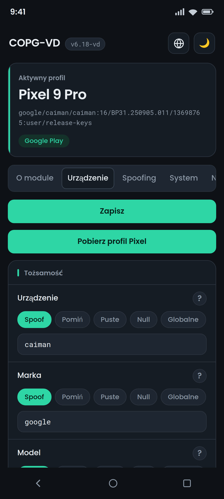
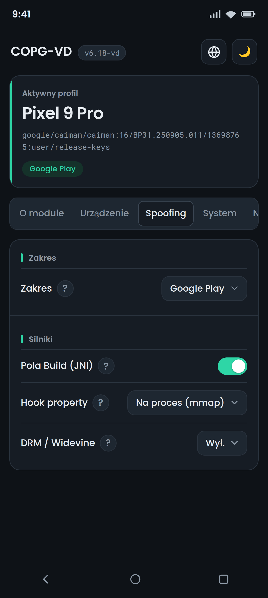
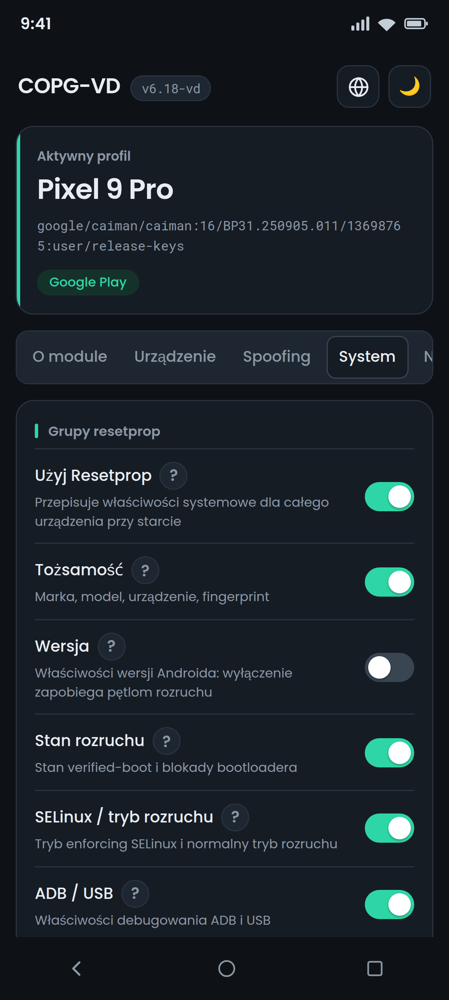
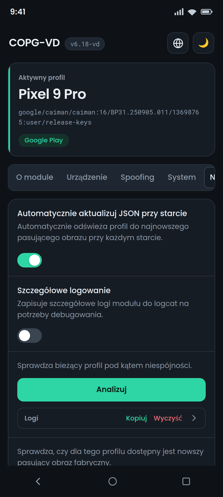

<!--
  ======================================================================
   COPG-VD  ::  global device spoofer
   Spoof your device fingerprint and build.

   Copyright (C) 2026  AlirezaParsi & VD171 (Fork by VD171)
   SPDX-License-Identifier: AGPL-3.0-or-later

   Licensed under the GNU AGPL v3.0 or later. You may obtain a copy at
   https://www.gnu.org/licenses/agpl-3.0.html

   Site           : https://vd171.ru
   Site           : https://vd.priv8.ru
   Source         : https://github.com/VD171/COPG-VD
   GitHub         : @VD171 https://github.com/VD171
   XDA-Developers : @VD171 https://xdaforums.com/m/vd171.4699873/
   XDA thread     : https://xdaforums.com/t/COPG-VD.4807698/
   Telegram       : @VD_Priv8 https://t.me/VD_Priv8
   Channel        : @Priv8_VD https://t.me/Priv8_VD
   Discord        : @VD.Priv8 https://discord.com/users/1296831918989639721
   E-mail         : vd.priv8@pm.me
  ======================================================================
-->

# COPG-VD

<p align="center">
  
</p>

<p align="center">
  <a href="https://github.com/VD171/COPG-VD/releases/latest"></a>
  <a href="LICENSE"></a>
  <a href="https://github.com/VD171/COPG-VD/releases"></a>
  <a href="https://github.com/VD171/COPG-VD/stargazers"></a>
</p>

<p align="center">
  <b>Spoofer urządzenia: przepisuje fingerprint i build urządzenia, aby aplikacje widziały urządzenie, które wybierzesz, zamiast prawdziwego.</b><br>
  Działa na Zygisk (KernelSU, APatch lub Magisk) i domyślnie ogranicza spoofing do stosu Google Play: lżejsza, bardziej niezawodna alternatywa dla PlayIntegrityFix.
</p>

<p align="center">
  <a href="https://github.com/VD171/COPG-VD/releases">Releases</a> ·
  <a href="https://github.com/VD171/COPG-VD/wiki/pl-Home">Wiki</a> ·
  <a href="https://github.com/VD171/COPG-VD/wiki/pl-USER-GUIDE">Przewodnik użytkownika</a> ·
  <a href="https://github.com/VD171/COPG-VD/wiki/pl-CONFIGURATION">Dokumentacja konfiguracji</a> ·
  <a href="https://github.com/VD171/COPG-VD/wiki/pl-ARCHITECTURE">Architektura</a> ·
  <a href="https://github.com/VD171/COPG-VD/wiki/pl-FILE-STRUCTURE">Struktura plików</a> ·
  <a href="https://github.com/VD171/COPG-VD/wiki/pl-AI-AGENTS">Agenci AI</a> ·
  <a href="https://xdaforums.com/t/COPG-VD.4807698/">XDA thread</a>
</p>

> **Languages:** [English](README.md) · [العربية](README.ar.md) · [Čeština](README.cs.md) · [Deutsch](README.de.md) · [Español](README.es.md) · [فارسی](README.fa.md) · [Français](README.fr.md) · [हिन्दी](README.hi.md) · [Bahasa Indonesia](README.id.md) · [Italiano](README.it.md) · [日本語](README.ja.md) · [한국어](README.ko.md) · [Nederlands](README.nl.md) · Polski · [Português](README.pt.md) · [Русский](README.ru.md) · [Svenska](README.sv.md) · [ไทย](README.th.md) · [Türkçe](README.tr.md) · [Українська](README.uk.md) · [Tiếng Việt](README.vi.md) · [中文](README.zh.md)

<p align="center">
     
</p>

---

## Dlaczego

Coraz więcej aplikacji odmawia uruchomienia lub po cichu obniża jakość działania, gdy urządzenie, które widzą, nie jest czystym, certyfikowanym telefonem: Play Integrity, poziomy DRM i kontrole urządzenia specyficzne dla aplikacji, wszystkie czytają fingerprint builda oraz właściwości systemowe. COPG-VD przepisuje tę tożsamość, aby aplikacje widziały spójnego Pixela (lub dowolne urządzenie, które skonfigurujesz) zamiast twojego prawdziwego. Z działającym fingerprint zwykle nie potrzebujesz PlayIntegrityFix ani GooglePhotosUnlimited: to lżejsza, solidniejsza alternatywa, a domyślnie ogranicza spoofing do stosu Google Play, pozostawiając resztę systemu w spokoju.

## Funkcje

- **Kontrola zakresu:** dostarcz spoofowaną tożsamość tylko do stosu Google Play (domyślnie), do całego urządzenia, do whitelisty albo do wszystkiego z wyjątkiem blacklisty. W trybie z zakresem Zygisk dostarcza tożsamość per proces, więc nigdy nie wycieka ona przez globalne właściwości.
- **Niezależne silniki:** pola Build (przepisanie `android.os.Build.*` w JNI), hook właściwości per proces w stylu clean-room (bez hooka funkcji), zgrupowany `resetprop` oraz opcjonalny poziom DRM / Widevine (L1 lub L3) z własną listą celów. Każdy można wyłączyć.
- **Kontrola per pole:** każde pole Build można ustawić, opróżnić, usunąć lub pominąć, a lista `global_fields` służy wartościom, które muszą pozostać spójne w całym urządzeniu.
- **Zawsze świeży fingerprint:** profil Pixela jest dołączony w pudełku i raz na boot odświeża się z najnowszego obrazu fabrycznego Google, możesz też pobrać inny profil Pixela z WebUI. Nigdy nie cofa się i odrzuca profil innego urządzenia.
- **Bezpieczna polityka wersji Androida:** przy żadnej polityce SDK nie jest podnoszone powyżej twojego prawdziwego frameworku (podniesienie go tylko wprowadza telefon w softloop).
- **Analyze:** audytuje konfigurację względem twojego ROM-u i props oraz oznacza wszystko, co niespójne, zanim dotrze to do aplikacji.
- **WebUI:** pięć kart do sterowania wszystkim, bez żadnego żądania sieciowego, plik konfiguracyjny niesie wszystkie ustawienia, więc przetrwają one aktualizację modułu.
- **Przyrostowa samoaktualizacja (VDLU)** oraz natywna biblioteka w **czterech ABI** (arm64-v8a, armeabi-v7a, x86, x86_64).

## Agenci AI

COPG-VD można skryptować bezgłowo: cały moduł jest sterowany jednym plikiem JSON (`/data/adb/COPG-VD/COPG-VD.json`) oraz pojedynczym punktem wejścia powłoki, `fingerprint-update.sh`, ze stabilnymi czasownikami (`check`, `apply`, `analyze`, `fetch-index`, `fetch <path>` i więcej). Agent działający jako root może czytać i zapisywać konfigurację oraz wykonać każdą akcję, którą potrafi WebUI, bez scrapowania WebUI. Zobacz [docs/AI-AGENTS.md](docs/pl/AI-AGENTS.md). Łatki od AI podlegają temu samemu progowi recenzji co wszystkie inne.

## Instalacja

Zflashuj zip w KernelSU, APatch lub Magisk i zrestartuj. Dołączony profil Pixela jest natychmiast spoofowany dla docelowych aplikacji. Instalator uruchamia bramkę integralności `.sha256` i przerywa przy uszkodzonym lub obciętym zipie (a bezpiecznie pomija tam, gdzie brak narzędzia do sum kontrolnych). Wymaga Zygisk, przez KernelSU, APatch lub Magisk, oraz roota.

## Bezpieczeństwo

Spoofing odbywa się wyłącznie po stronie użytkownika: COPG-VD nigdy nie podnosi SDK powyżej twojego prawdziwego frameworku, utrzymuje manufacturer spójny z resztą profilu i czyta prawdziwą wersję z `/system/build.prop`, nigdy z właściwości, które fałszuje. Samoaktualizator wymaga ważnego podpisu ed25519 i odrzuca downgrade'y, WebUI nie wykonuje żadnego żądania sieciowego. Zgłaszaj problemy zgodnie z [SECURITY.md](docs/pl/SECURITY.md).

## Budowanie

Zawsze release, nigdy debug. Biblioteka natywna i pomocnik zakresu są budowane w CI dla wszystkich czterech ABI, workflow wydania składa flashowalny zip, zapisuje towarzyszące pliki `.sha256` per plik, regeneruje podpisaną bazę VDLU i publikuje jako `github-actions[bot]`. Zobacz [CONTRIBUTING.md](docs/pl/CONTRIBUTING.md).

## Jak używać?
Zainstaluj moduł, zrestartuj, a dostarczony profil (Pixel) jest spoofowany dla docelowych aplikacji. Z działającym fingerprint nie potrzebujesz PlayIntegrityFix ani GooglePhotosUnlimited.  
Wszystko konfiguruje się w `/data/adb/COPG-VD/COPG-VD.json` lub z poziomu WebUI. Wszystkie pola są OPCJONALNE: pole, które nie zostanie podane, jest pomijane.  

### Zakres: kto widzi spoofing
`scope_mode` decyduje, które procesy otrzymują spoofowaną tożsamość. W trybie z zakresem tożsamość jest dostarczana per proces przez Zygisk i nie wycieka do reszty systemu przez właściwości globalne.  
* **Google Play** (`playstore`, domyślnie): tylko stos Play (Google Play services, jego proces unstable i Play Store).  
* **Global**: całe urządzenie, widzi ją każdy proces.  
* **Whitelist**: tylko aplikacje w `scope_whitelist`.  
* **Blacklist**: wszystkie aplikacje oprócz tych w `scope_blacklist`.  

### Silniki: jak dostarczany jest spoofing
Każdy z nich jest niezależny i można go wyłączyć:  
* **Build fields (JNI)**: przepisuje `android.os.Build.*` w docelowych procesach.  
* **Property hook**: przedstawia spoofowane właściwości systemowe docelowym procesom (czyste, przeprowadzane per proces remapowanie obszaru właściwości, bez hooka funkcji).  
* **resetprop**: przepisuje właściwości systemowe, zarządzane grupami: tożsamość, wersja, stan rozruchu, SELinux, adb/usb, anty-emulator i przebieg czyszczący. W trybie z zakresem grupy tożsamości i wersji pozostają poza obejmującym całe urządzenie resetprop (Zygisk dostarcza je per proces), grupy rozruchu/blokady/SELinux pozostają globalne.  
* **DRM / Widevine** (domyślnie wyłączone): zgłasza wybrany poziom bezpieczeństwa Widevine, L1 lub L3, aplikacjom, które go odczytują. Domyślnie podąża za zakresem powyżej, ustaw `drm_targets` (listę aplikacji), aby zastosować spoof DRM **tylko** do tych aplikacji, niezależnie od `scope_mode`: moduł pozostaje załadowany w wymienionej aplikacji wyłącznie dla hooka DRM, nawet gdy ta aplikacja znajduje się poza głównym zakresem. Puste lub brak oznacza podążanie za zakresem. (Wymaga trybu z zakresem, nie Global.)  

### Pola: ustaw, puste, usuń lub pomiń
Wewnątrz obiektu `COPG-VD` każde pole Build ma cztery stany:  
* **Ustaw**: `"KEY": "value"` zapisuje wartość.  
* **Puste**: `"KEY": ""` zapisuje pustą wartość.  
* **Usuń**: wypisz klucz w `"COPG-VD-Delete": [ ... ]` najwyższego poziomu, aby go usunąć (pole Build staje się null, właściwość jest usuwana przez `resetprop --delete`).  
* **Pomiń**: całkowicie pomiń klucz, zachowywana jest własna wartość ROM.  

Lista `"global_fields": [ ... ]` stosuje wymienione pola Build dla całego urządzenia nawet w trybie z zakresem, aby zachować spójną wartość wszędzie: tylko dla pól bezpiecznych pod względem spójności (na przykład security patch), nigdy dla tożsamości i nigdy dla grupy wersji Androida.  

### Przykładowy plik konfiguracyjny JSON
`/data/adb/COPG-VD/COPG-VD.json`
```json
{
  "Instructions": "Use strings on double-quotes only.",
  "Instructions": "All fields are OPTIONAL. If some field is not provided, it will be skipped.",
  "Strings extracted from": "https://dl.google.com/developers/android/CANARY/images/factory/tegu_beta-zp11.261016.008-factory-28d56d15.zip",
  "scope_mode": "playstore",
  "motor_drm": false,
  "drm_targets": [],
  "global_fields": ["SECURITY_PATCH"],
  "process_overrides": [],
  "COPG-VD": {
    "BRAND": "google",
    "DEVICE": "tegu",
    "MANUFACTURER": "Google",
    "MODEL": "Pixel 9a",
    "FINGERPRINT": "google/tegu_beta/tegu:CANARY/ZP11.261016.008/16754936:user/release-keys",
    "PRODUCT": "tegu_beta",
    "BOOTLOADER": "unknown",
    "BOARD": "tegu",
    "HARDWARE": "tegu",
    "DISPLAY": "ZP11.261016.008",
    "ID": "ZP11.261016.008",
    "HOST": "e4df75f83a59",
    "INCREMENTAL": "16754936",
    "TIMESTAMP": "1793211232",
    "PREVIEW_SDK": "20261104",
    "USER": "android-build",
    "SDK_FINGERPRINT": "ee82a872870173d77e68050e21a2bcbf",
    "UUID": "FjWvtSORkI0sEwekaPz2s30gqV5vWP_EZHFtBiXzboc",
    "SECURITY_PATCH": "2026-11-05",
    "FIRST_API_LEVEL": "35",
    "DRM_SECURITY_LEVEL": "L1"
  }
}
```
Pamiętaj, aby używać ciągów znaków tylko w podwójnych cudzysłowach.  
Blok powyżej oraz `module/COPG-VD.json.example` są codziennie odświeżane przez workflow [Update COPG-VD.json](.github/workflows/update-json.yml), prosto z najnowszego fabrycznego obrazu Google.  

### Utrzymywanie fingerprint w aktualności
`fingerprint-update.sh` pobiera ten plik i aktualizuje twoją konfigurację, z poziomu WebUI (**Check Update** / **Update Now**) lub samodzielnie **raz na rozruch** (**Auto-update JSON on boot**, domyślnie włączone).  
* `/data/adb/COPG-VD/COPG-VD.json` jest aktualizowany w miejscu, a poprzednia zawartość jest zachowywana obok niego jako `COPG-VD.json.bak`.  
* Przepisywane są tylko pola build (fingerprint, ID, incremental, timestamp, security patch, SDK, UUID, host, user). Wszystko inne, co dostosowałeś, jest zachowywane: dodatkowe klucze, `scope_mode`, `BOOTLOADER`/`BOARD`/`HARDWARE`, inne obiekty, kolejność kluczy i formatowanie.  
* Nigdy nie cofa się: build upstream starszy niż zainstalowany jest odrzucany. Jest to rutyna (repozytorium może być w tyle za konfiguracją, którą zaktualizowałeś ręcznie) i jest to także zabezpieczenie, które ma największe znaczenie na Androidzie, gdzie jedynym dostępnym downloaderem jest busybox `wget`, który nie potrafi weryfikować certyfikatów TLS: z tego samego powodu każda wartość jest weryfikowana przed użyciem.  
* Jeśli twój profil spoofuje **inne urządzenie** (inne `BRAND`/`DEVICE`/`MANUFACTURER`/`MODEL`/`PRODUCT`), nic nie jest stosowane: fingerprint Pixela na innym profilu jest gorszy niż stary fingerprint.  
* Przy rozruchu działa w tle i ponawia próby przez około 10 minut, ponieważ wifi zwykle nie jest jeszcze podniesione, gdy rozruch się kończy. Nigdy nie opóźnia rozruchu.  
* `resetprop` jest ponownie stosowany zaraz po aktualizacji, ale `android.os.Build` jest zapisywany przez moduł zygisk, gdy startuje zygote: **zrestartuj**, aby nowe wartości dotarły do aplikacji.  
* Log w `/data/adb/COPG-VD/update.log`.  

### Wersja Androida: i dlaczego nie jest spoofowana
`ANDROID_VERSION`, `SDK_INT`, `SDK_FULL` i `CODENAME` opisują **twoją ROM**, a nie spoofowane urządzenie. Mówienie aplikacjom, że SDK jest nowsze niż framework w rzeczywistości, sprawia, że wywołują API, które nie istnieją: aplikacje Google się wywalają, telefon się restartuje i zaczyna od nowa. Sam rozruch się kończy, więc jest to **softloop** i nic nie pojawia się w logach rozruchu.  
* Nie ma ich w dostarczonej konfiguracji, a aktualizator nigdy ich nie zapisuje.  
* **Spoof Android version** w WebUI decyduje, czy są one w ogóle stosowane:  
  * **Never** (domyślnie): używana jest własna wersja ROM.  
  * **Up to this ROM**: tylko to, co jej nie przekracza, co w praktyce oznacza obniżenie SDK.  
  * **Force**: wymusza pozostałe pola wersji dokładnie tak, jak prosi konfiguracja, ale SDK i tak jest ograniczone do wartości twojej ROM nawet tutaj (podniesienie SDK powyżej prawdziwego frameworku tylko powoduje softloop i nie ma żadnego uzasadnionego zastosowania), więc od v6.19 **Force już nie powoduje softloopa**.  
* Prawdziwa wersja jest odczytywana z `/system/build.prop`, nigdy z `getprop`: bo to właśnie jego ten moduł fałszuje.  

### Analyze
**Analyze** w WebUI (lub `fingerprint-update.sh analyze`) audytuje konfigurację w jej obecnej postaci: wersję względem ROM, czy plik w ogóle się jeszcze parsuje (uszkodzony sprawia, że moduł nie spoofuje **niczego**, i mówi o tym tylko logcat), czy fingerprint zgadza się z otaczającymi go polami, klucze, których moduł nie czyta, daty oraz czy props już niosą to, o co prosi konfiguracja.  

### WebUI
WebUI jest opcjonalne (wszystko można edytować bezpośrednio w konfiguracji JSON) ale to łatwy sposób na obsługę modułu. Ma pięć zakładek: **About**, **Device** (każde pole, ustawiane per stan, pogrupowane według kategorii), **Spoofing** (zakres i silniki), **System** (grupy resetprop) i **Tools** (Analyze, Check Update, Update Now, Backup/Restore oraz auto-aktualizacja przy rozruchu). Nie wykonuje żadnego żądania sieciowego, wszystko, czego potrzebuje, jest dostarczane wewnątrz modułu.  
Jeśli jesteś użytkownikiem Magisk, użyj KsuWebUI autorstwa KOW (https://github.com/KOWX712/KsuWebUIStandalone/releases). Możesz też użyć WebUI-X Portable autorstwa MMRL (https://github.com/MMRLApp/WebUI-X-Portable/releases) lub KsuWebUI-SN (https://github.com/dnascorpionofficial/KsuWebUI-SN/releases).  

### Ustawienia w konfiguracji
`COPG-VD.json` przechowuje swoje ustawienia obok profilu, więc twoje wybory podróżują wraz z kopią zapasową i mogą być edytowane ręcznie: `scope_mode`, przełączniki silników, grupy resetprop, `global_fields` oraz obiekt `COPG-VD-Settings` (`resetprop`, `autoupdate`, `spoof_version`). Wszystko znajduje się w tym jednym pliku: skrypty rozruchowe i WebUI czytają ustawienia bezpośrednio z niego, więc twoje wybory przetrwają aktualizację modułu. `"spoof_version": "force"` jest odrzucany z pliku i degradowany: przywrócenie starej kopii zapasowej nie może go ponownie uzbroić za twoimi plecami.  

## Aktualizacje przyrostowe (VDLU)

COPG-VD zawiera silnik **[VDLiveUpdate](https://github.com/VD171/VDLiveUpdate) (VDLU)** (wbudowany w `module/vdlu/`): moduł aktualizuje się sam, pobierając tylko zmienione pliki (bloby adresowane treścią + podpisany `manifest.json`), zamiast ponownie pobierać cały `.zip`. Profil **Hardened**: podpis ed25519 jest obowiązkowy, a downgrade'y są blokowane, pełny `.zip` pozostaje ważny jako rozwiązanie awaryjne.

- **`vdlu/`** (dołączony w zipie): `update.sh` (silnik) + `vdlu-verify` + `config.default` + `keyring/` (klucz publiczny).
- **Stan** w `/data/adb/COPG-VD/vdlu/` (config/journal/blobs/staged/rollback), poza modułem, przetrwa ponowne flashowanie.
- **Wyzwalacz przy starcie:** `post-fs-data.sh`, przed zygote, COPG-VD ma `zygisk/*.so` + `sepolicy.rule` (REBOOT-hard), więc nowa `.so` jest przygotowywana i podmieniana, zanim zygote ją zmapuje.
- **WebUI:** panel **Updates** (`webroot/vdlu.js`) z powiadomieniem o postępie i anulowaniem.
- **Wydanie:** zobacz `module/vdlu/RELEASE.md` (`vdlu-pack` + `vdlu-sign`, archiwizuje manifest, `vdlu-gc` usuwa osierocone bloby, wsadowy push na Pages).

<!-- vd-docs -->
## Dokumentacja

- **[Wiki](https://github.com/VD171/COPG-VD/wiki/pl-Home)**: pełna dokumentacja, dostępna online.
- **[Przewodnik użytkownika](https://github.com/VD171/COPG-VD/wiki/pl-USER-GUIDE)**: instalacja, WebUI i codzienne użytkowanie.
- **[Dokumentacja konfiguracji](https://github.com/VD171/COPG-VD/wiki/pl-CONFIGURATION)**: każde ustawienie w pliku konfiguracyjnym i jego działanie.
- **[Architektura](https://github.com/VD171/COPG-VD/wiki/pl-ARCHITECTURE)** i **[Struktura plików](https://github.com/VD171/COPG-VD/wiki/pl-FILE-STRUCTURE)**: jak działa spoofing i gdzie wszystko się znajduje.
- **[Agenci AI](https://github.com/VD171/COPG-VD/wiki/pl-AI-AGENTS)**: steruj konfiguracją i aktualizatorem bez interfejsu.

<!-- /vd-docs -->

## Zobacz także

- **[VDBackup](https://github.com/VD171/VD-Backup)**: pełny backup i przywracanie aplikacji oraz danych jako root, obsługiwane w całości z WebUI.
- **[VD-dropbear](https://github.com/VD171/VD-dropbear)**: samodzielny demon SSH działający z uprawnieniami roota (Dropbear).
- **[VDGoogle](https://github.com/VD171/VD-Google)**: twoje usługi Google (RCS, Wallet, atestacje Play Integrity), odczytane na twoim urządzeniu bez internetu.
- **[VDInstaller](https://github.com/VD171/VD-Installer)**: bezproblemowy rootowy instalator sideload dla pojedynczych, wsadowych i podzielonych APK, z przełącznikiem weryfikatora Play Protect i podszywaniem źródła instalacji.
- **[VDInfos](https://github.com/VD171/VD-Infos)**: debuger metod urządzenia, który odczytuje każdy element wszystkimi metodami zdolnymi go odczytać i porównuje je obok siebie.
- **[VDLiveUpdate](https://github.com/VD171/VDLiveUpdate)**: bezflashowy, przyrostowy silnik samoaktualizacji, wbudowany w moduły KernelSU/APatch/Magisk.
- **[VD-Modules](https://github.com/VD171/VD-Modules)**: nasze repozytorium modułów dla MMRL/WebUI-X (zainstaluj je wszystkie z menedżera roota).
- **[@VictorGabriel7Dev/build.prop](https://github.com/VictorGabriel7Dev/build.prop)**: zbiór danych odcisków `build.prop` urządzeń Pixel (fork @T3SL4).
- **[@VictorGabriel7Dev/mtproto-store](https://github.com/VictorGabriel7Dev/mtproto-store)**: używaj Telegrama jako magazynu obiektów z małego CLI w Go.

## Kontakty

- https://vd171.ru
- https://vd.priv8.ru
- **Telegram:** @VD_Priv8 https://t.me/VD_Priv8
- **Channel:** @Priv8_VD https://t.me/Priv8_VD
- **Discord:** @VD.Priv8 https://discord.com/users/1296831918989639721
- **E-mail:** vd.priv8@pm.me
- **XDA-Developers:** @VD171 https://xdaforums.com/m/vd171.4699873/
- **XDA thread:** https://xdaforums.com/t/COPG-VD.4807698/
- **GitHub:** @VD171 https://github.com/VD171

## Licencja

**AGPL-3.0-or-later**: zobacz [LICENSE](LICENSE). COPG-VD to fork autorstwa VD171 oryginalnego COPG autorstwa AlirezaParsi (Apache-2.0), udostępniony ponownie na licencji GNU AGPL-3.0-or-later. COPYLEFT SIECIOWY: jeśli uruchamiasz zmodyfikowaną wersję, nawet jako usługę, musisz udostępnić jej kod źródłowy.

## Znaki towarowe

COPG-VD to niezależny, nieoficjalny projekt. Nie jest powiązany z Google LLC, wspierany ani sponsorowany przez Google LLC. "Google", "Google Play", "Play Integrity", "Pixel", "Android" oraz powiązane nazwy i logo są znakami towarowymi Google LLC. COPG-VD działa w całości na twoim urządzeniu.

## Tags

`Zygisk` `KernelSU` `APatch` `Magisk` `device-spoofing` `fingerprint` `PlayIntegrity` `Pixel` `build.prop` `resetprop` `root` `Android` `COPG-VD`

---

📣 **Dołącz do kanału po aktualizacje:** @Priv8_VD https://t.me/Priv8_VD
