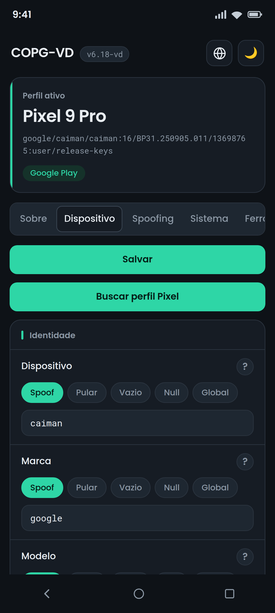
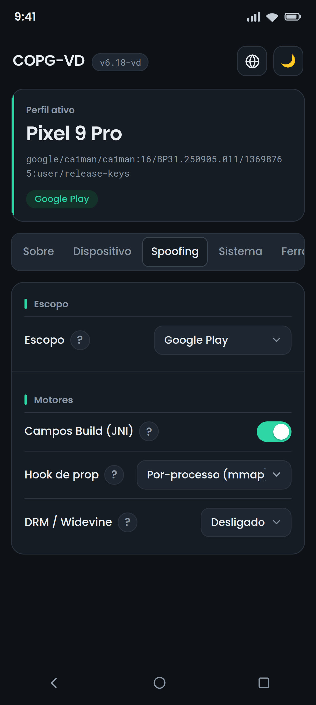
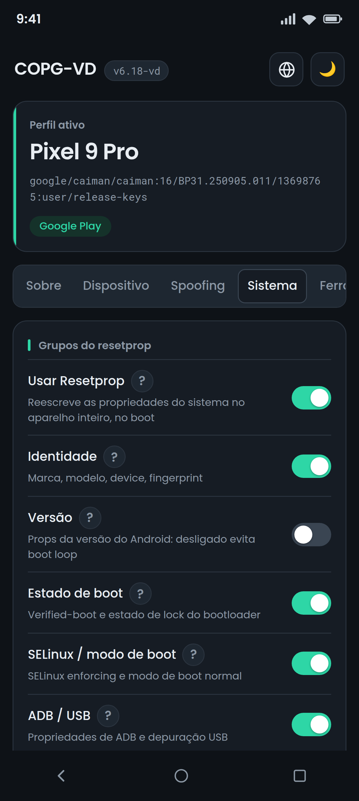
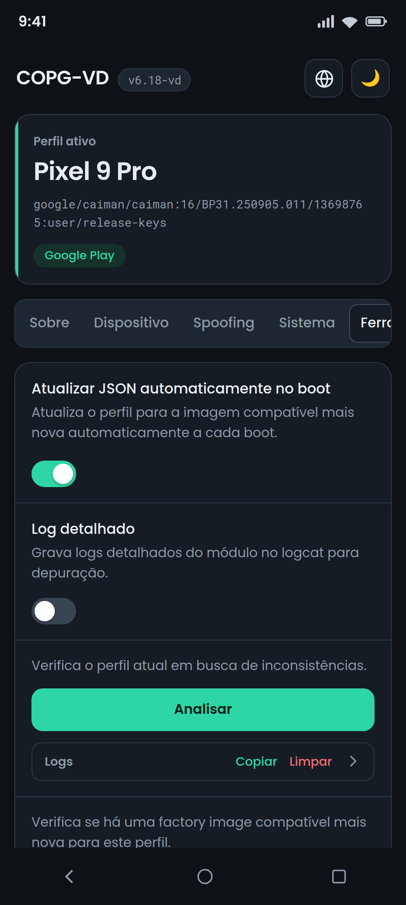

<!--
  ======================================================================
   COPG-VD  ::  global device spoofer
   Spoof your device fingerprint and build.

   Copyright (C) 2026  AlirezaParsi & VD171 (Fork by VD171)
   SPDX-License-Identifier: AGPL-3.0-or-later

   Licensed under the GNU AGPL v3.0 or later. You may obtain a copy at
   https://www.gnu.org/licenses/agpl-3.0.html

   Site           : https://vd171.ru
   Site           : https://vd.priv8.ru
   Source         : https://github.com/VD171/COPG-VD
   GitHub         : @VD171 https://github.com/VD171
   XDA-Developers : @VD171 https://xdaforums.com/m/vd171.4699873/
   XDA thread     : https://xdaforums.com/t/COPG-VD.4807698/
   Telegram       : @VD_Priv8 https://t.me/VD_Priv8
   Channel        : @Priv8_VD https://t.me/Priv8_VD
   Discord        : @VD.Priv8 https://discord.com/users/1296831918989639721
   E-mail         : vd.priv8@pm.me
  ======================================================================
-->

# COPG-VD

<p align="center">
  
</p>

<p align="center">
  <a href="https://github.com/VD171/COPG-VD/releases/latest"></a>
  <a href="LICENSE"></a>
  <a href="https://github.com/VD171/COPG-VD/releases"></a>
  <a href="https://github.com/VD171/COPG-VD/stargazers"></a>
</p>

<p align="center">
  <b>Um spoofer de dispositivo: ele reescreve o fingerprint e o build do dispositivo para que os apps vejam o dispositivo que você escolher em vez do real.</b><br>
  Ele roda no Zygisk (KernelSU, APatch ou Magisk) e, por padrão, restringe o spoof à stack do Google Play: uma alternativa mais leve e mais robusta ao PlayIntegrityFix.
</p>

<p align="center">
  <a href="https://github.com/VD171/COPG-VD/releases">Releases</a> ·
  <a href="https://github.com/VD171/COPG-VD/wiki/pt-Home">Wiki</a> ·
  <a href="https://github.com/VD171/COPG-VD/wiki/pt-USER-GUIDE">Guia do usuário</a> ·
  <a href="https://github.com/VD171/COPG-VD/wiki/pt-CONFIGURATION">Referência de configuração</a> ·
  <a href="https://github.com/VD171/COPG-VD/wiki/pt-ARCHITECTURE">Arquitetura</a> ·
  <a href="https://github.com/VD171/COPG-VD/wiki/pt-FILE-STRUCTURE">Estrutura de arquivos</a> ·
  <a href="https://github.com/VD171/COPG-VD/wiki/pt-AI-AGENTS">Agentes de IA</a> ·
  <a href="https://xdaforums.com/t/COPG-VD.4807698/">XDA thread</a>
</p>

> **Languages:** [English](README.md) · [العربية](README.ar.md) · [Čeština](README.cs.md) · [Deutsch](README.de.md) · [Español](README.es.md) · [فارسی](README.fa.md) · [Français](README.fr.md) · [हिन्दी](README.hi.md) · [Bahasa Indonesia](README.id.md) · [Italiano](README.it.md) · [日本語](README.ja.md) · [한국어](README.ko.md) · [Nederlands](README.nl.md) · [Polski](README.pl.md) · Português · [Русский](README.ru.md) · [Svenska](README.sv.md) · [ไทย](README.th.md) · [Türkçe](README.tr.md) · [Українська](README.uk.md) · [Tiếng Việt](README.vi.md) · [中文](README.zh.md)

<p align="center">
     
</p>

---

## Por quê

Cada vez mais apps se recusam a rodar, ou silenciosamente se degradam, quando o dispositivo que eles veem não é um telefone limpo e certificado: Play Integrity, níveis de DRM e verificações de dispositivo específicas do app leem todos o fingerprint do build e as propriedades de sistema. O COPG-VD reescreve essa identidade para que os apps vejam um Pixel coerente (ou qualquer dispositivo que você configurar) em vez do seu real. Com um fingerprint funcional você normalmente não precisa do PlayIntegrityFix nem do GooglePhotosUnlimited: é uma alternativa mais leve e mais robusta e, por padrão, restringe o spoof à stack do Google Play, deixando o resto do seu sistema em paz.

## Recursos

- **Controle de escopo:** entregue a identidade spoofada apenas à stack do Google Play (o padrão), ao dispositivo inteiro, a uma whitelist ou a tudo exceto uma blacklist. Em um modo com escopo, o Zygisk entrega a identidade por processo, então ela nunca vaza pelas propriedades globais.
- **Engines independentes:** campos Build (uma reescrita JNI de `android.os.Build.*`), um hook de propriedade por processo clean-room (sem hook de função), `resetprop` agrupado e um nível opcional de DRM / Widevine (L1 ou L3) com sua própria lista de alvos. Cada um pode ser desligado.
- **Controle por campo:** cada campo Build pode ser definido, esvaziado, removido ou ignorado, com uma lista `global_fields` para valores que precisam ficar consistentes em todo o dispositivo.
- **Fingerprint sempre atual:** um perfil Pixel vem incluído e se atualiza uma vez por boot a partir da imagem de fábrica mais recente do Google, você também pode buscar outro perfil Pixel pela WebUI. Ele nunca retrocede e recusa um perfil de outro dispositivo.
- **Política segura de versão do Android:** o SDK nunca é elevado acima do seu framework real (elevá-lo só causa softloop no telefone), sob qualquer política.
- **Analyze:** audita a config em relação à sua ROM e às props e sinaliza qualquer incoerência antes que ela chegue aos apps.
- **WebUI:** cinco abas para operar tudo, sem nenhuma requisição de rede, o arquivo de configuração carrega todas as configurações, então elas sobrevivem a uma atualização do módulo.
- **Auto-atualização incremental (VDLU)** e uma biblioteca nativa de **quatro ABIs** (arm64-v8a, armeabi-v7a, x86, x86_64).

## Agentes de IA

O COPG-VD é scriptável de forma headless: o módulo inteiro é controlado por um único arquivo JSON (`/data/adb/COPG-VD/COPG-VD.json`) e um único ponto de entrada shell, `fingerprint-update.sh`, com verbos estáveis (`check`, `apply`, `analyze`, `fetch-index`, `fetch <path>` e mais). Um agente rodando como root pode ler e escrever a config e executar toda ação que a WebUI faz, sem fazer scraping da WebUI. Veja [docs/AI-AGENTS.md](docs/pt/AI-AGENTS.md). Patches de IA passam pelo mesmo crivo de revisão que qualquer outro.

## Instalação

Faça o flash do zip no KernelSU, APatch ou Magisk e reinicie. O perfil Pixel incluído é spoofado para os apps alvo imediatamente. O instalador roda um gate de integridade `.sha256` e aborta num zip corrompido ou truncado (e pula com segurança onde não há ferramenta de checksum). Requer Zygisk, via KernelSU, APatch ou Magisk, e root.

## Segurança

O spoof é apenas do lado do usuário: o COPG-VD nunca eleva o SDK acima do seu framework real, mantém o manufacturer coerente com o resto do perfil e lê a versão real de `/system/build.prop`, nunca das propriedades que ele falsifica. O auto-atualizador exige uma assinatura ed25519 válida e recusa downgrades, a WebUI não faz nenhuma requisição de rede. Reporte problemas conforme o [SECURITY.md](docs/pt/SECURITY.md).

## Compilação

Sempre release, nunca debug. A biblioteca nativa e o helper de escopo são compilados no CI para todas as quatro ABIs, o workflow de release monta o zip flashável, escreve os companions `.sha256` por arquivo, regenera a baseline VDLU assinada e publica como `github-actions[bot]`. Veja [CONTRIBUTING.md](docs/pt/CONTRIBUTING.md).

## Como usar?
Instale o módulo, reinicie, e o perfil incluído (um Pixel) é spoofado para os apps alvo. Com um fingerprint funcional você não precisa do PlayIntegrityFix nem do GooglePhotosUnlimited.  
Tudo é configurado em `/data/adb/COPG-VD/COPG-VD.json`, ou pela WebUI. Todos os campos são OPCIONAIS: um campo que não for informado é ignorado.  

### Escopo: quem vê o spoof
`scope_mode` decide quais processos recebem a identidade spoofada. Em um modo com escopo, a identidade é entregue por processo pelo Zygisk e não vaza para o resto do sistema pelas propriedades globais.  
* **Google Play** (`playstore`, o padrão): apenas a stack do Play (Google Play services, seu processo unstable e a Play Store).  
* **Global**: o dispositivo inteiro, todo processo a vê.  
* **Whitelist**: apenas os apps em `scope_whitelist`.  
* **Blacklist**: todos os apps exceto os que estão em `scope_blacklist`.  

### Engines: como o spoof é entregue
Cada uma é independente e pode ser desligada:  
* **Build fields (JNI)**: reescreve `android.os.Build.*` nos processos alvo.  
* **Property hook**: apresenta as propriedades de sistema spoofadas aos processos alvo (um remapeamento clean-room da área de propriedades por processo, sem hook de função).  
* **resetprop**: reescreve as propriedades de sistema, gerenciadas por grupo: identidade, versão, estado de boot, SELinux, adb/usb, anti-emulador e uma passada de limpeza. Em um modo com escopo, os grupos de identidade e versão ficam de fora do resetprop para o dispositivo inteiro (o Zygisk os entrega por processo), os grupos de boot/lock/SELinux permanecem globais.  
* **DRM / Widevine** (desligado por padrão): reporta um nível de segurança Widevine escolhido, L1 ou L3, aos apps que o leem. Por padrão ele segue o escopo acima, defina `drm_targets` (uma lista de apps) para aplicar o spoof de DRM **apenas** a esses apps, independentemente do `scope_mode`: o módulo permanece carregado num app listado só para o hook de DRM, mesmo quando esse app está fora do escopo principal. Vazia ou ausente significa seguir o escopo. (Exige um modo com escopo, não Global.)  

### Campos: definir, vazio, remover ou ignorar
Dentro do objeto `COPG-VD`, cada campo Build tem quatro estados:  
* **Definir**: `"KEY": "value"` escreve o valor.  
* **Vazio**: `"KEY": ""` escreve um valor vazio.  
* **Remover**: liste a chave em um `"COPG-VD-Delete": [ ... ]` de nível superior para removê-la (um campo Build vira null, uma propriedade é removida com `resetprop --delete`).  
* **Ignorar**: deixe a chave totalmente de fora, o valor da própria ROM é mantido.  

Uma lista `"global_fields": [ ... ]` aplica os campos Build nomeados no dispositivo inteiro mesmo em um modo com escopo, para manter um valor consistente em todo lugar: apenas para campos seguros quanto à coerência (o security patch, por exemplo), nunca identidade e nunca o grupo da versão do Android.  

### Exemplo de arquivo de configuração JSON
`/data/adb/COPG-VD/COPG-VD.json`
```json
{
  "Instructions": "Use strings on double-quotes only.",
  "Instructions": "All fields are OPTIONAL. If some field is not provided, it will be skipped.",
  "Strings extracted from": "https://dl.google.com/developers/android/CANARY/images/factory/tegu_beta-zp11.261016.008-factory-28d56d15.zip",
  "scope_mode": "playstore",
  "motor_drm": false,
  "drm_targets": [],
  "global_fields": ["SECURITY_PATCH"],
  "process_overrides": [],
  "COPG-VD": {
    "BRAND": "google",
    "DEVICE": "tegu",
    "MANUFACTURER": "Google",
    "MODEL": "Pixel 9a",
    "FINGERPRINT": "google/tegu_beta/tegu:CANARY/ZP11.261016.008/16754936:user/release-keys",
    "PRODUCT": "tegu_beta",
    "BOOTLOADER": "unknown",
    "BOARD": "tegu",
    "HARDWARE": "tegu",
    "DISPLAY": "ZP11.261016.008",
    "ID": "ZP11.261016.008",
    "HOST": "e4df75f83a59",
    "INCREMENTAL": "16754936",
    "TIMESTAMP": "1793211232",
    "PREVIEW_SDK": "20261104",
    "USER": "android-build",
    "SDK_FINGERPRINT": "ee82a872870173d77e68050e21a2bcbf",
    "UUID": "FjWvtSORkI0sEwekaPz2s30gqV5vWP_EZHFtBiXzboc",
    "SECURITY_PATCH": "2026-11-05",
    "FIRST_API_LEVEL": "35",
    "DRM_SECURITY_LEVEL": "L1"
  }
}
```
Certifique-se de usar strings apenas com aspas duplas.  
O bloco acima e `module/COPG-VD.json.example` são atualizados diariamente pelo workflow [Update COPG-VD.json](.github/workflows/update-json.yml), direto da imagem de fábrica mais recente do Google.  

### Mantendo o fingerprint atualizado
`fingerprint-update.sh` baixa esse arquivo e atualiza sua configuração, pela WebUI (**Check Update** / **Update Now**) ou por conta própria **uma vez por boot** (**Auto-update JSON on boot**, ativado por padrão).  
* `/data/adb/COPG-VD/COPG-VD.json` é atualizado no lugar, e o conteúdo anterior é mantido ao lado como `COPG-VD.json.bak`.  
* Apenas os campos de build são reescritos (fingerprint, ID, incremental, timestamp, security patch, SDK, UUID, host, user). Todo o resto que você personalizou é preservado: chaves extras, `scope_mode`, `BOOTLOADER`/`BOARD`/`HARDWARE`, outros objetos, ordem das chaves e formatação.  
* Ele nunca retrocede: um build upstream mais antigo do que o instalado é recusado. Isso é rotineiro (o repositório pode ficar atrás de uma configuração que você atualizou à mão) e também é a proteção que mais importa no Android, onde o único downloader disponível é o busybox `wget`, que não consegue validar certificados TLS: todo valor é validado antes do uso pelo mesmo motivo.  
* Se o seu perfil faz spoof de **outro dispositivo** (`BRAND`/`DEVICE`/`MANUFACTURER`/`MODEL`/`PRODUCT` diferentes), nada é aplicado: um fingerprint de Pixel em outro perfil é pior do que um fingerprint antigo.  
* No boot ele roda em segundo plano e segue tentando por ~10 minutos, porque o wifi geralmente ainda não subiu quando o boot termina. Ele nunca atrasa o boot.  
* `resetprop` é reaplicado logo após uma atualização, mas `android.os.Build` é escrito pelo módulo zygisk quando o zygote inicia: **reinicie** para os novos valores chegarem aos apps.  
* Log em `/data/adb/COPG-VD/update.log`.  

### Versão do Android: e por que ela não é falsificada
`ANDROID_VERSION`, `SDK_INT`, `SDK_FULL` e `CODENAME` descrevem **a sua ROM**, não o dispositivo que está sendo spoofado. Dizer aos apps que o SDK é mais novo do que o framework realmente é faz com que eles chamem APIs que não existem: os apps do Google travam, o celular reinicia, e tudo recomeça. O boot em si se completa, então é um **softloop** e nada aparece nos logs de boot.  
* Eles não estão na configuração entregue e o atualizador nunca os escreve.  
* **Spoof Android version** na WebUI decide se eles são aplicados ou não:  
  * **Never** (padrão): a própria versão da ROM é usada.  
  * **Up to this ROM**: apenas o que não a ultrapassa, o que na prática significa baixar o SDK.  
  * **Force**: força os outros campos de versão exatamente como a configuração pede, mas o SDK ainda é limitado ao valor da sua ROM mesmo aqui (elevar o SDK acima do framework real só causa softloop e não tem uso legítimo), então desde a v6.19 **Force não causa mais softloop**.  
* A versão real é lida de `/system/build.prop`, nunca do `getprop`: que é justamente o que este módulo falsifica.  

### Analyze
**Analyze** na WebUI (ou `fingerprint-update.sh analyze`) audita a configuração como ela está: a versão em relação à ROM, se o arquivo ainda é interpretável (um arquivo quebrado faz o módulo não spoofar **nada**, e só o logcat avisa), se o fingerprint concorda com os campos ao redor, chaves que o módulo não lê, datas, e se as props já carregam o que a configuração pede.  

### WebUI
A WebUI é opcional (tudo pode ser editado diretamente na configuração JSON) mas é o jeito fácil de operar o módulo. Ela tem cinco abas: **About**, **Device** (todos os campos, definidos por estado, agrupados por categoria), **Spoofing** (escopo e engines), **System** (os grupos do resetprop) e **Tools** (Analyze, Check Update, Update Now, Backup/Restore e o auto-update de boot). Ela não faz nenhuma requisição de rede, tudo o que precisa vem dentro do módulo.  
Se você é usuário de Magisk, use o KsuWebUI do KOW (https://github.com/KOWX712/KsuWebUIStandalone/releases). Você também pode usar o WebUI-X Portable do MMRL (https://github.com/MMRLApp/WebUI-X-Portable/releases) ou KsuWebUI-SN (https://github.com/dnascorpionofficial/KsuWebUI-SN/releases).  

### Configurações na config
`COPG-VD.json` carrega suas configurações junto ao perfil, então suas escolhas viajam com um backup e podem ser editadas à mão: `scope_mode`, as chaves das engines, os grupos do resetprop, `global_fields`, e um objeto `COPG-VD-Settings` (`resetprop`, `autoupdate`, `spoof_version`). Tudo fica nesse único arquivo: os scripts de boot e a WebUI leem as configurações direto dele, então suas escolhas sobrevivem a uma atualização do módulo. `"spoof_version": "force"` é recusado a partir do arquivo e rebaixado: restaurar um backup antigo não deve rearmá-lo sem você saber.  

## Atualizações incrementais (VDLU)

O COPG-VD inclui o motor **[VDLiveUpdate](https://github.com/VD171/VDLiveUpdate) (VDLU)** (incorporado em `module/vdlu/`): o módulo se atualiza sozinho buscando apenas os arquivos que mudaram (blobs endereçados por conteúdo + um `manifest.json` assinado), em vez de baixar o `.zip` inteiro de novo. Perfil **Hardened**: a assinatura ed25519 é obrigatória e os downgrades são bloqueados, o `.zip` completo continua válido como alternativa.

- **`vdlu/`** (incluído no zip): `update.sh` (motor) + `vdlu-verify` + `config.default` + `keyring/` (chave pública).
- **Estado** em `/data/adb/COPG-VD/vdlu/` (config/journal/blobs/staged/rollback), fora do módulo, sobrevive a um reflash.
- **Gatilho de boot:** `post-fs-data.sh`, pré-zygote, o COPG-VD tem `zygisk/*.so` + `sepolicy.rule` (REBOOT-hard), então a nova `.so` é preparada e trocada antes de o zygote mapeá-la.
- **WebUI:** um painel **Updates** (`webroot/vdlu.js`) com um aviso de progresso e cancelamento.
- **Lançamento:** veja `module/vdlu/RELEASE.md` (`vdlu-pack` + `vdlu-sign`, arquiva o manifest, o `vdlu-gc` remove os blobs órfãos, push em lote para o Pages).

<!-- vd-docs -->
## Documentação

- **[Wiki](https://github.com/VD171/COPG-VD/wiki/pt-Home)**: a documentação completa, para consultar online.
- **[Guia do usuário](https://github.com/VD171/COPG-VD/wiki/pt-USER-GUIDE)**: como instalar, a WebUI e o uso no dia a dia.
- **[Referência de configuração](https://github.com/VD171/COPG-VD/wiki/pt-CONFIGURATION)**: cada opção do arquivo de configuração e o que faz.
- **[Arquitetura](https://github.com/VD171/COPG-VD/wiki/pt-ARCHITECTURE)** e **[Estrutura de arquivos](https://github.com/VD171/COPG-VD/wiki/pt-FILE-STRUCTURE)**: como o spoofing funciona e onde tudo fica.
- **[Agentes de IA](https://github.com/VD171/COPG-VD/wiki/pt-AI-AGENTS)**: controle a config e o atualizador sem interface.

<!-- /vd-docs -->

## Veja também

- **[VDBackup](https://github.com/VD171/VD-Backup)**: backup e restauração completos de apps e dados como root, operados inteiramente por uma WebUI.
- **[VD-dropbear](https://github.com/VD171/VD-dropbear)**: um daemon SSH standalone com root (Dropbear).
- **[VDGoogle](https://github.com/VD171/VD-Google)**: seus serviços Google (RCS, Wallet, atestações do Play Integrity), lidos no seu aparelho sem internet.
- **[VDInstaller](https://github.com/VD171/VD-Installer)**: um instalador sideload com root e sem atrito para APKs únicos, em lote e divididos, com um interruptor para o verificador do Play Protect e falsificação da origem de instalação.
- **[VDInfos](https://github.com/VD171/VD-Infos)**: um debugger de métodos de dispositivo que lê cada item por todos os métodos capazes de lê-lo e os compara lado a lado.
- **[VDLiveUpdate](https://github.com/VD171/VDLiveUpdate)**: um motor de autoatualização incremental e sem flash, embarcado em módulos KernelSU/APatch/Magisk.
- **[VD-Modules](https://github.com/VD171/VD-Modules)**: nosso repositório de módulos para MMRL/WebUI-X (instale todos eles pelo seu gerenciador de root).
- **[@VictorGabriel7Dev/build.prop](https://github.com/VictorGabriel7Dev/build.prop)**: um conjunto de dados de fingerprints `build.prop` de Pixel (fork de @T3SL4).
- **[@VictorGabriel7Dev/mtproto-store](https://github.com/VictorGabriel7Dev/mtproto-store)**: use o Telegram como armazenamento de objetos a partir de uma pequena CLI em Go.

## Contatos

- https://vd171.ru
- https://vd.priv8.ru
- **Telegram:** @VD_Priv8 https://t.me/VD_Priv8
- **Channel:** @Priv8_VD https://t.me/Priv8_VD
- **Discord:** @VD.Priv8 https://discord.com/users/1296831918989639721
- **E-mail:** vd.priv8@pm.me
- **XDA-Developers:** @VD171 https://xdaforums.com/m/vd171.4699873/
- **XDA thread:** https://xdaforums.com/t/COPG-VD.4807698/
- **GitHub:** @VD171 https://github.com/VD171

## Licença

**AGPL-3.0-or-later**: veja [LICENSE](LICENSE). COPG-VD é um fork feito por VD171 do COPG original de AlirezaParsi (Apache-2.0), relicenciado sob a GNU AGPL-3.0-or-later. COPYLEFT DE REDE: se você executar uma versão modificada, mesmo como serviço, deve oferecer o código-fonte.

## Marcas registradas

COPG-VD é um projeto independente e não oficial. Não é afiliado, endossado nem patrocinado pela Google LLC. "Google", "Google Play", "Play Integrity", "Pixel", "Android" e nomes e logotipos relacionados são marcas registradas da Google LLC. O COPG-VD roda inteiramente no seu dispositivo.

## Tags

`Zygisk` `KernelSU` `APatch` `Magisk` `device-spoofing` `fingerprint` `PlayIntegrity` `Pixel` `build.prop` `resetprop` `root` `Android` `COPG-VD`

---

📣 **Entre no canal para receber atualizações:** @Priv8_VD https://t.me/Priv8_VD
