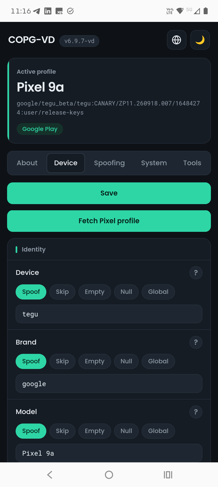
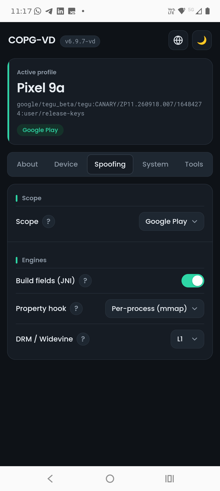
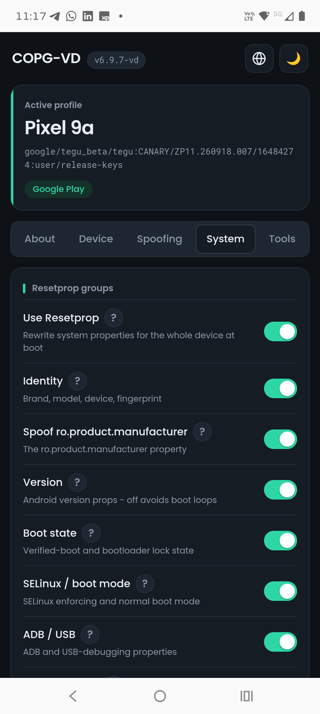
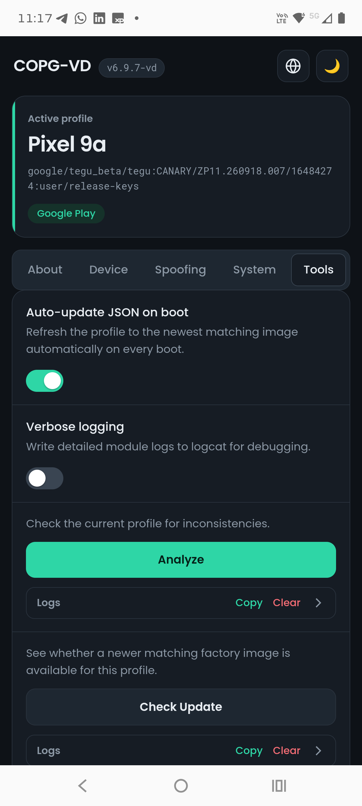

<!--
  COPG-VD: global device spoofer: spoof your device fingerprint and build.
  Copyright (C) 2026  AlirezaParsi & VD171. SPDX-License-Identifier: Apache-2.0 (Fork by VD171)
-->

# COPG-VD

<p align="center">
  
</p>

<p align="center">
  <a href="https://github.com/VD171/COPG-VD/releases/latest"></a>
  <a href="LICENSE"></a>
  <a href="https://github.com/VD171/COPG-VD/releases"></a>
  <a href="https://github.com/VD171/COPG-VD/stargazers"></a>
</p>

<p align="center">
  <b>COPG-VD är en enhetsspoofer: den skriver om enhetens fingerprint och build så att appar ser enheten du väljer i stället för den verkliga.</b><br>
  Den körs på Zygisk (KernelSU, APatch eller Magisk) och begränsar som standard spoofingen till Google Play-stacken: vilket gör den till ett lättare och mer robust alternativ till PlayIntegrityFix.
</p>

<p align="center">
  <a href="https://github.com/VD171/COPG-VD/releases">Releases</a> ·
  <a href="https://github.com/VD171/COPG-VD/wiki/sv-Home">Wiki</a> ·
  <a href="https://github.com/VD171/COPG-VD/wiki/sv-USER-GUIDE">Användarguide</a> ·
  <a href="https://github.com/VD171/COPG-VD/wiki/sv-CONFIGURATION">Konfigurationsreferens</a> ·
  <a href="https://github.com/VD171/COPG-VD/wiki/sv-ARCHITECTURE">Arkitektur</a> ·
  <a href="https://github.com/VD171/COPG-VD/wiki/sv-FILE-STRUCTURE">Filstruktur</a> ·
  <a href="https://github.com/VD171/COPG-VD/wiki/sv-AI-AGENTS">AI-agenter</a> ·
  <a href="https://xdaforums.com/t/COPG-VD.4807698/">XDA thread</a>
</p>

> **Languages:** [English](README.md) · [العربية](README.ar.md) · [Čeština](README.cs.md) · [Deutsch](README.de.md) · [Español](README.es.md) · [فارسی](README.fa.md) · [Français](README.fr.md) · [हिन्दी](README.hi.md) · [Bahasa Indonesia](README.id.md) · [Italiano](README.it.md) · [日本語](README.ja.md) · [한국어](README.ko.md) · [Nederlands](README.nl.md) · [Polski](README.pl.md) · [Português](README.pt.md) · [Русский](README.ru.md) · [Svenska](README.sv.md) · [ไทย](README.th.md) · [Türkçe](README.tr.md) · [Українська](README.uk.md) · [Tiếng Việt](README.vi.md) · [中文](README.zh.md)

<p align="center">
     
</p>

---

## Varför

Appar vägrar allt oftare att köra, eller nedgraderar tyst, när enheten de ser inte är en ren, certifierad telefon: Play Integrity, DRM-nivåer och appspecifika enhetskontroller läser alla build-fingerprintet och systemegenskaperna. COPG-VD skriver om den identiteten så att appar ser en koherent Pixel (eller vilken enhet du än konfigurerar) i stället för din verkliga. Med ett fungerande fingerprint behöver du oftast inte PlayIntegrityFix eller GooglePhotosUnlimited: det är ett lättare och mer robust alternativ, och som standard begränsar det spoofingen till Google Play-stacken så att resten av ditt system lämnas i fred.

## Funktioner

- **Omfattningskontroll:** leverera den spoofade identiteten till enbart Google Play-stacken (standard), hela enheten, en whitelist eller allt utom en blacklist. I ett läge med omfattning levererar Zygisk identiteten per process, så den läcker aldrig ut via de globala egenskaperna.
- **Oberoende motorer:** Build-fält (en JNI-omskrivning av `android.os.Build.*`), en clean-room property-hook per process (ingen funktionshook), grupperad `resetprop` och en valfri DRM- / Widevine-nivå (L1 eller L3) med en egen mållista. Var och en kan stängas av.
- **Kontroll per fält:** varje Build-fält kan anges, tömmas, raderas eller hoppas över, med en `global_fields`-lista för värden som måste förbli konsekventa enhetsövergripande.
- **Alltid färskt fingerprint:** en Pixel-profil medföljer och uppdaterar sig själv en gång per boot från den nyaste Google-factory-avbildningen; du kan också hämta en annan Pixel-profil från WebUI. Den nedgraderar aldrig och vägrar en profil för en annan enhet.
- **Säker policy för Android-version:** SDK:n höjs aldrig över ditt verkliga framework (att höja den softloopar bara telefonen), under varje policy.
- **Analyze:** granskar konfigurationen mot din ROM och dina props och flaggar allt inkoherent innan det når apparna.
- **WebUI:** fem flikar för att styra allt, utan någon nätverksbegäran; konfigurationsfilen bär alla inställningar så att de överlever en moduluppdatering.
- **Inkrementell självuppdatering (VDLU)** och ett native-bibliotek med **fyra ABI:er** (arm64-v8a, armeabi-v7a, x86, x86_64).

## AI-agenter

COPG-VD kan skriptas huvudlöst: hela modulen drivs av en enda JSON-fil (`/data/adb/COPG-VD/COPG-VD.json`) och en enda shell-ingångspunkt, `fingerprint-update.sh`, med stabila verb (`check`, `apply`, `analyze`, `fetch-index`, `fetch <path>` med flera). En agent som körs som root kan läsa och skriva konfigurationen och driva varje åtgärd som WebUI kan, utan att skrapa WebUI. Se [docs/AI-AGENTS.md](docs/sv/AI-AGENTS.md). Patchar från AI hålls till samma granskningsnivå som alla andra.

## Installation

Flasha zip-filen i KernelSU, APatch eller Magisk och starta om. Den medföljande Pixel-profilen spoofas omedelbart till målapparna. Installeraren kör en `.sha256`-integritetsgrind och avbryter vid en korrupt eller trunkerad zip (och hoppar säkert över där inget checksummeverktyg finns). Kräver Zygisk, via KernelSU, APatch eller Magisk, samt root.

## Säkerhet

Spoofingen är enbart användarsidig: COPG-VD höjer aldrig SDK:n över ditt verkliga framework, håller tillverkaren koherent med resten av profilen och läser den verkliga versionen från `/system/build.prop`, aldrig från egenskaperna den förfalskar. Självuppdateraren kräver en giltig ed25519-signatur och vägrar nedgraderingar; WebUI gör ingen nätverksbegäran. Rapportera problem enligt [SECURITY.md](docs/sv/SECURITY.md).

## Bygge

Alltid release, aldrig debug. Native-biblioteket och scope-hjälparen byggs i CI för alla fyra ABI:er; release-arbetsflödet sätter samman den flashbara zip-filen, skriver `.sha256`-följeslagarna per fil, regenererar den signerade VDLU-baslinjen och publicerar som `github-actions[bot]`. Se [CONTRIBUTING.md](docs/sv/CONTRIBUTING.md).

## Hur använder man den?
Installera modulen, starta om, så spoofas den medföljande profilen (en Pixel) till målapparna. Med ett fungerande fingerprint behöver du inte PlayIntegrityFix eller GooglePhotosUnlimited.  
Allt konfigureras i `/data/adb/COPG-VD/COPG-VD.json`, eller från WebUI. Alla fält är VALFRIA: ett fält som inte anges hoppas över.  

### Omfattning: vem som ser spoofingen
`scope_mode` avgör vilka processer som får den spoofade identiteten. I ett läge med omfattning levereras identiteten per process av Zygisk och läcker inte ut till resten av systemet via de globala egenskaperna.  
* **Google Play** (`playstore`, standard): endast Play-stacken (Google Play services, dess unstable-process och Play Store).  
* **Global**: hela enheten; varje process ser den.  
* **Whitelist**: endast apparna i `scope_whitelist`.  
* **Blacklist**: alla appar utom de i `scope_blacklist`.  

### Motorer: hur spoofingen levereras
Var och en är oberoende och kan stängas av:  
* **Build fields (JNI)**: skriver om `android.os.Build.*` i målprocesserna.  
* **Property hook**: presenterar de spoofade systemegenskaperna för målprocesserna (en clean-room-ommappning av egenskapsområdet per process, ingen funktionshook).  
* **resetprop**: skriver om systemegenskaperna, hanterade per grupp: identitet, version, starttillstånd, SELinux, adb/usb, anti-emulator och en rensningsomgång. I ett läge med omfattning hålls identitets- och versionsgrupperna utanför den enhetsövergripande resetprop (Zygisk levererar dem per process); grupperna för boot/lås/SELinux förblir globala.  
* **DRM / Widevine** (av som standard): rapporterar en vald Widevine-säkerhetsnivå, L1 eller L3, till apparna som läser den. Som standard följer den omfattningen ovan; ange `drm_targets` (en lista över appar) för att tillämpa DRM-spoofen **endast** på dessa appar, oberoende av `scope_mode`: modulen förblir laddad i en listad app enbart för DRM-hooken, även när den appen ligger utanför huvudomfattningen. Tomt eller saknat innebär att följa omfattningen. (Kräver ett läge med omfattning, inte Global.)  

### Fält: ange, tomt, radera eller hoppa över
Inuti `COPG-VD`-objektet har varje Build-fält fyra tillstånd:  
* **Ange**: `"KEY": "value"` skriver värdet.  
* **Tomt**: `"KEY": ""` skriver ett tomt värde.  
* **Radera**: lista nyckeln i en `"COPG-VD-Delete": [ ... ]` på toppnivå för att ta bort den (ett Build-fält blir null, en egenskap tas bort med `resetprop --delete`).  
* **Hoppa över**: utelämna nyckeln helt; ROM:ens eget värde behålls.  

En `"global_fields": [ ... ]`-lista tillämpar de angivna Build-fälten enhetsövergripande även i ett läge med omfattning, för att hålla ett värde konsekvent överallt: endast för koherenssäkra fält (säkerhetspatchen, till exempel), aldrig identitet och aldrig gruppen för Android-versionen.  

### Exempel på JSON-konfigurationsfil
`/data/adb/COPG-VD/COPG-VD.json`
```json
{
  "Instructions": "Use strings on double-quotes only.",
  "Instructions": "All fields are OPTIONAL. If some field is not provided, it will be skipped.",
  "Strings extracted from": "https://dl.google.com/developers/android/CANARY/images/factory/tegu_beta-zp11.261016.008-factory-28d56d15.zip",
  "scope_mode": "playstore",
  "motor_drm": false,
  "drm_targets": [],
  "global_fields": ["SECURITY_PATCH"],
  "process_overrides": [],
  "COPG-VD": {
    "BRAND": "google",
    "DEVICE": "tegu",
    "MANUFACTURER": "Google",
    "MODEL": "Pixel 9a",
    "FINGERPRINT": "google/tegu_beta/tegu:CANARY/ZP11.261016.008/16754936:user/release-keys",
    "PRODUCT": "tegu_beta",
    "BOOTLOADER": "unknown",
    "BOARD": "tegu",
    "HARDWARE": "tegu",
    "DISPLAY": "ZP11.261016.008",
    "ID": "ZP11.261016.008",
    "HOST": "e4df75f83a59",
    "INCREMENTAL": "16754936",
    "TIMESTAMP": "1793211232",
    "PREVIEW_SDK": "20261104",
    "USER": "android-build",
    "SDK_FINGERPRINT": "ee82a872870173d77e68050e21a2bcbf",
    "UUID": "FjWvtSORkI0sEwekaPz2s30gqV5vWP_EZHFtBiXzboc",
    "SECURITY_PATCH": "2026-11-05",
    "FIRST_API_LEVEL": "35",
    "DRM_SECURITY_LEVEL": "L1"
  }
}
```
Se till att endast använda strängar inom dubbla citattecken.  
Blocket ovan och `module/COPG-VD.json.example` uppdateras dagligen av arbetsflödet [Update COPG-VD.json](.github/workflows/update-json.yml), direkt från den senaste Google-fabriksavbildningen.  

### Att hålla fingerprint aktuellt
`fingerprint-update.sh` hämtar den filen och uppdaterar din konfiguration, antingen från WebUI (**Check Update** / **Update Now**) eller på egen hand **en gång per start** (**Auto-update JSON on boot**, på som standard).  
* `/data/adb/COPG-VD/COPG-VD.json` uppdateras på plats, och det tidigare innehållet behålls bredvid den som `COPG-VD.json.bak`.  
* Endast build-fälten skrivs om (fingerprint, ID, incremental, timestamp, security patch, SDK, UUID, host, user). Allt annat som du har anpassat bevaras: extra nycklar, `scope_mode`, `BOOTLOADER`/`BOARD`/`HARDWARE`, andra objekt, nyckelordning och formatering.  
* Den går aldrig bakåt: en uppströms-build som är äldre än den installerade avvisas. Detta är rutin (repot kan ligga efter en konfiguration som du uppdaterat för hand) och det är också det skydd som spelar störst roll på Android, där den enda tillgängliga nedladdaren är busybox `wget`, som inte kan validera TLS-certifikat: varje värde valideras före användning av samma skäl.  
* Om din profil spoofar **en annan enhet** (annat `BRAND`/`DEVICE`/`MANUFACTURER`/`MODEL`/`PRODUCT`) tillämpas ingenting: ett Pixel-fingerprint på en annan profil är värre än ett gammalt fingerprint.  
* Vid start körs den i bakgrunden och fortsätter försöka i cirka 10 minuter, eftersom wifi oftast inte är uppe ännu när starten är klar. Den fördröjer aldrig starten.  
* `resetprop` tillämpas på nytt direkt efter en uppdatering, men `android.os.Build` skrivs av zygisk-modulen när zygote startar: **starta om** för att de nya värdena ska nå apparna.  
* Logg i `/data/adb/COPG-VD/update.log`.  

### Android-versionen: och varför den inte spoofas
`ANDROID_VERSION`, `SDK_INT`, `SDK_FULL` och `CODENAME` beskriver **din ROM**, inte enheten som spoofas. Att berätta för appar att SDK:n är nyare än vad ramverket faktiskt är får dem att anropa API:er som inte finns: Googles appar kraschar, telefonen startar om, och det börjar om. Själva starten slutförs, så det är en **softloop** och ingenting syns i startloggarna.  
* De finns inte i den medföljande konfigurationen och uppdateraren skriver dem aldrig.  
* **Spoof Android version** i WebUI avgör om de tillämpas överhuvudtaget:  
  * **Never** (standard): ROM:ens egen version används.  
  * **Up to this ROM**: endast det som inte överskrider den, vilket i praktiken innebär att SDK:n sänks.  
  * **Force**: tvingar fram de övriga versionsfälten exakt som konfigurationen begär, men SDK:n begränsas fortfarande till din ROM:s värde även här (att höja SDK:n över det riktiga ramverket orsakar bara en softloop och har ingen legitim användning), så sedan v6.19 **softloopar Force inte längre**.  
* Den verkliga versionen läses från `/system/build.prop`, aldrig från `getprop`: det är just det som den här modulen förfalskar.  

### Analyze
**Analyze** i WebUI (eller `fingerprint-update.sh analyze`) granskar konfigurationen som den ser ut: versionen mot ROM:en, om filen fortfarande går att tolka alls (en trasig fil får modulen att spoofa **ingenting**, och bara logcat säger det), om fingerprint stämmer med fälten runt omkring, nycklar som modulen inte läser, datum, och om proparna redan bär det som konfigurationen begär.  

### WebUI
WebUI är valfritt (allt kan redigeras direkt i JSON-konfigurationen) men det är det enkla sättet att styra modulen. Det har fem flikar: **About**, **Device** (varje fält, satt per tillstånd, grupperat efter kategori), **Spoofing** (omfattning och motorer), **System** (resetprop-grupperna) och **Tools** (Analyze, Check Update, Update Now, Backup/Restore och auto-uppdateringen vid start). Det gör ingen nätverksbegäran; allt det behöver ingår i modulen.  
Om du är Magisk-användare, använd KsuWebUI av KOW (https://github.com/KOWX712/KsuWebUIStandalone/releases). Du kan också använda WebUI-X Portable av MMRL (https://github.com/MMRLApp/WebUI-X-Portable/releases) eller KsuWebUI-SN (https://github.com/dnascorpionofficial/KsuWebUI-SN/releases).  

### Inställningar i konfigurationen
`COPG-VD.json` bär sina inställningar bredvid profilen, så dina val följer med en säkerhetskopia och kan redigeras för hand: `scope_mode`, motor-brytarna, resetprop-grupperna, `global_fields` och ett `COPG-VD-Settings`-objekt (`resetprop`, `autoupdate`, `spoof_version`). Allt finns i denna enda fil: startskripten och WebUI läser inställningarna direkt från den, så dina val överlever en moduluppdatering. `"spoof_version": "force"` avvisas från filen och nedgraderas: att återställa en gammal säkerhetskopia får inte återaktivera det bakom din rygg.  

<!-- vd-docs -->
## Dokumentation

- **[Wiki](https://github.com/VD171/COPG-VD/wiki/sv-Home)**: den fullständiga dokumentationen, läsbar online.
- **[Användarguide](https://github.com/VD171/COPG-VD/wiki/sv-USER-GUIDE)**: installation, WebUI och den dagliga användningen.
- **[Konfigurationsreferens](https://github.com/VD171/COPG-VD/wiki/sv-CONFIGURATION)**: varje inställning i konfigurationsfilen och vad den gör.
- **[Arkitektur](https://github.com/VD171/COPG-VD/wiki/sv-ARCHITECTURE)** och **[Filstruktur](https://github.com/VD171/COPG-VD/wiki/sv-FILE-STRUCTURE)**: hur spoofingen fungerar och var allt finns.
- **[AI-agenter](https://github.com/VD171/COPG-VD/wiki/sv-AI-AGENTS)**: driv konfigurationen och uppdateraren huvudlöst.

<!-- /vd-docs -->

## Inkrementella uppdateringar (VDLU)

COPG-VD levereras med motorn **[VDLiveUpdate](https://github.com/VD171/VDLiveUpdate) (VDLU)** (inbäddad i `module/vdlu/`): modulen uppdaterar sig själv genom att bara hämta de filer som ändrats (innehållsadresserade blobbar + en signerad `manifest.json`), istället för att ladda ner hela `.zip` igen. Profilen **Hardened**: ed25519-signaturen är obligatorisk och nedgraderingar blockeras; den fullständiga `.zip` förblir giltig som reserv.

- **`vdlu/`** (medföljer i zip-filen): `update.sh` (motor) + `vdlu-verify` + `config.default` + `keyring/` (publik nyckel).
- **Tillstånd** i `/data/adb/COPG-VD/vdlu/` (config/journal/blobs/staged/rollback) - utanför modulen, överlever en omflashning.
- **Starttrigger:** `post-fs-data.sh`, före zygote - COPG-VD har `zygisk/*.so` + `sepolicy.rule` (REBOOT-hard), så den nya `.so` förbereds och byts ut innan zygote mappar den.
- **WebUI:** en **Updates**-panel (`webroot/vdlu.js`) med en förloppsavisering och avbryt.
- **Release:** se `module/vdlu/RELEASE.md` (`vdlu-pack` + `vdlu-sign`, arkiverar manifestet, `vdlu-gc` rensar föräldralösa blobbar, batchad Pages-push).

## Se även

- **[VDBackup](https://github.com/VD171/VD-Backup)**: fullständig säkerhetskopiering och återställning av appar och data som root, helt styrd från ett WebUI.
- **[VD-dropbear](https://github.com/VD171/VD-dropbear)**: en fristående SSH-daemon som körs som root (Dropbear).
- **[VDGoogle](https://github.com/VD171/VD-Google)**: dina Google-tjänster (RCS, Wallet, Play Integrity-attesteringar), lästa på din enhet utan internet.
- **[VDInstaller](https://github.com/VD171/VD-Installer)**: en friktionsfri root-sideload-installerare för enskilda, batch- och split-APK:er, med en växel för Play Protect-verifieraren och förfalskning av installationskällan.
- **[VDInfos](https://github.com/VD171/VD-Infos)**: en enhetsmetod-debugger som läser varje objekt genom varje metod som kan läsa det och jämför dem sida vid sida.
- **[VDLiveUpdate](https://github.com/VD171/VDLiveUpdate)**: en flashfri, inkrementell självuppdateringsmotor, inbäddad i KernelSU/APatch/Magisk-moduler.
- **[VD-Modules](https://github.com/VD171/VD-Modules)**: vårt modulförråd för MMRL/WebUI-X (installera alla dessa från din root-hanterare).
- **[@VictorGabriel7Dev/build.prop](https://github.com/VictorGabriel7Dev/build.prop)**: en datamängd med `build.prop`-fingeravtryck för Pixel (fork av @T3SL4).
- **[@VictorGabriel7Dev/mtproto-store](https://github.com/VictorGabriel7Dev/mtproto-store)**: använd Telegram som objektlagring från en liten Go-CLI.

## Kontakter

- Site           : https://vd171.ru
- Site           : https://vd.priv8.ru
- Source         : https://github.com/VD171/COPG-VD
- GitHub         : [@VD171](https://github.com/VD171)
- XDA-Developers : [@VD171](https://xdaforums.com/m/vd171.4699873/)
- XDA thread     : [COPG-VD](https://xdaforums.com/t/COPG-VD.4807698/)
- Telegram       : [@VD_Priv8](https://t.me/VD_Priv8)
- Channel        : [@Priv8_VD](https://t.me/Priv8_VD)
- Discord        : [@VD.Priv8](https://discord.com/users/1296831918989639721)
- E-mail         : vd.priv8@pm.me

## Licens

**Apache-2.0**: se [LICENSE](LICENSE). COPG-VD är en fork av VD171 av det ursprungliga COPG av AlirezaParsi, vidareutvecklad under samma licens.

## Varumärken

COPG-VD är ett oberoende, inofficiellt projekt. Det är inte anslutet till, godkänt av eller sponsrat av Google LLC. "Google", "Google Play", "Play Integrity", "Pixel", "Android" och relaterade namn och logotyper är varumärken som tillhör Google LLC. COPG-VD körs helt och hållet på din enhet.

## Tags

`Zygisk` `KernelSU` `APatch` `Magisk` `device-spoofing` `fingerprint` `PlayIntegrity` `Pixel` `build.prop` `resetprop` `root` `Android` `COPG-VD`
