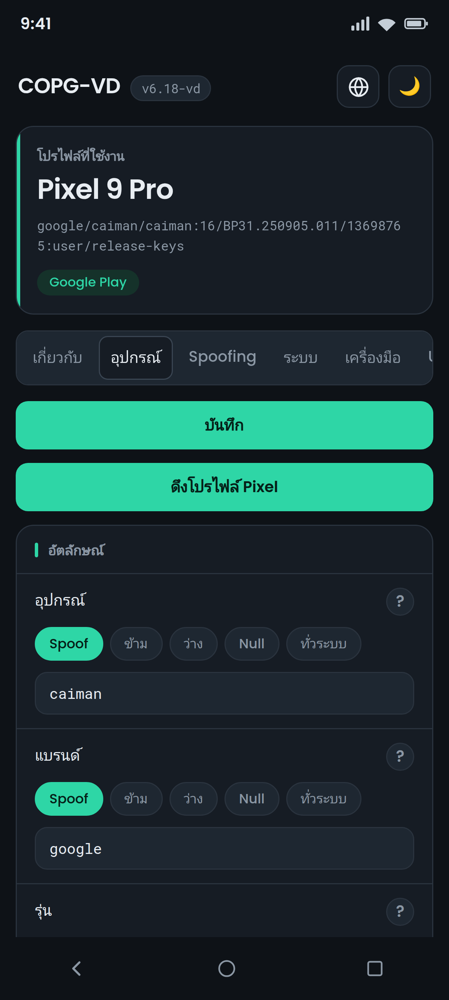
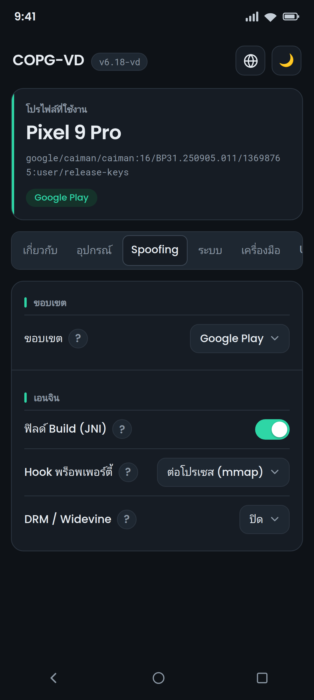
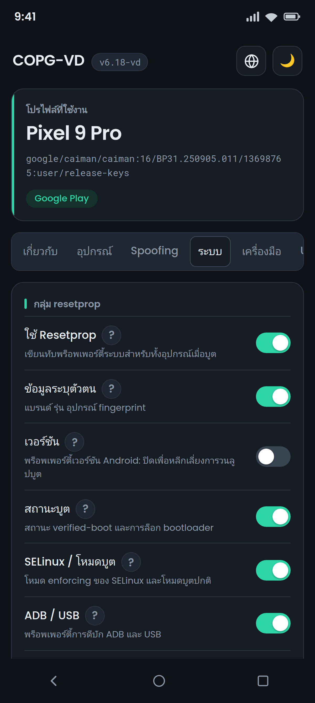
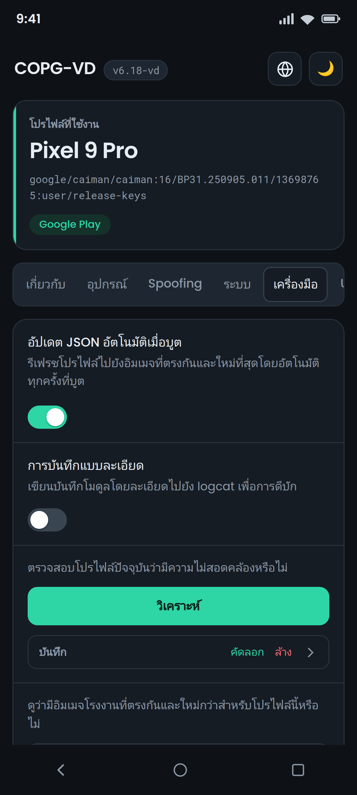

<!--
  ======================================================================
   COPG-VD  ::  global device spoofer
   Spoof your device fingerprint and build.

   Copyright (C) 2026  AlirezaParsi & VD171 (Fork by VD171)
   SPDX-License-Identifier: AGPL-3.0-or-later

   Licensed under the GNU AGPL v3.0 or later. You may obtain a copy at
   https://www.gnu.org/licenses/agpl-3.0.html

   Site           : https://vd171.ru
   Site           : https://vd.priv8.ru
   Source         : https://github.com/VD171/COPG-VD
   GitHub         : @VD171 https://github.com/VD171
   XDA-Developers : @VD171 https://xdaforums.com/m/vd171.4699873/
   XDA thread     : https://xdaforums.com/t/COPG-VD.4807698/
   Telegram       : @VD_Priv8 https://t.me/VD_Priv8
   Channel        : @Priv8_VD https://t.me/Priv8_VD
   Discord        : @VD.Priv8 https://discord.com/users/1296831918989639721
   E-mail         : vd.priv8@pm.me
  ======================================================================
-->

# COPG-VD

<p align="center">
  
</p>

<p align="center">
  <a href="https://github.com/VD171/COPG-VD/releases/latest"></a>
  <a href="LICENSE"></a>
  <a href="https://github.com/VD171/COPG-VD/releases"></a>
  <a href="https://github.com/VD171/COPG-VD/stargazers"></a>
</p>

<p align="center">
  <b>COPG-VD เป็นเครื่องมือปลอมแปลงอุปกรณ์: มันจะเขียน fingerprint และ build ของอุปกรณ์ใหม่ เพื่อให้แอปเห็นอุปกรณ์ที่คุณเลือกแทนที่จะเป็นอุปกรณ์จริง</b><br>
  มันทำงานบน Zygisk (KernelSU, APatch หรือ Magisk) และโดยค่าเริ่มต้นจะจำกัดขอบเขตการปลอมแปลงไว้ที่สแตก Google Play: จึงเป็นทางเลือกที่เบากว่าและทนทานกว่า PlayIntegrityFix
</p>

<p align="center">
  <a href="https://github.com/VD171/COPG-VD/releases">Releases</a> ·
  <a href="https://github.com/VD171/COPG-VD/wiki/th-Home">Wiki</a> ·
  <a href="https://github.com/VD171/COPG-VD/wiki/th-USER-GUIDE">คู่มือผู้ใช้</a> ·
  <a href="https://github.com/VD171/COPG-VD/wiki/th-CONFIGURATION">ข้อมูลอ้างอิงการตั้งค่า</a> ·
  <a href="https://github.com/VD171/COPG-VD/wiki/th-ARCHITECTURE">สถาปัตยกรรม</a> ·
  <a href="https://github.com/VD171/COPG-VD/wiki/th-FILE-STRUCTURE">โครงสร้างไฟล์</a> ·
  <a href="https://github.com/VD171/COPG-VD/wiki/th-AI-AGENTS">เอเจนต์ AI</a> ·
  <a href="https://xdaforums.com/t/COPG-VD.4807698/">XDA thread</a>
</p>

> **Languages:** [English](README.md) · [العربية](README.ar.md) · [Čeština](README.cs.md) · [Deutsch](README.de.md) · [Español](README.es.md) · [فارسی](README.fa.md) · [Français](README.fr.md) · [हिन्दी](README.hi.md) · [Bahasa Indonesia](README.id.md) · [Italiano](README.it.md) · [日本語](README.ja.md) · [한국어](README.ko.md) · [Nederlands](README.nl.md) · [Polski](README.pl.md) · [Português](README.pt.md) · [Русский](README.ru.md) · [Svenska](README.sv.md) · ไทย · [Türkçe](README.tr.md) · [Українська](README.uk.md) · [Tiếng Việt](README.vi.md) · [中文](README.zh.md)

<p align="center">
     
</p>

---

## ทำไม

แอปจำนวนมากขึ้นเรื่อย ๆ ปฏิเสธที่จะทำงาน หรือลดระดับการทำงานลงอย่างเงียบ ๆ เมื่ออุปกรณ์ที่แอปเห็นไม่ใช่โทรศัพท์ที่สะอาดและได้รับการรับรอง: Play Integrity, ระดับ DRM และการตรวจสอบอุปกรณ์เฉพาะแอปล้วนอ่าน build fingerprint และ system properties ทั้งสิ้น COPG-VD เขียนอัตลักษณ์นั้นใหม่ เพื่อให้แอปเห็น Pixel ที่สอดคล้องกัน (หรืออุปกรณ์ใด ๆ ที่คุณกำหนดค่า) แทนอุปกรณ์จริงของคุณ ด้วย fingerprint ที่ใช้งานได้ โดยปกติคุณไม่จำเป็นต้องใช้ PlayIntegrityFix หรือ GooglePhotosUnlimited: มันเป็นทางเลือกที่เบากว่าและทนทานกว่า และโดยค่าเริ่มต้นจะจำกัดขอบเขตการสปูฟไว้ที่สแตก Google Play เพื่อให้ส่วนที่เหลือของระบบของคุณไม่ถูกแตะต้อง

## คุณสมบัติ

- **การควบคุมขอบเขต:** ส่งอัตลักษณ์ที่สปูฟไปยังสแตก Google Play เท่านั้น (ค่าเริ่มต้น), ทั้งอุปกรณ์, whitelist, หรือทุกอย่างยกเว้น blacklist ในโหมดที่จำกัดขอบเขต Zygisk จะส่งอัตลักษณ์แบบต่อโปรเซส ดังนั้นมันจึงไม่รั่วไหลผ่าน global properties เลย
- **เอนจินที่เป็นอิสระ:** Build fields (การเขียน `android.os.Build.*` ใหม่ด้วย JNI), property hook แบบ clean-room ต่อโปรเซส (ไม่มี function hook), `resetprop` แบบจัดกลุ่ม, และระดับ DRM / Widevine ที่เป็นทางเลือก (L1 หรือ L3) พร้อมรายการเป้าหมายของตัวเอง แต่ละอย่างสามารถปิดได้
- **การควบคุมรายฟิลด์:** Build field ทุกตัวสามารถตั้งค่า, ทำให้ว่าง, ลบ หรือข้ามได้ พร้อมรายการ `global_fields` สำหรับค่าที่ต้องคงความสอดคล้องทั่วทั้งอุปกรณ์
- **fingerprint ที่สดใหม่เสมอ:** โปรไฟล์ Pixel มาพร้อมในแพ็กเกจและรีเฟรชตัวเองหนึ่งครั้งต่อการบูตจาก Google factory image ที่ใหม่ที่สุด, คุณยังสามารถดึงโปรไฟล์ Pixel อื่นจาก WebUI ได้ด้วย มันจะไม่ลดระดับเวอร์ชันและปฏิเสธโปรไฟล์สำหรับอุปกรณ์อื่น
- **นโยบายเวอร์ชัน Android ที่ปลอดภัย:** SDK จะไม่ถูกยกให้สูงกว่า framework จริงของคุณเลย (การยกมันขึ้นมีแต่จะทำให้โทรศัพท์ softloop) ภายใต้ทุกนโยบาย
- **Analyze:** ตรวจสอบการตั้งค่าเทียบกับ ROM และ props ของคุณ และแจ้งเตือนสิ่งที่ไม่สอดคล้องกันก่อนที่มันจะไปถึงแอป
- **WebUI:** ห้าแท็บสำหรับควบคุมทุกอย่าง โดยไม่มีคำขอเครือข่าย, ไฟล์การตั้งค่าเก็บการตั้งค่าทั้งหมดไว้ ดังนั้นมันจึงอยู่รอดผ่านการอัปเดตโมดูล
- **การอัปเดตตัวเองแบบเพิ่มทีละส่วน (VDLU)** และไลบรารีเนทีฟ **สี่ ABI** (arm64-v8a, armeabi-v7a, x86, x86_64)

## เอเจนต์ AI

COPG-VD สามารถสคริปต์แบบ headless ได้: ทั้งโมดูลถูกขับเคลื่อนด้วยไฟล์ JSON เดียว (`/data/adb/COPG-VD/COPG-VD.json`) และจุดเข้าเชลล์เดียวคือ `fingerprint-update.sh` พร้อม verb ที่เสถียร (`check`, `apply`, `analyze`, `fetch-index`, `fetch <path>` และอื่น ๆ) เอเจนต์ที่ทำงานในฐานะ root สามารถอ่านและเขียนการตั้งค่า และขับเคลื่อนทุกการกระทำที่ WebUI ทำได้ โดยไม่ต้อง scrape WebUI ดู [docs/AI-AGENTS.md](docs/th/AI-AGENTS.md) แพตช์จาก AI ถูกยึดตามมาตรฐานการตรวจทานเดียวกันกับแพตช์อื่น ๆ

## การติดตั้ง

แฟลชไฟล์ zip ใน KernelSU, APatch หรือ Magisk แล้วรีบูต โปรไฟล์ Pixel ที่มาพร้อมจะถูกสปูฟไปยังแอปเป้าหมายทันที ตัวติดตั้งจะรันเกตตรวจสอบความสมบูรณ์ `.sha256` และยกเลิกเมื่อ zip เสียหายหรือถูกตัดทอน (และข้ามอย่างปลอดภัยเมื่อไม่มีเครื่องมือ checksum) ต้องใช้ Zygisk ผ่าน KernelSU, APatch หรือ Magisk และ root

## ความปลอดภัย

การสปูฟอยู่ฝั่งผู้ใช้เท่านั้น: COPG-VD จะไม่ยก SDK ให้สูงกว่า framework จริงของคุณเลย, คงผู้ผลิตให้สอดคล้องกับส่วนที่เหลือของโปรไฟล์, และอ่านเวอร์ชันจริงจาก `/system/build.prop` ไม่ใช่จาก properties ที่มันปลอมแปลง ตัวอัปเดตตัวเองต้องการลายเซ็น ed25519 ที่ถูกต้องและปฏิเสธการลดระดับเวอร์ชัน, WebUI ไม่ส่งคำขอเครือข่ายใด ๆ รายงานปัญหาตาม [SECURITY.md](docs/th/SECURITY.md)

## การบิลด์

เป็น release เสมอ ไม่เคยเป็น debug ไลบรารีเนทีฟและตัวช่วย scope ถูกบิลด์ใน CI สำหรับทั้งสี่ ABI, เวิร์กโฟลว์ release ประกอบไฟล์ zip ที่แฟลชได้, เขียนไฟล์คู่ `.sha256` ต่อไฟล์, สร้าง VDLU baseline ที่ลงนามแล้วขึ้นใหม่ และเผยแพร่ในฐานะ `github-actions[bot]` ดู [CONTRIBUTING.md](docs/th/CONTRIBUTING.md)

## วิธีใช้งาน?
ติดตั้งโมดูล รีบูต แล้วโปรไฟล์ที่มาพร้อมกัน (ซึ่งเป็น Pixel) จะถูกปลอมแปลงให้กับแอปเป้าหมาย เมื่อมี fingerprint ที่ใช้งานได้ คุณก็ไม่จำเป็นต้องใช้ PlayIntegrityFix หรือ GooglePhotosUnlimited  
ทุกอย่างกำหนดค่าได้ใน `/data/adb/COPG-VD/COPG-VD.json` หรือจาก WebUI ทุกฟิลด์เป็นตัวเลือก (OPTIONAL): ฟิลด์ที่ไม่ได้ระบุจะถูกข้ามไป  

### Scope: ใครเห็นการปลอมแปลง
`scope_mode` ตัดสินว่าโปรเซสใดจะได้รับตัวตนที่ปลอมแปลง ในโหมดที่จำกัดขอบเขต ตัวตนจะถูกส่งมอบแยกรายโปรเซสโดย Zygisk และจะไม่รั่วไหลไปยังส่วนที่เหลือของระบบผ่าน global properties  
* **Google Play** (`playstore`, ค่าเริ่มต้น): เฉพาะสแตก Play เท่านั้น (Google Play services, โปรเซส unstable ของมัน และ Play Store)  
* **Global**: ทั้งอุปกรณ์ ทุกโปรเซสเห็นมัน  
* **Whitelist**: เฉพาะแอปที่อยู่ใน `scope_whitelist`  
* **Blacklist**: ทุกแอปยกเว้นแอปที่อยู่ใน `scope_blacklist`  

### Engines: การปลอมแปลงถูกส่งมอบอย่างไร
แต่ละตัวเป็นอิสระต่อกันและสามารถปิดได้:  
* **Build fields (JNI)**: เขียน `android.os.Build.*` ใหม่ในโปรเซสเป้าหมาย  
* **Property hook**: แสดงพรอเพอร์ตีระบบที่ปลอมแปลงให้กับโปรเซสเป้าหมาย (การ remap พื้นที่พรอเพอร์ตีแบบ clean-room แยกรายโปรเซส ไม่มีการ hook ฟังก์ชัน)  
* **resetprop**: เขียนพรอเพอร์ตีระบบใหม่ จัดการเป็นกลุ่ม: identity, version, boot state, SELinux, adb/usb, anti-emulator และรอบทำความสะอาด ในโหมดที่จำกัดขอบเขต กลุ่ม identity และ version จะไม่อยู่ใน resetprop ระดับทั้งอุปกรณ์ (Zygisk ส่งมอบแยกรายโปรเซส) ส่วนกลุ่ม boot/lock/SELinux จะยังคงเป็น global  
* **DRM / Widevine** (ปิดตามค่าเริ่มต้น): รายงานระดับความปลอดภัย Widevine ที่เลือกไว้ คือ L1 หรือ L3 ให้กับแอปที่อ่านมัน โดยค่าเริ่มต้นจะทำตามขอบเขตด้านบน ตั้งค่า `drm_targets` (รายการแอป) เพื่อใช้การปลอมแปลง DRM กับเฉพาะแอปเหล่านั้น โดยไม่ขึ้นกับ `scope_mode`: โมดูลจะยังคงโหลดอยู่ในแอปที่อยู่ในรายการเพียงเพื่อ DRM hook แม้ว่าแอปนั้นจะอยู่นอกขอบเขตหลัก เว้นว่างหรือไม่ได้กำหนดหมายถึงทำตามขอบเขต (ต้องใช้โหมดที่มีขอบเขต ไม่ใช่ Global)  

### Fields: set, empty, delete หรือ skip
ภายในออบเจกต์ `COPG-VD` แต่ละฟิลด์ Build มีสี่สถานะ:  
* **Set**: `"KEY": "value"` เขียนค่า  
* **Empty**: `"KEY": ""` เขียนค่าว่าง  
* **Delete**: ระบุคีย์ไว้ใน `"COPG-VD-Delete": [ ... ]` ที่ระดับบนสุดเพื่อลบมัน (ฟิลด์ Build จะกลายเป็น null, พรอเพอร์ตีจะถูกลบด้วย `resetprop --delete`)  
* **Skip**: ละคีย์ออกไปทั้งหมด ค่าของ ROM เองจะถูกเก็บไว้  

รายการ `"global_fields": [ ... ]` จะใช้ฟิลด์ Build ที่ระบุชื่อไว้แบบทั้งอุปกรณ์แม้ในโหมดที่จำกัดขอบเขต เพื่อให้ค่าสอดคล้องกันทุกที่: สำหรับฟิลด์ที่ปลอดภัยต่อความสอดคล้องเท่านั้น (เช่น security patch) ห้ามใช้กับ identity และห้ามใช้กับกลุ่มเวอร์ชัน Android โดยเด็ดขาด  

### Example JSON config file
`/data/adb/COPG-VD/COPG-VD.json`
```json
{
  "Instructions": "Use strings on double-quotes only.",
  "Instructions": "All fields are OPTIONAL. If some field is not provided, it will be skipped.",
  "Strings extracted from": "https://dl.google.com/developers/android/CANARY/images/factory/tegu_beta-zp11.261016.008-factory-28d56d15.zip",
  "scope_mode": "playstore",
  "motor_drm": false,
  "drm_targets": [],
  "global_fields": ["SECURITY_PATCH"],
  "process_overrides": [],
  "COPG-VD": {
    "BRAND": "google",
    "DEVICE": "tegu",
    "MANUFACTURER": "Google",
    "MODEL": "Pixel 9a",
    "FINGERPRINT": "google/tegu_beta/tegu:CANARY/ZP11.261016.008/16754936:user/release-keys",
    "PRODUCT": "tegu_beta",
    "BOOTLOADER": "unknown",
    "BOARD": "tegu",
    "HARDWARE": "tegu",
    "DISPLAY": "ZP11.261016.008",
    "ID": "ZP11.261016.008",
    "HOST": "e4df75f83a59",
    "INCREMENTAL": "16754936",
    "TIMESTAMP": "1793211232",
    "PREVIEW_SDK": "20261104",
    "USER": "android-build",
    "SDK_FINGERPRINT": "ee82a872870173d77e68050e21a2bcbf",
    "UUID": "FjWvtSORkI0sEwekaPz2s30gqV5vWP_EZHFtBiXzboc",
    "SECURITY_PATCH": "2026-11-05",
    "FIRST_API_LEVEL": "35",
    "DRM_SECURITY_LEVEL": "L1"
  }
}
```
โปรดใช้สตริงภายในเครื่องหมายอัญประกาศคู่เท่านั้น  
บล็อกด้านบนและ `module/COPG-VD.json.example` จะถูกรีเฟรชทุกวันโดยเวิร์กโฟลว์ [Update COPG-VD.json](.github/workflows/update-json.yml) โดยดึงมาจากอิมเมจโรงงานของ Google ล่าสุดโดยตรง  

### การทำให้ fingerprint เป็นเวอร์ชันล่าสุดอยู่เสมอ
`fingerprint-update.sh` จะดึงไฟล์นั้นและอัปเดตการกำหนดค่าของคุณ ไม่ว่าจะจาก WebUI (**Check Update** / **Update Now**) หรือโดยตัวมันเอง **หนึ่งครั้งต่อการบูต** (**Auto-update JSON on boot** เปิดใช้งานตามค่าเริ่มต้น)  
* `/data/adb/COPG-VD/COPG-VD.json` จะถูกอัปเดตในที่เดิม และเนื้อหาเดิมจะถูกเก็บไว้ข้าง ๆ เป็น `COPG-VD.json.bak`  
* เฉพาะฟิลด์ build เท่านั้นที่จะถูกเขียนใหม่ (fingerprint, ID, incremental, timestamp, security patch, SDK, UUID, host, user) ทุกอย่างอื่นที่คุณปรับแต่งไว้จะถูกเก็บรักษาไว้ ได้แก่ คีย์เพิ่มเติม `scope_mode`, `BOOTLOADER`/`BOARD`/`HARDWARE` ออบเจกต์อื่น ๆ ลำดับคีย์ และการจัดรูปแบบ  
* มันจะไม่ย้อนกลับไปเวอร์ชันเก่า: build จากต้นทางที่เก่ากว่าตัวที่ติดตั้งอยู่จะถูกปฏิเสธ นี่เป็นเรื่องปกติ (รีโปอาจตามหลังการกำหนดค่าที่คุณอัปเดตด้วยมือ) และยังเป็นเกราะป้องกันที่สำคัญที่สุดบน Android ที่ซึ่งตัวดาวน์โหลดเดียวที่มีให้คือ busybox `wget` ซึ่งไม่สามารถตรวจสอบใบรับรอง TLS ได้: ทุกค่าจะถูกตรวจสอบความถูกต้องก่อนใช้งานด้วยเหตุผลเดียวกัน  
* หากโปรไฟล์ของคุณปลอมแปลงเป็น **อุปกรณ์อื่น** (`BRAND`/`DEVICE`/`MANUFACTURER`/`MODEL`/`PRODUCT` ต่างกัน) จะไม่มีการใช้อะไรเลย: fingerprint ของ Pixel บนโปรไฟล์อื่นแย่ยิ่งกว่า fingerprint เก่า  
* ขณะบูต มันจะทำงานเบื้องหลังและลองใหม่ต่อเนื่องประมาณ 10 นาที เพราะโดยปกติแล้ว wifi ยังไม่พร้อมใช้งานเมื่อการบูตเสร็จสิ้น มันจะไม่ทำให้การบูตล่าช้า  
* `resetprop` จะถูกนำไปใช้ใหม่ทันทีหลังการอัปเดต แต่ `android.os.Build` ถูกเขียนโดยโมดูล zygisk เมื่อ zygote เริ่มทำงาน: **รีบูต** เพื่อให้ค่าใหม่ไปถึงแอป  
* บันทึกอยู่ที่ `/data/adb/COPG-VD/update.log`  

### เวอร์ชัน Android: และเหตุผลที่ไม่ปลอมแปลง
`ANDROID_VERSION`, `SDK_INT`, `SDK_FULL` และ `CODENAME` อธิบายถึง **ROM ของคุณ** ไม่ใช่อุปกรณ์ที่กำลังปลอมแปลง การบอกแอปว่า SDK ใหม่กว่าเฟรมเวิร์กจริง ทำให้แอปเรียก API ที่ไม่มีอยู่จริง: แอปของ Google ขัดข้อง โทรศัพท์รีบูต แล้วก็เริ่มใหม่ การบูตเองเสร็จสมบูรณ์ ดังนั้นมันจึงเป็น **softloop** และไม่มีอะไรปรากฏในบันทึกการบูต  
* ค่าเหล่านี้ไม่ได้อยู่ในการกำหนดค่าที่มาพร้อมโมดูล และตัวอัปเดตจะไม่เขียนค่าเหล่านี้  
* **Spoof Android version** ใน WebUI เป็นตัวตัดสินว่าจะมีการนำไปใช้หรือไม่:  
  * **Never** (ค่าเริ่มต้น): ใช้เวอร์ชันของ ROM เอง  
  * **Up to this ROM**: เฉพาะสิ่งที่ไม่เกินเวอร์ชันนั้น ซึ่งในทางปฏิบัติหมายถึงการลด SDK ลง  
  * **Force**: บังคับใช้ฟิลด์เวอร์ชันอื่น ๆ ตรงตามที่การกำหนดค่าร้องขอ แต่ SDK ยังคงถูกจำกัดไว้ที่ค่าของ ROM ของคุณแม้ในกรณีนี้ (การเพิ่ม SDK ให้สูงกว่าเฟรมเวิร์กจริงมีแต่ทำให้เกิด softloop และไม่มีประโยชน์ที่ถูกต้อง) ดังนั้นตั้งแต่ v6.19 **Force จะไม่ทำให้เกิด softloop อีกต่อไป**  
* เวอร์ชันจริงจะถูกอ่านจาก `/system/build.prop` ไม่เคยอ่านจาก `getprop`: เพราะนั่นคือสิ่งที่โมดูลนี้ปลอมแปลงเลยทีเดียว  

### Analyze
**Analyze** ใน WebUI (หรือ `fingerprint-update.sh analyze`) จะตรวจสอบการกำหนดค่าตามที่เป็นอยู่: เวอร์ชันเทียบกับ ROM, ว่าไฟล์ยังสามารถแยกวิเคราะห์ได้หรือไม่ (ไฟล์ที่เสียหายจะทำให้โมดูลปลอมแปลง **ไม่อะไรเลย** และมีเพียง logcat เท่านั้นที่จะบอก), ว่า fingerprint สอดคล้องกับฟิลด์รอบ ๆ หรือไม่, คีย์ที่โมดูลไม่ได้อ่าน, วันที่, และว่า prop มีค่าตามที่การกำหนดค่าร้องขอไว้แล้วหรือไม่  

### WebUI
WebUI เป็นตัวเลือก (ทุกอย่างสามารถแก้ไขได้โดยตรงในไฟล์กำหนดค่า JSON) แต่มันเป็นวิธีที่ง่ายในการควบคุมโมดูล มันมีห้าแท็บ: **About**, **Device** (ทุกฟิลด์ ตั้งค่าแยกตามสถานะ จัดกลุ่มตามหมวดหมู่), **Spoofing** (scope และ engines), **System** (กลุ่ม resetprop) และ **Tools** (Analyze, Check Update, Update Now, Backup/Restore และการอัปเดตอัตโนมัติขณะบูต) มันไม่ส่งคำขอเครือข่ายใด ๆ ทุกอย่างที่มันต้องการมาพร้อมภายในโมดูล  
หากคุณเป็นผู้ใช้ Magisk ให้ใช้ KsuWebUI โดย KOW (https://github.com/KOWX712/KsuWebUIStandalone/releases) คุณยังสามารถใช้ WebUI-X Portable โดย MMRL ได้ (https://github.com/MMRLApp/WebUI-X-Portable/releases) หรือ KsuWebUI-SN (https://github.com/dnascorpionofficial/KsuWebUI-SN/releases)  

### การตั้งค่าภายในการกำหนดค่า
`COPG-VD.json` เก็บการตั้งค่าของมันไว้ข้าง ๆ โปรไฟล์ เพื่อให้ตัวเลือกของคุณติดไปกับการสำรองข้อมูลและสามารถแก้ไขด้วยมือได้: `scope_mode`, สวิตช์ของ engine, กลุ่ม resetprop, `global_fields` และออบเจกต์ `COPG-VD-Settings` (`resetprop`, `autoupdate`, `spoof_version`) ทุกอย่างอยู่ในไฟล์เดียวนี้: สคริปต์บูตและ WebUI อ่านการตั้งค่าจากมันโดยตรง ดังนั้นตัวเลือกของคุณจะคงอยู่แม้จะอัปเดตโมดูล `"spoof_version": "force"` จะถูกปฏิเสธจากไฟล์และถูกลดระดับลง: การกู้คืนการสำรองข้อมูลเก่าต้องไม่เปิดใช้งานมันอีกครั้งโดยที่คุณไม่รู้ตัว  

## การอัปเดตแบบเพิ่มทีละส่วน (VDLU)

COPG-VD มาพร้อมกับเอนจิน **[VDLiveUpdate](https://github.com/VD171/VDLiveUpdate) (VDLU)** (ฝังไว้ใน `module/vdlu/`): โมดูลจะอัปเดตตัวเองโดยดึงเฉพาะไฟล์ที่เปลี่ยนแปลง (blob แบบระบุที่อยู่ด้วยเนื้อหา + `manifest.json` ที่เซ็นชื่อ) แทนที่จะดาวน์โหลด `.zip` ทั้งก้อนใหม่ โปรไฟล์ **Hardened**: ลายเซ็น ed25519 เป็นสิ่งจำเป็นและการดาวน์เกรดถูกบล็อก, ไฟล์ `.zip` แบบเต็มยังคงใช้งานได้เป็นตัวสำรอง

- **`vdlu/`** (รวมอยู่ใน zip): `update.sh` (เอนจิน) + `vdlu-verify` + `config.default` + `keyring/` (กุญแจสาธารณะ)
- **สถานะ** ใน `/data/adb/COPG-VD/vdlu/` (config/journal/blobs/staged/rollback) อยู่นอกโมดูล และคงอยู่หลังการแฟลชใหม่
- **ตัวกระตุ้นตอนบูต:** `post-fs-data.sh`, ก่อน zygote COPG-VD มี `zygisk/*.so` + `sepolicy.rule` (REBOOT-hard) ดังนั้นไฟล์ `.so` ใหม่จะถูกจัดเตรียมและสลับก่อนที่ zygote จะแมปมัน
- **WebUI:** แผง **Updates** (`webroot/vdlu.js`) พร้อมการแจ้งเตือนความคืบหน้าและการยกเลิก
- **การเผยแพร่:** ดู `module/vdlu/RELEASE.md` (`vdlu-pack` + `vdlu-sign`, เก็บถาวร manifest, `vdlu-gc` ลบ blob ที่กำพร้า, push ไปยัง Pages แบบเป็นชุด)

<!-- vd-docs -->
## เอกสารประกอบ

- **[Wiki](https://github.com/VD171/COPG-VD/wiki/th-Home)**: เอกสารฉบับเต็ม อ่านได้ทางออนไลน์
- **[คู่มือผู้ใช้](https://github.com/VD171/COPG-VD/wiki/th-USER-GUIDE)**: การติดตั้ง WebUI และการใช้งานประจำวัน
- **[ข้อมูลอ้างอิงการตั้งค่า](https://github.com/VD171/COPG-VD/wiki/th-CONFIGURATION)**: ทุกการตั้งค่าในไฟล์คอนฟิกและหน้าที่ของมัน
- **[สถาปัตยกรรม](https://github.com/VD171/COPG-VD/wiki/th-ARCHITECTURE)** และ **[โครงสร้างไฟล์](https://github.com/VD171/COPG-VD/wiki/th-FILE-STRUCTURE)**: สปูฟทำงานอย่างไรและทุกอย่างอยู่ที่ไหน
- **[เอเจนต์ AI](https://github.com/VD171/COPG-VD/wiki/th-AI-AGENTS)**: ขับเคลื่อนการตั้งค่าและตัวอัปเดตแบบ headless

<!-- /vd-docs -->

## ดูเพิ่มเติม

- **[VDBackup](https://github.com/VD171/VD-Backup)**: สำรองและกู้คืนแอปและข้อมูลแบบเต็มรูปแบบในฐานะ root ควบคุมทั้งหมดจาก WebUI
- **[VD-dropbear](https://github.com/VD171/VD-dropbear)**: SSH daemon แบบสแตนด์อโลนที่ทำงานด้วยสิทธิ์ root (Dropbear)
- **[VDGoogle](https://github.com/VD171/VD-Google)**: บริการ Google ของคุณ (RCS, Wallet, การรับรอง Play Integrity) อ่านบนอุปกรณ์ของคุณโดยไม่ใช้อินเทอร์เน็ต
- **[VDInstaller](https://github.com/VD171/VD-Installer)**: ตัวติดตั้งแบบ sideload ด้วยสิทธิ์ root ที่ไร้แรงเสียดทาน สำหรับ APK เดี่ยว แบบชุด และแบบแยก พร้อมสวิตช์ตัวตรวจสอบ Play Protect และการปลอมแหล่งที่มาของการติดตั้ง
- **[VDInfos](https://github.com/VD171/VD-Infos)**: ตัวดีบักเมธอดของอุปกรณ์ที่อ่านแต่ละรายการผ่านทุกเมธอดที่สามารถอ่านได้ และนำมาเปรียบเทียบกันเคียงข้างกัน
- **[VDLiveUpdate](https://github.com/VD171/VDLiveUpdate)**: เอนจินอัปเดตตัวเองแบบเพิ่มทีละส่วนโดยไม่ต้องแฟลช ฝังอยู่ในโมดูล KernelSU/APatch/Magisk
- **[VD-Modules](https://github.com/VD171/VD-Modules)**: ที่เก็บโมดูลของเราสำหรับ MMRL/WebUI-X (ติดตั้งทั้งหมดนี้จากตัวจัดการ root ของคุณ)
- **[@VictorGabriel7Dev/build.prop](https://github.com/VictorGabriel7Dev/build.prop)**: ชุดข้อมูลลายนิ้วมือ `build.prop` ของ Pixel (fork จาก @T3SL4)
- **[@VictorGabriel7Dev/mtproto-store](https://github.com/VictorGabriel7Dev/mtproto-store)**: ใช้ Telegram เป็นที่เก็บออบเจกต์จาก CLI ขนาดเล็กที่เขียนด้วย Go

## ช่องทางติดต่อ

- https://vd171.ru
- https://vd.priv8.ru
- **Telegram:** @VD_Priv8 https://t.me/VD_Priv8
- **Channel:** @Priv8_VD https://t.me/Priv8_VD
- **Discord:** @VD.Priv8 https://discord.com/users/1296831918989639721
- **E-mail:** vd.priv8@pm.me
- **XDA-Developers:** @VD171 https://xdaforums.com/m/vd171.4699873/
- **XDA thread:** https://xdaforums.com/t/COPG-VD.4807698/
- **GitHub:** @VD171 https://github.com/VD171

## สัญญาอนุญาต

**AGPL-3.0-or-later**: ดู [LICENSE](LICENSE) COPG-VD เป็นฟอร์กโดย VD171 ของ COPG ดั้งเดิมโดย AlirezaParsi (Apache-2.0) ออกใบอนุญาตใหม่ภายใต้ GNU AGPL-3.0-or-later NETWORK COPYLEFT: หากคุณรันเวอร์ชันที่แก้ไข แม้จะเป็นบริการ คุณต้องเสนอซอร์สโค้ดของมัน

## เครื่องหมายการค้า

COPG-VD เป็นโปรเจกต์อิสระที่ไม่เป็นทางการ ไม่มีส่วนเกี่ยวข้องกับ ไม่ได้รับการรับรองจาก หรือได้รับการสนับสนุนจาก Google LLC "Google", "Google Play", "Play Integrity", "Pixel", "Android" และชื่อและโลโก้ที่เกี่ยวข้องเป็นเครื่องหมายการค้าของ Google LLC COPG-VD ทำงานทั้งหมดบนอุปกรณ์ของคุณ

## Tags

`Zygisk` `KernelSU` `APatch` `Magisk` `device-spoofing` `fingerprint` `PlayIntegrity` `Pixel` `build.prop` `resetprop` `root` `Android` `COPG-VD`

---

📣 **เข้าร่วมช่องเพื่อรับการอัปเดต:** @Priv8_VD https://t.me/Priv8_VD
