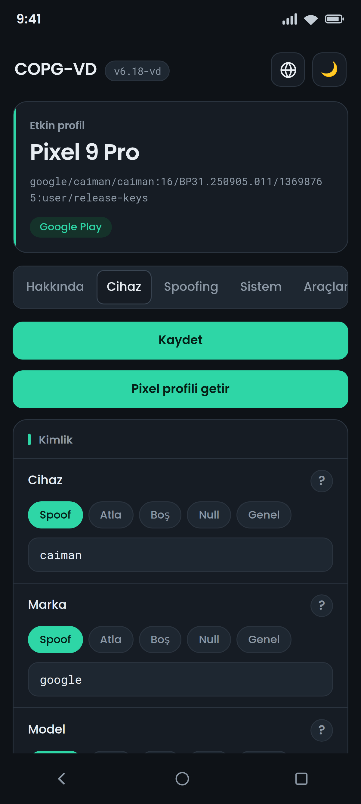
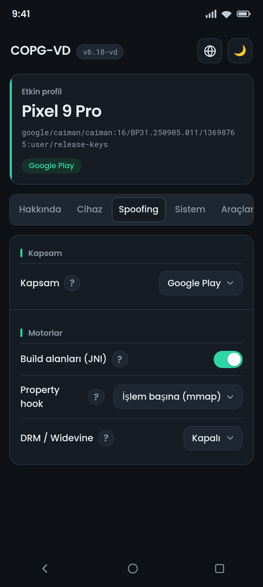
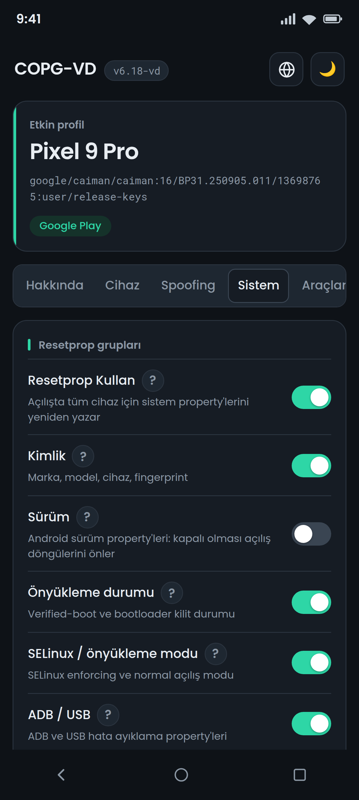
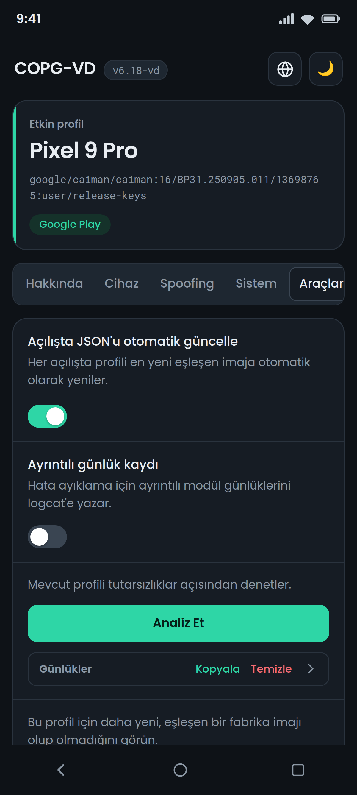

<!--
  ======================================================================
   COPG-VD  ::  global device spoofer
   Spoof your device fingerprint and build.

   Copyright (C) 2026  AlirezaParsi & VD171 (Fork by VD171)
   SPDX-License-Identifier: AGPL-3.0-or-later

   Licensed under the GNU AGPL v3.0 or later. You may obtain a copy at
   https://www.gnu.org/licenses/agpl-3.0.html

   Site           : https://vd171.ru
   Site           : https://vd.priv8.ru
   Source         : https://github.com/VD171/COPG-VD
   GitHub         : @VD171 https://github.com/VD171
   XDA-Developers : @VD171 https://xdaforums.com/m/vd171.4699873/
   XDA thread     : https://xdaforums.com/t/COPG-VD.4807698/
   Telegram       : @VD_Priv8 https://t.me/VD_Priv8
   Channel        : @Priv8_VD https://t.me/Priv8_VD
   Discord        : @VD.Priv8 https://discord.com/users/1296831918989639721
   E-mail         : vd.priv8@pm.me
  ======================================================================
-->

# COPG-VD

<p align="center">
  
</p>

<p align="center">
  <a href="https://github.com/VD171/COPG-VD/releases/latest"></a>
  <a href="LICENSE"></a>
  <a href="https://github.com/VD171/COPG-VD/releases"></a>
  <a href="https://github.com/VD171/COPG-VD/stargazers"></a>
</p>

<p align="center">
  <b>COPG-VD bir cihaz sahteleyicidir: cihazın fingerprint ve build bilgisini yeniden yazar, böylece uygulamalar gerçek cihaz yerine sizin seçtiğiniz cihazı görür.</b><br>
  Zygisk (KernelSU, APatch veya Magisk) üzerinde çalışır ve varsayılan olarak sahteciliğin kapsamını Google Play yığınına daraltır: bu yüzden PlayIntegrityFix'e göre daha hafif ve daha sağlam bir alternatiftir.
</p>

<p align="center">
  <a href="https://github.com/VD171/COPG-VD/releases">Releases</a> ·
  <a href="https://github.com/VD171/COPG-VD/wiki/tr-Home">Wiki</a> ·
  <a href="https://github.com/VD171/COPG-VD/wiki/tr-USER-GUIDE">Kullanıcı Kılavuzu</a> ·
  <a href="https://github.com/VD171/COPG-VD/wiki/tr-CONFIGURATION">Yapılandırma referansı</a> ·
  <a href="https://github.com/VD171/COPG-VD/wiki/tr-ARCHITECTURE">Mimari</a> ·
  <a href="https://github.com/VD171/COPG-VD/wiki/tr-FILE-STRUCTURE">Dosya yapısı</a> ·
  <a href="https://github.com/VD171/COPG-VD/wiki/tr-AI-AGENTS">AI ajanları</a> ·
  <a href="https://xdaforums.com/t/COPG-VD.4807698/">XDA thread</a>
</p>

> **Languages:** [English](README.md) · [العربية](README.ar.md) · [Čeština](README.cs.md) · [Deutsch](README.de.md) · [Español](README.es.md) · [فارسی](README.fa.md) · [Français](README.fr.md) · [हिन्दी](README.hi.md) · [Bahasa Indonesia](README.id.md) · [Italiano](README.it.md) · [日本語](README.ja.md) · [한국어](README.ko.md) · [Nederlands](README.nl.md) · [Polski](README.pl.md) · [Português](README.pt.md) · [Русский](README.ru.md) · [Svenska](README.sv.md) · [ไทย](README.th.md) · Türkçe · [Українська](README.uk.md) · [Tiếng Việt](README.vi.md) · [中文](README.zh.md)

<p align="center">
     
</p>

---

## Neden

Uygulamalar, gördükleri cihaz temiz ve sertifikalı bir telefon olmadığında giderek daha sık çalışmayı reddediyor ya da sessizce düşük kalitede çalışıyor: Play Integrity, DRM seviyeleri ve uygulamaya özgü cihaz denetimlerinin tümü build fingerprint'ini ve sistem özelliklerini okur. COPG-VD bu kimliği yeniden yazar, böylece uygulamalar gerçek cihazınız yerine tutarlı bir Pixel (ya da yapılandırdığınız herhangi bir cihazı) görür. Çalışan bir fingerprint ile genellikle PlayIntegrityFix veya GooglePhotosUnlimited'e ihtiyacınız olmaz: daha hafif ve daha sağlam bir alternatiftir ve varsayılan olarak sahtelemeyi Google Play yığınına sınırlar, böylece sisteminizin geri kalanına dokunulmaz.

## Özellikler

- **Kapsam denetimi:** sahte kimliği yalnızca Google Play yığınına (varsayılan), tüm cihaza, bir whitelist'e veya bir blacklist dışındaki her şeye iletir. Kapsamlı bir modda Zygisk kimliği her işlem için iletir, böylece asla global özellikler üzerinden sızmaz.
- **Bağımsız motorlar:** Build alanları (`android.os.Build.*` öğesinin JNI ile yeniden yazılması), işlem başına temiz oda yöntemiyle bir property hook (function hook yok), gruplanmış `resetprop` ve kendi hedef listesine sahip isteğe bağlı bir DRM / Widevine seviyesi (L1 veya L3). Her biri kapatılabilir.
- **Alan başına denetim:** her Build alanı ayarlanabilir, boşaltılabilir, silinebilir veya atlanabilir, cihaz genelinde tutarlı kalması gereken değerler için bir `global_fields` listesiyle birlikte.
- **Her zaman taze fingerprint:** bir Pixel profili paketle birlikte gelir ve her önyüklemede bir kez en yeni Google fabrika imajından kendini yeniler, WebUI'den başka bir Pixel profili de getirebilirsiniz. Asla sürüm düşürmez ve farklı bir cihaza ait profili reddeder.
- **Güvenli Android sürüm politikası:** SDK, her politika altında gerçek framework'ünüzün üzerine asla yükseltilmez (yükseltmek telefonu yalnızca softloop'a sokar).
- **Analyze:** yapılandırmayı ROM'unuza ve props'larınıza karşı denetler ve uygulamalara ulaşmadan önce tutarsız olan her şeyi işaretler.
- **WebUI:** hiçbir ağ isteği olmadan her şeyi yönetmek için beş sekme, yapılandırma dosyası tüm ayarları taşır, böylece bunlar bir modül güncellemesinden sağ çıkar.
- **Artımlı kendi kendini güncelleme (VDLU)** ve **dört ABI'li** bir native kütüphane (arm64-v8a, armeabi-v7a, x86, x86_64).

## AI ajanları

COPG-VD başsız olarak betiklenebilir: tüm modül tek bir JSON dosyası (`/data/adb/COPG-VD/COPG-VD.json`) ve tek bir kabuk giriş noktası olan `fingerprint-update.sh` ile, kararlı fiillerle (`check`, `apply`, `analyze`, `fetch-index`, `fetch <path>` ve daha fazlası) yönetilir. root olarak çalışan bir ajan, WebUI'yi kazımadan yapılandırmayı okuyup yazabilir ve WebUI'nin yapabildiği her eylemi yürütebilir. Bkz. [docs/AI-AGENTS.md](docs/tr/AI-AGENTS.md). AI'dan gelen yamalar, diğerleriyle aynı inceleme çıtasına tabi tutulur.

## Kurulum

zip'i KernelSU, APatch veya Magisk'te flaşlayın ve yeniden başlatın. Birlikte gelen Pixel profili, hedeflenen uygulamalara anında sahtelenir. Yükleyici bir `.sha256` bütünlük kapısı çalıştırır ve bozuk veya kesilmiş bir zip'te iptal eder (ve checksum aracı bulunmayan yerlerde güvenli şekilde atlar). KernelSU, APatch veya Magisk aracılığıyla Zygisk ve root gerektirir.

## Güvenlik

Sahteleme yalnızca kullanıcı tarafındadır: COPG-VD, SDK'yı asla gerçek framework'ünüzün üzerine yükseltmez, üreticiyi profilin geri kalanıyla tutarlı tutar ve gerçek sürümü, sahtelediği özelliklerden değil `/system/build.prop` dosyasından okur. Kendi kendini güncelleyen bileşen geçerli bir ed25519 imzası gerektirir ve sürüm düşürmeyi reddeder, WebUI hiçbir ağ isteği yapmaz. Sorunları [SECURITY.md](docs/tr/SECURITY.md) uyarınca bildirin.

## Derleme

Her zaman release, asla debug değil. Native kütüphane ve kapsam yardımcısı, dört ABI'nin tümü için CI'da derlenir, release iş akışı flaşlanabilir zip'i bir araya getirir, dosya başına `.sha256` eşlerini yazar, imzalı VDLU taban çizgisini yeniden oluşturur ve `github-actions[bot]` olarak yayımlar. Bkz. [CONTRIBUTING.md](docs/tr/CONTRIBUTING.md).

## Nasıl kullanılır?
Modülü kurun, yeniden başlatın, böylece birlikte gelen profil (bir Pixel) hedeflenen uygulamalara sahtelenir. Çalışan bir fingerprint ile PlayIntegrityFix veya GooglePhotosUnlimited'e ihtiyacınız olmaz.  
Her şey `/data/adb/COPG-VD/COPG-VD.json` içinde ya da WebUI'den yapılandırılır. Tüm alanlar İSTEĞE BAĞLIDIR: sağlanmayan bir alan atlanır.  

### Scope: sahteciliği kim görür
`scope_mode`, sahtelenen kimliği hangi süreçlerin alacağına karar verir. Kapsamı daraltılmış bir modda kimlik, Zygisk tarafından süreç başına teslim edilir ve global özellikler aracılığıyla sistemin geri kalanına sızmaz.  
* **Google Play** (`playstore`, varsayılan): yalnızca Play yığını (Google Play services, onun kararsız (unstable) süreci ve Play Store).  
* **Global**: tüm cihaz, her süreç onu görür.  
* **Whitelist**: yalnızca `scope_whitelist` içindeki uygulamalar.  
* **Blacklist**: `scope_blacklist` içindekiler dışındaki her uygulama.  

### Engines: sahtecilik nasıl teslim edilir
Her biri bağımsızdır ve kapatılabilir:  
* **Build fields (JNI)**: hedeflenen süreçlerde `android.os.Build.*` ögesini yeniden yazar.  
* **Property hook**: sahtelenen sistem özelliklerini hedeflenen süreçlere sunar (özellik alanının süreç başına clean-room yeniden eşlemesi, işlev hook'u yok).  
* **resetprop**: sistem özelliklerini yeniden yazar, grup halinde yönetilir: identity, version, boot state, SELinux, adb/usb, anti-emulator ve bir temizlik geçişi. Kapsamı daraltılmış bir modda identity ve version grupları cihaz genelindeki resetprop'un dışında kalır (Zygisk bunları süreç başına teslim eder), boot/lock/SELinux grupları global kalır.  
* **DRM / Widevine** (varsayılan olarak kapalı): seçilen bir Widevine güvenlik seviyesini, L1 veya L3, onu okuyan uygulamalara bildirir. Varsayılan olarak yukarıdaki kapsamı izler, DRM spoof'unu yalnızca belirli uygulamalara uygulamak için `drm_targets` (bir uygulama listesi) ayarlayın, `scope_mode`'dan bağımsız olarak: modül, listelenen bir uygulamada yalnızca DRM hook için yüklü kalır, o uygulama ana kapsamın dışında olsa bile. Boş veya yok, kapsamı izlemek anlamına gelir. (Kapsamlı bir mod gerektirir, Global değil.)  

### Fields: set, empty, delete veya skip
`COPG-VD` nesnesinin içinde her Build alanının dört durumu vardır:  
* **Set**: `"KEY": "value"` değeri yazar.  
* **Empty**: `"KEY": ""` boş bir değer yazar.  
* **Delete**: kaldırmak için anahtarı üst seviyedeki `"COPG-VD-Delete": [ ... ]` içinde listeleyin (bir Build alanı null olur, bir özellik `resetprop --delete` ile kaldırılır).  
* **Skip**: anahtarı tamamen dışarıda bırakın, ROM'un kendi değeri korunur.  

Bir `"global_fields": [ ... ]` listesi, bir değeri her yerde tutarlı tutmak için, kapsamı daraltılmış bir modda bile adı verilen Build alanlarını cihaz genelinde uygular: yalnızca tutarlılık açısından güvenli alanlar için (örneğin güvenlik yaması), asla identity için ve asla Android sürüm grubu için değil.  

### Example JSON config file
`/data/adb/COPG-VD/COPG-VD.json`
```json
{
  "Instructions": "Use strings on double-quotes only.",
  "Instructions": "All fields are OPTIONAL. If some field is not provided, it will be skipped.",
  "Strings extracted from": "https://dl.google.com/developers/android/CANARY/images/factory/tegu_beta-zp11.261016.008-factory-28d56d15.zip",
  "scope_mode": "playstore",
  "motor_drm": false,
  "drm_targets": [],
  "global_fields": ["SECURITY_PATCH"],
  "process_overrides": [],
  "COPG-VD": {
    "BRAND": "google",
    "DEVICE": "tegu",
    "MANUFACTURER": "Google",
    "MODEL": "Pixel 9a",
    "FINGERPRINT": "google/tegu_beta/tegu:CANARY/ZP11.261016.008/16754936:user/release-keys",
    "PRODUCT": "tegu_beta",
    "BOOTLOADER": "unknown",
    "BOARD": "tegu",
    "HARDWARE": "tegu",
    "DISPLAY": "ZP11.261016.008",
    "ID": "ZP11.261016.008",
    "HOST": "e4df75f83a59",
    "INCREMENTAL": "16754936",
    "TIMESTAMP": "1793211232",
    "PREVIEW_SDK": "20261104",
    "USER": "android-build",
    "SDK_FINGERPRINT": "ee82a872870173d77e68050e21a2bcbf",
    "UUID": "FjWvtSORkI0sEwekaPz2s30gqV5vWP_EZHFtBiXzboc",
    "SECURITY_PATCH": "2026-11-05",
    "FIRST_API_LEVEL": "35",
    "DRM_SECURITY_LEVEL": "L1"
  }
}
```
Dizeleri yalnızca çift tırnak içinde kullandığınızdan emin olun.  
Yukarıdaki blok ve `module/COPG-VD.json.example`, en yeni Google fabrika imajından doğrudan alınarak [Update COPG-VD.json](.github/workflows/update-json.yml) iş akışı tarafından her gün yenilenir.  

### Fingerprint'i güncel tutmak
`fingerprint-update.sh` o dosyayı çeker ve yapılandırmanızı günceller, bunu ya WebUI'den (**Check Update** / **Update Now**) ya da kendi kendine **her açılışta bir kez** (**Auto-update JSON on boot**, varsayılan olarak açık) yapar.  
* `/data/adb/COPG-VD/COPG-VD.json` yerinde güncellenir ve önceki içerik yanında `COPG-VD.json.bak` olarak saklanır.  
* Yalnızca build alanları yeniden yazılır (fingerprint, ID, incremental, timestamp, güvenlik yaması, SDK, UUID, host, user). Özelleştirdiğiniz diğer her şey korunur: ek anahtarlar, `scope_mode`, `BOOTLOADER`/`BOARD`/`HARDWARE`, diğer nesneler, anahtar sırası ve biçimlendirme.  
* Asla geriye gitmez: yüklü olandan daha eski bir üst kaynak (upstream) build reddedilir. Bu olağandır (repo, elle güncellediğiniz bir yapılandırmanın gerisinde kalabilir) ve ayrıca Android'de en çok önem taşıyan korumadır, çünkü Android'de mevcut tek indirici busybox `wget`'tir ve bu da TLS sertifikalarını doğrulayamaz: aynı nedenle her değer kullanılmadan önce doğrulanır.  
* Profiliniz **başka bir cihazı** sahteliyorsa (farklı `BRAND`/`DEVICE`/`MANUFACTURER`/`MODEL`/`PRODUCT`), hiçbir şey uygulanmaz: başka bir profildeki bir Pixel fingerprint'i, eski bir fingerprint'ten daha kötüdür.  
* Açılışta arka planda çalışır ve yaklaşık 10 dakika boyunca tekrar denemeyi sürdürür, çünkü açılış tamamlandığında genellikle wifi henüz hazır değildir. Açılışı asla geciktirmez.  
* `resetprop`, bir güncellemeden hemen sonra yeniden uygulanır, ancak `android.os.Build`, zygote başladığında zygisk modülü tarafından yazılır: yeni değerlerin uygulamalara ulaşması için **yeniden başlatın**.  
* Günlük `/data/adb/COPG-VD/update.log` konumundadır.  

### Android sürümü: ve neden sahtelenmiyor
`ANDROID_VERSION`, `SDK_INT`, `SDK_FULL` ve `CODENAME`, sahtelenen cihazı değil **sizin ROM'unuzu** tanımlar. Uygulamalara SDK'nın framework'ün gerçekte olduğundan daha yeni olduğunu söylemek, onların var olmayan API'leri çağırmasına neden olur: Google'ın uygulamaları çöker, telefon yeniden başlar ve her şey baştan başlar. Açılışın kendisi tamamlandığı için bu bir **softloop**'tur ve açılış günlüklerinde hiçbir şey görünmez.  
* Bunlar paketlenmiş yapılandırmada yer almaz ve güncelleyici bunları asla yazmaz.  
* WebUI'deki **Spoof Android version**, bunların hiç uygulanıp uygulanmayacağına karar verir:  
  * **Never** (varsayılan): ROM'un kendi sürümü kullanılır.  
  * **Up to this ROM**: yalnızca bunu aşmayan kısım, ki bu pratikte SDK'yı düşürmek demektir.  
  * **Force**: diğer sürüm alanlarını tam olarak yapılandırmanın istediği gibi zorlar, ancak SDK burada bile hâlâ ROM'unuzun değerinde sınırlanır (SDK'yı gerçek framework'ün üzerine çıkarmak yalnızca softloop'a yol açar ve meşru bir kullanımı yoktur), bu yüzden v6.19'dan beri **Force artık softloop yapmaz**.  
* Gerçek sürüm `/system/build.prop`'tan okunur, asla `getprop`'tan değil: çünkü bu modülün sahtelediği şey tam da odur.  

### Analyze
WebUI'deki **Analyze** (veya `fingerprint-update.sh analyze`), yapılandırmayı olduğu haliyle denetler: sürümü ROM'a karşı, dosyanın hâlâ ayrıştırılabilir olup olmadığını (bozuk bir dosya modülün **hiçbir şeyi** sahtelememesine yol açar ve bunu yalnızca logcat söyler), fingerprint'in çevresindeki alanlarla uyuşup uyuşmadığını, modülün okumadığı anahtarları, tarihleri ve propların yapılandırmanın istediği değerleri zaten taşıyıp taşımadığını kontrol eder.  

### WebUI
WebUI isteğe bağlıdır (her şey doğrudan JSON yapılandırmasında düzenlenebilir) ancak modülü sürmenin kolay yolu odur. Beş sekmesi vardır: **About**, **Device** (her alan, duruma göre ayarlanır, kategoriye göre gruplanır), **Spoofing** (scope ve engines), **System** (resetprop grupları) ve **Tools** (Analyze, Check Update, Update Now, Backup/Restore ve açılışta otomatik güncelleme). Hiçbir ağ isteği yapmaz, ihtiyaç duyduğu her şey modülün içinde gelir.  
Magisk kullanıcısıysanız, KOW tarafından geliştirilen KsuWebUI'yi kullanın (https://github.com/KOWX712/KsuWebUIStandalone/releases). Ayrıca MMRL tarafından geliştirilen WebUI-X Portable'ı da kullanabilirsiniz (https://github.com/MMRLApp/WebUI-X-Portable/releases) veya KsuWebUI-SN (https://github.com/dnascorpionofficial/KsuWebUI-SN/releases).  

### Yapılandırmadaki ayarlar
`COPG-VD.json` ayarlarını profilin yanında taşır, böylece seçimleriniz bir yedekle birlikte taşınır ve elle düzenlenebilir: `scope_mode`, engine anahtarları, resetprop grupları, `global_fields` ve bir `COPG-VD-Settings` nesnesi (`resetprop`, `autoupdate`, `spoof_version`). Her şey bu tek dosyada bulunur: açılış betikleri ve WebUI ayarları doğrudan oradan okur, böylece seçimleriniz bir modül güncellemesinden sağ çıkar. `"spoof_version": "force"` dosyadan reddedilir ve düşürülür: eski bir yedeği geri yüklemek, onu arkanızdan yeniden etkinleştirmemelidir.  

## Artımlı güncellemeler (VDLU)

COPG-VD, **[VDLiveUpdate](https://github.com/VD171/VDLiveUpdate) (VDLU)** motorunu içerir (`module/vdlu/` içine gömülü): modül, tüm `.zip` dosyasını yeniden indirmek yerine yalnızca değişen dosyaları getirerek kendini günceller (içerik adresli bloblar + imzalı bir `manifest.json`). **Hardened** profili: ed25519 imzası zorunludur ve sürüm düşürmeler engellenir, tam `.zip` yedek olarak geçerli kalır.

- **`vdlu/`** (zip içinde gelir): `update.sh` (motor) + `vdlu-verify` + `config.default` + `keyring/` (genel anahtar).
- **Durum** `/data/adb/COPG-VD/vdlu/` içinde (config/journal/blobs/staged/rollback), modülün dışında, yeniden flashlamadan sonra da kalır.
- **Önyükleme tetikleyicisi:** `post-fs-data.sh`, zygote öncesi, COPG-VD'de `zygisk/*.so` + `sepolicy.rule` (REBOOT-hard) bulunur, bu yüzden yeni `.so`, zygote onu eşlemeden önce hazırlanıp değiştirilir.
- **WebUI:** ilerleme bildirimi ve iptal içeren bir **Updates** paneli (`webroot/vdlu.js`).
- **Yayın:** `module/vdlu/RELEASE.md` dosyasına bakın (`vdlu-pack` + `vdlu-sign`, manifest'i arşivler, `vdlu-gc` yetim blobları temizler, toplu Pages push).

<!-- vd-docs -->
## Belgeler

- **[Wiki](https://github.com/VD171/COPG-VD/wiki/tr-Home)**: çevrimiçi göz atılabilen tam belgeler.
- **[Kullanıcı Kılavuzu](https://github.com/VD171/COPG-VD/wiki/tr-USER-GUIDE)**: kurulumu, WebUI ve günlük kullanımı.
- **[Yapılandırma referansı](https://github.com/VD171/COPG-VD/wiki/tr-CONFIGURATION)**: yapılandırma dosyasındaki her ayar ve ne işe yaradığı.
- **[Mimari](https://github.com/VD171/COPG-VD/wiki/tr-ARCHITECTURE)** ve **[Dosya yapısı](https://github.com/VD171/COPG-VD/wiki/tr-FILE-STRUCTURE)**: spoofing'in nasıl çalıştığı ve her şeyin nerede olduğu.
- **[AI ajanları](https://github.com/VD171/COPG-VD/wiki/tr-AI-AGENTS)**: yapılandırmayı ve güncelleyiciyi başsız olarak yönetin.

<!-- /vd-docs -->

## Ayrıca bakınız

- **[VDBackup](https://github.com/VD171/VD-Backup)**: root olarak tam uygulama ve veri yedekleme ve geri yükleme, tamamen bir WebUI'den yönetilir.
- **[VD-dropbear](https://github.com/VD171/VD-dropbear)**: root olarak çalışan bağımsız bir SSH arka plan hizmeti (Dropbear).
- **[VDGoogle](https://github.com/VD171/VD-Google)**: Google hizmetleriniz (RCS, Wallet, Play Integrity doğrulamaları), internet olmadan cihazınızda okunur.
- **[VDInstaller](https://github.com/VD171/VD-Installer)**: tekli, toplu ve bölünmüş APK'lar için sürtünmesiz bir root sideload yükleyicisi, Play Protect doğrulayıcı anahtarı ve kurulum kaynağı sahteciliği ile birlikte.
- **[VDInfos](https://github.com/VD171/VD-Infos)**: her bir ögeyi onu okuyabilen her yöntemle okuyup yan yana karşılaştıran bir cihaz yöntemi hata ayıklayıcısı.
- **[VDLiveUpdate](https://github.com/VD171/VDLiveUpdate)**: KernelSU/APatch/Magisk modüllerine gömülü, flash'sız, artımlı bir kendini güncelleme motoru.
- **[VD-Modules](https://github.com/VD171/VD-Modules)**: MMRL/WebUI-X için modül deposu (bunların hepsini root yöneticinizden yükleyin).
- **[@VictorGabriel7Dev/build.prop](https://github.com/VictorGabriel7Dev/build.prop)**: Pixel `build.prop` parmak izlerinden oluşan bir veri kümesi (@T3SL4 fork'u).
- **[@VictorGabriel7Dev/mtproto-store](https://github.com/VictorGabriel7Dev/mtproto-store)**: Telegram'ı küçük bir Go CLI'sinden nesne deposu olarak kullanın.

## İletişim

- https://vd171.ru
- https://vd.priv8.ru
- **Telegram:** @VD_Priv8 https://t.me/VD_Priv8
- **Channel:** @Priv8_VD https://t.me/Priv8_VD
- **Discord:** @VD.Priv8 https://discord.com/users/1296831918989639721
- **E-mail:** vd.priv8@pm.me
- **XDA-Developers:** @VD171 https://xdaforums.com/m/vd171.4699873/
- **XDA thread:** https://xdaforums.com/t/COPG-VD.4807698/
- **GitHub:** @VD171 https://github.com/VD171

## Lisans

**AGPL-3.0-or-later**: bkz. [LICENSE](LICENSE). COPG-VD, AlirezaParsi tarafından geliştirilen özgün COPG'nin (Apache-2.0) VD171 tarafından yapılmış bir fork'udur ve GNU AGPL-3.0-or-later altında yeniden lisanslanmıştır. AĞ COPYLEFT: değiştirilmiş bir sürümü, hizmet olarak bile çalıştırıyorsanız, kaynak kodunu sunmalısınız.

## Ticari markalar

COPG-VD bağımsız, resmi olmayan bir projedir. Google LLC ile bağlantılı değildir, onun tarafından onaylanmamış veya desteklenmemiştir. "Google", "Google Play", "Play Integrity", "Pixel", "Android" ve ilgili adlar ile logolar Google LLC'nin ticari markalarıdır. COPG-VD tamamen cihazınızda çalışır.

## Tags

`Zygisk` `KernelSU` `APatch` `Magisk` `device-spoofing` `fingerprint` `PlayIntegrity` `Pixel` `build.prop` `resetprop` `root` `Android` `COPG-VD`

---

📣 **Güncellemeler için kanala katılın:** @Priv8_VD https://t.me/Priv8_VD
