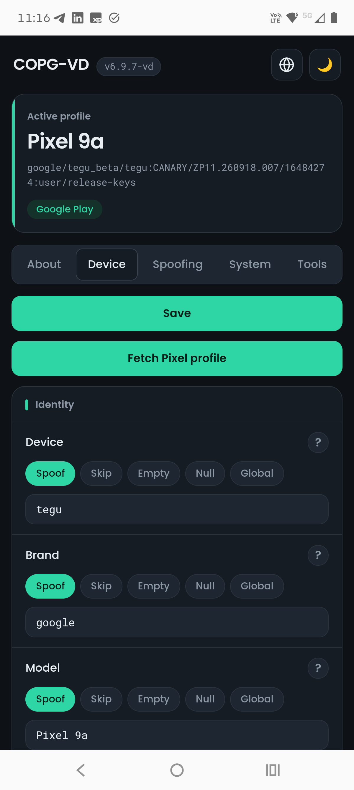
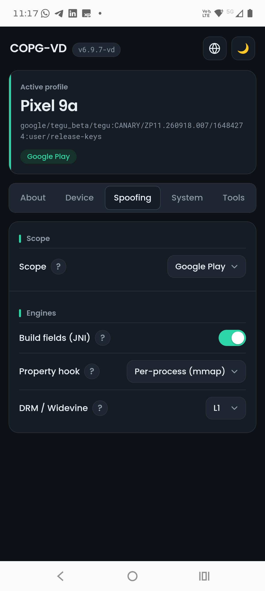
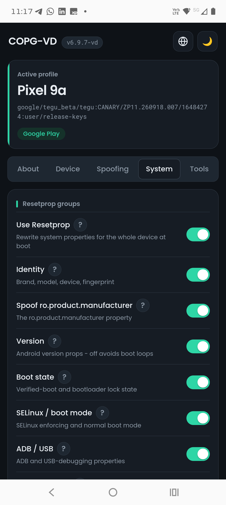
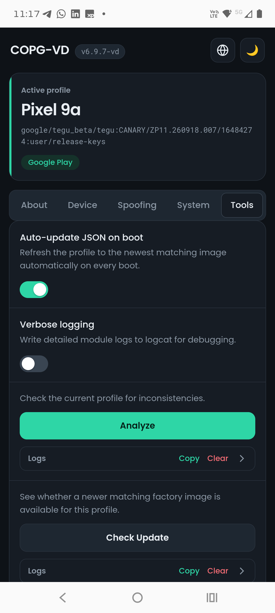

<!--
  COPG-VD - global device spoofer: spoof your device fingerprint and build.
  Copyright (C) 2026  AlirezaParsi & VD171 - SPDX-License-Identifier: Apache-2.0 (Fork by VD171)
-->

# COPG-VD

<p align="center">
  
</p>

<p align="center">
  <a href="https://github.com/VD171/COPG-VD/releases/latest"></a>
  <a href="LICENSE"></a>
  <a href="https://github.com/VD171/COPG-VD/releases"></a>
  <a href="https://github.com/VD171/COPG-VD/stargazers"></a>
</p>

<p align="center">
  <b>Інструмент підміни пристрою: він переписує fingerprint і build пристрою, щоб застосунки бачили пристрій, який ви обрали, замість справжнього.</b><br>
  Він працює на Zygisk (KernelSU, APatch або Magisk) і за замовчуванням обмежує підміну стеком Google Play - легша й надійніша альтернатива PlayIntegrityFix.
</p>

<p align="center">
  <a href="https://github.com/VD171/COPG-VD/releases">Releases</a> ·
  <a href="https://github.com/VD171/COPG-VD/wiki">Wiki</a> ·
  <a href="https://github.com/VD171/COPG-VD/wiki/USER-GUIDE">User guide</a> ·
  <a href="https://github.com/VD171/COPG-VD/wiki/CONFIGURATION">Configuration</a> ·
  <a href="https://github.com/VD171/COPG-VD/wiki/ARCHITECTURE">Architecture</a> ·
  <a href="https://github.com/VD171/COPG-VD/wiki/FILE-STRUCTURE">File structure</a> ·
  <a href="https://xdaforums.com/t/COPG-VD.4807698/">XDA thread</a>
</p>

> **Languages:** [English](README.md) · [العربية](README.ar.md) · [Čeština](README.cs.md) · [Deutsch](README.de.md) · [Español](README.es.md) · [فارسی](README.fa.md) · [Français](README.fr.md) · [हिन्दी](README.hi.md) · [Bahasa Indonesia](README.in.md) · [Italiano](README.it.md) · [日本語](README.ja.md) · [한국어](README.ko.md) · [Nederlands](README.nl.md) · [Polski](README.pl.md) · [Português](README.pt.md) · [Русский](README.ru.md) · [Svenska](README.sv.md) · [ไทย](README.th.md) · [Türkçe](README.tr.md) · [Українська](README.uk.md) · [Tiếng Việt](README.vi.md) · [中文](README.zh.md)

<p align="center">
     
</p>

---

## Як користуватися?
Встановіть модуль, перезавантажте, і вбудований профіль (Pixel) підміняється для цільових застосунків. З робочим fingerprint вам не потрібні PlayIntegrityFix чи GooglePhotosUnlimited.  
Усе налаштовується у `/data/adb/COPG-VD/COPG-VD.json` або з WebUI. Усі поля НЕОБОВ'ЯЗКОВІ - поле, яке не вказано, пропускається.  

### Scope - хто бачить підміну
`scope_mode` вирішує, які процеси отримують підмінену ідентичність. У режимі з обмеженою областю ідентичність доставляється для кожного процесу через Zygisk і не витікає до решти системи через глобальні властивості.  
* **Google Play** (`playstore`, за замовчуванням) - лише стек Play (Google Play services, його процес unstable і Play Store).  
* **Global** - весь пристрій; її бачить кожен процес.  
* **Whitelist** - лише застосунки у `scope_whitelist`.  
* **Blacklist** - кожен застосунок, окрім тих, що у `scope_blacklist`.  

### Engines - як доставляється підміна
Кожен із них незалежний і може бути вимкнений:  
* **Build fields (JNI)** - переписує `android.os.Build.*` у цільових процесах.  
* **Property hook** - подає підмінені системні властивості цільовим процесам (переприв'язка області властивостей для кожного процесу в стилі clean-room, без хука функцій).  
* **resetprop** - переписує системні властивості, керується групами: identity, version, boot state, SELinux, adb/usb, anti-emulator і прохід очищення. У режимі з обмеженою областю групи identity та version лишаються поза загальносистемним resetprop (Zygisk доставляє їх для кожного процесу); групи boot/lock/SELinux лишаються глобальними.  
* **DRM / Widevine** (вимкнено за замовчуванням) - повідомляє обраний рівень безпеки Widevine, L1 або L3, застосункам, які його читають. За замовчуванням він дотримується області вище; задайте `drm_targets` (список застосунків), щоб застосувати підміну DRM **лише** до цих застосунків, незалежно від `scope_mode` - модуль лишається завантаженим у перелічений застосунок лише заради хука DRM, навіть коли цей застосунок поза основною областю. Порожнє або відсутнє означає дотримуватися області. (Потребує режиму з областю, не Global.)  

### Fields - set, empty, delete або skip
Усередині об'єкта `COPG-VD` кожне поле Build має чотири стани:  
* **Set** - `"KEY": "value"` записує значення.  
* **Empty** - `"KEY": ""` записує порожнє значення.  
* **Delete** - перелічіть ключ у `"COPG-VD-Delete": [ ... ]` верхнього рівня, щоб видалити його (поле Build стає null, властивість видаляється через `resetprop --delete`).  
* **Skip** - повністю залиште ключ осторонь; зберігається власне значення ROM.  

Список `"global_fields": [ ... ]` застосовує названі поля Build на весь пристрій навіть у режимі з обмеженою областю, щоб зберегти значення узгодженим усюди - лише для полів, безпечних щодо узгодженості (наприклад, security patch), ніколи для identity і ніколи для групи версії Android.  

### Example JSON config file
`/data/adb/COPG-VD/COPG-VD.json`
```json
{
  "Instructions": "Use strings on double-quotes only.",
  "Instructions": "All fields are OPTIONAL. If some field is not provided, it will be skipped.",
  "Strings extracted from": "https://dl.google.com/developers/android/CANARY/images/factory/tegu_beta-zp11.261016.008-factory-28d56d15.zip",
  "scope_mode": "playstore",
  "motor_drm": false,
  "drm_targets": [],
  "global_fields": ["SECURITY_PATCH"],
  "process_overrides": [],
  "COPG-VD": {
    "BRAND": "google",
    "DEVICE": "tegu",
    "MANUFACTURER": "Google",
    "MODEL": "Pixel 9a",
    "FINGERPRINT": "google/tegu_beta/tegu:CANARY/ZP11.261016.008/16754936:user/release-keys",
    "PRODUCT": "tegu_beta",
    "BOOTLOADER": "unknown",
    "BOARD": "tegu",
    "HARDWARE": "tegu",
    "DISPLAY": "ZP11.261016.008",
    "ID": "ZP11.261016.008",
    "HOST": "e4df75f83a59",
    "INCREMENTAL": "16754936",
    "TIMESTAMP": "1793211232",
    "PREVIEW_SDK": "20261104",
    "USER": "android-build",
    "SDK_FINGERPRINT": "ee82a872870173d77e68050e21a2bcbf",
    "UUID": "FjWvtSORkI0sEwekaPz2s30gqV5vWP_EZHFtBiXzboc",
    "SECURITY_PATCH": "2026-11-05",
    "FIRST_API_LEVEL": "35",
    "DRM_SECURITY_LEVEL": "L1"
  }
}
```
Обов'язково використовуйте лише рядки в подвійних лапках.  
Блок вище та `module/COPG-VD.json.example` щодня оновлюються робочим процесом [Update COPG-VD.json](.github/workflows/update-json.yml), безпосередньо з найновішого заводського образу Google.  

### Підтримання fingerprint в актуальному стані
`fingerprint-update.sh` завантажує цей файл і оновлює вашу конфігурацію, з WebUI (**Check Update** / **Update Now**) або самостійно **один раз за завантаження** (**Auto-update JSON on boot**, увімкнено за замовчуванням).  
* `/data/adb/COPG-VD/COPG-VD.json` оновлюється на місці, а попередній вміст зберігається поруч як `COPG-VD.json.bak`.  
* Переписуються лише поля build (fingerprint, ID, incremental, timestamp, security patch, SDK, UUID, host, user). Усе інше, що ви налаштували, зберігається: додаткові ключі, `scope_mode`, `BOOTLOADER`/`BOARD`/`HARDWARE`, інші об'єкти, порядок ключів і форматування.  
* Воно ніколи не йде назад: вихідний build, старіший за встановлений, відхиляється. Це
  звичайна справа (репозиторій може відставати від конфігурації, яку ви оновили вручну) і
  водночас це захист, що важить найбільше на Android, де єдиний доступний завантажувач - це
  busybox `wget`, який не може перевіряти TLS-сертифікати - з тієї ж причини кожне значення
  перевіряється перед використанням.  
* Якщо ваш профіль підміняє **інший пристрій** (інші `BRAND`/`DEVICE`/`MANUFACTURER`/`MODEL`/`PRODUCT`), нічого не застосовується - fingerprint Pixel на іншому профілі гірший за старий fingerprint.  
* Під час завантаження воно працює у фоні та продовжує повторювати спроби протягом ~10 хвилин, бо wifi зазвичай ще не піднятий, коли завантаження завершується. Воно ніколи не затримує завантаження.  
* `resetprop` повторно застосовується одразу після оновлення, але `android.os.Build` записується модулем zygisk під час запуску zygote: **перезавантажте**, щоб нові значення дійшли до застосунків.  
* Журнал у `/data/adb/COPG-VD/update.log`.  

### Версія Android - і чому вона не підміняється
`ANDROID_VERSION`, `SDK_INT`, `SDK_FULL` і `CODENAME` описують **вашу ROM**, а не пристрій, який підміняється. Повідомлення застосункам, що SDK новіший, ніж насправді є framework, змушує їх викликати API, яких не існує: застосунки Google падають, телефон перезавантажується, і все починається спочатку. Саме завантаження завершується, тож це **softloop**, і в журналах завантаження нічого не з'являється.  
* Їх немає у вбудованій конфігурації, і оновлювач ніколи їх не записує.  
* **Spoof Android version** у WebUI вирішує, чи застосовуються вони взагалі:  
  * **Never** (за замовчуванням) - використовується власна версія ROM.  
  * **Up to this ROM** - лише те, що не перевищує її, що на практиці означає зниження SDK.  
  * **Force** - точно те, що каже конфігурація. Саме це спричиняє softloop.  
* Справжня версія читається з `/system/build.prop`, ніколи з `getprop` - бо це саме те, що цей модуль фальсифікує.  

### Analyze
**Analyze** у WebUI (або `fingerprint-update.sh analyze`) перевіряє конфігурацію в її поточному стані: версію щодо ROM, чи файл усе ще парситься (зламаний робить так, що модуль не підміняє **нічого**, і лише logcat про це каже), чи fingerprint узгоджується з полями навколо нього, ключі, які модуль не читає, дати, і чи властивості вже несуть те, що вимагає конфігурація.  

### WebUI
WebUI необов'язковий - усе можна редагувати безпосередньо в конфігурації JSON - але це простий спосіб керувати модулем. Він має п'ять вкладок: **About**, **Device** (кожне поле, задане за станом, згруповане за категорією), **Spoofing** (scope та engines), **System** (групи resetprop) і **Tools** (Analyze, Check Update, Update Now, Backup/Restore та автооновлення під час завантаження). Він не робить жодного мережевого запиту; усе, що йому потрібно, постачається всередині модуля.  
Якщо ви користувач Magisk, скористайтеся KsuWebUI від KOW (https://github.com/KOWX712/KsuWebUIStandalone/releases).  

### Налаштування в конфігурації
`COPG-VD.json` несе свої налаштування поруч із профілем, тож ваші вибори подорожують із резервною копією і можуть редагуватися вручну: `scope_mode`, перемикачі engine, групи resetprop, `global_fields` та об'єкт `COPG-VD-Settings` (`resetprop`, `autoupdate`, `spoof_version`). Усе живе в цьому одному файлі - скрипти завантаження та WebUI читають налаштування просто з нього, тож ваші вибори переживають оновлення модуля. `"spoof_version": "force"` відхиляється з файлу й знижується: відновлення старої резервної копії не повинно переозброювати його за вашою спиною.  

<!-- vd-docs -->
## Документація

[Посібник користувача](docs/uk/USER-GUIDE.md) · [Довідник з конфігурації](docs/uk/CONFIGURATION.md) · [Архітектура](docs/uk/ARCHITECTURE.md) · [Структура файлів](docs/uk/FILE-STRUCTURE.md) · [Wiki](https://github.com/VD171/COPG-VD/wiki/uk-Home)

<!-- /vd-docs -->

## See also

Споріднені проєкти того самого автора:

- **[VDInfos](https://github.com/VD171/VD-Infos)**: налагоджувач методів пристрою, що читає кожен елемент через кожен метод, який може його прочитати, і порівнює їх пліч-о-пліч.
- **[VDGoogle](https://github.com/VD171/VD-Google)**: ваші сервіси Google (RCS, Wallet, атестації Play Integrity), прочитані на вашому пристрої без інтернету.
- **[VDBackup](https://github.com/VD171/VD-Backup)**: повне резервне копіювання та відновлення застосунків і даних з правами root, кероване повністю з WebUI.

Pixel `build.prop`: **[@VictorGabriel7Dev/build.prop](https://github.com/VictorGabriel7Dev/build.prop)** (fork of @T3SL4).

## Contacts

* https://vd171.ru
* https://vd.priv8.ru
* **Telegram:** @VD_Priv8 https://t.me/VD_Priv8
* **Channel:** @Priv8_VD https://t.me/Priv8_VD
* **Discord:** @VD.Priv8 https://discord.com/users/1296831918989639721
* **E-mail:** vd.priv8@pm.me
* **XDA-Developers:** @VD171 https://xdaforums.com/m/vd171.4699873/
* **XDA thread:** https://xdaforums.com/t/COPG-VD.4807698/
* **GitHub:** @VD171 https://github.com/VD171

## License

**Apache-2.0** - див. [LICENSE](LICENSE). COPG-VD - це форк COPG від AlirezaParsi, зроблений VD171, що продовжується під тією самою ліцензією.

## Trademarks

COPG-VD - незалежний, неофіційний проєкт. Він не пов'язаний із Google LLC, не схвалений і не спонсорований нею. "Google", "Google Play", "Play Integrity", "Pixel", "Android" та пов'язані назви й логотипи є торговими марками Google LLC. COPG-VD працює повністю на вашому пристрої.

## Tags

`Zygisk` `KernelSU` `APatch` `Magisk` `device-spoofing` `fingerprint` `PlayIntegrity` `Pixel` `build.prop` `resetprop` `root` `Android` `COPG` `COPG-VD`
